# EXStreamTV — GitHub repository & wiki mirror

> **Generated for Confluence** (space [ESTV](https://exstreamtv2.atlassian.net/wiki/spaces/ESTV/overview)). Mermaid diagrams render if your site has a Mermaid macro/app (see [Confluence Marketplace](https://marketplace.atlassian.com/search?query=mermaid)) or paste blocks into [mermaid.live](https://mermaid.live).

- **Version (pyproject):** 2.6.0
- **Repository:** [github.com/roto31/EXStreamTV](https://github.com/roto31/EXStreamTV)
- **Wiki:** [github.com/roto31/EXStreamTV/wiki](https://github.com/roto31/EXStreamTV/wiki)
- **Source folder:** `EXStreamTV.wiki/` in clone

---

## README (repository root)

# EXStreamTV

[](https://www.python.org/)
[](https://fastapi.tiangolo.com/)
[](LICENSE)
[]()
[](https://github.com/roto31/EXStreamTV)

EXStreamTV creates custom live TV channels from online sources (YouTube, Archive.org) and local media (Plex, Jellyfin, Emby, local folders). Plex DVR treats it as an HDHomeRun tuner — discover, add, and tune your channels like a physical device.

## What It Does

- Streams YouTube and Archive.org without downloading
- Pulls content from Plex, Jellyfin, Emby, and local folders
- Schedules channels with block scheduling, templates, and filler
- Emulates HDHomeRun so Plex DVR can discover and tune channels
- Provides M3U/EPG for IPTV players and a web interface

## Plex Integration

Plex discovers EXStreamTV as an HDHomeRun device on your network. After adding the DVR, you see your custom channels in the lineup. Tuning a channel starts live streaming; multiple clients can share the same stream.

See [Platform Guide](docs/PLATFORM_GUIDE.md#3-hdhomrun-emulation) for how discovery, lineup, and tuning work.

## Architecture Overview

```
Clients (Plex, IPTV, Web) → REST / M3U / HDHomeRun API → SessionManager → ChannelManager
    → ProcessPoolManager (FFmpeg) → StreamThrottler → Live MPEG-TS
```

Restarts are bounded by a global throttle (10 per 60s), per-channel cooldown (30s), and a per-channel circuit breaker. The ProcessPoolManager is the sole gatekeeper for FFmpeg process spawning.

See [Platform Guide](docs/PLATFORM_GUIDE.md) for full architecture and diagrams.

## Key Features

- **HDHomeRun Emulation** — Plex, Emby, Jellyfin DVR support
- **Hardware Transcoding** — NVENC, QSV, VAAPI, VideoToolbox, AMF
- **Advanced Scheduling** — Time slots, balance scheduling, filler
- **AI Agent** — Bounded diagnostic and remediation loop (optional)
- **macOS Menu Bar App** — Native app with onboarding wizard
- **Session Management & Throttling** — Tunarr/dizqueTV-style delivery

## Feature Flags (Summary)

| Area | Key Flags | Default |
|------|-----------|---------|
| AI Agent | `ai_agent.bounded_agent_enabled` | false |
| Metadata Self-Resolution | `ai_agent.metadata_self_resolution_enabled` | false |
| HDHomeRun | `hdhomerun.enabled` | true |
| Stream Throttler | `stream_throttler.enabled` | true |

See [Feature Flags](docs/FEATURE_FLAGS.md) for full reference.

## Safety Guarantees

- **Bounded restarts** — Throttle, cooldown, and circuit breaker prevent restart storms
- **Containment mode** — AI agent stops when restart velocity or pool pressure is high
- **Confidence gating** — Metadata tools require minimum confidence before running
- **No unbounded loops** — Agent loop capped at 3 steps; no tool-from-tool
- **Automatic shutdown** — Stops after 3 consecutive metadata tool failures

See [Platform Guide](docs/PLATFORM_GUIDE.md#10-production-readiness--safety-model) for details.

## Quick Start

### macOS
```bash
cd EXStreamTV
./scripts/install_macos.sh
./start.sh
```

### macOS App (Recommended)
```bash
cd EXStreamTVApp
swift build -c release
cp -r .build/release/EXStreamTVApp.app /Applications/
```
Launch the app and follow the onboarding wizard.

### Docker
```bash
cd containers/docker
docker-compose up -d
```

### AI Setup (Optional)
Get a free Groq API key at [console.groq.com](https://console.groq.com) for AI-assisted channel creation.

Access the web interface at `http://localhost:8411`

## Requirements

- **Python**: 3.10 or higher
- **FFmpeg**: With hardware acceleration support
- **Network**: Internet for online streaming sources

## Documentation

| Document | Description |
|----------|-------------|
| [Platform Guide](docs/PLATFORM_GUIDE.md) | Full architecture, streaming, HDHomeRun, AI, observability |
| [Installation](docs/guides/INSTALLATION.md) | Installation steps |
| [Quick Start](docs/guides/QUICK_START.md) | First channel in 10 minutes |
| [AI Setup](docs/guides/AI_SETUP.md) | AI configuration and bounded agent |
| [Streaming Stability](docs/guides/STREAMING_STABILITY.md) | Session management, throttling, error screens |
| [API Reference](docs/api/README.md) | REST and IPTV endpoints |
| [Observability](docs/OBSERVABILITY.md) | Prometheus metrics and alerting |
| [Operational Guide](docs/OPERATIONAL_GUIDE.md) | Diagnosis and verification |

## Troubleshooting

| Symptom | Check |
|---------|-------|
| Plex "Could not Tune Channel" | DeviceID must be 8 hex chars. See `config.yaml` → `hdhomerun.device_id`. Re-add DVR in Plex after fixing. |
| Restarts blocked | Circuit breaker or storm throttle. Check `/metrics` for `exstreamtv_circuit_breaker_state` and restart rate. |
| No stream output | Channel health: last output > 180s. Check logs for `ProcessPoolManager` or FFmpeg errors. |
| High memory / FDs | Pool pressure. Reduce channels or increase `ffmpeg.max_processes` if system allows. |
| AI not acting | `bounded_agent_enabled` and `metadata_self_resolution_enabled` default to false. Check containment mode. |

See [Operational Guide](docs/OPERATIONAL_GUIDE.md) for detailed diagnosis.

## Project Structure

```
EXStreamTV/
├── exstreamtv/           # Python backend
│   ├── api/              # REST, IPTV, HDHomeRun
│   ├── ai_agent/         # Bounded agent, tools, metadata resolution
│   ├── streaming/        # ChannelManager, ProcessPoolManager, CircuitBreaker
│   ├── scheduling/       # Playout engine
│   ├── ffmpeg/           # Transcoding pipeline
│   └── monitoring/       # Metrics, Prometheus
├── EXStreamTVApp/        # macOS menu bar app
├── containers/           # Docker
├── tests/                # pytest suite
└── docs/                 # Documentation
```

## Migration

### From StreamTV
```bash
python scripts/migrate_from_streamtv.py --source /path/to/streamtv
```

### From ErsatzTV
```bash
python scripts/migrate_from_ersatztv.py --source /path/to/ersatztv
```

## Contributing

Contributions are welcome. See [CONTRIBUTING.md](CONTRIBUTING.md) for guidelines.

## License

MIT License — see [LICENSE](LICENSE).

## Acknowledgments

- [StreamTV](https://github.com/roto31/StreamTV) — Original Python streaming platform
- [ErsatzTV](https://github.com/ErsatzTV/ErsatzTV) — Scheduling and transcoding
- [pseudotv-plex](https://github.com/DEFENDORe/pseudotv) — Original inspiration
- [dizquetv](https://github.com/vexorian/dizquetv) — Community fork inspiration


---

## Wiki page: Home

*Source: [`EXStreamTV.wiki/Home.md`](https://github.com/roto31/EXStreamTV/wiki/Home)*

# EXStreamTV Documentation

Architecture diagrams: [docs/architecture/DIAGRAMS.md](Architecture-Diagrams) — Mermaid-only, **18** standardized diagrams (includes six-layer AI/coding safety, §18).

**Version:** 2.6.0  
**Last Updated:** 2026-03-21

Welcome to the EXStreamTV documentation. This guide will help you set up, configure, and use EXStreamTV for your IPTV streaming needs.

---

## Quick Links

| Document | Description |
|----------|-------------|
| [Platform Guide](Platform-Guide) | Full architecture, streaming, HDHomeRun, AI, observability |
| [Quick Start](Quick-Start) | Get started in 10 minutes |
| [Installation](Installation) | Complete installation guide |
| [API Reference](API-Reference) | REST API documentation |
| [System Design](System-Design) | Architecture overview |

---

## Documentation Structure

```
docs/
├── README.md                    # This file
├── PLATFORM_GUIDE.md            # Master platform document (architecture, streaming, AI, observability)
├── OBSERVABILITY.md             # Prometheus metrics reference
├── OPERATIONAL_GUIDE.md         # Diagnosis and verification
├── INVARIANTS.md                # Formal invariants
├── FEATURE_FLAGS.md             # Config toggles
├── VERSION                      # Documentation version
├── CHANGELOG.md                 # Documentation changes
│
├── guides/                      # User Guides
│   ├── QUICK_START.md          # Getting started
│   ├── INSTALLATION.md         # Installation
│   ├── AI_SETUP.md             # AI configuration
│   ├── CHANNEL_CREATION_GUIDE.md # Channel creation
│   ├── LOCAL_MEDIA.md          # Local media setup
│   ├── HW_TRANSCODING.md       # Hardware transcoding
│   ├── MACOS_APP_GUIDE.md      # macOS app
│   ├── NAVIGATION_GUIDE.md     # UI navigation
│   ├── ONBOARDING.md           # Onboarding
│   ├── STREAMING_STABILITY.md  # Streaming features (NEW)
│   └── ADVANCED_SCHEDULING.md  # Scheduling features (NEW)
│
├── api/                         # API Documentation
│   └── README.md               # Complete API reference
│
├── architecture/                # Architecture Documentation
│   ├── SYSTEM_DESIGN.md        # System architecture
│   ├── DIAGRAMS.md             # 18 Mermaid diagrams (canonical)
│   └── TUNARR_DIZQUETV_INTEGRATION.md # v2.6.0 integration (NEW)
│
├── development/                 # Development Documentation
│   └── DISTRIBUTION.md         # Distribution guide
│
├── confluence/                  # Confluence-Ready Documentation (NEW)
│   ├── README.md               # Upload instructions
│   ├── 00-HOME.confluence.md   # Documentation home
│   ├── 01-SYSTEM-DESIGN.confluence.md
│   ├── 02-TUNARR-INTEGRATION.confluence.md
│   ├── 03-API-REFERENCE.confluence.md
│   ├── 04-STREAMING-STABILITY.confluence.md
│   ├── 05-ADVANCED-SCHEDULING.confluence.md
│   ├── 06-AI-SETUP.confluence.md
│   ├── 07-QUICK-START.confluence.md
│   └── 08-BUILD-PROGRESS.confluence.md
│
└── BUILD_PROGRESS.md           # Build tracking
```

---

## Getting Started

### New Users

1. **[Installation Guide](Installation)** - Install EXStreamTV on your system
2. **[Quick Start](Quick-Start)** - Create your first channel in 10 minutes
3. **[AI Setup](AI-Setup)** - Configure AI for smart channel creation

### Intermediate Users

1. **[Channel Creation Guide](Channel-Creation-Guide)** - Advanced channel options
2. **[Local Media Setup](Local-Media)** - Add your own media libraries
3. **[Hardware Transcoding](Hardware-Transcoding)** - GPU acceleration setup

### Advanced Users

1. **[Advanced Scheduling](Advanced-Scheduling)** - Time slots and balance scheduling
2. **[Streaming Stability](Streaming-Stability)** - Session management and throttling
3. **[API Reference](API-Reference)** - Build integrations

---

## New in v2.6.0

EXStreamTV v2.6.0 introduces major enhancements from the Tunarr/dizqueTV integration:

### Streaming Stability

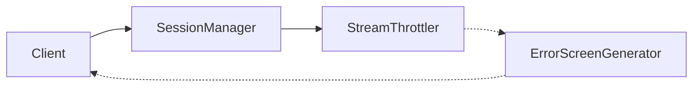

- **Session Management** - Track and manage client connections
- **Stream Throttling** - Prevent buffer overruns
- **Error Screens** - Graceful fallback during failures

📖 [Streaming Stability Guide](Streaming-Stability)

### Advanced Scheduling

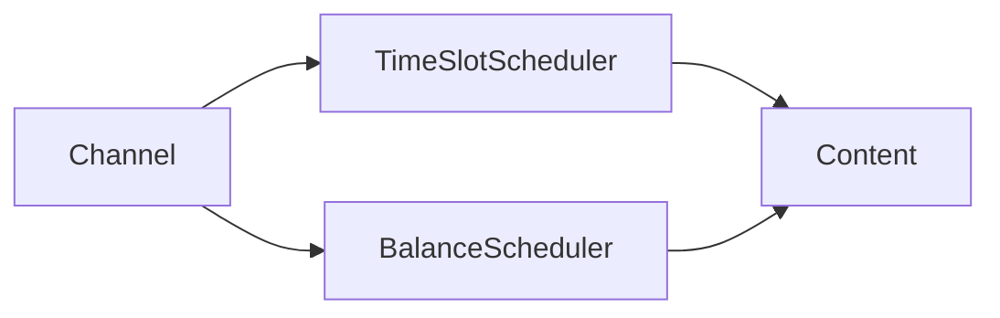

- **Time Slot Scheduling** - Time-of-day programming blocks
- **Balance Scheduling** - Weight-based content distribution

📖 [Advanced Scheduling Guide](Advanced-Scheduling)

### AI Self-Healing


- **Unified Log Collector** - Multi-source log aggregation
- **FFmpeg AI Monitor** - Intelligent process monitoring
- **Pattern Detector** - ML-based issue detection
- **Auto Resolver** - Autonomous issue resolution

📖 [AI Setup Guide](AI-Setup#ai-self-healing-system-new-in-v260)

### Database Backup

- **Scheduled Backups** - Automatic daily backups
- **Backup Rotation** - Keep N most recent
- **Compression** - Gzip for space savings
- **Easy Restore** - One-click restoration

📖 [AI Setup Guide](AI-Setup#database-backup-new-in-v260)

---

## Architecture Overview

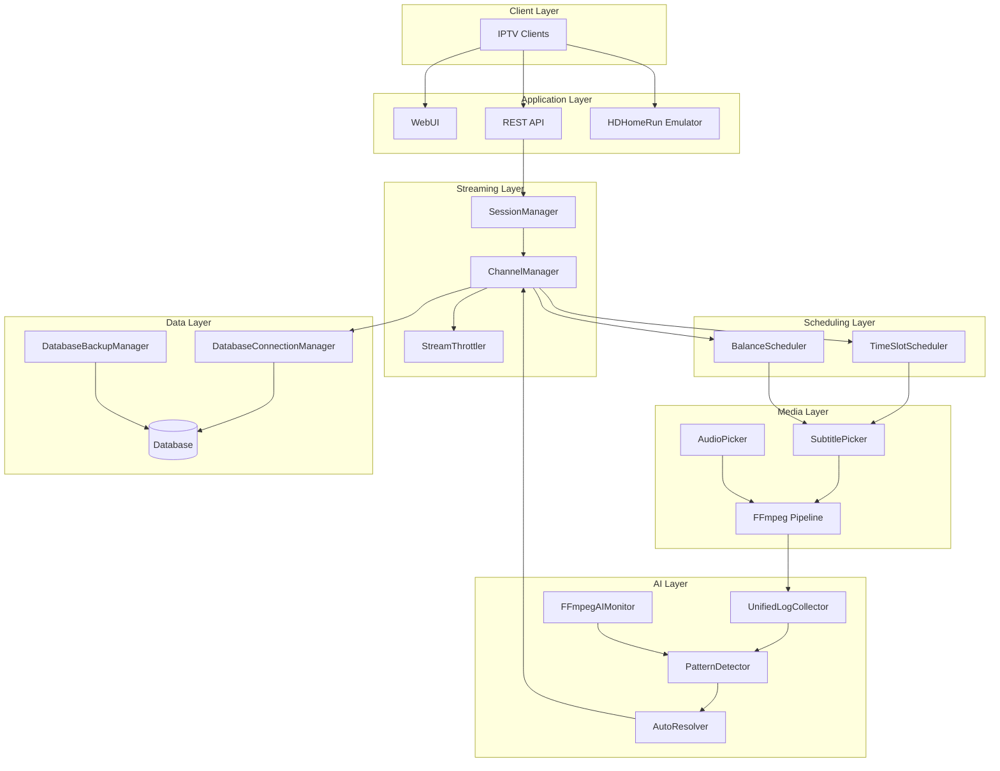

📖 [System Design](System-Design) | [Tunarr/dizqueTV Integration](Tunarr-DizqueTV-Integration)

---

## API Overview

The EXStreamTV API provides complete control over your streaming server:

| Category | Endpoints | Description |
|----------|-----------|-------------|
| Channels | `/api/channels` | Channel CRUD, filler, deco |
| Playlists | `/api/playlists` | Playlist management |
| Schedules | `/api/schedules` | Schedule configuration |
| Playouts | `/api/playouts` | Playout control |
| Blocks | `/api/blocks` | Time-based blocks |
| Templates | `/api/templates` | Reusable schedules |
| AI | `/api/ai` | AI self-healing, health |
| System | `/api/health` | System monitoring |

📖 [Complete API Reference](API-Reference)

---

## Component Versions

| Component | Version | Last Modified |
|-----------|---------|---------------|
| backend_core | 2.6.0 | 2026-01-31 |
| streaming | 2.6.0 | 2026-01-31 |
| database | 2.6.0 | 2026-01-31 |
| ai_agent | 2.6.0 | 2026-01-31 |
| scheduling | 2.6.0 | 2026-01-31 |
| ffmpeg | 2.6.0 | 2026-01-31 |
| docs | 2.6.0 | 2026-01-31 |

---

## Confluence Export

All documentation is available in Confluence-ready format in the `confluence/` folder.

### Confluence Files

| File | Description |
|------|-------------|
| `00-HOME.confluence.md` | Documentation home page |
| `01-SYSTEM-DESIGN.confluence.md` | System architecture |
| `02-TUNARR-INTEGRATION.confluence.md` | v2.6.0 integration details |
| `03-API-REFERENCE.confluence.md` | REST API documentation |
| `04-STREAMING-STABILITY.confluence.md` | Streaming features |
| `05-ADVANCED-SCHEDULING.confluence.md` | Scheduling features |
| `06-AI-SETUP.confluence.md` | AI configuration |
| `07-QUICK-START.confluence.md` | Getting started |
| `08-BUILD-PROGRESS.confluence.md` | Development status |

### Upload Instructions

1. Install the "Mermaid Diagrams for Confluence" app
2. Create a new page in Confluence
3. Use "Insert" → "Markup" → "Markdown"
4. Copy/paste content from `.confluence.md` files

See `confluence/README.md` for detailed instructions.

---

## Support

- **GitHub Issues**: Report bugs and request features
- **Documentation**: This documentation site
- **Logs**: Check `Settings > Logs` for troubleshooting

---

## Related Resources

- [CHANGELOG](Documentation-Changelog) - Version history
- [CONTRIBUTING](../CONTRIBUTING.md) - Contribution guidelines
- [LICENSE](../LICENSE) - MIT license

**Last Revised:** 2026-03-21

Repo root [AGENTS.md](../AGENTS.md) and per-module `exstreamtv/*/AGENTS.md` complement `.cursor/rules/` for human and AI contributors. Wiki pages are synced from `docs/` with `scripts/sync_docs_to_wiki.py`.


---

## Wiki page: Platform Guide

*Source: [`EXStreamTV.wiki/Platform-Guide.md`](https://github.com/roto31/EXStreamTV/wiki/Platform-Guide)*

# EXStreamTV Platform Guide

**Version:** 2.6.0  
**Last Updated:** 2026-03-21

This guide explains what EXStreamTV is, how it works, and how to operate it safely. It is written for technically literate readers who may not be familiar with streaming internals, AI agent architectures, or HDHomeRun protocols.

---

## 1. Platform Overview

### What EXStreamTV Is

EXStreamTV is a software platform that lets you create custom TV channels from online sources (YouTube, Archive.org) and local media libraries (Plex, Jellyfin, Emby, local folders). Those channels stream live, like traditional broadcast TV, and can be watched through Plex DVR, IPTV players, or the built-in web interface.

### What Problem It Solves

Media servers like Plex store your content but don’t natively support “live channels” — continuous, scheduled programming that plays one item after another. EXStreamTV fills that gap: it manages channel scheduling, transcodes media in real time, and exposes the result as a tuner that Plex and other clients can tune like a physical HDHomeRun device.

### How It Interacts with Plex

Plex DVR expects to discover and tune physical TV tuners (e.g., HDHomeRun hardware) over the network. EXStreamTV pretends to be such a device: it responds to discovery requests, advertises your custom channels in a lineup, and serves live streams when Plex “tunes” a channel. From Plex’s perspective, EXStreamTV is another HDHomeRun on your network.

### High-Level Architecture

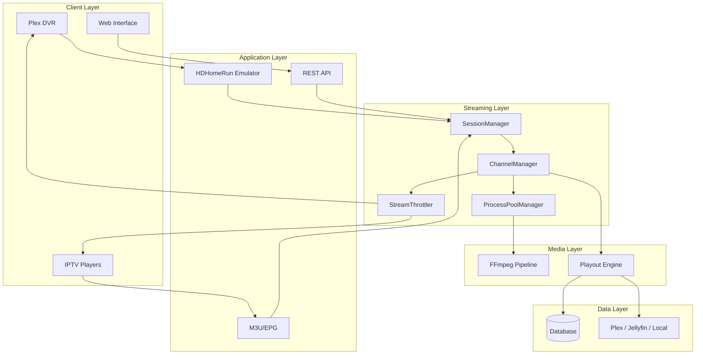

The flow is simple: clients connect through REST, M3U/EPG, or HDHomeRun; a session is tracked; the channel manager gets the requested channel’s stream from the playout engine and FFmpeg; the ProcessPoolManager controls how many FFmpeg processes run; and the StreamThrottler delivers data at a safe rate to clients.

### HDHomeRun Emulation in Plain Language

HDHomeRun is a physical TV tuner that broadcasts its presence on the local network. Media servers discover it, read its channel lineup, and request streams by “tuning” a channel number. EXStreamTV behaves the same way: it answers discovery requests, provides a lineup of your custom channels, and serves live MPEG-TS when a channel is tuned. Plex does not distinguish this from a real HDHomeRun.

---

## 2. How Streaming Works

### Channel Lifecycle

Each channel runs continuously in the background. When you enable a channel:

1. The channel manager starts a stream for that channel.
2. The playout engine decides what to play and when (based on schedules).
3. FFmpeg transcodes the current media item to MPEG-TS.
4. Clients receive the stream through the throttler.

If a client tunes a channel that is already running, they share the same FFmpeg output. Multiple clients can watch the same channel without spawning additional FFmpeg processes.

### FFmpeg Process Management

All FFmpeg processes go through the ProcessPoolManager. It is the single place that decides when to spawn or release FFmpeg. No other component starts FFmpeg directly.

The ProcessPoolManager:

- Enforces a global limit on processes (from config, memory, and file-descriptor limits).
- Rate-limits how quickly new processes can start (token bucket, default 5 per second).
- Checks memory and file descriptor usage before spawning.
- Detects zombie processes (exited but not cleaned up) and long-running processes (default: over 24 hours) and releases them.

If a spawn is rejected (e.g., memory too high or capacity reached), the request fails and the circuit breaker may record a failure for that channel.

### ProcessPoolManager Role

The ProcessPoolManager (`exstreamtv/streaming/process_pool_manager.py`):

- `acquire_process(channel_id, ffmpeg_cmd, timeout_seconds)` — Reserves a slot, runs guards, rate-limits, spawns FFmpeg, registers the process.
- `release_process(channel_id)` — Stops FFmpeg, unregisters, releases the slot.

The mpegts_streamer calls `acquire_process` before streaming and `release_process` when done or on error.

### Health Monitoring

A background task runs every 30 seconds to check channel health:

- **Last output time** — If no stream output for more than 180 seconds, the channel is considered unhealthy.
- **Error rate** — High error counts in the last 5 minutes trigger warnings.

When a channel is unhealthy and auto-restart is enabled, the system may trigger a restart—but only if the restart guards allow it.

### Restart Safety

Restarts are not unbounded. Three mechanisms limit them:

1. **Global throttle** — At most 10 restarts in any 60-second window. Exceeding this blocks all restarts.
2. **Per-channel cooldown** — A channel cannot be restarted again within 30 seconds of its last restart.
3. **Circuit breaker** — Per-channel: after 5 failures in a 300-second window, the circuit opens and blocks restarts for 120 seconds.

### CircuitBreaker Behavior

The circuit breaker has three states per channel:

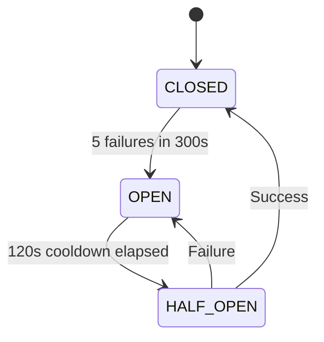

- **CLOSED** — Restarts are allowed. Failures are counted.
- **OPEN** — Restarts are blocked. The channel must wait 120 seconds.
- **HALF_OPEN** — After the cooldown, one restart is allowed. Success closes the circuit; failure reopens it.

### Why Restarts Are Bounded

Unbounded restarts can cause a “restart storm”: channels restart repeatedly, exhausting CPU, memory, and file descriptors. The throttle, cooldown, and circuit breaker prevent that. The system prefers stability over aggressive auto-recovery.

### Restart Decision Flow

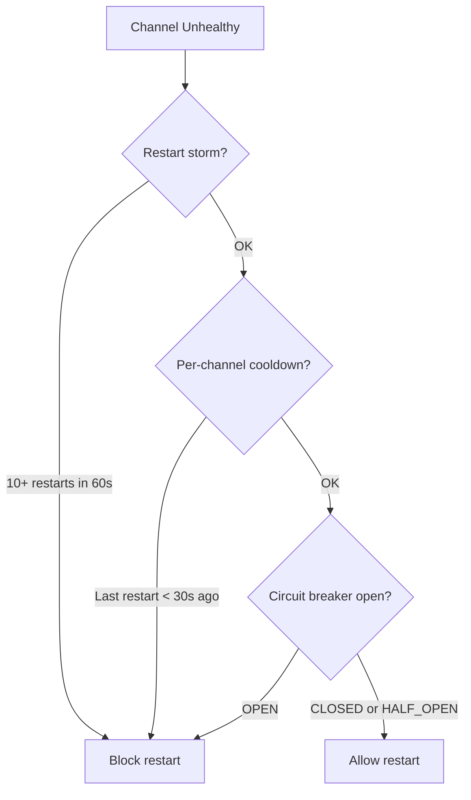

All restart requests—whether from the health task or the AI agent—go through `request_channel_restart` in `health_tasks.py`, which applies these checks.

### Stream Request Lifecycle

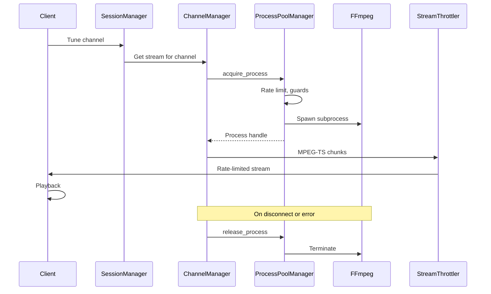

---

## 3. HDHomeRun Emulation

### discover.json

When Plex searches for tuners, it requests `/hdhomerun/discover.json`. EXStreamTV responds with a JSON object describing the virtual device:

- **FriendlyName** — Display name (e.g., "EXStreamTV").
- **ModelNumber** — Model identifier for compatibility.
- **DeviceID** — Exactly 8 hexadecimal characters (e.g., `E5E17001`).
- **BaseURL** — Base URL for HDHomeRun endpoints.
- **LineupURL** — URL to fetch the channel lineup.
- **GuideURL** — URL for EPG/guide data.
- **TunerCount** — Number of virtual tuners (default 4).

### lineup.json

The lineup is a JSON array of channel objects. Each entry has:

- **GuideNumber** — Channel number (used when tuning).
- **GuideName** — Channel name.
- **URL** — Stream URL for that channel (e.g., `/hdhomerun/tuner0/stream?...`).

Only enabled channels appear. Channels are ordered by number.

### Tuner Behavior

When Plex tunes a channel, it requests a URL like `/hdhomerun/tuner0/stream?channel=auto:v7` (where 7 is the guide number). EXStreamTV parses the channel number, maps it to the internal channel, and streams that channel’s output as MPEG-TS.

Tuner numbers must be in range (0 to tuner_count - 1). Plex typically uses `tuner0` for the first tune.

### DeviceID Requirements

Plex validates the DeviceID. It must be exactly 8 hexadecimal characters. Invalid IDs (e.g., `EXSTREAMTV`) cause “Could not Tune Channel” errors. The config validator normalizes invalid DeviceIDs to the default `E5E17001` and logs a warning.

### What Happens When Tuning a Channel

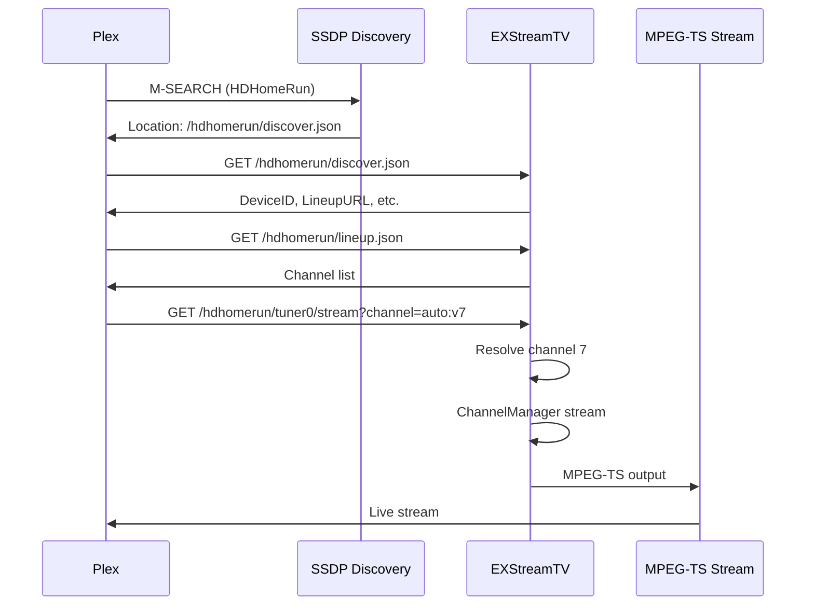

---

## 4. Metadata & XMLTV Pipeline

### Metadata Enrichment

Metadata (titles, episode numbers, years, descriptions) comes from multiple sources. The enricher tries them in order:

1. **TVDB** — Best for TV shows.
2. **TMDB** — Fallback or supplement.
3. **Local NFO files** — XML metadata beside media files.
4. **Filename extraction** — Patterns like `Show S01E02` or `Movie (2020)`.

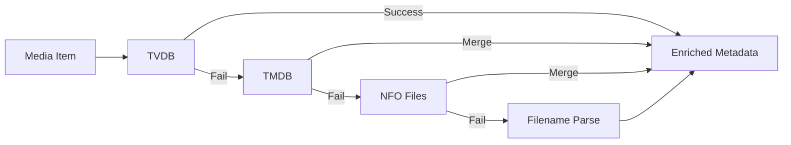

Each successful or failed lookup is counted for observability.

### Placeholder Detection

Some imports produce titles like `Item 12345` (internal IDs). The title resolver rejects these as placeholders. The XMLTV generator:

1. Checks if a title matches the `Item \d+` pattern.
2. Falls back to show/series title.
3. If still empty, uses `"{channel_name} — {timestamp}"`.

Placeholder usage is tracked per channel and overall for early warnings.

### Drift Detection

The metadata pipeline compares the current metadata failure ratio to the previous check. If the ratio increases by more than 0.1, a warning is logged. This is non-blocking: it does not stop streaming or EPG generation.

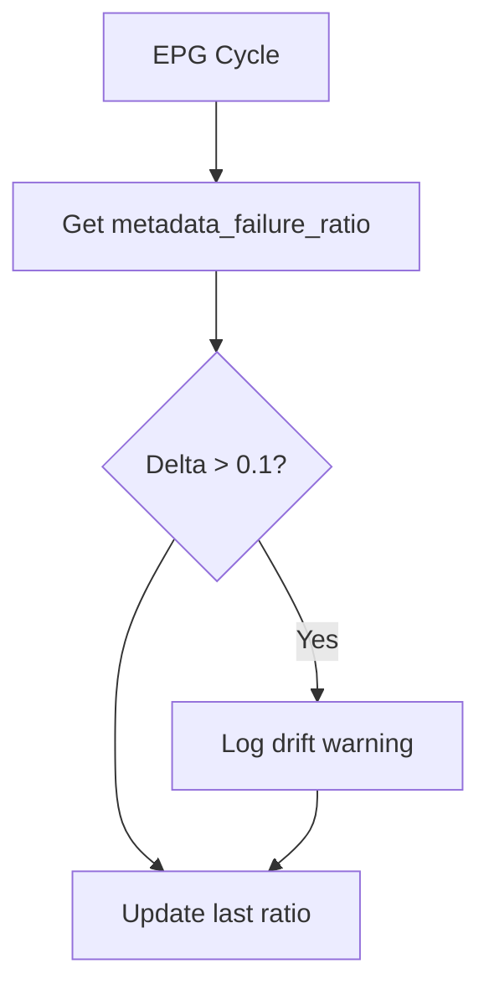

### Confidence Gating

The AI agent’s metadata tools require a minimum confidence (default 0.3) before running. If confidence is below the threshold, the tool is skipped unless explicitly overridden. On metadata tool failure, confidence decays (multiplied by 0.8, floor 0.1).

### XMLTV Generation

Programmes derive from `BroadcastScheduleAuthority.get_timeline`. Interval verification (normalize→repair→symbolic→simulation→fuzz→SMT) must return VERIFIED before emit.

- **Monotonic times** — `start_time < stop_time` for each programme.
- **No overlaps** — `programme[i].stop_time <= programme[i+1].start_time`.
- **Required fields** — Non-empty title.
- **Datetime range** — Timestamps between 1970 and 2100.

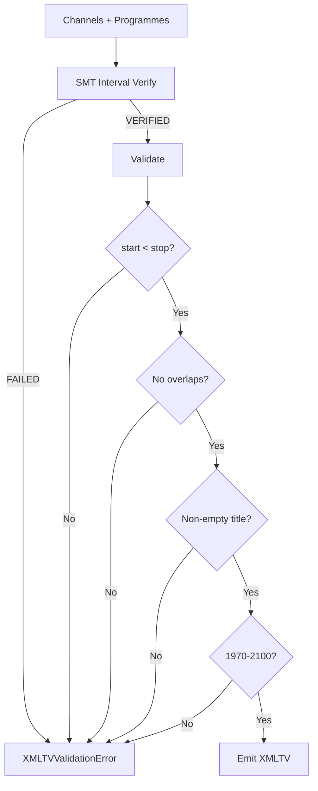

### Guide Corruption Prevention

The pipeline avoids corrupting the guide by:

- Rejecting placeholder titles and using safe fallbacks.
- Validating programme times and structure before emit.
- Cross-checking lineup vs. XMLTV (unique guide numbers, channel IDs, non-empty display names).

---

## 5. AI Agent & Safety Model

### What the Bounded Agent Is

The bounded agent is a deterministic loop that executes a small number of tools (diagnostic or remediation) based on context. It does not call LLMs for arbitrary actions. It does not perform database writes, tool-from-tool calls, or direct channel restarts. All restarts go through `health_tasks.request_channel_restart`.

### Why Autonomy Is Restricted

Unrestricted AI could restart channels repeatedly, overwrite data, or run expensive operations indefinitely. The bounded agent enforces:

- A maximum number of steps per run (default 3).
- A maximum of one HIGH-risk tool per loop.
- Cooldowns between tools (5 seconds normal, 30 seconds for metadata).
- Containment mode: when the system is unstable, the agent stops and escalates to the operator.

### How Tool Execution Works

Each tool has a risk class (LOW, MEDIUM, HIGH) and constraints (cooldown, retry cap, circuit breaker awareness). Before execution:

- Policy is checked (allow, deny, require_approval, require_evidence).
- HIGH-risk tools are limited to one per loop.
- Restart tools require failure classification and go through `request_channel_restart`.

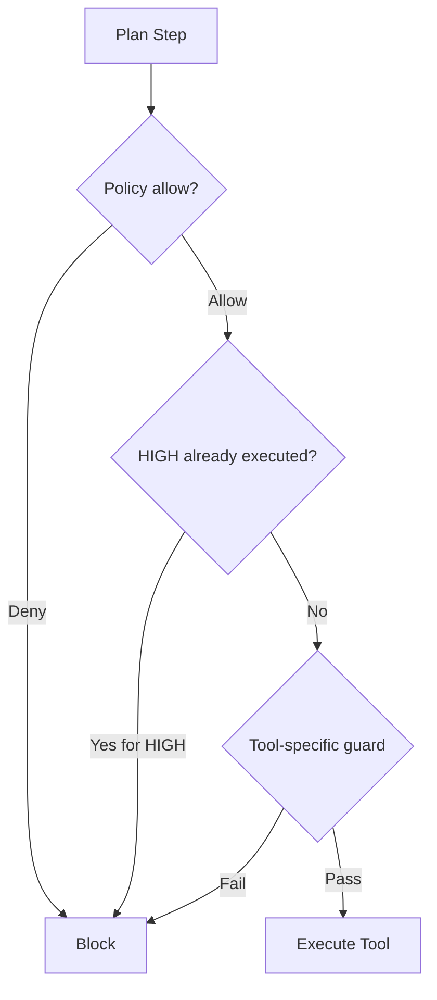

### Risk Levels

| Risk   | Tools                                  | Behavior                                      |
|--------|----------------------------------------|-----------------------------------------------|
| HIGH   | `restart_channel`                      | Max 1 per loop, circuit breaker aware         |
| MEDIUM | `rebuild_playout`                     | 120s cooldown, not implemented as action      |
| LOW    | Metadata tools, diagnostics            | 30s cooldown (metadata), 5s (diagnostics)     |

### Confidence Gating

Metadata tools require `confidence >= 0.3` (unless overridden). Confidence comes from pattern analysis. On failure:

```
new_confidence = max(0.1, confidence * 0.8)
```

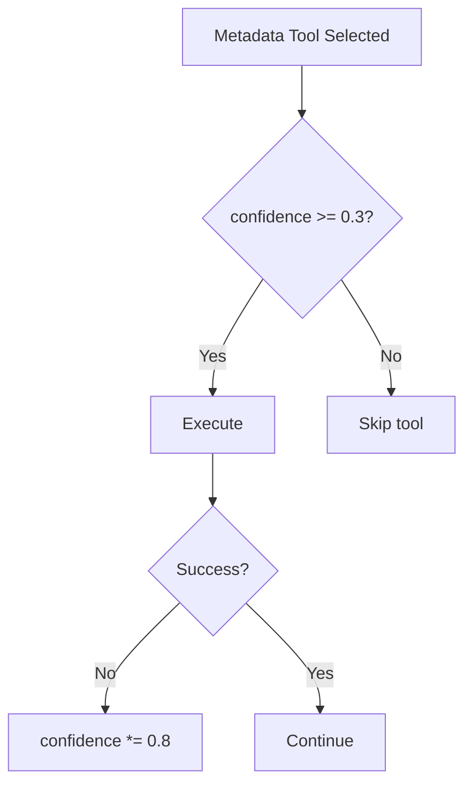

### Automatic Shutdown on Regression

After 3 consecutive metadata tool failures, the agent loop stops and escalates. It does not keep retrying. In metadata self-resolution, if the metadata failure ratio increases by more than 0.1 after an attempt, the system treats it as regression and can suspend further automatic resolution.

### Containment Mode

Containment mode disables the agent. It is triggered when:

- Restart velocity ≥ 10 restarts per 60 seconds.
- Pool pressure ≥ 0.9 (90% of FFmpeg capacity).
- Circuit breaker is OPEN for the channel.
- Long-run leak detection: RSS growth > 100 MB over the last 10 minutes.

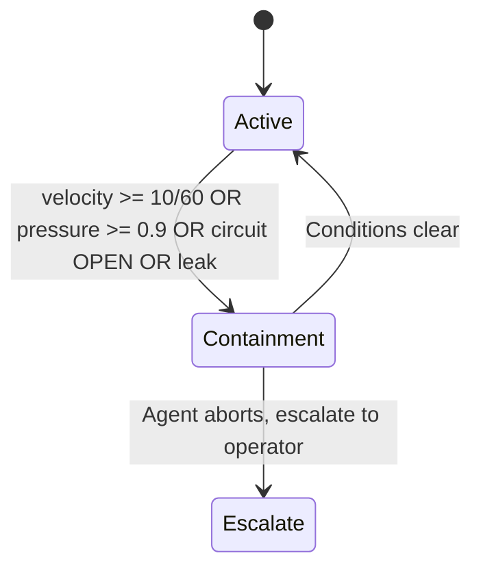

When containment is active, the agent loop exits immediately with an escalation message. No tools are executed.

---

## 6. Observability & Monitoring

### Prometheus Metrics

The `/metrics` endpoint exposes Prometheus text format. Metrics include:

#### FFmpeg Process Pool

| Metric                                     | Type   | Description                                  |
|--------------------------------------------|--------|----------------------------------------------|
| `exstreamtv_ffmpeg_processes_active`      | gauge  | Active FFmpeg processes                      |
| `exstreamtv_ffmpeg_spawn_pending`         | gauge  | Pending spawns                               |
| `exstreamtv_ffmpeg_spawn_rejected_total{reason}` | counter | Rejected spawns (memory, fd, capacity) |
| `exstreamtv_ffmpeg_spawn_timeout_total`   | counter | Spawn timeouts                             |
| `exstreamtv_ffmpeg_pool_pressure_events_total` | counter | Pool pressure events                    |

#### Per-Channel

| Metric                                 | Type   | Description                     |
|----------------------------------------|--------|---------------------------------|
| `exstreamtv_channel_restart_total{channel_id}` | counter | Restarts per channel     |
| `exstreamtv_stream_success_total{channel_id}` | counter | Successful streams     |
| `exstreamtv_stream_failure_total{channel_id}` | counter | Failed streams        |
| `exstreamtv_channel_memory_bytes{channel_id}`  | gauge  | Memory per channel      |
| `exstreamtv_circuit_breaker_state{channel_id}` | gauge  | 0=closed, 1=half_open, 2=open |

#### Stability

| Metric                                  | Type   | Description              |
|-----------------------------------------|--------|--------------------------|
| `exstreamtv_pool_acquisition_latency_seconds` | gauge | Pool acquisition time |
| `exstreamtv_restart_rate_per_minute`     | gauge  | Restart rate             |
| `exstreamtv_health_timeouts_total`      | counter | Health check timeouts  |
| `exstreamtv_playout_rebuild_total`       | counter | Playout rebuilds       |

#### System

| Metric                       | Type   | Description          |
|------------------------------|--------|----------------------|
| `exstreamtv_system_rss_bytes`| gauge  | Resident set size    |
| `exstreamtv_fd_usage`        | gauge  | Open file descriptors|
| `exstreamtv_event_loop_lag_seconds` | gauge | Event loop lag  |
| `exstreamtv_db_pool_checked_out`    | gauge | DB connections in use |
| `exstreamtv_db_pool_size`           | gauge | DB pool size          |

#### Metadata

| Metric                                           | Type   | Description                    |
|--------------------------------------------------|--------|--------------------------------|
| `exstreamtv_metadata_lookup_success_total`        | counter | Successful lookups          |
| `exstreamtv_metadata_lookup_failure_total`      | counter | Failed lookups             |
| `exstreamtv_placeholder_title_generated_total`   | counter | Placeholder titles used    |
| `exstreamtv_xmltv_validation_error_total`         | counter | XMLTV validation errors    |
| `exstreamtv_ai_metadata_resolution_attempt_total`  | counter | AI resolution attempts   |
| `exstreamtv_ai_metadata_resolution_success_total`   | counter | AI resolution successes  |
| `exstreamtv_ai_metadata_resolution_abort_total`     | counter | AI resolution aborts     |

### Alerting Philosophy

The codebase defines thresholds for external alerting (e.g., Prometheus Alertmanager):

- **Metadata failure ratio** — Warning at 0.3, critical at 0.5.
- **Placeholder ratio** — Warning at 0.2.
- **Restart velocity** — Warning at 0.5/min, critical at 2.0/min.
- **Pool pressure** — Critical at 0.9.

These are not enforced in-process; they are intended for observability stacks.

### Early Warning Signals

The metadata pipeline emits a single structured log per EPG cycle when:

- More than 5% of programmes lack episode number.
- More than 5% lack year.
- More than 10 programmes use placeholder titles.
- Metadata failure ratio exceeds 0.3.

---

## 7. Formal Invariants

### Restart Invariants

- **R1** — No more than 10 restarts in any 60-second window.
- **R2** — No channel restarts within 30 seconds of its previous restart.
- **R3** — When the circuit breaker is OPEN for a channel, no restart for that channel until cooldown (120s) elapses.
- **R4** — All restarts go through `request_channel_restart`; no direct `stop_channel`/`start_channel` from external callers.

### Streaming Invariants

- **S1** — All FFmpeg processes are acquired and released via ProcessPoolManager.
- **S2** — Process count never exceeds `min(config, memory-based, FD-based)`.
- **S3** — Spawn rate is limited by the token bucket (default 5/sec).
- **S4** — Memory and FD guards are checked before each spawn.

### Agent Invariants

- **A1** — No database writes by the agent loop.
- **A2** — No tool-from-tool calls; tools are executed sequentially.
- **A3** — At most one HIGH-risk tool per loop.
- **A4** — Containment mode blocks all tool execution.
- **A5** — Restart tools route through `health_tasks.request_channel_restart`.

### Async Invariants

- **U1** — No blocking I/O in the agent loop or envelope builder.
- **U2** — ProcessPoolManager uses asyncio.Lock for registry access.
- **U3** — Circuit breaker uses asyncio.Lock for state updates.

### Metadata Invariants

- **M1** — XMLTV validation runs before emit; invalid programmes raise XMLTVValidationError.
- **M2** — Placeholder titles (`Item \d+`) are never emitted; fallbacks are used.
- **M3** — Drift detection does not block EPG generation or streaming.

---

## 8. CI/CD & Deployment

### Test Enforcement

Tests use pytest with markers: `unit`, `integration`, `e2e`, `slow`, `ffmpeg`, `network`. Run focused suites:

```bash
pytest tests/unit/ tests/integration/ -v
pytest -m "not e2e and not slow" -v
```

### Regression Protection

- **Reliability tests** — `tests/reliability/test_streaming_stress.py` (restart guards, circuit breaker), `test_metadata_soak.py` (EPG loop, no spurious restarts), `test_platform_pytest.py` (HDHomeRun discover/lineup).
- **Safety invariant tests** — `tests/unit/test_section_a_safety_invariants.py`, `test_section_c_ai_gating.py`.

### Soak Tests

The script `scripts/soak_test.py` runs configurable-duration stress tests (default 24 hours). It tracks:

- Request counts, restarts, pool usage.
- Memory growth, recursion errors, restart storms.

Failure thresholds (configurable) include recursion errors, restart storms, and memory growth.

### Feature Flag Rollout

Feature flags are in `config.yaml` (see FEATURE_FLAGS.md). Bounded agent and metadata self-resolution are disabled by default. Enable them after validation in your environment.

### Deployment Options

- **Direct** — `./scripts/install_macos.sh`, then `./start.sh`.
- **Docker** — `docker-compose up` in `containers/docker`.
- **macOS App** — Build `EXStreamTVApp`, install to `/Applications`.

---

## 9. Operational Guide

### Diagnosing Issues

1. Check `/metrics` for restart rate, circuit breaker state, pool pressure.
2. Review logs for `ProcessPoolManager`, `Circuit breaker`, `Health check`.
3. If channels fail to tune, verify `discover.json` and `lineup.json` return valid JSON and DeviceID.

### Reading Logs

- **Channel health** — `Channel X no output for Ys` indicates stale stream; restart may be triggered.
- **Restart storm** — `Restart storm throttle` means the global limit was hit.
- **Circuit breaker** — `Circuit breaker OPEN for channel X` means restarts are blocked.
- **Metadata** — `EPG metadata early warning` or `Metadata drift` indicate enrichment or structural issues.

### Verifying Stream Health

- Use the web UI channel status.
- Query `exstreamtv_stream_success_total` and `exstreamtv_stream_failure_total` per channel.
- Ensure `last_output_time` is recent for active channels.

### Verifying HDHomeRun Compliance

- `GET /hdhomerun/discover.json` — DeviceID must be 8 hex chars.
- `GET /hdhomerun/lineup.json` — Non-empty array, unique GuideNumbers, non-empty URLs.
- If Plex reports “Could not Tune Channel,” re-add the DVR after fixing DeviceID.

### Verifying XMLTV Integrity

- Check `exstreamtv_xmltv_validation_error_total` — should be 0 in normal operation.
- Check `exstreamtv_xmltv_lineup_mismatch_total` — indicates lineup vs. XMLTV inconsistency.
- Fetch the EPG URL and validate structure if needed.

### Safely Disabling AI

Set in config:

- `ai_agent.enabled: false` — Disables all AI features.
- `ai_agent.bounded_agent_enabled: false` — Disables bounded agent (default).
- `ai_agent.metadata_self_resolution_enabled: false` — Disables metadata self-resolution (default).

---

## 10. Production Readiness & Safety Model

### Why Containment Over Automation

When the system is under stress (restart storms, high pool pressure, circuit breakers open), automation can worsen the situation. Containment mode stops the AI agent and escalates to the operator. Recovery is then human-driven.

### Why Bounded Loops Exist

Unbounded loops can run indefinitely and exhaust resources. The agent loop has a fixed maximum number of steps (default 3). No recursion, no tool-from-tool—each step is a single tool call.

### Why Automatic Shutdown Exists

Consecutive metadata tool failures suggest the remediation strategy is wrong. Continuing would waste resources and risk additional failures. Shutting down after 3 failures forces operator review.

### How Regression Detection Works

In metadata self-resolution, metrics before and after an attempt are compared. If the metadata failure ratio increases by more than 0.1, the change is treated as regression. The system can suspend automatic resolution to prevent further degradation.

---

## 11. Documentation, Wiki, and Branch Alignment

- **Canonical diagrams:** [Architecture Diagrams](Architecture-Diagrams) — 18 Mermaid diagrams (system overview, FFmpeg constants layer, async lock pattern, six-layer AI/coding safety, etc.).
- **Wiki:** Source markdown lives under `docs/wiki/` and main guides under `docs/`. Regenerate the GitHub Wiki tree with:
  `python scripts/sync_docs_to_wiki.py --wiki-dir EXStreamTV.wiki`
  then commit and push `EXStreamTV.wiki/` (or copy `wiki_out/` into your wiki clone).
- **Default branch:** `main` includes the full 2026-03 remediation merge (`2026-02-21-ufnw`); keep docs, wiki exports, and code on the same branch for audits and certification.
- **Contributor guardrails:** Root `AGENTS.md`, path-local `exstreamtv/*/AGENTS.md`, `.cursor/rules/exstreamtv-safety.mdc`, and `.cursor/rules/exstreamtv-critical.mdc` overlap by design (see DIAGRAMS §18).

---

## Related Documentation

- [README](Home) — Quick start and overview.
- [Architecture Diagrams](Architecture-Diagrams) — All Mermaid architecture diagrams.
- [System Design](System-Design) — Architecture details.
- [Streaming Stability](Streaming-Stability) — Session management, throttling, error screens.
- [AI Setup](AI-Setup) — AI configuration and bounded agent.
- [Observability](Observability) — Full metrics reference.
- [Feature Flags](Feature-Flags) — Config toggles.


---

## Wiki page: Installation

*Source: [`EXStreamTV.wiki/Installation.md`](https://github.com/roto31/EXStreamTV/wiki/Installation)*

# Installation Guide

This guide covers installing EXStreamTV on various platforms.

## Table of Contents

- [Requirements](#requirements)
- [macOS Installation](#macos-installation)
- [Linux Installation](#linux-installation)
- [Windows Installation](#windows-installation)
- [Docker Installation](#docker-installation)
- [From Source](#from-source)
- [AI Configuration](#ai-configuration)
- [Verifying Installation](#verifying-installation)
- [Troubleshooting](#troubleshooting)

---

## Requirements

### System Requirements

| Component | Minimum | Recommended |
|-----------|---------|-------------|
| CPU | 2 cores | 4+ cores |
| RAM | 2 GB | 4+ GB |
| Storage | 500 MB | 2+ GB |
| Network | 10 Mbps | 100+ Mbps |

### Software Requirements

- **Python**: 3.10 or higher
- **FFmpeg**: 5.0+ with hardware acceleration support
- **pip**: Latest version recommended

### Optional Requirements

For hardware transcoding:
- **macOS**: VideoToolbox (built-in on Apple Silicon/Intel Macs)
- **NVIDIA**: CUDA 11.0+, NVENC-capable GPU
- **Intel**: QSV-capable CPU (6th gen+)
- **AMD**: AMF-capable GPU
- **Linux**: VAAPI drivers

For AI features:
- **Cloud AI**: Free API key from Groq, SambaNova, or OpenRouter
- **Local AI**: Ollama with 4GB+ RAM (8GB+ recommended)

---

## macOS Installation

### Using the Installer Script

The easiest way to install on macOS:

```bash
# Clone the repository
git clone https://github.com/roto31/EXStreamTV.git
cd EXStreamTV

# Run the installer
./scripts/install_macos.sh
```

The installer will:
1. Check/install Homebrew
2. Check/install Python 3.10+
3. Check/install FFmpeg with VideoToolbox
4. Create a virtual environment
5. Install Python dependencies
6. Initialize the database
7. Optionally install Ollama for local AI

### Manual Installation on macOS

```bash
# Install Python (if needed)
brew install python@3.11

# Install FFmpeg with hardware acceleration
brew install ffmpeg

# Clone repository
git clone https://github.com/roto31/EXStreamTV.git
cd EXStreamTV

# Create virtual environment
python3 -m venv venv
source venv/bin/activate

# Install dependencies
pip install -r requirements.txt

# Initialize database
python -m exstreamtv.database init
```

### Menu Bar App (Recommended)

Build and install the native macOS menu bar app:

```bash
cd EXStreamTVApp
swift build -c release
cp -r .build/release/EXStreamTVApp.app /Applications/
```

On first launch, the app guides you through:
1. Dependency verification
2. AI provider setup (cloud or local)
3. Server configuration
4. Media source connections
5. First channel creation

See [Onboarding Guide](ONBOARDING.md) for details.

---

## Linux Installation

### Ubuntu/Debian

```bash
# Update packages
sudo apt update && sudo apt upgrade -y

# Install Python
sudo apt install python3 python3-pip python3-venv -y

# Install FFmpeg with hardware support
sudo apt install ffmpeg -y

# For NVIDIA GPU support
sudo apt install nvidia-cuda-toolkit -y

# For Intel QSV support
sudo apt install intel-media-va-driver-non-free -y

# Clone repository
git clone https://github.com/roto31/EXStreamTV.git
cd EXStreamTV

# Create virtual environment
python3 -m venv venv
source venv/bin/activate

# Install dependencies
pip install -r requirements.txt
```

### Fedora/RHEL

```bash
# Install Python
sudo dnf install python3 python3-pip -y

# Install FFmpeg (enable RPM Fusion first)
sudo dnf install https://download1.rpmfusion.org/free/fedora/rpmfusion-free-release-$(rpm -E %fedora).noarch.rpm -y
sudo dnf install ffmpeg -y

# Clone and install
git clone https://github.com/roto31/EXStreamTV.git
cd EXStreamTV
python3 -m venv venv
source venv/bin/activate
pip install -r requirements.txt
```

### Running as a Service

Create a systemd service:

```bash
sudo nano /etc/systemd/system/exstreamtv.service
```

Add the following content:

```ini
[Unit]
Description=EXStreamTV IPTV Streaming Server
After=network.target

[Service]
Type=simple
User=exstreamtv
WorkingDirectory=/opt/EXStreamTV
ExecStart=/opt/EXStreamTV/venv/bin/python -m exstreamtv
Restart=always
RestartSec=10

[Install]
WantedBy=multi-user.target
```

Enable and start the service:

```bash
sudo systemctl daemon-reload
sudo systemctl enable exstreamtv
sudo systemctl start exstreamtv
```

---

## Windows Installation

### Using PowerShell

```powershell
# Install Python (if needed) - using winget
winget install Python.Python.3.11

# Install FFmpeg
winget install Gyan.FFmpeg

# Clone repository
git clone https://github.com/roto31/EXStreamTV.git
cd EXStreamTV

# Create virtual environment
python -m venv venv
.\venv\Scripts\Activate.ps1

# Install dependencies
pip install -r requirements.txt
```

### Running as a Windows Service

Use NSSM (Non-Sucking Service Manager):

```powershell
# Install NSSM
winget install NSSM.NSSM

# Install as service
nssm install EXStreamTV "C:\EXStreamTV\venv\Scripts\python.exe" "-m exstreamtv"
nssm set EXStreamTV AppDirectory "C:\EXStreamTV"
nssm start EXStreamTV
```

---

## Docker Installation

### Using Docker Compose (Recommended)

```bash
# Clone repository
git clone https://github.com/roto31/EXStreamTV.git
cd EXStreamTV/containers/docker

# Configure environment (optional - for AI)
cp env.example .env
# Edit .env to add your GROQ_API_KEY

# Start the container
docker-compose up -d
```

### Using Docker Directly

```bash
# Pull the image
docker pull exstreamtv/exstreamtv:latest

# Run the container
docker run -d \
  --name exstreamtv \
  -p 8411:8411 \
  -v exstreamtv_data:/app/data \
  -v /path/to/media:/media:ro \
  exstreamtv/exstreamtv:latest
```

### Docker Compose with GPU Support

For NVIDIA GPU acceleration:

```yaml
version: '3.8'
services:
  exstreamtv:
    image: exstreamtv/exstreamtv:latest
    ports:
      - "8411:8411"
    environment:
      - GROQ_API_KEY=${GROQ_API_KEY}  # For cloud AI
    volumes:
      - exstreamtv_data:/app/data
      - /path/to/media:/media:ro
    deploy:
      resources:
        reservations:
          devices:
            - driver: nvidia
              count: 1
              capabilities: [gpu]

volumes:
  exstreamtv_data:
```

### Docker with Local AI

To include Ollama for local AI:

```bash
docker-compose --profile ai-local up -d
```

This starts an Ollama container alongside EXStreamTV.

---

## From Source

### Development Installation

```bash
# Clone repository
git clone https://github.com/roto31/EXStreamTV.git
cd EXStreamTV

# Create virtual environment
python3 -m venv venv
source venv/bin/activate  # or .\venv\Scripts\Activate.ps1 on Windows

# Install in development mode
pip install -e ".[dev]"

# Or install all dependencies
pip install -r requirements.txt
pip install -r requirements-dev.txt
```

### Building from Source

```bash
# Build the package
python -m build

# Install the built package
pip install dist/exstreamtv-*.whl
```

---

## AI Configuration

EXStreamTV uses AI for channel creation, troubleshooting, and log analysis. Choose from cloud or local providers.

### Quick Setup: Cloud AI (Recommended)

1. Get a free API key from [console.groq.com](https://console.groq.com)
2. Set the environment variable:

```bash
export GROQ_API_KEY="gsk_your_key_here"
```

3. Or add to `config.yaml`:

```yaml
ai_agent:
  enabled: true
  provider_type: "cloud"
  cloud:
    provider: "groq"
    api_key: "gsk_your_key_here"
```

### Quick Setup: Local AI

1. Install Ollama:

```bash
brew install ollama
ollama serve  # Start the service
```

2. Download a model (based on your RAM):

```bash
# 4GB RAM
ollama pull phi4-mini:3.8b-q4

# 8GB RAM
ollama pull qwen2.5:7b

# 16GB+ RAM
ollama pull qwen2.5:14b
```

3. Configure in `config.yaml`:

```yaml
ai_agent:
  enabled: true
  provider_type: "local"
  local:
    model: "auto"  # Auto-selects based on RAM
```

For detailed AI configuration, see [AI Setup Guide](AI_SETUP.md).

---

## Verifying Installation

### Check Python Dependencies

```bash
# Activate virtual environment
source venv/bin/activate

# Verify imports
python -c "import exstreamtv; print(exstreamtv.__version__)"
```

### Check FFmpeg

```bash
# Verify FFmpeg installation
ffmpeg -version

# Check for hardware encoders
ffmpeg -encoders | grep -E "(h264|hevc)_(nvenc|qsv|videotoolbox|vaapi)"
```

### Start the Server

```bash
# Start EXStreamTV
python -m exstreamtv

# Or use the start script
./start.sh
```

### Access the Web Interface

Open your browser and navigate to:

```
http://localhost:8411
```

You should see the EXStreamTV dashboard.

---

## Troubleshooting

### Common Issues

#### Port Already in Use

```bash
# Check what's using port 8411
lsof -i :8411  # macOS/Linux
netstat -ano | findstr :8411  # Windows

# Use a different port
EXSTREAMTV_PORT=9000 python -m exstreamtv
```

#### Permission Denied on Media Folder

```bash
# Check permissions
ls -la /path/to/media

# Fix permissions (Linux/macOS)
sudo chown -R $USER:$USER /path/to/media
chmod -R 755 /path/to/media
```

#### FFmpeg Not Found

```bash
# Add FFmpeg to PATH
export PATH="/usr/local/bin:$PATH"

# Or specify path in config
echo "ffmpeg_path: /usr/local/bin/ffmpeg" >> config.yaml
```

#### Database Errors

```bash
# Reset the database
rm -rf data/exstreamtv.db
python -m exstreamtv.database init
```

### Getting Help

- Check the [FAQ](FAQ.md)
- Search [GitHub Issues](https://github.com/roto31/EXStreamTV/issues)
- Join our [Discord community](https://discord.gg/exstreamtv)

---

## Next Steps

After installation:
1. [Quick Start Guide](QUICK_START.md) - Get your first channel running
2. [AI Setup Guide](AI_SETUP.md) - Configure AI-assisted features
3. [macOS App Guide](MACOS_APP_GUIDE.md) - Use the menu bar app
4. [Configure Hardware Transcoding](HW_TRANSCODING.md) - Enable GPU acceleration
5. [Add Local Media](LOCAL_MEDIA.md) - Connect your media libraries

**Last Revised:** 2026-03-20


---

## Wiki page: Quick Start

*Source: [`EXStreamTV.wiki/Quick-Start.md`](https://github.com/roto31/EXStreamTV/wiki/Quick-Start)*

# Quick Start Guide

Get your first EXStreamTV channel running in under 10 minutes.

## Table of Contents

- [Prerequisites](#prerequisites)
- [Starting the Server](#starting-the-server)
- [Accessing the Web UI](#accessing-the-web-ui)
- [Creating Your First Channel](#creating-your-first-channel)
- [Adding Content](#adding-content)
- [Watching Your Channel](#watching-your-channel)
- [Next Steps](#next-steps)

---

## Prerequisites

Before starting, ensure you have:

1. **EXStreamTV installed** - See [Installation Guide](INSTALLATION.md)
2. **FFmpeg available** - Required for transcoding
3. **Media content** - Videos to add to your channel

---

## Starting the Server

### Option 1: Command Line

```bash
# Navigate to EXStreamTV directory
cd /path/to/EXStreamTV

# Activate virtual environment
source venv/bin/activate  # macOS/Linux
# or
.\venv\Scripts\Activate.ps1  # Windows

# Start the server
python -m exstreamtv
```

### Option 2: Start Script

```bash
./start.sh
```

### Option 3: macOS Menu Bar App (Recommended)

Launch the EXStreamTV app from your Applications folder.

On first launch, the **Onboarding Wizard** guides you through:
1. Dependency verification
2. AI provider setup
3. Server configuration
4. Media source connections

See [Onboarding Guide](ONBOARDING.md) for the complete walkthrough.

After onboarding, click "Start Server" from the menu bar icon.

You should see output like:

```
INFO:     Starting EXStreamTV v2.6.0
INFO:     Configuration loaded, server port: 8411
INFO:     Database initialized
INFO:     Uvicorn running on http://0.0.0.0:8411
```

---

## Accessing the Web UI

Open your browser and go to:

```
http://localhost:8411
```

You'll see the EXStreamTV Dashboard with:

- **Quick Stats** - Channels, playlists, media counts
- **System Resources** - CPU, memory, disk usage
- **Active Streams** - Currently playing channels
- **Quick Actions** - Shortcuts to common tasks

---

## Creating Your First Channel

### Option A: AI-Assisted Creation (Recommended)

If you configured AI during setup:

1. Go to **Channels** in the sidebar
2. Click **+ New Channel**
3. Click **AI-Assisted** tab
4. Describe your channel:
   - "Classic 80s action movies channel"
   - "Kids cartoons with morning schedule"
   - "Documentary channel about nature"
5. AI suggests content and schedule
6. Review and click **Create**

This creates a complete channel with:
- Curated content from your libraries
- Appropriate scheduling
- Channel branding suggestions

### Option B: Manual Creation

#### Step 1: Navigate to Channels

Click **Channels** in the sidebar or go to:

```
http://localhost:8411/channels
```

#### Step 2: Create New Channel

1. Click the **+ New Channel** button
2. Fill in the details:
   - **Channel Number**: `1`
   - **Channel Name**: `My First Channel`
   - **Group**: `Entertainment` (optional)
3. Click **Create**

#### Step 3: Channel Settings (Optional)

In the channel editor, you can configure:

- **Logo** - Upload a channel logo
- **FFmpeg Profile** - Select quality preset (Default 1080p, HD 720p, etc.)
- **Guide Color** - Color for EPG display

---

## Adding Content

### Option A: Create a Playlist with URLs

1. Go to **Playlists** in the sidebar
2. Click **+ New Playlist**
3. Name it `First Playlist`
4. Click **Add Item** and enter:
   - **Title**: `Sample Video`
   - **URL**: `http://example.com/video.mp4` or a YouTube URL
5. Repeat for more videos
6. Click **Save**

### Option B: Add Local Media

1. Go to **Libraries** in the sidebar
2. Click **+ Add Library**
3. Choose **Local Library**
4. Enter the path to your media folder: `/path/to/videos`
5. Click **Scan** to discover media
6. Create a playlist from the scanned media

### Option C: Import from Plex/Jellyfin

1. Go to **Libraries** → **+ Add Library**
2. Choose **Plex** or **Jellyfin**
3. Enter your server details:
   - **Server URL**: `http://localhost:32400` (Plex)
   - **Token/API Key**: Your authentication token
4. Select libraries to import
5. Click **Sync**

---

## Assigning Content to Channel

### Using a Playlist

1. Go to **Channels** and select your channel
2. Click **Edit Channel**
3. In the **Playlist Panel**, click **+ Add Content**
4. Select your playlist
5. Click **Save**

### Using the Schedule Builder

For more control over when content plays:

1. Go to **Schedules** in the sidebar
2. Click **+ New Schedule**
3. Add time blocks:
   - Morning: 6 AM - 12 PM
   - Afternoon: 12 PM - 6 PM
   - Evening: 6 PM - 12 AM
4. Assign playlists to each block
5. Apply the schedule to your channel

---

## Watching Your Channel

### Option 1: Built-in Player

1. Go to **Channels**
2. Click the **Play** button on your channel
3. The video will play in the browser

### Option 2: External Player

Copy the stream URL:

```
http://localhost:8411/channels/1/stream.m3u8
```

Open in VLC, mpv, or any HLS-compatible player:

```bash
# VLC
vlc http://localhost:8411/channels/1/stream.m3u8

# mpv
mpv http://localhost:8411/channels/1/stream.m3u8
```

### Option 3: HDHomeRun/IPTV Client

EXStreamTV emulates an HDHomeRun device. In Plex, Emby, or Jellyfin:

1. Go to Live TV settings
2. Click "Add DVR" or "Add Tuner"
3. It should auto-discover EXStreamTV
4. Or manually enter: `http://localhost:8411`

### Option 4: M3U Playlist

Download the M3U playlist:

```
http://localhost:8411/iptv/channels.m3u
```

Import into any IPTV app (IPTV Smarters, TiviMate, etc.)

---

## Quick Reference

### Common URLs

| Resource | URL |
|----------|-----|
| Dashboard | `http://localhost:8411/dashboard` |
| Channels | `http://localhost:8411/channels` |
| Guide | `http://localhost:8411/guide` |
| M3U Playlist | `http://localhost:8411/iptv/channels.m3u` |
| EPG (XML) | `http://localhost:8411/iptv/xmltv.xml` |
| API Docs | `http://localhost:8411/api/docs` |

### Keyboard Shortcuts

#### Web Player
| Shortcut | Action |
|----------|--------|
| `Space` | Play/Pause (in player) |
| `F` | Fullscreen |
| `M` | Mute |
| `←` / `→` | Seek 10 seconds |

#### macOS App Channel Switcher
| Shortcut | Action |
|----------|--------|
| `Cmd+G` | Open channel switcher |
| `Cmd+Up` | Previous channel |
| `Cmd+Down` | Next channel |
| `0-9` | Jump to channel number |
| `Esc` | Close switcher |

---

## Next Steps

Now that you have a working channel:

1. **[Configure AI](AI_SETUP.md)** - Set up AI-assisted channel creation
2. **[Add more content](LOCAL_MEDIA.md)** - Connect local libraries or streaming sources
3. **[Enable hardware transcoding](HW_TRANSCODING.md)** - Reduce CPU usage
4. **[Create a schedule](API-Reference)** - Program your channels like real TV
5. **[Use the macOS app](MACOS_APP_GUIDE.md)** - Native player and keyboard shortcuts
6. **[Customize your setup](System-Design)** - Advanced configuration

---

## Troubleshooting

### Channel Not Playing

- Check that FFmpeg is installed: `ffmpeg -version`
- Verify the source URL is accessible
- Check the logs: **Settings** → **Logs**

### Poor Video Quality

- Adjust the FFmpeg profile in channel settings
- Enable hardware transcoding for better performance

### Buffering Issues

- Reduce the output bitrate in FFmpeg profile
- Check network bandwidth
- Try a lower resolution preset

### Need Help?

- Check the [FAQ](FAQ.md)
- Browse [GitHub Issues](https://github.com/roto31/EXStreamTV/issues)
- Join our community on [Discord](https://discord.gg/exstreamtv)

**Last Revised:** 2026-03-20


---

## Wiki page: Onboarding

*Source: [`EXStreamTV.wiki/Onboarding.md`](https://github.com/roto31/EXStreamTV/wiki/Onboarding)*

# Onboarding Guide

This guide walks you through the EXStreamTV first-run setup wizard.

## Table of Contents

- [Overview](#overview)
- [Step 1: Welcome](#step-1-welcome)
- [Step 2: AI Assistant](#step-2-ai-assistant)
- [Step 3: Server Setup](#step-3-server-setup)
- [Step 4: Media Sources](#step-4-media-sources)
- [Step 5: First Channel](#step-5-first-channel)
- [Step 6: Complete](#step-6-complete)
- [Re-running Onboarding](#re-running-onboarding)
- [Skipping Steps](#skipping-steps)

---

## Overview

The onboarding wizard appears when you first launch the EXStreamTV macOS app. It guides you through:

1. Checking dependencies (Python, FFmpeg)
2. Configuring AI assistance
3. Setting up the backend server
4. Connecting media sources
5. Creating your first channel

You can skip optional steps and configure them later in Settings.

---

## Step 1: Welcome

The Welcome step introduces EXStreamTV and checks your system.

### What It Shows

- **App Introduction**: Key features overview
- **Dependency Status**: Checks for Python and FFmpeg

### Dependency Checks

| Dependency | Status | Action Needed |
|------------|--------|---------------|
| Python 3.10+ | Green checkmark | None |
| Python | Red X | Install via Homebrew or python.org |
| FFmpeg | Green checkmark | None |
| FFmpeg | Red X | Install via Homebrew |

### If Dependencies Are Missing

Click **Run Install Script** to automatically install missing dependencies. This runs:

```bash
./scripts/install_macos.sh
```

The script installs:
- Python 3.11 via Homebrew
- FFmpeg with VideoToolbox support
- Python virtual environment and packages

### Moving Forward

Once all dependencies show green checkmarks, click **Next** to continue.

---

## Step 2: AI Assistant

Configure how EXStreamTV uses AI for channel creation and troubleshooting.

### AI Options

| Option | Badge | Description |
|--------|-------|-------------|
| **Cloud AI** | FREE | Uses Groq's cloud servers. Instant setup, requires internet. |
| **Local AI** | - | Runs on your Mac via Ollama. Works offline, uses more RAM. |
| **Hybrid** | - | Cloud primary, local backup. Best of both worlds. |
| **Skip for Now** | - | Configure AI later in Settings. |

### Choosing Cloud AI (Recommended)

1. Select **Cloud AI**
2. Click **Continue**
3. The Groq Setup wizard appears

**Groq Setup:**

1. Click **Open Groq Console** to get your free API key
2. Sign in with Google or GitHub (30 seconds)
3. Create and copy your API key
4. Paste it in the app
5. Click **Validate & Continue**

### Choosing Local AI

1. Select **Local AI**
2. Click **Continue**
3. The Local AI Setup wizard appears

**Local AI Setup:**

1. Your Mac's RAM is detected automatically
2. A model is recommended based on your RAM
3. If Ollama isn't installed, click **Install Ollama**
4. Click **Download Model** to download the recommended model
5. Wait for download to complete
6. Click **Continue**

### Choosing Hybrid

1. Select **Hybrid**
2. Click **Continue**
3. Set up Cloud AI first (Groq)
4. Optionally set up Local AI as fallback

### Skipping AI

1. Select **Skip for Now**
2. Click **Continue**
3. You can configure AI later in **Settings** > **AI** tab

---

## Step 3: Server Setup

Configure the EXStreamTV backend server.

### Configuration Options

| Setting | Default | Description |
|---------|---------|-------------|
| **Server Port** | 8411 | Port for web UI and API |
| **Data Directory** | ~/Library/Application Support/EXStreamTV | Where data is stored |

### Changing the Port

If port 8411 is in use:

1. Enter a different port (e.g., 9000)
2. Remember this port for accessing the web UI

### Changing Data Directory

1. Click **Change**
2. Select a folder
3. Useful for storing data on external drives

### Starting the Server

1. Click **Start Server**
2. Wait for "Server is running" message
3. The port will show in green

### If Server Fails to Start

- Check that the port isn't in use
- Verify Python path in logs
- Click the error message for details

---

## Step 4: Media Sources

Connect your media libraries to create channel content.

### Available Sources

| Source | Description |
|--------|-------------|
| **Plex** | Connect to Plex Media Server |
| **Jellyfin** | Connect to Jellyfin server |
| **Emby** | Connect to Emby server |
| **Local Folders** | Add folders from your Mac |

### Connecting Plex

1. Click **Connect** next to Plex
2. Enter your Plex server URL (e.g., `http://localhost:32400`)
3. Enter your Plex token
4. Click **Connect**

**Finding Your Plex Token:**

1. Open Plex Web
2. Play any media
3. Click "Get Info" > "View XML"
4. Find `X-Plex-Token=` in the URL

### Connecting Jellyfin/Emby

1. Click **Connect** next to the service
2. Enter server URL
3. Enter API key (from server settings)
4. Click **Connect**

### Adding Local Folders

1. Click **Connect** next to Local Folders
2. Select one or more folders containing videos
3. Click **Open**
4. The folders will be scanned for media

### Skipping This Step

This step is optional. Click **Skip** or **Next** to continue without connecting sources. You can add sources later from the web dashboard.

---

## Step 5: First Channel

Create your first TV channel.

### Creation Options

| Option | Description |
|--------|-------------|
| **AI-Assisted** | AI helps you create a channel based on preferences |
| **Manual Configuration** | Configure everything yourself |
| **Import from M3U** | Import an existing playlist file |

### AI-Assisted Creation

*Requires AI to be configured in Step 2*

1. Click **AI-Assisted**
2. Describe the channel you want (e.g., "80s action movies channel")
3. AI suggests content and schedule
4. Review and approve
5. Channel is created

### Manual Configuration

1. Click **Manual Configuration**
2. Enter channel name and number
3. Add content from connected sources
4. Configure schedule (optional)
5. Click **Create**

### Import from M3U

1. Click **Import from M3U**
2. Select your .m3u or .m3u8 file
3. Review imported channels
4. Click **Import**

### Skipping This Step

Creating a channel is optional. Click **Skip** to proceed. You can create channels from the web dashboard later.

---

## Step 6: Complete

Setup is complete! This step shows a summary of your configuration.

### Summary Display

- **Server**: Port and status
- **AI Assistant**: Provider configured or "Not configured"
- **Media Sources**: Connected services

### Opening the Dashboard

Click **Open Dashboard** to:

1. Close the onboarding wizard
2. Open the web dashboard at `http://localhost:8411`
3. Start using EXStreamTV

### What Happens Next

- The server continues running in the background
- The menu bar icon appears
- You can control everything from the menu bar
- The onboarding won't show again on future launches

---

## Re-running Onboarding

To run the setup wizard again:

### Method 1: Reset Settings

1. Open **Settings** (Cmd+,)
2. Go to **Advanced** tab
3. Click **Reset All Settings**
4. Restart the app

### Method 2: Delete Preferences

```bash
defaults delete com.exstreamtv.EXStreamTVApp
```

Then restart the app.

### Method 3: Re-run Specific Steps

Instead of full reset, configure individual items:

- **AI**: Settings > AI tab
- **Server**: Settings > Server tab
- **Media Sources**: Web dashboard > Libraries
- **Channels**: Web dashboard > Channels

---

## Skipping Steps

### Steps You Can Skip

| Step | Skippable? | Impact |
|------|------------|--------|
| Welcome | No | Must verify dependencies |
| AI Assistant | Yes | AI features won't work until configured |
| Server Setup | No | Must start server to use app |
| Media Sources | Yes | Can add later from web dashboard |
| First Channel | Yes | Can create later from web dashboard |

### Configuring Later

Everything skipped can be configured later:

- **AI**: Settings > AI tab, or reopen onboarding
- **Media Sources**: Web dashboard > Libraries
- **Channels**: Web dashboard > Channels

---

## Troubleshooting

### Wizard Won't Advance

- Ensure required fields are filled
- Check for validation errors (red text)
- For Server step, server must be running

### Can't Install Dependencies

Run the install script manually:

```bash
cd /path/to/EXStreamTV
./scripts/install_macos.sh
```

### API Key Validation Fails

- Check for extra spaces in the key
- Verify you're using the correct provider's key
- Try clicking **Open Groq Console** to get a fresh key

### Server Won't Start

1. Check if port is in use: `lsof -i :8411`
2. Try a different port
3. Check Python installation: `python3 --version`

### Onboarding Appears Every Launch

Ensure you complete the wizard to Step 6. If it keeps appearing:

1. Check write permissions on preferences
2. Look for errors in Console.app
3. Try resetting and completing again

---

## Next Steps

After completing onboarding:

1. [Create more channels](QUICK_START.md#creating-your-first-channel)
2. [Configure AI in detail](AI_SETUP.md)
3. [Enable hardware transcoding](HW_TRANSCODING.md)
4. [Set up schedules](API-Reference)

**Last Revised:** 2026-03-20


---

## Wiki page: AI Setup

*Source: [`EXStreamTV.wiki/AI-Setup.md`](https://github.com/roto31/EXStreamTV/wiki/AI-Setup)*

# AI Setup Guide

EXStreamTV uses AI to help create channels, troubleshoot issues, and analyze logs. This guide covers configuring AI providers. For the bounded agent, containment, and safety model, see the [Platform Guide](Platform-Guide#5-ai-agent--safety-model).

## Table of Contents

- [Overview](#overview)
- [Bounded Agent & Safety](#bounded-agent--safety)
- [Provider Options](#provider-options)
- [Cloud AI Setup](#cloud-ai-setup)
  - [Groq (Recommended)](#groq-recommended)
  - [SambaNova](#sambanova)
  - [OpenRouter](#openrouter)
- [Local AI Setup](#local-ai-setup)
  - [Installing Ollama](#installing-ollama)
  - [Choosing a Model](#choosing-a-model)
  - [Downloading Models](#downloading-models)
- [Hybrid Mode](#hybrid-mode)
- [Configuration Reference](#configuration-reference)
- [Troubleshooting](#troubleshooting)

---

## Overview

EXStreamTV supports three AI provider modes:

| Mode | Description | Best For |
|------|-------------|----------|
| **Cloud** | Uses cloud AI services (Groq, SambaNova, OpenRouter) | Most users - fast setup, no local resources needed |
| **Local** | Runs AI models on your Mac via Ollama | Privacy-focused users, offline usage |
| **Hybrid** | Cloud primary with local fallback | Best reliability - works offline when cloud unavailable |

All cloud providers offer **free tiers** - no credit card required.

---

## Bounded Agent & Safety

### Bounded Agent

The bounded agent is a deterministic loop that runs up to 3 steps. It does not write to the database, call tools from tools, or restart channels directly—all restarts go through the guarded `request_channel_restart` path. This prevents runaway automation.

### Containment Mode

When the system is stressed (restart velocity ≥ 10/60s, pool pressure ≥ 90%, circuit breaker open, or memory leak detected), the agent enters **containment mode**. No tools run; the agent escalates to the operator. See [Platform Guide §5](Platform-Guide#containment-mode).

### Confidence Gating

Metadata tools require a minimum confidence (0.3) before running. If a metadata tool fails, confidence decays. After 3 consecutive failures, the agent stops. This limits ineffective retries.

### Safely Disabling AI

| Config Key | Effect |
|------------|--------|
| `ai_agent.enabled: false` | Disables all AI features |
| `ai_agent.bounded_agent_enabled: false` | Disables bounded agent (default) |
| `ai_agent.metadata_self_resolution_enabled: false` | Disables metadata self-resolution (default) |

Set these in `config.yaml` when you want to run without AI automation. Channel creation and troubleshooting can still use AI when invoked manually, depending on provider setup.

---

## Provider Options

### Cloud Providers Comparison

| Provider | Free Tier | Speed | Models | Signup Time |
|----------|-----------|-------|--------|-------------|
| **Groq** | 14,400 req/day, 30 req/min | Ultra-fast | Llama 3.3 70B, Mixtral | 30 seconds |
| **SambaNova** | 1M tokens/day | Fast | Llama 3.3 70B, DeepSeek | 1 minute |
| **OpenRouter** | $5 credit | Varies | 100+ models | 2 minutes |

### Local Models by RAM

| RAM | Recommended Model | Size | Capabilities |
|-----|------------------|------|--------------|
| 4GB | phi4-mini:3.8b-q4 | 2.5GB | Basic channel creation, troubleshooting |
| 6-8GB | granite3.1:2b-instruct | 2GB | Full troubleshooting, tool calling |
| 8-16GB | qwen2.5:7b | 4.4GB | All features, excellent JSON output |
| 16GB+ | qwen2.5:14b | 9GB | Best quality, all 6 channel personas |
| 32GB+ | qwen2.5-coder:32b | 18GB | Power users, complex schedules |

---

## Cloud AI Setup

### Groq (Recommended)

Groq offers the fastest inference and a generous free tier. This is the recommended choice for most users.

#### Step 1: Get Your API Key

1. Go to [console.groq.com](https://console.groq.com/keys)
2. Sign in with Google or GitHub (takes 10 seconds)
3. Click **Create API Key**
4. Copy your API key (starts with `gsk_`)

#### Step 2: Configure EXStreamTV

**Option A: Environment Variable**

```bash
export GROQ_API_KEY="gsk_your_key_here"
```

Add to your shell profile (`~/.zshrc` or `~/.bashrc`) for persistence.

**Option B: Configuration File**

Edit `config.yaml`:

```yaml
ai_agent:
  enabled: true
  provider_type: "cloud"
  cloud:
    provider: "groq"
    api_key: "gsk_your_key_here"
    model: "llama-3.3-70b-versatile"
```

**Option C: macOS App Settings**

1. Open EXStreamTV menu bar app
2. Go to **Settings** > **AI** tab
3. Select **Cloud AI**
4. Choose **Groq**
5. Paste your API key
6. Click **Validate & Save**

#### Groq Free Tier Limits

- 30 requests per minute
- 14,400 requests per day
- 6,000 tokens per minute
- No credit card required

---

### SambaNova

SambaNova offers 1 million tokens per day free, making it an excellent backup provider.

#### Step 1: Get Your API Key

1. Go to [cloud.sambanova.ai](https://cloud.sambanova.ai)
2. Create an account
3. Navigate to API Keys section
4. Generate a new key

#### Step 2: Configure

```yaml
ai_agent:
  provider_type: "cloud"
  cloud:
    provider: "sambanova"
    api_key: "your_sambanova_key"
    model: "Meta-Llama-3.3-70B-Instruct"
```

Or set environment variable:

```bash
export SAMBANOVA_API_KEY="your_key_here"
```

---

### OpenRouter

OpenRouter provides access to 100+ models with $5 free credit on signup.

#### Step 1: Get Your API Key

1. Go to [openrouter.ai/keys](https://openrouter.ai/keys)
2. Sign in with Google or GitHub
3. Create an API key

#### Step 2: Configure

```yaml
ai_agent:
  provider_type: "cloud"
  cloud:
    provider: "openrouter"
    api_key: "sk-or-your_key_here"
    model: "meta-llama/llama-3.3-70b-instruct"
```

#### Free Models on OpenRouter

- `meta-llama/llama-3.2-3b-instruct:free`
- `mistralai/mistral-7b-instruct:free`
- `google/gemini-2.0-flash-exp:free`

---

## Local AI Setup

Local AI runs entirely on your Mac using Ollama. No internet required after setup.

### Installing Ollama

**Option 1: Homebrew (Recommended)**

```bash
brew install ollama
```

**Option 2: Direct Download**

1. Go to [ollama.com/download](https://ollama.com/download)
2. Download and install the macOS app

**Option 3: Script Installation**

```bash
curl -fsSL https://ollama.com/install.sh | sh
```

### Starting Ollama

Ollama runs as a background service:

```bash
# Start Ollama service
ollama serve
```

Or launch the Ollama app, which starts the service automatically.

### Choosing a Model

Check your Mac's RAM to determine the best model:

```bash
# Check RAM
sysctl -n hw.memsize | awk '{print int($1/1024/1024/1024) " GB"}'
```

**Model Recommendations:**

| Your RAM | Model Command | Use Case |
|----------|---------------|----------|
| 4GB | `ollama pull phi4-mini:3.8b-q4` | Basic AI features |
| 8GB | `ollama pull qwen2.5:7b` | Full functionality |
| 16GB | `ollama pull qwen2.5:14b` | Best quality |
| 32GB+ | `ollama pull qwen2.5-coder:32b` | Power users |

### Downloading Models

```bash
# Download recommended model for 8GB RAM
ollama pull qwen2.5:7b

# Verify installation
ollama list
```

### Configure for Local AI

```yaml
ai_agent:
  enabled: true
  provider_type: "local"
  local:
    host: "http://localhost:11434"
    model: "qwen2.5:7b"  # or "auto" for automatic selection
```

Setting `model: "auto"` automatically selects the best model based on your RAM.

---

## Hybrid Mode

Hybrid mode uses cloud AI when available and falls back to local when offline.

### Configuration

```yaml
ai_agent:
  provider_type: "hybrid"
  
  cloud:
    provider: "groq"
    api_key: "${GROQ_API_KEY}"
    model: "llama-3.3-70b-versatile"
    
    # Optional fallback providers
    fallback:
      - provider: "sambanova"
        api_key: "${SAMBANOVA_API_KEY}"
        model: "Meta-Llama-3.3-70B-Instruct"
  
  local:
    host: "http://localhost:11434"
    model: "auto"
```

### How Hybrid Mode Works

1. Attempts cloud provider first (Groq)
2. If cloud fails, tries fallback cloud providers in order
3. If all cloud providers fail, uses local Ollama
4. Returns error only if all providers fail

---

## Configuration Reference

### Complete config.yaml Example

```yaml
ai_agent:
  enabled: true
  
  # Provider selection: cloud, local, or hybrid
  provider_type: "cloud"
  
  # Cloud provider configuration
  cloud:
    provider: "groq"  # groq, sambanova, or openrouter
    api_key: "${GROQ_API_KEY}"
    model: "llama-3.3-70b-versatile"
    
    # Fallback providers (optional)
    fallback:
      - provider: "sambanova"
        api_key: "${SAMBANOVA_API_KEY}"
        model: "Meta-Llama-3.3-70B-Instruct"
  
  # Local provider configuration
  local:
    host: "http://localhost:11434"
    model: "auto"  # or specific model like "qwen2.5:7b"
  
  # Model settings
  settings:
    temperature: 0.3  # Lower = more deterministic
    max_tokens: 4096
    timeout: 30  # seconds
```

### Environment Variables

| Variable | Description |
|----------|-------------|
| `GROQ_API_KEY` | Groq Cloud API key |
| `SAMBANOVA_API_KEY` | SambaNova API key |
| `OPENROUTER_API_KEY` | OpenRouter API key |
| `OLLAMA_URL` | Custom Ollama URL (default: http://localhost:11434) |

---

## Troubleshooting

### Cloud AI Issues

**"Invalid API key" Error**

- Verify the key is correct (no extra spaces)
- Check the key hasn't expired
- Ensure you're using the right provider's key

**"Rate limit exceeded"**

- Wait a few minutes and try again
- Consider adding fallback providers
- Switch to a different cloud provider

**"Connection refused"**

- Check your internet connection
- Verify the provider's service status
- Try a different provider

### Local AI Issues

**"Ollama not found"**

```bash
# Check if Ollama is installed
which ollama

# Install if missing
brew install ollama
```

**"Model not found"**

```bash
# List installed models
ollama list

# Pull the required model
ollama pull qwen2.5:7b
```

**"Connection refused to localhost:11434"**

```bash
# Start Ollama service
ollama serve

# Or check if already running
pgrep -f ollama
```

**Slow performance with local AI**

- Choose a smaller model appropriate for your RAM
- Close other memory-intensive applications
- Consider using cloud AI for better performance

### General Issues

**AI features not working**

1. Check that `ai_agent.enabled: true` in config.yaml
2. Verify at least one provider is configured
3. Check the logs: **Settings** > **Logs**

**"AI configuration incomplete"**

- Ensure you've entered an API key (cloud) or installed a model (local)
- Run the onboarding wizard again from Settings

---

## AI Self-Healing System (NEW in v2.6.0)

EXStreamTV v2.6.0 introduces an AI-powered self-healing system that autonomously detects and resolves streaming issues.

### Overview

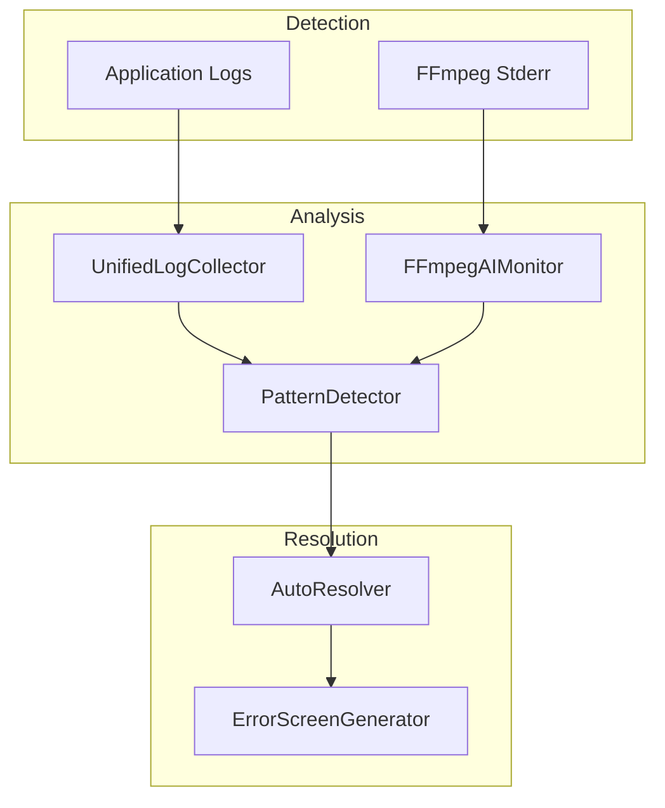

### Configuration

Add to your `config.yaml`:

```yaml
ai_auto_heal:
  enabled: true
  
  # Log collection
  log_buffer_minutes: 30
  realtime_streaming: true
  
  # FFmpeg monitoring
  ffmpeg_monitor_enabled: true
  ffmpeg_health_threshold: 0.8  # Speed threshold for healthy
  
  # Pattern detection
  pattern_detection_enabled: true
  prediction_confidence_threshold: 0.75
  
  # Auto resolution
  auto_resolve_enabled: true
  max_auto_fixes_per_hour: 50
  require_approval_above_risk: "MEDIUM"  # SAFE, LOW, MEDIUM, HIGH
  
  # Zero-downtime features
  use_error_screen_fallback: true
  hot_swap_enabled: true
  
  # Learning
  learning_enabled: true
```

### Components

#### 1. Unified Log Collector

Aggregates logs from all sources in real-time:

- Application logs
- FFmpeg stderr
- Plex/Jellyfin events
- System logs

```python
# Access log collector
from exstreamtv.ai_agent.unified_log_collector import get_log_collector

collector = get_log_collector()

# Get recent errors
errors = collector.get_recent_errors(minutes=60)

# Get context window for a channel
context = collector.get_context_window(channel_id=1, minutes=5)
```

#### 2. FFmpeg AI Monitor

Monitors FFmpeg processes for issues:

| Metric | Description | Healthy Range |
|--------|-------------|---------------|
| FPS | Frames per second | 25-30 |
| Speed | Encoding speed | 0.95-1.1x |
| Bitrate | Output bitrate | Target ±20% |
| Dropped Frames | Frame drops | < 10/minute |

#### 3. Pattern Detector

Detects known problematic patterns:

| Pattern | Indicators | Risk Level |
|---------|------------|------------|
| DB Pool Exhaustion | "pool exhausted", "connection timeout" | HIGH |
| FFmpeg Degradation | "speed < 1.0x", "dropping frames" | MEDIUM |
| URL Expiration | "403 forbidden", "token expired" | MEDIUM |
| Network Instability | "connection reset", "timeout" | HIGH |
| Memory Pressure | "out of memory" | CRITICAL |

#### 4. Auto Resolver

Automatically resolves detected issues:

| Issue Type | Strategy | Downtime |
|------------|----------|----------|
| FFmpeg Hang | Restart | ~2 sec |
| URL Expired | Refresh | 0 sec |
| DB Pool Exhausted | Expand | 0 sec |
| Source Unavailable | Fallback | 0 sec |

### Error Screen Fallback

During issue resolution, clients receive an error screen instead of a broken stream:

```yaml
# Visual modes: text, static, test_pattern, slate
# Audio modes: silent, sine_wave, white_noise, beep

ai_auto_heal:
  use_error_screen_fallback: true
```

### Monitoring AI Health

Check the AI system status:

```bash
# Via API
curl http://localhost:8411/api/ai/health

# Via WebUI
# Navigate to Settings > AI > Health Status
```

### Risk Levels

Configure which fixes require approval:

| Risk Level | Example Fixes | Default Behavior |
|------------|---------------|------------------|
| SAFE | Refresh URL, Switch fallback | Auto-apply |
| LOW | Expand pool, Restart channel | Auto-apply |
| MEDIUM | Reduce load, Kill process | Requires approval |
| HIGH | Full restart, Database restore | Requires approval |

---

## Database Backup (NEW in v2.6.0)

EXStreamTV now includes automatic database backup:

```yaml
database_backup:
  enabled: true
  backup_directory: "backups"
  interval_hours: 24      # Backup every 24 hours
  keep_count: 7           # Keep 7 most recent
  keep_days: 30           # Delete older than 30 days
  compress: true          # Gzip compression
```

### Manual Backup

```bash
# Via API
curl -X POST http://localhost:8411/api/database/backup

# Via WebUI
# Navigate to Settings > Database > Create Backup
```

---

## Next Steps

- [Quick Start Guide](QUICK_START.md) - Create your first channel
- [Onboarding Guide](ONBOARDING.md) - Complete setup wizard
- [macOS App Guide](MACOS_APP_GUIDE.md) - Use the menu bar app
- [Tunarr/dizqueTV Integration](Tunarr-DizqueTV-Integration) - v2.6.0 technical details
**Last Revised:** 2026-03-20


---

## Wiki page: Channel Creation Guide

*Source: [`EXStreamTV.wiki/Channel-Creation-Guide.md`](https://github.com/roto31/EXStreamTV/wiki/Channel-Creation-Guide)*

# Channel Creation Guide

A comprehensive guide to creating TV channels in EXStreamTV, from the simplest setup to advanced multi-block scheduled programming.

## Table of Contents

1. [Introduction](#introduction)
2. [Quick Start: Your First Channel in 5 Minutes](#quick-start-your-first-channel-in-5-minutes)
3. [Method 1: Basic Manual Channel](#method-1-basic-manual-channel)
4. [Method 2: AI-Powered Channel Creation](#method-2-ai-powered-channel-creation)
5. [Method 3: Scheduled Channel](#method-3-scheduled-channel)
6. [Method 4: Advanced Multi-Block Channel](#method-4-advanced-multi-block-channel)
7. [Method 5: Import and Customize](#method-5-import-and-customize)
8. [Best Practices](#best-practices)
9. [Troubleshooting](#troubleshooting)

---

## Introduction

### What is a Channel in EXStreamTV?

A channel in EXStreamTV represents a continuous stream of video content, similar to a traditional TV channel. Each channel consists of:

- **Content Source** - Where your media comes from (playlists, collections, or individual items)
- **Schedule** (optional) - Rules for when specific content plays
- **Playout** - The active playback configuration
- **Branding** (optional) - Logos, watermarks, and overlays

### Channel Components

```
Channel
├── Basic Info (name, number, logo, group)
├── Content
│   ├── Playlist (ordered list of items)
│   └── Collection (filtered set of media)
├── Schedule (optional)
│   ├── Time Blocks
│   ├── Recurring Patterns
│   └── Filler/Commercials
├── Playout
│   ├── Mode (continuous, scheduled, loop)
│   └── Anchor Points
└── Deco (optional)
    ├── Watermarks
    └── Bumpers
```

### Choosing the Right Method

| Method | Complexity | Best For |
|--------|------------|----------|
| Quick Start | Beginner | Single playlist, continuous playback |
| Basic Manual | Beginner | Simple channel with custom settings |
| AI-Powered | Intermediate | Complex themed channels, scheduling help |
| Scheduled | Intermediate | Time-based programming |
| Multi-Block | Advanced | Full broadcast-style scheduling |
| Import | Varies | Migration from other platforms |

---

## Quick Start: Your First Channel in 5 Minutes

Get a channel up and running as fast as possible.


*Animated walkthrough of the basic channel creation process*

### Prerequisites

- At least one media source connected (Plex, Jellyfin, or local folder)
- Some media scanned into the system

### Step-by-Step

**Step 1: Navigate to Channels**

Go to **Channels > Manage Channels** in the sidebar.


*The channels management page showing the toolbar with Add Channel and AI Create buttons*

**Step 2: Click Add Channel**

Click the **Add Channel** button in the toolbar. You'll see both "Add Channel" for manual creation and "AI Create" for guided setup.


*The Create Channel dialog with empty form fields*

**Step 3: Fill Basic Information**


*Example: Creating "Classic Movies" channel (101) in the Entertainment group*

- **Channel Number**: Enter a number (e.g., "101")
- **Channel Name**: Give it a name (e.g., "Movies")
- **Group**: Optional category (e.g., "Entertainment")

**Step 4: Select Content**

Under "Content Source," choose:
- **Playlist**: Select an existing playlist, OR
- **Collection**: Choose a collection, OR
- **Quick Setup**: The system will create a playlist for you

**Step 5: Save and Enable**

1. Click **Save** to create the channel
2. Toggle the channel to **Enabled**
3. Your channel is now streaming!

### Test Your Channel

1. Go to **Player** in the sidebar
2. Select your new channel from the dropdown
3. Press play to verify it works

**Congratulations!** You've created your first channel.

---

## Method 1: Basic Manual Channel

For more control over channel settings while keeping things simple.

### When to Use

- You want a single collection or playlist to play continuously
- No complex scheduling needed
- Simple 24/7 playback of similar content

### Step-by-Step Guide

#### 1. Prepare Your Content

Before creating the channel, organize your content:

1. Go to **Content > Playlists** or **Content > Collections**
2. Create a new playlist/collection if needed
3. Add media items to your playlist

**Tip**: Playlists maintain order, collections are more dynamic.

#### 2. Create the Channel

1. Navigate to **Channels > Manage Channels**
2. Click **Add Channel**
3. Fill in the form:

| Field | Description | Example |
|-------|-------------|---------|
| Number | Unique channel number | 201 |
| Name | Display name | Classic Movies |
| Group | Category for organization | Movies |
| Logo | Upload or URL to channel logo | (optional) |
| Enabled | Whether channel is active | On |

#### 3. Configure Content Source

- **Playlist Mode**: Choose an existing playlist for ordered playback
- **Collection Mode**: Select a collection for dynamic content
- **Playback Order**: Chronological, random, or shuffle

#### 4. Set Playback Options

- **Continuous**: Plays forever, looping when content ends
- **Keep Position**: Remember where viewers left off
- **Episode Tracking**: For TV shows, track episode progression

#### 5. Save and Test

1. Click **Save**
2. Enable the channel if not already enabled
3. Go to **Player** and test playback

### Best Practices for Basic Channels

- **Name clearly**: Use descriptive names like "80s Action Movies"
- **Group logically**: Use groups to organize similar channels
- **Add a logo**: Channels with logos look more professional
- **Test playback**: Always verify your channel works before sharing

---

## Method 2: AI-Powered Channel Creation

Use the AI Channel Creator for guided setup with expert personas specialized in different content types.


*Animated preview of the AI Channel Creator interface*

### When to Use

- You want guidance on channel setup
- Creating themed channels (e.g., "1970s Nostalgia")
- Need help with scheduling and commercial breaks
- Want best practices built-in

### Accessing AI Create

1. Go to **Channels > AI Create Channel**, OR
2. Click **AI Create** in the channels toolbar, OR
3. Use the **AI Create** quick action from the dashboard


*The AI Channel Creator with expert persona selection*


*Choose from 6 expert personas, each specialized in different content types*

### Available Expert Personas

Choose from specialized AI experts for different content types:

| Persona | Specialty | Best For |
|---------|-----------|----------|
| Max Sterling | TV Programming Executive | Classic TV, scheduling, dayparts |
| Howard Kowalski | Sports Savant | Sports, classic games, documentaries |
| Steve Nakamura | Tech Savant | Technology, Apple, computing |
| Vincent & Clara | Movie Critics | Films, film history, directors |
| Professor Chen | Kids Programming | Children, Disney, animation |
| Dr. Eleanor Marsh | PBS Expert | Documentary, educational, PBS |

### How It Works

You'll chat with your selected expert, who will:

- Asks questions about your channel concept
- Suggests scheduling approaches
- Recommends content organization
- Handles technical configuration

### Example Conversation

**You**: "I want a 1970s and 1980s TV channel with commercials"

**Max**: "Ah, the golden age of television! Let me ask you a few questions:

1. What's your content library situation? Do you have TV shows from Plex?
2. Are you looking for a 24-hour schedule or specific dayparts?
3. Should we include Saturday morning cartoons?
4. Any particular genres you want to emphasize?"

**You**: "I have Plex with classic TV shows. I want 24-hour with Saturday cartoons. Primetime should be dramas and comedies."

**Max**: "Perfect! Here's how I'd structure this..."

### The AI Process

1. **Describe Your Vision**: Tell the AI what kind of channel you want
2. **Answer Questions**: The AI asks clarifying questions
3. **Review Specification**: See a preview of the channel structure
4. **Create Channel**: Let the AI build everything for you

The right panel shows a live preview of your channel specification as you chat, updating in real-time as Max gathers information about your preferences.

### AI-Created Components

The AI can automatically create:

- The channel with proper settings
- Smart collections for content filtering
- Schedules with daypart assignments
- Filler presets for commercials
- Playout configuration

### Tips for AI Channel Creation

- **Be specific about eras**: "1970s-1980s" works better than "old"
- **Describe your library**: Tell the AI what content you have
- **Mention preferences**: Commercials, start times, special blocks
- **Ask for suggestions**: The AI knows classic TV programming patterns

---

## Method 3: Scheduled Channel

Create channels with time-based programming.


*Overview of the scheduling interface*

### When to Use

- Different content at different times of day
- Specific shows at specific times
- Weekly programming patterns
- More broadcast-like experience

### Understanding Schedules

A schedule defines WHEN content plays:

```
Schedule
├── Monday-Friday
│   ├── 6:00 AM - Morning News
│   ├── 9:00 AM - Talk Shows
│   ├── 12:00 PM - Soap Operas
│   ├── 6:00 PM - Evening News
│   └── 8:00 PM - Primetime Dramas
└── Saturday
    ├── 8:00 AM - Cartoons
    └── 8:00 PM - Movies
```

### Step-by-Step

#### 1. Create a Schedule

1. Go to **Scheduling > Schedules**
2. Click **Add Schedule**
3. Give it a descriptive name (e.g., "Classic TV Daily Schedule")


*The Schedules management page with Add Schedule button*


*The Create Schedule dialog with options for multi-part episodes and shuffle settings*

#### 2. Add Schedule Items

For each time slot:

1. Click **Add Item**
2. Set the **Start Time**
3. Choose the **Content Source** (collection/playlist)
4. Set **Duration** or let it auto-calculate
5. Configure playback options

#### 3. Configure Recurring Patterns

- **Daily**: Same schedule every day
- **Weekdays**: Monday-Friday only
- **Weekends**: Saturday-Sunday only
- **Specific Days**: Choose individual days

#### 4. Create the Channel

1. Go to **Channels > Manage Channels**
2. Create a new channel
3. Under Playout settings, select **Scheduled Mode**
4. Choose your created schedule

#### 5. Create a Playout

1. Go to **Scheduling > Playouts**
2. Click **Create Playout**
3. Link your channel and schedule
4. Set to **Active**

### Schedule Tips

- **Plan on paper first**: Sketch your schedule before building
- **Use collections**: Easier to manage than individual items
- **Buffer time**: Add a few minutes between shows for flexibility
- **Test transitions**: Make sure shows switch correctly

---

## Method 4: Advanced Multi-Block Channel

Full broadcast-style channel with blocks, filler, and branding.

### When to Use

- Replicating traditional TV experience
- Complex programming with commercials
- Multiple themed blocks per day
- Professional presentation with branding

### Architecture Overview

```
Channel: "Retro TV"
├── Schedule: "Retro TV Master Schedule"
│   ├── Morning Block
│   │   ├── 6:00 - Wake Up Cartoons
│   │   └── Commercial Break (Filler Preset A)
│   ├── Daytime Block
│   │   ├── 9:00 - Game Shows
│   │   ├── 12:00 - Soaps
│   │   └── Commercial Breaks (Filler Preset B)
│   └── Primetime Block
│       ├── 8:00 - Drama Hour
│       ├── 9:00 - Comedy Block
│       └── Commercial Breaks (Filler Preset C)
├── Filler Presets
│   ├── Preset A: Short breaks (30 sec)
│   ├── Preset B: Standard breaks (2 min)
│   └── Preset C: Long breaks (3 min)
└── Deco
    ├── Channel Watermark (logo)
    └── Bumpers (station ID)
```

### Building It Step by Step

#### Phase 1: Organize Your Content

1. **Create Collections** by genre and era:
   - "70s-80s Cartoons"
   - "Classic Game Shows"
   - "Daytime Soaps"
   - "Primetime Dramas"
   - "Sitcoms"

2. **Create a Filler Collection** for commercials:
   - Archive.org Prelinger collection
   - Custom bumpers/promos

#### Phase 2: Create Programming Blocks

1. Go to **Scheduling > Blocks**
2. Create blocks for each daypart:


*The Blocks management page for creating time-based programming blocks*

**Morning Cartoon Block**
- Name: "Saturday Morning Cartoons"
- Duration: 4 hours
- Source: "70s-80s Cartoons" collection
- Shuffle: Yes

**Primetime Drama Block**
- Name: "Drama Hour"
- Duration: 1 hour
- Source: "Primetime Dramas" collection
- Shuffle: No (chronological)

#### Phase 3: Configure Filler Presets

1. Go to **Scheduling > Filler Presets**
2. Create presets for different contexts:


*The Filler Presets page for configuring commercial breaks and filler content*

**Standard Commercial Break**
- Duration: 2 minutes
- Frequency: Every 15 minutes
- Source: Filler collection
- Shuffle: Yes

#### Phase 4: Build the Schedule

1. Go to **Scheduling > Templates** (optional: create reusable template)


*The Templates page for creating reusable schedule patterns*

2. Go to **Scheduling > Schedules**
3. Create master schedule
4. Add blocks and filler:

```
6:00 AM - Morning Block
  → Insert Filler Preset: Short Breaks
9:00 AM - Daytime Block
  → Insert Filler Preset: Standard Breaks
8:00 PM - Primetime Block
  → Insert Filler Preset: Long Breaks
11:00 PM - Late Night
  → Movies with minimal breaks
```

#### Phase 5: Add Branding (Deco)

1. Go to **Scheduling > Deco**


*The Deco page for bumpers, station IDs, and promotional content*

2. Create channel watermark:
   - Upload logo image
   - Position: Bottom-right
   - Opacity: 70%

3. Create station ID bumpers:
   - 5-second clips between shows
   - "You're watching Retro TV"

#### Phase 6: Connect Everything

1. Create the channel at **Channels > Manage Channels**
2. Create playout at **Scheduling > Playouts**:
   - Link channel to schedule
   - Enable filler presets
   - Enable deco

#### Phase 7: Test Thoroughly

1. Use **Diagnostics > Test Stream**
2. Verify:
   - Content plays in correct order
   - Commercial breaks insert properly
   - Watermark displays correctly
   - Bumpers play between shows

### Advanced Tips

- **Use templates**: Create schedule templates for consistency
- **Time alignment**: Set shows to start on the hour or half-hour
- **Vary filler**: Mix commercial lengths for authenticity
- **Preview schedule**: Check the visual timeline before going live

---

## Method 5: Import and Customize

Migrate from other platforms or M3U sources.


*The Import Channels page for importing from YAML configuration files*

### Importing from ErsatzTV

1. Go to **Channels > Import Channels**
2. Select **ErsatzTV** as source
3. Provide your ErsatzTV database or export file
4. Map channels to local media sources
5. Review and import

### Importing from M3U

1. Go to **Channels > Import M3U**
2. Paste your M3U playlist URL or content
3. Configure import options:


*The Import M3U page for importing from M3U playlists or the curated stream library*
   - Channel number assignment
   - Group mapping
   - Logo handling
4. Review channels before import
5. Click **Import**

### Post-Import Customization

After importing, you may want to:

- Update channel logos
- Reassign content sources to local media
- Adjust channel numbers
- Modify playback settings

---

## Best Practices

### Content Organization

1. **Use descriptive names**: "80s Action Movies" not "Movies 1"
2. **Create smart collections**: Filter by genre, year, rating
3. **Separate content types**: Don't mix movies and TV episodes
4. **Maintain metadata**: Good metadata = better filtering

### Schedule Design

1. **Know your dayparts**: 
   - Morning (6-9 AM): Light content
   - Daytime (9 AM-5 PM): Talk shows, soaps
   - Early fringe (5-8 PM): Transition content
   - Primetime (8-11 PM): Best content
   - Late night (11 PM+): Movies, adult content

2. **Lead-in strategy**: Put popular shows before new content
3. **Consistent timing**: Start shows at predictable times
4. **Genre flow**: Similar content should flow together

### Commercial Breaks

1. **Period-appropriate**: Match commercials to content era
2. **Varied length**: 30 seconds to 3 minutes
3. **Natural breaks**: Insert at logical story breaks
4. **Don't overdo it**: 8-12 minutes per hour maximum

### Performance

1. **Test before publishing**: Always verify playback
2. **Monitor resources**: Watch CPU/memory during transcoding
3. **Use hardware acceleration**: Enable GPU encoding if available
4. **Optimize source files**: Pre-transcode if possible

### Channel Maintenance

1. **Refresh content**: Update collections regularly
2. **Monitor playback**: Check logs for errors
3. **Update schedules**: Seasonal or holiday changes
4. **Backup configuration**: Export settings regularly

---

## Troubleshooting

### Channel Not Playing

**Symptoms**: Black screen, buffering, or error message

**Check**:
1. Is the channel enabled?
2. Is the playout active?
3. Does the content source have items?
4. Are media files accessible?

**Fix**:
- Enable channel and playout
- Verify playlist/collection has content
- Check media source connectivity
- Review streaming logs for errors

### Content Not Appearing

**Symptoms**: Empty playlist, missing items

**Check**:
1. Is the media source connected?
2. Has the library been scanned?
3. Are collection filters correct?

**Fix**:
- Refresh media source
- Rescan libraries
- Adjust collection filter criteria

### Schedule Not Following

**Symptoms**: Wrong content at wrong times

**Check**:
1. Is the schedule linked to the channel?
2. Are schedule items correctly configured?
3. Is the time zone correct?

**Fix**:
- Verify playout connects schedule to channel
- Check schedule item times
- Verify server time zone setting

### AI Not Responding

**Symptoms**: AI Channel Creator not working

**Check**:
1. Is Ollama installed and running?
2. Is the AI model downloaded?
3. Check Diagnostics > AI Troubleshooting

**Fix**:
- Install Ollama following the guide
- Download required AI model
- Check Ollama connection in settings

### Using AI Troubleshooting

For persistent issues:

1. Go to **Diagnostics > AI Troubleshooting**
2. Describe your problem
3. Include relevant error messages
4. The AI will analyze and suggest fixes

---

## Next Steps

After creating your first channels:

1. **Set up HDHomeRun** - Share channels with TV apps
2. **Configure EPG** - Electronic program guide for clients
3. **Add more sources** - Connect additional media libraries
4. **Explore scheduling** - Try more complex programming

---

*Last updated: January 2026*

**Last Revised:** 2026-03-20


---

## Wiki page: Local Media

*Source: [`EXStreamTV.wiki/Local-Media.md`](https://github.com/roto31/EXStreamTV/wiki/Local-Media)*

# Local Media Setup Guide

Connect your local media libraries to EXStreamTV for organized, scheduled playback.

## Table of Contents

- [Overview](#overview)
- [Supported Library Types](#supported-library-types)
- [Local Folder Library](#local-folder-library)
- [Plex Integration](#plex-integration)
- [Jellyfin Integration](#jellyfin-integration)
- [Emby Integration](#emby-integration)
- [Media Organization](#media-organization)
- [Metadata Management](#metadata-management)
- [Scanning and Syncing](#scanning-and-syncing)
- [Troubleshooting](#troubleshooting)

---

## Overview

EXStreamTV can stream content from multiple sources:

- **Local folders** - Direct access to video files on your system
- **Plex** - Connect to your Plex Media Server
- **Jellyfin** - Connect to your Jellyfin server
- **Emby** - Connect to your Emby server

Each library is scanned and indexed, allowing you to:
- Browse and search your media
- Create playlists and schedules
- Generate rich EPG data with metadata
- Stream in various qualities

---

## Supported Library Types

| Source | Movies | TV Shows | Music Videos | Live TV |
|--------|--------|----------|--------------|---------|
| Local Folder | ✅ | ✅ | ✅ | ❌ |
| Plex | ✅ | ✅ | ✅ | ✅ |
| Jellyfin | ✅ | ✅ | ✅ | ✅ |
| Emby | ✅ | ✅ | ✅ | ✅ |

### Supported Video Formats

EXStreamTV supports any format FFmpeg can handle:

- **Containers**: MP4, MKV, AVI, MOV, WMV, FLV, WebM, M2TS
- **Video Codecs**: H.264, H.265/HEVC, VP9, AV1, MPEG-2, MPEG-4
- **Audio Codecs**: AAC, AC3, EAC3, DTS, FLAC, MP3, Opus

---

## Local Folder Library

The simplest way to add media—point EXStreamTV at a folder.

### Adding a Local Library

**Via Web UI:**

1. Go to **Libraries** in the sidebar
2. Click **+ Add Library**
3. Select **Local Folder**
4. Enter details:
   - **Name**: `Movies` or descriptive name
   - **Path**: `/path/to/your/media`
   - **Media Type**: Movies, TV Shows, or Mixed
5. Click **Save**
6. Click **Scan** to discover media

**Via API:**

```bash
curl -X POST http://localhost:8411/api/libraries \
  -H "Content-Type: application/json" \
  -d '{
    "name": "Movies",
    "library_type": "local",
    "path": "/media/movies",
    "media_type": "movie"
  }'
```

### Local Library Settings

| Setting | Description | Default |
|---------|-------------|---------|
| Path | Root folder path | Required |
| Media Type | movie, show, mixed | mixed |
| File Extensions | Extensions to scan | mp4,mkv,avi,mov |
| Scan Interval | Hours between scans | 24 |
| Recursive | Scan subdirectories | true |

### File Organization

For best results, organize your files:

**Movies:**
```
/media/movies/
├── Movie Name (2024)/
│   ├── Movie Name (2024).mkv
│   └── Movie Name (2024).nfo    # Optional metadata
├── Another Movie (2023).mp4
```

**TV Shows:**
```
/media/tv/
├── Show Name/
│   ├── Season 01/
│   │   ├── Show Name - S01E01 - Episode Title.mkv
│   │   ├── Show Name - S01E02 - Episode Title.mkv
│   ├── Season 02/
│   │   ├── Show Name - S02E01 - Episode Title.mkv
```

---

## Plex Integration

Connect your Plex Media Server for seamless library access.

### Prerequisites

- Plex Media Server running and accessible
- Plex authentication token

### Getting Your Plex Token

**Option 1: From Plex Web**

1. Open Plex Web App
2. Play any media
3. Open browser developer tools (F12)
4. Go to **Network** tab
5. Look for requests to `plex.tv`
6. Find `X-Plex-Token` in headers

**Option 2: Via API**

```bash
curl -X POST 'https://plex.tv/users/sign_in.json' \
  -H 'X-Plex-Client-Identifier: EXStreamTV' \
  -d 'user[login]=your_email&user[password]=your_password'
```

### Adding Plex Library

**Via Web UI:**

1. Go to **Libraries** → **+ Add Library**
2. Select **Plex**
3. Enter connection details:
   - **Server URL**: `http://192.168.1.100:32400`
   - **Token**: Your Plex token
4. Click **Discover Libraries**
5. Select libraries to sync
6. Click **Save**

**Via API:**

```bash
curl -X POST http://localhost:8411/api/libraries \
  -H "Content-Type: application/json" \
  -d '{
    "name": "Plex Movies",
    "library_type": "plex",
    "server_url": "http://192.168.1.100:32400",
    "token": "your-plex-token",
    "library_key": "1"
  }'
```

### Plex Features

- **Direct Play**: Stream optimized versions from Plex
- **Transcoding**: Use Plex's transcoding or EXStreamTV's
- **Metadata Sync**: Import Plex's rich metadata
- **Watch State**: Respect Plex's watched status (optional)

### Plex Settings

| Setting | Description |
|---------|-------------|
| Server URL | Plex server address |
| Token | Authentication token |
| Use Direct Play | Stream directly vs transcode |
| Sync Metadata | Import Plex metadata |
| Sync Collections | Import Plex collections |

---

## Jellyfin Integration

Connect to your Jellyfin server for free, open-source media management.

### Prerequisites

- Jellyfin server running
- API key or user credentials

### Getting Your Jellyfin API Key

1. Open Jellyfin Dashboard
2. Go to **Administration** → **API Keys**
3. Click **+** to create new key
4. Name it `EXStreamTV`
5. Copy the generated key

### Adding Jellyfin Library

**Via Web UI:**

1. Go to **Libraries** → **+ Add Library**
2. Select **Jellyfin**
3. Enter details:
   - **Server URL**: `http://192.168.1.100:8096`
   - **API Key**: Your Jellyfin API key
4. Click **Discover Libraries**
5. Select libraries to sync
6. Click **Save**

**Via API:**

```bash
curl -X POST http://localhost:8411/api/libraries \
  -H "Content-Type: application/json" \
  -d '{
    "name": "Jellyfin TV",
    "library_type": "jellyfin",
    "server_url": "http://192.168.1.100:8096",
    "api_key": "your-jellyfin-api-key",
    "user_id": "optional-user-id"
  }'
```

### Jellyfin Settings

| Setting | Description |
|---------|-------------|
| Server URL | Jellyfin server address |
| API Key | Authentication key |
| User ID | Specific user (optional) |
| Include Special Features | Import extras/featurettes |

---

## Emby Integration

Connect to your Emby server with similar functionality to Jellyfin.

### Prerequisites

- Emby server running
- API key

### Getting Your Emby API Key

1. Open Emby Dashboard
2. Go to **Advanced** → **Security**
3. Under **Api Keys**, click **New Api Key**
4. Name it `EXStreamTV`
5. Copy the key

### Adding Emby Library

**Via Web UI:**

1. Go to **Libraries** → **+ Add Library**
2. Select **Emby**
3. Enter details:
   - **Server URL**: `http://192.168.1.100:8096`
   - **API Key**: Your Emby API key
4. Click **Discover Libraries**
5. Select libraries to sync
6. Click **Save**

---

## Media Organization

### Automatic Recognition

EXStreamTV uses multiple methods to identify media:

1. **Filename Parsing**: Extracts title, year, season, episode
2. **NFO Files**: Reads Kodi-compatible metadata files
3. **Online Lookup**: Queries TMDB, TVDB for matches
4. **Folder Structure**: Infers organization from paths

### Naming Conventions

For best automatic recognition:

**Movies:**
```
Movie Title (Year).ext
Movie Title (Year) - Quality.ext
```

Examples:
```
The Matrix (1999).mkv
Inception (2010) - 1080p BluRay.mkv
```

**TV Shows:**
```
Show Name - S##E## - Episode Title.ext
Show.Name.S##E##.Episode.Title.ext
```

Examples:
```
Breaking Bad - S01E01 - Pilot.mkv
Game.of.Thrones.S08E06.The.Iron.Throne.mkv
```

### Collections

Group related content automatically:

- Movie franchises (Marvel, Star Wars)
- TV show seasons
- Custom collections

Create collections in **Libraries** → **Collections**.

---

## Metadata Management

### Metadata Sources

EXStreamTV fetches metadata from:

| Source | Movies | TV Shows | Priority |
|--------|--------|----------|----------|
| NFO Files | ✅ | ✅ | 1 (highest) |
| TMDB | ✅ | ✅ | 2 |
| TVDB | ❌ | ✅ | 3 |
| Embedded | ✅ | ✅ | 4 |

### NFO File Support

Create `.nfo` files alongside your media for manual metadata:

**Movie NFO:**
```xml
<?xml version="1.0" encoding="UTF-8"?>
<movie>
  <title>Movie Title</title>
  <year>2024</year>
  <plot>Movie description goes here...</plot>
  <genre>Action</genre>
  <genre>Thriller</genre>
  <rating>8.5</rating>
  <runtime>120</runtime>
  <thumb>poster.jpg</thumb>
</movie>
```

**TV Show NFO:**
```xml
<?xml version="1.0" encoding="UTF-8"?>
<tvshow>
  <title>Show Name</title>
  <year>2020</year>
  <plot>Show description...</plot>
  <genre>Drama</genre>
</tvshow>
```

### Refreshing Metadata

1. Go to **Libraries**
2. Select a library
3. Click **Refresh Metadata**

Or for individual items:
1. Go to **Browse** → Find the item
2. Click the menu (⋮) → **Refresh Metadata**

### API Keys for Metadata

Configure API keys in **Settings** → **Metadata**:

- **TMDB API Key**: Get from [themoviedb.org](https://www.themoviedb.org/settings/api)
- **TVDB API Key**: Get from [thetvdb.com](https://thetvdb.com/dashboard/account/apikey)

---

## Scanning and Syncing

### Manual Scan

**Single Library:**
1. Go to **Libraries**
2. Find the library
3. Click **Scan**

**All Libraries:**
1. Go to **Settings** → **Libraries**
2. Click **Scan All Libraries**

### Automatic Scanning

Configure scan intervals:

```yaml
# config.yaml
libraries:
  scan_on_startup: true
  scan_interval_hours: 24
  watch_for_changes: true  # File system watcher
```

### Scan Status

Monitor scan progress:
- View in **Libraries** → Library card shows progress
- Check **System Monitor** for background tasks
- API: `GET /api/libraries/{id}/scan/status`

### Syncing from Plex/Jellyfin

When connected to external servers:

1. **Initial Sync**: Full library import
2. **Incremental Sync**: Only changes synced
3. **Metadata Refresh**: Updates from server

Configure in library settings:
- **Sync Interval**: How often to check for changes
- **Sync Watched State**: Track what's been played

---

## Troubleshooting

### Library Not Showing Content

**Check path permissions:**
```bash
ls -la /path/to/media
```

**Verify file extensions:**
- Default: `.mp4, .mkv, .avi, .mov`
- Add custom extensions in library settings

**Check scan logs:**
1. Go to **Settings** → **Logs**
2. Filter by "scan" or library name

### Plex Connection Failed

- Verify Plex is running: `http://your-plex-ip:32400`
- Check token is valid
- Ensure EXStreamTV can reach Plex (firewall)
- Try: `curl -H "X-Plex-Token: YOUR_TOKEN" http://plex:32400/identity`

### Jellyfin/Emby Connection Issues

- Verify server URL (including port)
- Check API key has correct permissions
- Test: `curl -H "X-Emby-Token: YOUR_KEY" http://server:8096/System/Info`

### Missing Metadata

1. Check internet connectivity
2. Verify API keys are configured
3. Manually refresh: Library → Item → Refresh Metadata
4. Check filename matches expected format

### Slow Scanning

- Reduce concurrent scans in settings
- Disable FFprobe analysis for initial scan
- Use SSD for database storage
- Exclude unnecessary directories

### Duplicate Items

- Check for multiple library paths pointing to same content
- Remove overlapping library configurations
- Use **Libraries** → **Deduplicate** tool

---

## Best Practices

1. **Organize files properly** - Use standard naming conventions
2. **Use NFO files** - For custom or corrected metadata
3. **Configure API keys** - Enable rich metadata lookup
4. **Regular scans** - Keep library in sync with files
5. **Monitor logs** - Catch issues early

---

## See Also

- [Quick Start Guide](QUICK_START.md)
- [Hardware Transcoding](HW_TRANSCODING.md)
- [API Reference](API-Reference)

**Last Revised:** 2026-03-20


---

## Wiki page: Hardware Transcoding

*Source: [`EXStreamTV.wiki/Hardware-Transcoding.md`](https://github.com/roto31/EXStreamTV/wiki/Hardware-Transcoding)*

# Hardware Transcoding Guide

Leverage your GPU for efficient video transcoding with significantly reduced CPU usage.

## Table of Contents

- [Overview](#overview)
- [Supported Hardware](#supported-hardware)
- [macOS VideoToolbox](#macos-videotoolbox)
- [NVIDIA NVENC](#nvidia-nvenc)
- [Intel Quick Sync (QSV)](#intel-quick-sync-qsv)
- [AMD AMF/VCE](#amd-amfvce)
- [Linux VAAPI](#linux-vaapi)
- [FFmpeg Profiles](#ffmpeg-profiles)
- [Performance Tuning](#performance-tuning)
- [Troubleshooting](#troubleshooting)

---

## Overview

Hardware transcoding uses your GPU's dedicated video processing unit instead of the CPU. Benefits include:

- **Lower CPU usage** - Free up CPU for other tasks
- **Higher throughput** - Transcode multiple streams simultaneously
- **Reduced power consumption** - GPUs are more efficient for video
- **Cooler operation** - Less heat generated

### Quality Comparison

| Method | Speed | Quality | Power Usage |
|--------|-------|---------|-------------|
| Software (libx264) | Slow | Excellent | High |
| NVENC | Fast | Very Good | Low |
| QSV | Fast | Good | Very Low |
| VideoToolbox | Fast | Very Good | Low |
| VAAPI | Fast | Good | Low |
| AMF | Fast | Good | Low |

---

## Supported Hardware

### Quick Compatibility Check

```bash
# Check available encoders in FFmpeg
ffmpeg -encoders 2>/dev/null | grep -E "h264|hevc"
```

Look for these encoder names:

| Hardware | H.264 Encoder | HEVC Encoder |
|----------|--------------|--------------|
| macOS | `h264_videotoolbox` | `hevc_videotoolbox` |
| NVIDIA | `h264_nvenc` | `hevc_nvenc` |
| Intel | `h264_qsv` | `hevc_qsv` |
| AMD | `h264_amf` | `hevc_amf` |
| Linux/VAAPI | `h264_vaapi` | `hevc_vaapi` |

---

## macOS VideoToolbox

VideoToolbox is Apple's hardware acceleration framework, available on all modern Macs.

### Requirements

- macOS 10.13 or later
- Any Mac with Intel HD Graphics 4000+ or Apple Silicon

### Verification

```bash
# Check for VideoToolbox support
ffmpeg -encoders | grep videotoolbox
```

Expected output:
```
V....D h264_videotoolbox    VideoToolbox H.264 Encoder (codec h264)
V....D hevc_videotoolbox    VideoToolbox HEVC Encoder (codec hevc)
```

### Configuration

In EXStreamTV, VideoToolbox is automatically detected and used. To force it:

```yaml
# config.yaml
transcoding:
  hardware_acceleration: videotoolbox
  encoder: h264_videotoolbox
  decoder: h264  # or h264_videotoolbox for full HW pipeline
```

### Recommended Settings

```yaml
transcoding:
  hardware_acceleration: videotoolbox
  profile: high
  level: 4.1
  bitrate: 8M
  options:
    realtime: true
    allow_sw: false  # Fail if HW not available
```

### Apple Silicon Notes

On M1/M2/M3 Macs:
- Both encoding and decoding are hardware accelerated
- H.264 and HEVC are fully supported
- HDR tonemapping works in software

---

## NVIDIA NVENC

NVIDIA's dedicated hardware encoder, available on GeForce GTX 600+ and all RTX cards.

### Requirements

- NVIDIA GPU (GTX 600 series or newer)
- NVIDIA Driver 418.81+ (Windows/Linux)
- CUDA Toolkit (optional, for CUDA filters)

### Verification

```bash
# Check NVIDIA driver
nvidia-smi

# Check for NVENC support
ffmpeg -encoders | grep nvenc
```

Expected output:
```
V....D h264_nvenc           NVIDIA NVENC H.264 encoder (codec h264)
V....D hevc_nvenc           NVIDIA NVENC HEVC encoder (codec hevc)
```

### Configuration

```yaml
# config.yaml
transcoding:
  hardware_acceleration: nvenc
  encoder: h264_nvenc
  decoder: h264_cuvid  # Hardware decoding
```

### Recommended Settings

```yaml
transcoding:
  hardware_acceleration: nvenc
  encoder: h264_nvenc
  preset: p4  # p1 (fastest) to p7 (best quality)
  tune: ll    # Low latency for streaming
  rc: vbr    # Rate control: cbr, vbr, cq
  bitrate: 8M
  maxrate: 12M
  bufsize: 16M
  options:
    b_adapt: 0       # Disable B-frame adaptation for low latency
    spatial_aq: 1    # Enable spatial adaptive quantization
    temporal_aq: 1   # Enable temporal adaptive quantization
    rc-lookahead: 20
```

### Docker with NVIDIA GPU

```yaml
# docker-compose.yml
services:
  exstreamtv:
    image: exstreamtv/exstreamtv:latest
    deploy:
      resources:
        reservations:
          devices:
            - driver: nvidia
              count: 1
              capabilities: [gpu, video]
```

---

## Intel Quick Sync (QSV)

Intel's hardware encoder, available on CPUs with integrated graphics.

### Requirements

- Intel CPU with integrated graphics (6th gen Skylake or newer recommended)
- Intel Media Driver (Linux) or Intel Graphics Driver (Windows)

### Linux Setup

```bash
# Ubuntu/Debian
sudo apt install intel-media-va-driver-non-free vainfo

# Verify installation
vainfo
```

### Verification

```bash
# Check for QSV support
ffmpeg -encoders | grep qsv
```

Expected output:
```
V....D h264_qsv             H.264 / AVC / MPEG-4 AVC / MPEG-4 part 10 (codec h264)
V....D hevc_qsv             HEVC (codec hevc)
```

### Configuration

```yaml
# config.yaml
transcoding:
  hardware_acceleration: qsv
  encoder: h264_qsv
  decoder: h264_qsv
```

### Recommended Settings

```yaml
transcoding:
  hardware_acceleration: qsv
  encoder: h264_qsv
  preset: fast     # veryfast, fast, medium, slow
  global_quality: 23
  options:
    look_ahead: 1
    look_ahead_depth: 40
```

### QSV in Docker

Mount the Intel render device:

```yaml
services:
  exstreamtv:
    devices:
      - /dev/dri:/dev/dri
```

---

## AMD AMF/VCE

AMD's Video Coding Engine, available on recent AMD GPUs.

### Requirements

- AMD GPU with VCE/VCN (Radeon HD 7700+ or RX series)
- AMD drivers with AMF support
- Windows or Linux with AMDGPU driver

### Verification

```bash
# Check for AMF support
ffmpeg -encoders | grep amf
```

Expected output:
```
V....D h264_amf             AMD AMF H.264 Encoder (codec h264)
V....D hevc_amf             AMD AMF HEVC Encoder (codec hevc)
```

### Configuration

```yaml
# config.yaml
transcoding:
  hardware_acceleration: amf
  encoder: h264_amf
```

### Recommended Settings

```yaml
transcoding:
  hardware_acceleration: amf
  encoder: h264_amf
  quality: balanced  # speed, balanced, quality
  rc: vbr_latency
  bitrate: 8M
```

---

## Linux VAAPI

VA-API (Video Acceleration API) works with Intel, AMD, and some NVIDIA GPUs on Linux.

### Requirements

- Linux with Mesa/VAAPI support
- Appropriate VA-API driver for your GPU

### Installation

```bash
# Ubuntu/Debian
sudo apt install vainfo libva-dev

# For Intel
sudo apt install intel-media-va-driver-non-free

# For AMD
sudo apt install mesa-va-drivers

# Verify
vainfo
```

### Configuration

```yaml
# config.yaml
transcoding:
  hardware_acceleration: vaapi
  encoder: h264_vaapi
  vaapi_device: /dev/dri/renderD128
```

### Recommended Settings

```yaml
transcoding:
  hardware_acceleration: vaapi
  encoder: h264_vaapi
  vaapi_device: /dev/dri/renderD128
  options:
    qp: 23
```

### VAAPI in Docker

```yaml
services:
  exstreamtv:
    devices:
      - /dev/dri:/dev/dri
    environment:
      - LIBVA_DRIVER_NAME=iHD  # or radeonsi for AMD
```

---

## FFmpeg Profiles

EXStreamTV includes pre-configured profiles for common use cases.

### Built-in Profiles

| Profile | Resolution | Bitrate | Use Case |
|---------|------------|---------|----------|
| `1080p-high` | 1920x1080 | 10 Mbps | High quality local streaming |
| `1080p-medium` | 1920x1080 | 6 Mbps | Balanced quality/bandwidth |
| `720p-high` | 1280x720 | 5 Mbps | HD streaming |
| `720p-medium` | 1280x720 | 3 Mbps | Good for most devices |
| `480p` | 854x480 | 1.5 Mbps | Mobile/low bandwidth |

### Custom Profile Example

Create custom profiles in the WebUI or config:

```yaml
# config.yaml
ffmpeg_profiles:
  my_4k_profile:
    name: "4K HEVC"
    video_codec: hevc_videotoolbox  # or hevc_nvenc, hevc_qsv
    audio_codec: aac
    resolution: 3840x2160
    bitrate: 25M
    framerate: 60
    preset: slow
    options:
      profile: main10
      level: 5.1
```

### Selecting a Profile

In the channel editor:

1. Go to **Channels** → Select channel → **Edit**
2. Find **FFmpeg Profile**
3. Select from dropdown or create custom
4. Click **Save**

---

## Performance Tuning

### Concurrent Streams

Each GPU can handle multiple streams. Typical limits:

| GPU | Estimated Concurrent 1080p Streams |
|-----|-----------------------------------|
| GTX 1650 | 2-3 |
| RTX 3070 | 5-8 |
| RTX 4090 | 12-15 |
| Intel UHD 630 | 2-3 |
| Apple M1 | 4-6 |
| Apple M2 Pro | 8-10 |

### Optimizing Latency

For live streaming with minimal delay:

```yaml
transcoding:
  hardware_acceleration: nvenc
  encoder: h264_nvenc
  preset: p1  # Fastest
  tune: ull   # Ultra-low latency
  options:
    zerolatency: 1
    rc: cbr
    bf: 0      # No B-frames
```

### Balancing Quality and Speed

```yaml
# Quality focused (VOD)
transcoding:
  preset: p6
  rc: vbr
  cq: 19
  options:
    2pass: 1

# Speed focused (Live)
transcoding:
  preset: p2
  rc: cbr
  options:
    zerolatency: 1
```

---

## Troubleshooting

### Hardware Acceleration Not Working

```bash
# Check FFmpeg build
ffmpeg -hwaccels

# Test encoding
ffmpeg -f lavfi -i testsrc=duration=5 -c:v h264_nvenc test.mp4
```

### "No NVENC capable devices found"

- Update NVIDIA drivers
- Ensure GPU supports NVENC (check NVIDIA's matrix)
- On Docker, verify GPU passthrough: `docker run --gpus all nvidia/cuda:11.0-base nvidia-smi`

### QSV Initialization Failed

```bash
# Check Intel driver
vainfo

# If missing, install driver
sudo apt install intel-media-va-driver-non-free
```

### VideoToolbox Errors on macOS

- Ensure FFmpeg was built with VideoToolbox support
- Try reinstalling: `brew reinstall ffmpeg`

### VAAPI Permission Denied

```bash
# Add user to video/render group
sudo usermod -aG video $USER
sudo usermod -aG render $USER

# Log out and back in
```

### Encoder Performance Issues

Monitor GPU usage:

```bash
# NVIDIA
nvidia-smi -l 1

# Intel
intel_gpu_top

# General (with iotop-like display)
watch -n 1 cat /sys/class/drm/card0/device/gpu_busy_percent
```

---

## Best Practices

1. **Match source resolution** - Don't upscale, only downscale
2. **Use appropriate bitrates** - Higher isn't always better
3. **Enable hardware decoding** - Full GPU pipeline when possible
4. **Monitor temperatures** - GPUs can throttle when hot
5. **Keep drivers updated** - New drivers often improve performance

---

## See Also

- [FFmpeg Hardware Acceleration Wiki](https://trac.ffmpeg.org/wiki/HWAccelIntro)
- [NVIDIA Video Codec SDK](https://developer.nvidia.com/nvidia-video-codec-sdk)
- [Intel Media Driver](https://github.com/intel/media-driver)

**Last Revised:** 2026-03-20


---

## Wiki page: macOS App Guide

*Source: [`EXStreamTV.wiki/macOS-App-Guide.md`](https://github.com/roto31/EXStreamTV/wiki/macOS-App-Guide)*

# macOS App User Guide

Complete guide to using the EXStreamTV macOS menu bar application.

## Table of Contents

- [Overview](#overview)
- [Installation](#installation)
- [First Launch](#first-launch)
- [Menu Bar Interface](#menu-bar-interface)
- [Server Management](#server-management)
- [AI Configuration](#ai-configuration)
- [Native Video Player](#native-video-player)
- [Channel Switcher](#channel-switcher)
- [Notifications](#notifications)
- [Settings](#settings)
- [Keyboard Shortcuts](#keyboard-shortcuts)
- [Troubleshooting](#troubleshooting)

---

## Overview

The EXStreamTV macOS app provides:

- **Menu Bar Control**: Quick access to server controls from the menu bar
- **Native Video Player**: Watch channels directly in the app with PiP support
- **Channel Switcher**: Quick channel navigation with keyboard shortcuts
- **AI Integration**: Configure and manage AI providers
- **System Notifications**: Alerts for server events and AI suggestions
- **Launch at Login**: Start automatically with your Mac

**Requirements:**
- macOS 13.0 (Ventura) or later
- Python 3.10+ with EXStreamTV installed
- FFmpeg for streaming

---

## Installation

### From DMG

1. Download `EXStreamTV-Installer.dmg`
2. Open the DMG file
3. Drag EXStreamTV to Applications folder
4. Launch from Applications or Spotlight

### From Source

```bash
cd EXStreamTVApp
swift build -c release
cp -r .build/release/EXStreamTVApp.app /Applications/
```

---

## First Launch

When you first launch EXStreamTV, the **Onboarding Wizard** guides you through setup:

### Step 1: Welcome

- Checks for Python and FFmpeg dependencies
- Shows installation status
- Offers to run the install script if dependencies are missing

### Step 2: AI Assistant Setup

Choose your AI configuration:

| Option | Description |
|--------|-------------|
| **Cloud AI** | Uses Groq's free cloud service. Recommended for most users. |
| **Local AI** | Runs on your Mac with Ollama. Works offline. |
| **Hybrid** | Cloud primary with local fallback. Best reliability. |
| **Skip** | Configure AI later in Settings. |

### Step 3: Server Setup

- Set the server port (default: 8411)
- Choose data directory location
- Start the server

### Step 4: Media Sources

Connect your media libraries (optional):
- Plex Media Server
- Jellyfin
- Emby
- Local folders

### Step 5: First Channel

Create your first channel:
- **AI-Assisted**: Let AI help create a channel
- **Manual**: Configure everything yourself
- **Import M3U**: Import existing playlist

### Step 6: Complete

- Summary of your configuration
- Link to open the web dashboard

---

## Menu Bar Interface

The EXStreamTV icon appears in your macOS menu bar.

### Icon States

| Icon | Meaning |
|------|---------|
| TV icon (gray) | Server stopped |
| TV icon (green) | Server running |
| TV icon with number | Active stream count |

### Popover Menu

Click the menu bar icon to see:

- **Server Status**: Running/Stopped with uptime
- **Start/Stop Button**: Control the server
- **Quick Actions**: Open Web UI, Dashboard, Channels
- **Active Streams**: List of current streams
- **Settings Gear**: Open preferences

---

## Server Management

### Starting the Server

1. Click the menu bar icon
2. Click **Start Server**
3. Wait for "Server running" status

Or use keyboard shortcut: **Cmd+Shift+S**

### Stopping the Server

1. Click the menu bar icon
2. Click **Stop Server**

### Auto-Start

Enable in Settings to start the server automatically when the app launches.

### Restart After Sleep

The app can automatically restart the server when your Mac wakes from sleep. Enable in **Settings** > **General**.

---

## AI Configuration

Configure AI providers in **Settings** > **AI** tab.

### Provider Selection

1. **Provider Type**: Choose Cloud, Local, or Hybrid
2. **Cloud Service**: Select Groq, SambaNova, or OpenRouter
3. **API Key**: Enter your provider's API key

### Adding an API Key

1. Click **Get Free API Key** to open the provider's website
2. Sign up and create an API key
3. Paste the key in the API Key field
4. Click **Validate & Save**

### Local AI Setup

1. Select **Local AI** as provider type
2. Ensure Ollama is running (green status)
3. Select a model from the dropdown
4. Models are auto-recommended based on your RAM

### Validation

The app shows:
- Green checkmark: AI configured and working
- Orange warning: Configuration incomplete
- **Test** button: Send a test request

---

## Native Video Player

Watch channels directly in the app with the native video player.

### Opening the Player

1. Go to Channels in the web dashboard
2. Click **Play** on a channel
3. Select "Open in App" (or it opens automatically)

### Player Controls

| Control | Action |
|---------|--------|
| **Play/Pause** | Click center button or press Space |
| **Mute** | Click speaker icon or press M |
| **Volume** | Drag slider or use scroll |
| **Fullscreen** | Click expand icon or press F |
| **Picture in Picture** | Click PiP icon |

### Picture in Picture (PiP)

1. Click the PiP icon in the player controls
2. The video floats above other windows
3. Click again to exit PiP

### Quality Indicator

The player shows current stream quality (1080p, 720p, etc.) in the bottom right.

---

## Channel Switcher

Quickly switch between channels using the overlay.

### Opening the Switcher

- Press **Cmd+G** to open the channel switcher
- Or click **Channels** in the menu bar popover

### Navigation

| Key | Action |
|-----|--------|
| **Up/Down Arrow** | Navigate channels |
| **Enter** | Select channel |
| **0-9** | Type channel number to jump |
| **Escape** | Close switcher |

### Quick Channel Change

- **Cmd+Up Arrow**: Previous channel
- **Cmd+Down Arrow**: Next channel

### Direct Channel Access

Type a channel number (e.g., "12") to jump directly. The switcher waits 1.5 seconds for additional digits, then switches.

---

## Notifications

EXStreamTV sends macOS notifications for important events.

### Notification Types

| Event | Description |
|-------|-------------|
| **Server Started** | Server is running and ready |
| **Server Stopped** | Server has stopped |
| **Server Error** | An error occurred |
| **Stream Started** | A channel started playing |
| **AI Fix Found** | AI troubleshooting found solutions |

### Configuring Notifications

Go to **Settings** > **Notifications**:

- **Enable notifications**: Master toggle
- **Server started/stopped**: Startup notifications
- **Server errors**: Error alerts
- **Stream started**: Playback notifications

### Dock Badge

When streams are active, the dock icon shows a badge with the count.

To disable: Go to **Settings** > **Notifications** and disable dock badge.

---

## Settings

Access settings via:
- Click gear icon in menu bar popover
- Press **Cmd+,**
- Menu: EXStreamTV > Settings

### General Tab

| Setting | Description |
|---------|-------------|
| Start server on launch | Auto-start when app opens |
| Restart after sleep | Restart server after Mac wakes |
| Launch at login | Start app when you log in |

### Server Tab

| Setting | Description |
|---------|-------------|
| Port | Server port (default: 8411) |
| Python Path | Path to Python executable |
| Server Path | Path to EXStreamTV directory |

### AI Tab

Configure AI providers. See [AI Configuration](#ai-configuration).

### Notifications Tab

Configure notification preferences. See [Notifications](#notifications).

### Advanced Tab

| Setting | Description |
|---------|-------------|
| Debug mode | Enable verbose logging |
| Log level | Set logging verbosity |
| Health check interval | Server monitoring frequency |
| Reset settings | Restore defaults |

---

## Keyboard Shortcuts

### Global Shortcuts

| Shortcut | Action |
|----------|--------|
| **Cmd+G** | Open channel switcher |
| **Cmd+Up** | Channel up |
| **Cmd+Down** | Channel down |
| **Cmd+,** | Open Settings |
| **Cmd+Q** | Quit app |

### Player Shortcuts

| Shortcut | Action |
|----------|--------|
| **Space** | Play/Pause |
| **M** | Mute/Unmute |
| **F** | Toggle fullscreen |
| **Esc** | Exit fullscreen/Close |

### Channel Switcher

| Shortcut | Action |
|----------|--------|
| **Up/Down** | Navigate |
| **Enter** | Select |
| **0-9** | Jump to channel |
| **Esc** | Close |

---

## Troubleshooting

### App Won't Launch

1. Check macOS version (requires 13.0+)
2. Right-click app > Open (bypasses Gatekeeper first time)
3. Check Console.app for crash logs

### Server Won't Start

1. Check Python path in Settings > Server
2. Verify EXStreamTV is installed: `python -c "import exstreamtv"`
3. Check if port is in use: `lsof -i :8411`
4. View logs in Settings > Advanced > Open Logs Folder

### Dependencies Missing

Run the install script:

1. Click "Run Install Script" in Welcome step
2. Or run manually: `./scripts/install_macos.sh`

### AI Not Working

1. Check Settings > AI shows green status
2. Verify API key is entered correctly
3. For local AI, ensure Ollama is running
4. Click "Test" to verify connection

### No Notifications

1. Check Settings > Notifications are enabled
2. Verify macOS notification permissions:
   - System Settings > Notifications > EXStreamTV

### Video Player Issues

1. Ensure FFmpeg is installed
2. Check the channel has valid content
3. Try the web player as alternative

### Re-run Onboarding

To restart the setup wizard:

1. Go to Settings > Advanced
2. Click "Reset All Settings"
3. Restart the app

---

## Next Steps

- [AI Setup Guide](AI_SETUP.md) - Detailed AI configuration
- [Quick Start Guide](QUICK_START.md) - Create your first channel
- [Installation Guide](INSTALLATION.md) - Platform-specific setup

**Last Revised:** 2026-03-20


---

## Wiki page: Navigation Guide

*Source: [`EXStreamTV.wiki/Navigation-Guide.md`](https://github.com/roto31/EXStreamTV/wiki/Navigation-Guide)*

# EXStreamTV Navigation Guide

A complete reference guide for navigating the EXStreamTV platform. This guide covers every menu item and feature available in the web interface.


*The EXStreamTV dashboard with the reorganized sidebar navigation*

## Table of Contents

1. [Getting Started](#getting-started)
2. [Interface Overview](#interface-overview)
3. [Top-Level Navigation](#top-level-navigation)
4. [Channels Group](#channels-group)
5. [Content Group](#content-group)
6. [Scheduling Group](#scheduling-group)
7. [Integrations Group](#integrations-group)
8. [System Group](#system-group)
9. [Help Group](#help-group)
10. [Diagnostics Group](#diagnostics-group)
11. [Developer Section](#developer-section)
12. [Quick Access Menu](#quick-access-menu)

---

## Getting Started

When you first access EXStreamTV, you'll be greeted by the **Dashboard** - your central hub for monitoring channels, streams, and system status.

### First Login Checklist

1. **Connect a Media Source** - Go to Integrations > Media Sources to connect Plex, Jellyfin, or local folders
2. **Create Your First Channel** - Use Channels > Manage Channels or try AI Create Channel for guided setup
3. **Configure Streaming** - Set up FFmpeg and HDHomeRun settings in the System section
4. **Test Your Setup** - Use Diagnostics > Test Stream to verify everything works

---

## Interface Overview

The EXStreamTV interface consists of three main areas:

### 1. Header Bar

Located at the top of every page:

- **Menu Button** (hamburger icon) - Toggle the sidebar on mobile devices
- **Quick Launch** - Fast access to common actions and channels
- **Theme Toggle** - Switch between light and dark modes

### 2. Sidebar Navigation

The left sidebar contains all navigation organized into logical groups. Each group has a header title and expandable content.


*The complete sidebar showing all navigation groups*

### 3. Main Content Area

The central area where page content is displayed. This changes based on your current location in the app.

---

## Top-Level Navigation

These items appear at the very top of the sidebar and provide quick access to the most commonly used features.

### Dashboard

**Icon:** 📊 | **Path:** `/`

Your home base in EXStreamTV. The dashboard displays:

- **Quick Stats** - Channel count, media items, active streams, schedule items
- **Active Streams** - Currently playing channels with viewer counts
- **Quick Actions** - Fast links to common tasks
- **Library Breakdown** - Overview of your media sources
- **Activity Feed** - Recent system events and changes
- **System Monitor** - CPU, memory, and disk usage

### Player

**Icon:** ▶️ | **Path:** `/player`

The built-in video player for previewing channels:

- Live channel playback
- Channel switching via dropdown or quick launch
- Playback controls (play, pause, volume)
- Full-screen mode support

---

## Channels Group

Everything related to creating and managing your TV channels.


*The channels management page with Add Channel and AI Create buttons*

### Manage Channels

**Icon:** 📺 | **Path:** `/channels`

The main channel management interface:

- **View all channels** - See channel number, name, logo, group, and status
- **Create channels** - Click "Add Channel" for manual creation
- **Edit channels** - Modify name, number, logo, group assignment
- **Enable/Disable** - Toggle channels on or off
- **Delete channels** - Remove channels you no longer need
- **Preview** - Quick preview of channel playback

**Toolbar Options:**
- **Add Channel** - Create a new channel manually
- **AI Create** - Use AI-powered guided channel creation
- **Show Disabled** - Toggle visibility of disabled channels

### AI Create Channel

**Icon:** 🤖 | **Path:** `/api/ai/channel`

The AI-powered channel creation wizard. Chat with "Max Sterling," a virtual TV programming executive who helps you:


*The AI Channel Creator interface with Max Sterling*

- Define your channel concept through natural conversation
- Set up scheduling (primetime, daytime, special blocks)
- Configure commercial breaks and filler content
- Choose content from your media libraries
- Generate complex schedules automatically

Best for: Complex channels with scheduling, themed programming, or when you want guidance on best practices.

### Import Channels

**Icon:** ⬆️ | **Path:** `/import`

Import channels from other platforms:

- **ErsatzTV** - Migrate existing ErsatzTV configurations
- **Other StreamTV instances** - Import from backup files
- **Configuration files** - Load JSON/YAML channel definitions

### Import M3U

**Icon:** 📋 | **Path:** `/import/m3u`

Import channels from M3U playlists:

- Paste M3U playlist URLs or content
- Map imported channels to local media
- Configure channel properties during import
- Support for IPTV playlist formats

---

## Content Group

Manage your media content, playlists, and collections.

### Media Items

**Icon:** 📹 | **Path:** `/media`

Browse and manage all media in your connected libraries:

- **Filter by type** - Movies, TV Shows, Episodes, Music Videos
- **Search** - Find specific titles across all sources
- **View details** - Duration, resolution, codec information
- **Manual refresh** - Update metadata for specific items

### Playlists

**Icon:** 📋 | **Path:** `/playlists`

Create and manage playlists of media:

- **Create playlists** - Manually curated content lists
- **Reorder items** - Drag and drop to arrange playback order
- **Assign to channels** - Use playlists as channel content sources
- **Smart playlists** - Auto-updating based on criteria

### Collections

**Icon:** 🗂️ | **Path:** `/collections`

Organize media into logical collections:

- **Smart Collections** - Auto-populate based on filters (genre, year, etc.)
- **Manual Collections** - Hand-picked content groupings
- **Use in scheduling** - Assign collections to schedule blocks

### Libraries

**Icon:** 📚 | **Path:** `/libraries`

Manage connections to your media libraries:

- **View connected libraries** - See all sources and their status
- **Refresh libraries** - Trigger a rescan of media
- **Library statistics** - Item counts, last scan time
- **Configure mappings** - Map remote paths to local paths

---

## Scheduling Group

Control when and how content plays on your channels.

### Playouts

**Icon:** ⏯️ | **Path:** `/playouts`

Active playback configurations connecting channels to schedules:

- **View active playouts** - See what's currently playing
- **Create playouts** - Link a channel to a schedule
- **Playout modes** - Continuous, scheduled, or looping
- **Anchor points** - Control episode progression

### Schedules

**Icon:** ⏰ | **Path:** `/schedules`

Time-based programming schedules:

- **Create schedules** - Define when content plays
- **Schedule items** - Add content to specific time slots
- **Recurring patterns** - Set up daily, weekly schedules
- **Preview timeline** - Visual schedule representation

### Blocks

**Icon:** 📊 | **Path:** `/blocks`

Programming blocks for schedule templates:

- **Create blocks** - Define themed content groupings (e.g., "Saturday Morning Cartoons")
- **Set duration** - Define block length
- **Content rules** - What types of content to include
- **Shuffle options** - Randomize within blocks

### Templates

**Icon:** 📄 | **Path:** `/templates`

Reusable schedule templates:

- **Create templates** - Design standard day layouts
- **Apply to schedules** - Use templates as starting points
- **Clone and modify** - Create variations easily

### Filler Presets

**Icon:** 🎬 | **Path:** `/filler-presets`

Configure commercial breaks and filler content:

- **Create presets** - Define filler content rules
- **Duration settings** - How long between content
- **Source selection** - Which content to use as filler
- **Period-appropriate options** - Match content era

### Deco

**Icon:** ✨ | **Path:** `/deco`

Channel branding and overlays:

- **Watermarks** - Add channel logos
- **Bumpers** - Intro/outro content
- **Overlays** - On-screen graphics
- **Positioning** - Control placement of elements

---

## Integrations Group

Connect external services and media sources.

### Plex API

**Icon:** 🔗 | **Path:** `/settings/plex`

Configure Plex Media Server connection:

- **Server URL** - Your Plex server address
- **Authentication** - Plex token configuration
- **Library selection** - Choose which libraries to use
- **Path mapping** - Map Plex paths to local paths

### Media Sources

**Icon:** 🖼️ | **Path:** `/settings/media-sources`

Manage all media source connections:

- **Add sources** - Connect Plex, Jellyfin, Emby, or local folders
- **Test connections** - Verify sources are accessible
- **Configure priorities** - Set source preferences
- **Manage credentials** - Update authentication

### Archive.org

**Icon:** 📦 | **Path:** `/api/auth/archive-org`

Connect to Internet Archive:

- **Authentication** - Log in with Archive.org account
- **Access public domain content** - Classic TV, movies, commercials
- **Prelinger Collection** - Vintage commercials and films

### YouTube

**Icon:** 📺 | **Path:** `/api/auth/youtube`

Connect YouTube for additional content:

- **OAuth authentication** - Secure login
- **Playlist access** - Use YouTube playlists in channels
- **Search integration** - Find content by query

---

## System Group

Core system configuration and settings.

### FFmpeg

**Icon:** ⚙️ | **Path:** `/settings/ffmpeg`

Video transcoding settings:

- **FFmpeg path** - Location of FFmpeg binary
- **Hardware acceleration** - Enable GPU encoding (VideoToolbox, NVENC, etc.)
- **Default profiles** - Output quality presets
- **Advanced options** - Custom encoding parameters

### HDHomeRun

**Icon:** 📡 | **Path:** `/settings/hdhr`

Virtual HDHomeRun tuner configuration:

- **Enable/disable** - Toggle virtual tuner
- **Tuner count** - Number of simultaneous streams
- **Device ID** - Virtual device identifier
- **Network settings** - Broadcast address configuration

### Playout Settings

**Icon:** 🎛️ | **Path:** `/settings/playout`

Global playback settings:

- **Buffer settings** - Stream buffering configuration
- **Error handling** - What to do on playback errors
- **Transition options** - Content transition behavior
- **Default behaviors** - System-wide playout defaults

### Quick Launch

**Icon:** 📱 | **Path:** `/settings/quick-launch`

Customize the Quick Launch menu:

- **Enable/disable items** - Choose what appears
- **Reorder items** - Set your preferred order
- **Channel shortcuts** - Add favorite channels
- **Reset to defaults** - Restore original configuration

---

## Help Group

Documentation and system health.

### Documentation

**Icon:** 📚 | **Dropdown menu**

Access to all guides and documentation:

- **Quick Start** - Get up and running fast
- **Beginner Guide** - Comprehensive introduction
- **Navigation Guide** - This document
- **Channel Creation** - How to create channels
- **Installation Guide** - Setup instructions
- **Troubleshooting** - Common issues and solutions

### Health Check

**Icon:** 🏥 | **Path:** `/health-check`

System diagnostics and status:

- **Service status** - Check all components
- **Configuration validation** - Verify settings
- **Resource usage** - Memory, CPU, disk
- **Connectivity tests** - Verify external connections

---

## Diagnostics Group

Troubleshooting and testing tools.

### Streaming Logs

**Icon:** 💻 | **Path:** `/logs`

Real-time streaming activity logs:

- **Live log stream** - See events as they happen
- **Filter by level** - Error, warning, info, debug
- **Search logs** - Find specific events
- **Export logs** - Download for analysis

### Plex Server Logs

**Icon:** 📺 | **Path:** `/plex-logs`

View Plex Media Server logs:

- **Plex activity** - Transcoding, playback events
- **Error tracking** - Identify Plex issues
- **Filter and search** - Find relevant entries

### AI Troubleshooting

**Icon:** 🧠 | **Path:** `/ollama`

AI-powered error analysis:

- **Automatic analysis** - AI interprets error messages
- **Fix suggestions** - Recommended solutions
- **Learn from patterns** - Improves over time
- **Requires Ollama** - Local AI model installation

### Test Stream

**Icon:** 📹 | **Path:** `/test-stream`

Test channel playback:

- **Select channel** - Choose what to test
- **View output** - See actual stream
- **Debug information** - Detailed playback data
- **Error reporting** - Identify issues

---

## Developer Section

Advanced tools for developers (hidden by default).

### Enabling Developer Tools

Developer tools are hidden by default. To enable:

1. Open browser console (F12 or Cmd+Option+I)
2. Run: `toggleDevTools(true)`
3. The Developer section will appear in the sidebar

Or enable permanently:
```javascript
localStorage.setItem('showDevTools', 'true')
```

### API Documentation

**Icon:** 🔌 | **Path:** `/docs` | **Opens in new tab**

Interactive Swagger UI for the API:

- **Explore endpoints** - See all available APIs
- **Try requests** - Test API calls directly
- **View schemas** - Request/response formats
- **Authentication info** - How to authenticate

### ReDoc

**Icon:** 📰 | **Path:** `/redoc` | **Opens in new tab**

Alternative API documentation view:

- **Clean layout** - Easy-to-read format
- **Search** - Find endpoints quickly
- **Code examples** - Sample requests

---

## Quick Access Menu

The Quick Access menu provides fast access to common features without navigating through the sidebar.

### Accessing Quick Access

Click the **Quick Launch** button in the header bar (shows "Quick Launch" with dropdown arrow).

### Default Quick Access Items

- **All Channels** - Go to channel management
- **AI Create Channel** - Start AI channel creation
- **Schedules** - View and edit schedules
- **Import** - Import channels
- **M3U Playlist** - Download M3U file (external link)
- **XMLTV EPG** - Download EPG file (external link)
- **Settings** - System settings
- **Health Check** - System diagnostics

### Customizing Quick Access

Go to System > Quick Launch to:

- Add or remove menu items
- Reorder items by priority
- Add channel shortcuts
- Configure which channels appear

---

## Keyboard Shortcuts

| Shortcut | Action |
|----------|--------|
| `Esc` | Close modals and dialogs |
| `/` | Focus search (on supported pages) |
| `?` | Show help (on supported pages) |

---

## Getting Help

If you need assistance:

1. **Check the Documentation** - Help > Documentation
2. **Run Health Check** - Help > Health Check
3. **Use AI Troubleshooting** - Diagnostics > AI Troubleshooting
4. **View Logs** - Diagnostics > Streaming Logs

---

*Last updated: January 2026*

**Last Revised:** 2026-03-20


---

## Wiki page: Streaming Stability

*Source: [`EXStreamTV.wiki/Streaming-Stability.md`](https://github.com/roto31/EXStreamTV/wiki/Streaming-Stability)*

# Streaming Stability Guide

**Version:** 2.6.0  
**Last Updated:** 2026-02-21

This guide covers streaming stability: session management, stream throttling, error screens, ProcessPoolManager, CircuitBreaker, and restart safety. For full architecture and restart decision logic, see the [Platform Guide](Platform-Guide#2-how-streaming-works).

---

## Table of Contents

- [Overview](#overview)
- [ProcessPoolManager & Restart Safety](#processpoolmanager--restart-safety)
- [Session Management](#session-management)
- [Stream Throttling](#stream-throttling)
- [Error Screens](#error-screens)
- [Configuration](#configuration)
- [Monitoring](#monitoring)
- [Troubleshooting](#troubleshooting)

---

## Overview

EXStreamTV v2.6.0 integrates proven streaming patterns from Tunarr and dizqueTV to provide:

- **Session Tracking**: Monitor and manage client connections
- **Stream Throttling**: Prevent buffer overruns and optimize delivery
- **Error Screens**: Graceful fallback during failures
- **Zero-Downtime Fixes**: Hot-swap streams during repairs

### Streaming Architecture

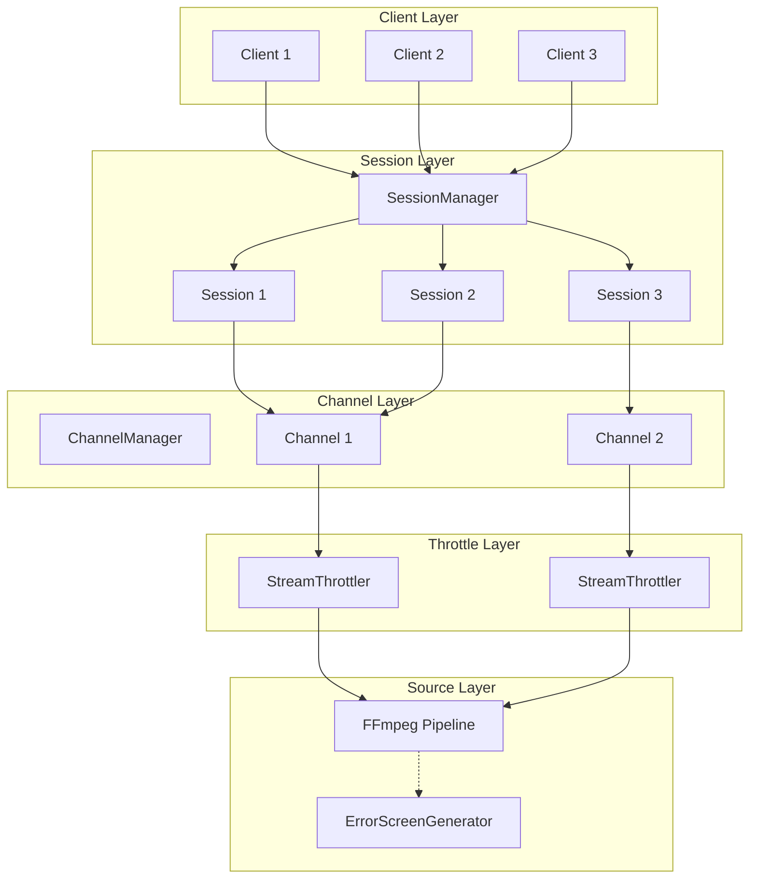

---

## ProcessPoolManager & Restart Safety

### ProcessPoolManager

All FFmpeg processes are spawned through the ProcessPoolManager. It enforces:

- **Global process cap** — From config, memory, and file descriptor limits
- **Rate limiting** — Token bucket (default 5 spawns per second)
- **Guards** — Memory (85% threshold), FD reserve (100) before each spawn
- **Zombie detection** — Background task checks every 30 seconds
- **Long-run guard** — Processes running > 24 hours are released

When a spawn is rejected (memory, FD, or capacity), the circuit breaker may record a failure for that channel.

### Circuit Breaker

Per-channel protection. After 5 failures in a 300-second window, restarts are blocked for 120 seconds. States: CLOSED → OPEN → HALF_OPEN. See [Platform Guide §2](Platform-Guide#circuitbreaker-behavior).

### Restart Guards

Three mechanisms prevent restart storms:

1. **Global throttle** — Max 10 restarts in any 60-second window
2. **Per-channel cooldown** — 30 seconds between restarts for the same channel
3. **Circuit breaker** — Blocks when OPEN for that channel

All restart requests (health task, AI agent) go through `request_channel_restart`, which applies these checks. See [Platform Guide §2](Platform-Guide#restart-decision-flow).

---

## Session Management

Session management tracks each client connection to your channels.

### How It Works

1. **Client Connects**: SessionManager creates a StreamSession
2. **Session Tracking**: Records bytes sent, duration, errors
3. **Idle Detection**: Monitors for inactive sessions
4. **Cleanup**: Removes disconnected or idle sessions

### Session States

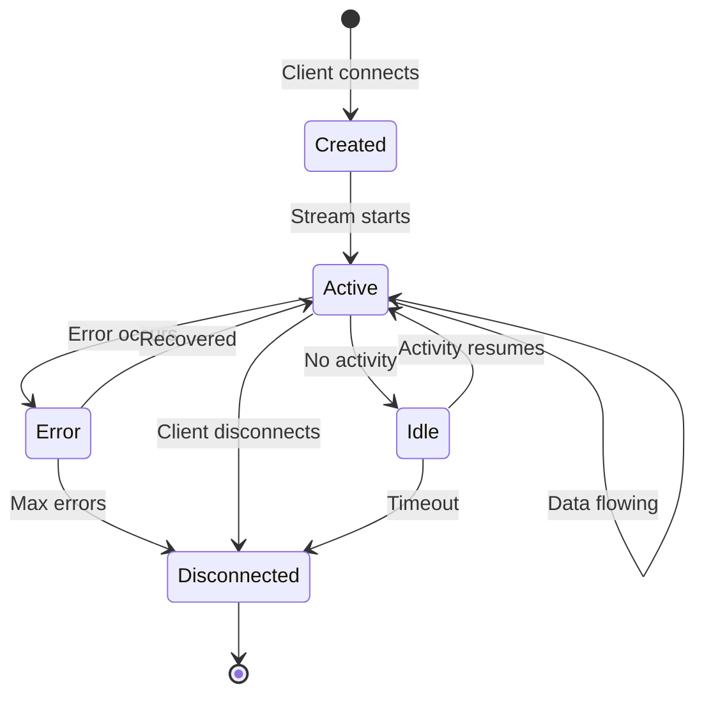

### Session Limits

Prevent resource exhaustion with per-channel limits:

```yaml
session_manager:
  max_sessions_per_channel: 50   # Max concurrent viewers per channel
  idle_timeout_seconds: 300      # Disconnect after 5 min idle
  cleanup_interval_seconds: 60   # Check for idle sessions every minute
```

### API Access

```bash
# Get all active sessions
curl http://localhost:8411/api/ai/sessions

# Get sessions for a specific channel
curl http://localhost:8411/api/ai/sessions?channel_id=1
```

---

## Stream Throttling

Stream throttling prevents buffer overruns and ensures smooth playback.

### The Problem

Without throttling:
- FFmpeg outputs data as fast as possible
- Client buffers fill rapidly
- Seeking becomes unreliable
- Memory usage spikes

### The Solution

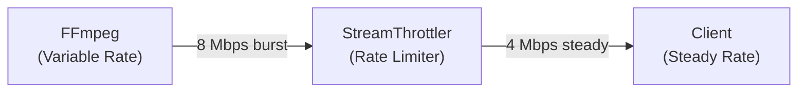

### Throttle Modes

| Mode | Behavior | Best For |
|------|----------|----------|
| `realtime` | Match target bitrate exactly | Live/linear streaming |
| `burst` | Allow 2x bursts, then throttle | VOD with seeking |
| `adaptive` | Adjust based on client feedback | Variable networks |
| `disabled` | No throttling | Direct/local connections |

### Configuration

```yaml
stream_throttler:
  enabled: true
  target_bitrate_bps: 4000000    # 4 Mbps target
  mode: "realtime"               # realtime, burst, adaptive, disabled
```

### Bitrate Guidelines

| Content Type | Recommended Bitrate |
|--------------|---------------------|
| 480p SD | 1.5-2.5 Mbps |
| 720p HD | 3-5 Mbps |
| 1080p Full HD | 6-10 Mbps |
| 4K UHD | 15-25 Mbps |

---

## Error Screens

Error screens provide a graceful user experience during failures.

### When Error Screens Appear

- Channel restart in progress
- Source temporarily unavailable
- FFmpeg process recovery
- Network interruption

### Visual Modes

| Mode | Description | Example |
|------|-------------|---------|
| `text` | Text overlay on background | "We'll Be Right Back" |
| `static` | Static image | Channel logo |
| `test_pattern` | SMPTE color bars | Technical difficulties |
| `slate` | Solid color with text | Simple fallback |

### Audio Modes

| Mode | Description | Use Case |
|------|-------------|----------|
| `silent` | No audio | Default |
| `sine_wave` | 440Hz tone | Signal presence |
| `white_noise` | Static noise | Retro feel |
| `beep` | Periodic beep | Attention |

### Customization

Error screens can display:

- Channel name and number
- Custom title and subtitle
- Timestamp
- Estimated return time

```python
from exstreamtv.streaming.error_screens import (
    get_error_screen_generator,
    ErrorScreenMessage,
    ErrorScreenConfig,
    ErrorVisualMode,
    ErrorAudioMode,
)

generator = get_error_screen_generator()

message = ErrorScreenMessage(
    title="Technical Difficulties",
    subtitle="We'll be right back shortly",
    channel_name="Movie Channel",
    channel_number=5,
)

config = ErrorScreenConfig(
    visual_mode=ErrorVisualMode.TEXT,
    audio_mode=ErrorAudioMode.SILENT,
    background_color="#1a1a1a",
    text_color="#ffffff",
)

# Generate error stream
async for chunk in generator.generate_error_stream(message, config, duration=30):
    # Stream to clients
    pass
```

---

## Configuration

### Complete Example

```yaml
# Session management
session_manager:
  max_sessions_per_channel: 50
  idle_timeout_seconds: 300
  cleanup_interval_seconds: 60

# Stream throttling
stream_throttler:
  enabled: true
  target_bitrate_bps: 4000000
  mode: "realtime"

# AI self-healing
ai_auto_heal:
  enabled: true
  use_error_screen_fallback: true
  hot_swap_enabled: true
  
# Database backup
database_backup:
  enabled: true
  interval_hours: 24
  keep_count: 7
  compress: true
```

### Environment Variables

| Variable | Description | Default |
|----------|-------------|---------|
| `EXSTREAMTV_MAX_SESSIONS` | Max sessions per channel | 50 |
| `EXSTREAMTV_THROTTLE_BITRATE` | Target bitrate in bps | 4000000 |
| `EXSTREAMTV_THROTTLE_MODE` | Throttle mode | realtime |

---

## Monitoring

### Session Metrics

```bash
# Get session statistics
curl http://localhost:8411/api/ai/sessions

# Response:
{
  "total_sessions": 15,
  "sessions_by_channel": {
    "1": 8,
    "2": 4,
    "3": 3
  },
  "average_duration_seconds": 1847,
  "total_bytes_sent": 125000000000
}
```

### Channel Health

```bash
# Get channel health metrics
curl http://localhost:8411/api/ai/channels/1/health

# Response:
{
  "channel_id": 1,
  "status": "healthy",
  "current_fps": 29.97,
  "current_speed": 1.02,
  "current_bitrate_kbps": 4250,
  "dropped_frames": 5,
  "sessions_active": 8
}
```

### Health Status Values

| Status | Description | Action |
|--------|-------------|--------|
| `healthy` | Normal operation | None |
| `degraded` | Minor issues | Monitor |
| `unhealthy` | Significant problems | Investigate |
| `failed` | Stream down | Immediate action |

---

## Troubleshooting

### Session Issues

**"Max sessions reached"**

- Increase `max_sessions_per_channel`
- Check for zombie sessions
- Reduce `idle_timeout_seconds` to clean up faster

**"Session not found"**

- Session may have been cleaned up
- Check if client disconnected
- Verify session ID is correct

### Throttling Issues

**"Buffer underrun on client"**

- Increase `target_bitrate_bps`
- Switch to `burst` mode
- Check source media bitrate

**"Seeking not working"**

- Use `burst` mode for VOD content
- Ensure throttle is not too aggressive
- Check client player settings

### Error Screen Issues

**"Error screen not appearing"**

- Verify `use_error_screen_fallback: true`
- Check FFmpeg is installed correctly
- Review logs for generation errors

**"Error screen quality poor"**

- Error screens use minimal resources by design
- Focus on message clarity over quality
- Custom images can improve appearance

### General Issues

**"High memory usage"**

- Check session count
- Reduce buffer sizes
- Enable more aggressive cleanup

**"Streams dropping randomly"**

- Check AI self-healing logs
- Monitor FFmpeg health
- Verify source stability

---

## Data Flow Diagram

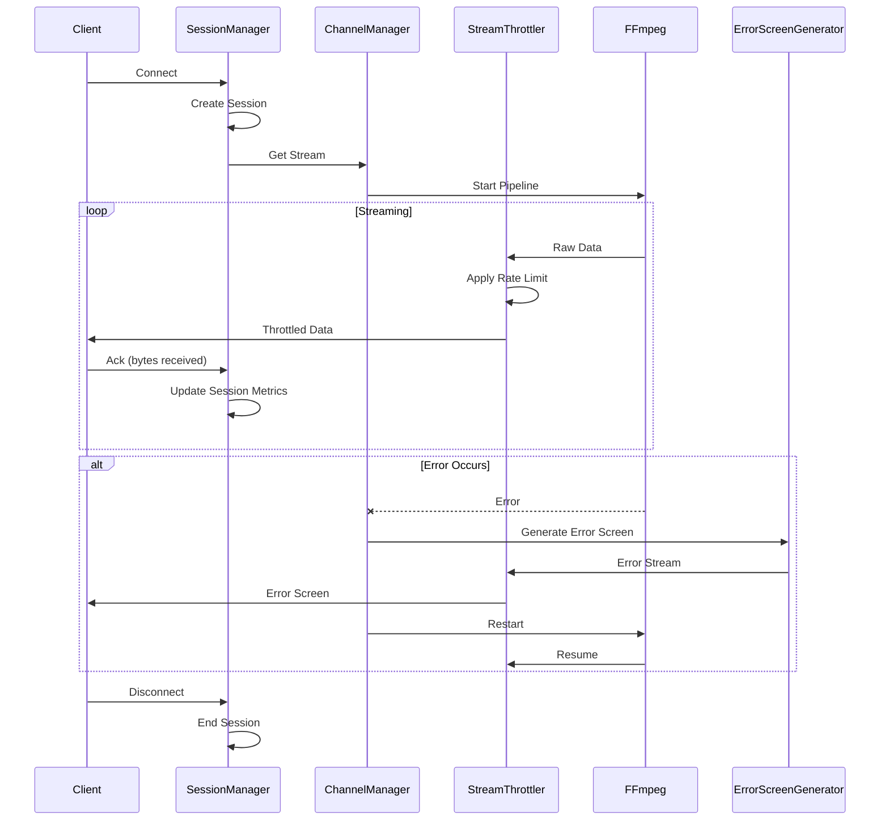

---

## Related Documentation

- [Platform Guide](Platform-Guide) — Full streaming lifecycle and restart logic
- [System Design](System-Design) — Overall architecture
- [Tunarr/dizqueTV Integration](Tunarr-DizqueTV-Integration) — Technical details
- [AI Setup Guide](AI_SETUP.md) — AI configuration
- [Hardware Transcoding](HW_TRANSCODING.md) — FFmpeg optimization

**Last Revised:** 2026-03-20


---

## Wiki page: Advanced Scheduling

*Source: [`EXStreamTV.wiki/Advanced-Scheduling.md`](https://github.com/roto31/EXStreamTV/wiki/Advanced-Scheduling)*

# Advanced Scheduling Guide

**Version:** 2.6.0  
**Last Updated:** 2026-01-31

This guide covers the advanced scheduling features introduced in EXStreamTV v2.6.0, including time slot scheduling and balance scheduling from Tunarr.

---

## Table of Contents

- [Overview](#overview)
- [Time Slot Scheduling](#time-slot-scheduling)
- [Balance Scheduling](#balance-scheduling)
- [Combining Schedulers](#combining-schedulers)
- [Configuration](#configuration)
- [API Reference](#api-reference)
- [Best Practices](#best-practices)

---

## Overview

EXStreamTV v2.6.0 introduces two powerful scheduling systems from Tunarr:

| Scheduler | Purpose | Best For |
|-----------|---------|----------|
| **Time Slot Scheduler** | Time-of-day programming | Traditional TV schedules |
| **Balance Scheduler** | Weight-based content mixing | Variety channels |

### Scheduling Architecture

```mermaid
flowchart TB
    subgraph "Channel Request"
        Request[Get Next Item]
    end
    
    subgraph "Scheduler Selection"
        Config[Channel Config]
        TSS[TimeSlotScheduler]
        BS[BalanceScheduler]
        Legacy[Legacy Playout]
    end
    
    subgraph "Content Selection"
        Collections[Collections]
        Media[Media Items]
    end
    
    subgraph "Output"
        Item[Scheduled Item]
    end
    
    Request --> Config
    Config -->|time_slots| TSS
    Config -->|balance| BS
    Config -->|playout| Legacy
    
    TSS --> Collections
    BS --> Collections
    Legacy --> Collections
    Collections --> Media
    Media --> Item
```

---

## Time Slot Scheduling

Time slot scheduling divides the day into blocks, each with its own content and settings.

### Concept

```mermaid
gantt
    title Daily Schedule
    dateFormat HH:mm
    axisFormat %H:%M
    
    section Morning
    Morning News :06:00, 3h
    
    section Daytime
    Talk Shows :09:00, 3h
    Afternoon Movies :12:00, 6h
    
    section Evening
    Prime Time :18:00, 4h
    Late Night :22:00, 8h
```

### Time Slot Configuration

```python
from exstreamtv.scheduling.time_slots import (
    TimeSlot,
    TimeSlotSchedule,
    TimeSlotScheduler,
    TimeSlotOrderMode,
    TimeSlotPaddingMode,
)
from datetime import time

# Define slots
morning_slot = TimeSlot(
    slot_id="morning",
    name="Morning News",
    start_time=time(6, 0),      # 6:00 AM
    duration_minutes=180,        # 3 hours
    collection_id=1,             # News collection
    order_mode=TimeSlotOrderMode.ORDERED,
    padding_mode=TimeSlotPaddingMode.LOOP,
    days_of_week=62,            # Monday-Friday (2+4+8+16+32)
)

prime_time_slot = TimeSlot(
    slot_id="primetime",
    name="Prime Time",
    start_time=time(18, 0),     # 6:00 PM
    duration_minutes=240,        # 4 hours
    collection_id=5,             # Prime time collection
    order_mode=TimeSlotOrderMode.SHUFFLE,
    padding_mode=TimeSlotPaddingMode.FILLER,
    filler_preset_id=2,         # Commercial breaks
    days_of_week=127,           # All days
)

# Create schedule
schedule = TimeSlotSchedule(
    schedule_id="main_schedule",
    name="Main Channel Schedule",
    slots=[morning_slot, prime_time_slot],
)
```

### Order Modes

| Mode | Behavior | Use Case |
|------|----------|----------|
| `ORDERED` | Play items in sequence | News, episodes |
| `SHUFFLE` | Random order, no repeats until all played | Movies, variety |
| `RANDOM` | Pure random selection | Music videos, clips |

### Padding Modes

When a slot ends before the next begins:

| Mode | Behavior | Use Case |
|------|----------|----------|
| `NONE` | Dead air | Not recommended |
| `FILLER` | Play from filler preset | Commercials, bumpers |
| `LOOP` | Repeat slot content | Short programs |
| `NEXT` | Start next slot early | Continuous programming |

### Flex Modes

When content doesn't fit the slot exactly:

| Mode | Behavior | Use Case |
|------|----------|----------|
| `NONE` | Cut off at slot end | Strict scheduling |
| `EXTEND` | Let current item finish | Movies, long shows |
| `COMPRESS` | Skip items to fit | Time-sensitive content |

### Days of Week

Use a bitmask to specify active days:

| Day | Value |
|-----|-------|
| Sunday | 1 |
| Monday | 2 |
| Tuesday | 4 |
| Wednesday | 8 |
| Thursday | 16 |
| Friday | 32 |
| Saturday | 64 |

Examples:
- All days: `127` (1+2+4+8+16+32+64)
- Weekdays: `62` (2+4+8+16+32)
- Weekends: `65` (1+64)

---

## Balance Scheduling

Balance scheduling distributes content based on weights, ensuring variety.

### Concept

```mermaid
pie title Content Distribution
    "Movies (40%)" : 40
    "TV Shows (30%)" : 30
    "Documentaries (20%)" : 20
    "Specials (10%)" : 10
```

### Balance Configuration

```python
from exstreamtv.scheduling.balance import (
    BalanceScheduler,
    BalanceConfig,
    ContentSource,
)

# Define content sources
movies = ContentSource(
    source_id="movies",
    name="Movies",
    collection_id=1,
    weight=40,              # 40% of content
    cooldown_minutes=60,    # Wait 1 hour before repeating
    max_consecutive=2,      # Max 2 movies in a row
)

tv_shows = ContentSource(
    source_id="tv_shows",
    name="TV Shows",
    collection_id=2,
    weight=30,
    cooldown_minutes=30,
    max_consecutive=4,
)

documentaries = ContentSource(
    source_id="docs",
    name="Documentaries",
    collection_id=3,
    weight=20,
    cooldown_minutes=120,
    max_consecutive=1,
)

specials = ContentSource(
    source_id="specials",
    name="Specials",
    collection_id=4,
    weight=10,
    cooldown_minutes=240,
    max_consecutive=1,
)

# Create scheduler
config = BalanceConfig(
    sources=[movies, tv_shows, documentaries, specials],
    enforce_cooldown=True,
    enforce_max_consecutive=True,
)

scheduler = BalanceScheduler(config=config)
```

### Weight Selection Algorithm

```mermaid
flowchart TB
    Start[Select Next Source]
    Filter[Filter Available Sources]
    Cooldown{Cooldown\nExpired?}
    Consecutive{Under Max\nConsecutive?}
    Weight[Calculate Weights]
    Select[Random Weighted Selection]
    Item[Get Item from Source]
    
    Start --> Filter
    Filter --> Cooldown
    Cooldown -->|Yes| Consecutive
    Cooldown -->|No| Filter
    Consecutive -->|Yes| Weight
    Consecutive -->|No| Filter
    Weight --> Select
    Select --> Item
```

### Cooldown

Cooldown prevents the same source from being selected too frequently:

```python
ContentSource(
    source_id="movies",
    collection_id=1,
    weight=40,
    cooldown_minutes=60,    # After playing a movie, wait 60 min
)
```

### Max Consecutive

Limits how many items from one source play in a row:

```python
ContentSource(
    source_id="documentaries",
    collection_id=3,
    weight=20,
    max_consecutive=1,      # Never play 2 documentaries back-to-back
)
```

---

## Combining Schedulers

You can use both schedulers together for complex programming.

### Example: Time-Based Balance

Different balance weights at different times of day:

```python
from datetime import time

# Morning: More news and talk shows
morning_config = BalanceConfig(
    sources=[
        ContentSource("news", 1, weight=50),
        ContentSource("talk", 2, weight=30),
        ContentSource("reruns", 3, weight=20),
    ]
)

# Prime Time: More movies and premium content
evening_config = BalanceConfig(
    sources=[
        ContentSource("movies", 4, weight=45),
        ContentSource("series", 5, weight=35),
        ContentSource("documentaries", 6, weight=20),
    ]
)

# Create time slots with different balance configs
morning_slot = TimeSlot(
    slot_id="morning",
    start_time=time(6, 0),
    duration_minutes=360,
    balance_config=morning_config,
)

evening_slot = TimeSlot(
    slot_id="evening",
    start_time=time(18, 0),
    duration_minutes=360,
    balance_config=evening_config,
)
```

### Flow Diagram

```mermaid
flowchart TB
    Time[Current Time]
    TSS[TimeSlotScheduler]
    Slot[Active Slot]
    BS[BalanceScheduler]
    Item[Selected Item]
    
    Time --> TSS
    TSS --> Slot
    Slot --> BS
    BS --> Item
    
    style TSS fill:#4CAF50,color:white
    style BS fill:#4CAF50,color:white
```

---

## Configuration

### config.yaml Example

```yaml
# Time Slot Scheduling
scheduling:
  type: "time_slots"  # or "balance" or "hybrid"
  
  time_slots:
    enabled: true
    default_padding_mode: "filler"
    default_order_mode: "shuffle"
    
  balance:
    enabled: true
    enforce_cooldown: true
    enforce_max_consecutive: true
    
# Channel-specific overrides
channels:
  - number: 1
    name: "Movie Channel"
    scheduling:
      type: "balance"
      sources:
        - collection_id: 1
          weight: 70
          name: "Action Movies"
        - collection_id: 2
          weight: 30
          name: "Comedy Movies"
          
  - number: 2
    name: "News 24/7"
    scheduling:
      type: "time_slots"
      slots:
        - name: "Morning News"
          start_time: "06:00"
          duration_minutes: 180
          collection_id: 3
```

---

## API Reference

### Time Slot Scheduler API

```python
from exstreamtv.scheduling import (
    TimeSlot,
    TimeSlotSchedule,
    TimeSlotScheduler,
    get_time_slot_scheduler,
)

# Get global scheduler
scheduler = get_time_slot_scheduler()

# Get current item for a channel
item = await scheduler.get_current_item(
    channel_id=1,
    dt=datetime.now(),
    get_media_items=media_callback,
)

# Get active slot
slot = schedule.get_active_slot(datetime.now())

# Get next slot
next_slot = schedule.get_next_slot(datetime.now())
```

### Balance Scheduler API

```python
from exstreamtv.scheduling import (
    BalanceScheduler,
    BalanceConfig,
    ContentSource,
    get_balance_scheduler,
)

# Get global scheduler
scheduler = get_balance_scheduler()

# Get next item
item = await scheduler.get_next_item(
    channel_id=1,
    get_media_items=media_callback,
)

# Get distribution stats
stats = scheduler.get_stats(channel_id=1)
# Returns: {"movies": 42.1, "tv_shows": 31.5, "docs": 18.9, "specials": 7.5}
```

---

## Best Practices

### Time Slot Scheduling

1. **Cover the Full Day**: Ensure slots cover 24 hours to avoid gaps
2. **Use Flex Mode**: Set `EXTEND` for movies to prevent mid-film cuts
3. **Add Filler**: Configure filler presets for smooth transitions
4. **Weekend Variations**: Use different slots for weekends

### Balance Scheduling

1. **Set Appropriate Weights**: Start with 10-point increments
2. **Use Cooldowns**: Prevent repetition fatigue
3. **Limit Consecutive**: Keep variety with max_consecutive
4. **Monitor Distribution**: Check stats and adjust weights

### General Tips

1. **Test Before Production**: Run schedules in preview mode
2. **Have Fallback Content**: Always configure filler collections
3. **Monitor Performance**: Check AI health metrics
4. **Use AI Personas**: Let AI suggest optimal schedules

---

## Related Documentation

- [Channel Creation Guide](CHANNEL_CREATION_GUIDE.md) - Basic channel setup
- [Tunarr/dizqueTV Integration](Tunarr-DizqueTV-Integration) - Technical details
- [Streaming Stability](STREAMING_STABILITY.md) - Streaming features
- [API Reference](API-Reference) - Complete API documentation

**Last Revised:** 2026-03-20


---

## Wiki page: API Reference

*Source: [`EXStreamTV.wiki/API-Reference.md`](https://github.com/roto31/EXStreamTV/wiki/API-Reference)*

# EXStreamTV API Documentation

Welcome to the EXStreamTV API documentation. This guide explains how to use the API to control your streaming server, manage channels, organize content, and build custom schedules. For HDHomeRun emulation, streaming lifecycle, and observability, see the [Platform Guide](Platform-Guide).

## Table of Contents

- [Getting Started](#getting-started)
- [How the API Works](#how-the-api-works)
- [Core APIs](#core-apis)
  - [Channels](#channels)
  - [Playlists](#playlists)
  - [Collections](#collections)
  - [Media Items](#media-items)
- [Scheduling APIs](#scheduling-apis)
  - [Schedules](#schedules)
  - [Playouts](#playouts)
  - [Blocks](#blocks)
  - [Templates](#templates)
- [Content Enhancement APIs](#content-enhancement-apis)
  - [Filler Presets](#filler-presets)
  - [Deco (Bumpers & Station IDs)](#deco-bumpers--station-ids)
  - [Multi-Collections](#multi-collections)
- [Advanced APIs](#advanced-apis)
  - [Scripted Schedule Builder](#scripted-schedule-builder)
  - [Build Sessions](#build-sessions)
- [Streaming & IPTV](#streaming--iptv)
- [System & Settings](#system--settings)
- [Error Handling](#error-handling)
- [Interactive Documentation](#interactive-documentation)

---

## Getting Started

### What is an API?

An API (Application Programming Interface) is a way for software programs to talk to each other. Think of it like a waiter at a restaurant: you tell the waiter what you want (make a request), and the waiter brings you your food (returns a response). The API is the waiter between you and the EXStreamTV server.

### Base URL

All API requests go to this address:

```
http://localhost:8411/api
```

If you're accessing EXStreamTV from another computer on your network, replace `localhost` with your server's IP address (like `192.168.1.100`).

### Making Your First Request

Here's how to get a list of all your channels:

**Using a web browser:** Just visit `http://localhost:8411/api/channels`

**Using the command line:**
```bash
curl http://localhost:8411/api/channels
```

**Using JavaScript:**
```javascript
const response = await fetch('http://localhost:8411/api/channels');
const data = await response.json();
console.log(data);
```

### Authentication

By default, EXStreamTV doesn't require a password for local use. For remote access, you can enable API key authentication in your configuration.

---

## How the API Works

### Request Methods

The API uses different "methods" to perform different actions:

| Method | What It Does | Example |
|--------|--------------|---------|
| **GET** | Retrieve information | Get a list of channels |
| **POST** | Create something new | Create a new channel |
| **PUT** | Update something existing | Change a channel's name |
| **DELETE** | Remove something | Delete a channel |

### Request and Response Format

All data is sent and received as JSON (JavaScript Object Notation). JSON is a simple text format that looks like this:

```json
{
  "name": "Movie Channel",
  "number": 5,
  "enabled": true
}
```

### Understanding Responses

When you make a request, you'll get back:

1. **A status code** - A number indicating success or failure
2. **Response data** - The information you requested (in JSON format)

Common status codes:
- **200** - Success! Everything worked.
- **201** - Created! A new item was made.
- **204** - Deleted! The item was removed.
- **400** - Bad request. Something was wrong with your request.
- **404** - Not found. The item doesn't exist.
- **500** - Server error. Something went wrong on our end.

---

## Core APIs

These are the fundamental APIs for managing your streaming content.

### Channels

Channels are virtual TV stations that stream your content. Each channel has a number, name, and plays content from a playlist or schedule.

#### List All Channels

Get a list of every channel you've created.

```
GET /api/channels
```

**Example Response:**
```json
[
  {
    "id": 1,
    "number": 1,
    "name": "Movies 24/7",
    "group": "Entertainment",
    "enabled": true,
    "logo_url": "/api/channels/1/logo"
  },
  {
    "id": 2,
    "number": 2,
    "name": "Classic TV",
    "group": "Entertainment",
    "enabled": true
  }
]
```

#### Get a Single Channel

Get detailed information about one specific channel.

```
GET /api/channels/{id}
```

Replace `{id}` with the channel's ID number.

**Example:** `GET /api/channels/1`

#### Create a New Channel

Add a new channel to your lineup.

```
POST /api/channels
```

**What to send:**
```json
{
  "number": 3,
  "name": "Kids Shows",
  "group": "Family",
  "enabled": true
}
```

#### Update a Channel

Change a channel's settings.

```
PUT /api/channels/{id}
```

**What to send:** Only include the fields you want to change.
```json
{
  "name": "Children's Programming"
}
```

#### Delete a Channel

Remove a channel permanently.

```
DELETE /api/channels/{id}
```

#### Get Channel's Filler Configuration

See what filler content is assigned to a channel.

```
GET /api/channels/{id}/filler
```

**Example Response:**
```json
{
  "channel_id": 1,
  "fallback_filler_id": 5,
  "pre_roll_filler_id": 2,
  "post_roll_filler_id": null,
  "fallback_filler": {
    "id": 5,
    "name": "Commercial Breaks",
    "filler_mode": "duration"
  }
}
```

#### Update Channel's Filler Configuration

Assign filler presets to a channel.

```
PUT /api/channels/{id}/filler
```

**What to send:**
```json
{
  "fallback_filler_id": 5,
  "pre_roll_filler_id": 2
}
```

#### Get Channel's Deco Configuration

See what decorative content (bumpers, station IDs) is assigned.

```
GET /api/channels/{id}/deco
```

#### Update Channel's Deco Configuration

Assign deco groups to a channel.

```
PUT /api/channels/{id}/deco
```

**What to send:**
```json
{
  "deco_group_id": 3,
  "bumper_group_id": 1
}
```

#### Get Programming Guide

See what's scheduled to play on a channel.

```
GET /api/channels/{id}/programming?hours=24
```

**Parameters:**
- `hours` - How many hours of programming to show (default: 24)

---

### Playlists

Playlists are ordered lists of media items that play in sequence.

#### List All Playlists

```
GET /api/playlists
```

#### Get a Playlist

```
GET /api/playlists/{id}
```

Returns the playlist with all its items.

#### Create a Playlist

```
POST /api/playlists
```

**What to send:**
```json
{
  "name": "Saturday Night Movies",
  "description": "Action films for the weekend"
}
```

#### Add Item to Playlist

```
POST /api/playlists/{id}/items/{media_id}
```

#### Remove Item from Playlist

```
DELETE /api/playlists/{id}/items/{media_id}
```

#### Reorder Playlist Items

```
POST /api/playlists/{id}/reorder
```

**What to send:**
```json
{
  "item_ids": [5, 3, 1, 4, 2]
}
```

The items will be reordered to match the order you specify.

---

### Collections

Collections are groups of related media items. Unlike playlists, collections don't have a specific order—they're just ways to organize your content.

#### List All Collections

```
GET /api/collections
```

#### Get a Collection

```
GET /api/collections/{id}
```

#### Create a Collection

```
POST /api/collections
```

**What to send:**
```json
{
  "name": "80s Action Movies",
  "description": "The best action films from the 1980s"
}
```

#### Create a Smart Collection

Smart collections automatically find and include media based on search criteria.

```
POST /api/collections/smart
```

**Parameters:**
- `name` - Name for the collection
- `search_query` - What to search for
- `description` - Optional description

**Example:** Create a collection that automatically includes all Star Wars content:
```
POST /api/collections/smart?name=Star Wars&search_query=star wars
```

#### Refresh a Smart Collection

Re-run the search to update the collection with new matching items.

```
POST /api/collections/smart/{id}/refresh
```

#### Add Item to Collection

```
POST /api/collections/{id}/items/{media_id}
```

#### Remove Item from Collection

```
DELETE /api/collections/{id}/items/{media_id}
```

---

### Media Items

Media items are individual videos, movies, or TV episodes in your library.

#### List Media Items

```
GET /api/media
```

**Optional filters:**
- `library_id` - Only show items from a specific library
- `media_type` - Filter by type: `movie`, `episode`, `other_video`
- `query` - Search by title
- `limit` - Maximum number of results
- `offset` - Skip this many results (for pagination)

#### Get a Media Item

```
GET /api/media/{id}
```

Returns complete information about a media item including file paths, duration, and metadata.

---

## Scheduling APIs

These APIs control when and how content plays on your channels.

### Schedules

Schedules define what content plays and in what order.

#### List All Schedules

```
GET /api/schedules
```

#### Get a Schedule

```
GET /api/schedules/{id}
```

#### Create a Schedule

```
POST /api/schedules
```

**What to send:**
```json
{
  "name": "Weekday Programming",
  "keep_multi_part_episodes": true,
  "shuffle_schedule_items": false
}
```

#### Update a Schedule

```
PUT /api/schedules/{id}
```

#### Delete a Schedule

```
DELETE /api/schedules/{id}
```

---

### Playouts

A playout is the actual running program for a channel—it turns your schedule into a real-time stream of content.

#### List All Playouts

```
GET /api/playouts
```

#### Get a Playout

```
GET /api/playouts/{id}
```

#### Get Current Item

See what's currently playing on a playout.

```
GET /api/playouts/{id}/current
```

#### Get Upcoming Items

See what's coming up next.

```
GET /api/playouts/{id}/upcoming?count=10
```

#### Skip Current Item

Jump to the next item in the playout.

```
POST /api/playouts/{id}/skip
```

---

### Blocks

Blocks are time-based programming segments. For example, you might have a "Morning Cartoons" block from 6 AM to 9 AM.

#### Block Groups

Block groups help you organize related blocks together.

##### List All Block Groups

```
GET /api/block-groups
```

**Example Response:**
```json
[
  {
    "id": 1,
    "name": "Weekday Blocks",
    "block_count": 5
  },
  {
    "id": 2,
    "name": "Weekend Blocks",
    "block_count": 3
  }
]
```

##### Create a Block Group

```
POST /api/block-groups
```

**What to send:**
```json
{
  "name": "Holiday Specials"
}
```

##### Get a Block Group

```
GET /api/block-groups/{id}
```

##### Update a Block Group

```
PUT /api/block-groups/{id}
```

##### Delete a Block Group

Deletes the group and all blocks inside it.

```
DELETE /api/block-groups/{id}
```

#### Blocks

##### List All Blocks

```
GET /api/blocks
```

**Optional filter:**
- `group_id` - Only show blocks from a specific group

**Example Response:**
```json
[
  {
    "id": 1,
    "name": "Morning Cartoons",
    "group_id": 1,
    "start_time": "06:00",
    "duration_minutes": 180,
    "days_of_week": 127,
    "items": []
  }
]
```

##### Create a Block

```
POST /api/blocks
```

**What to send:**
```json
{
  "name": "Prime Time Movies",
  "group_id": 1,
  "start_time": "20:00",
  "duration_minutes": 180,
  "days_of_week": 127
}
```

**Understanding `days_of_week`:**

This is a number that represents which days the block is active. Each day has a value:

| Day | Value |
|-----|-------|
| Sunday | 1 |
| Monday | 2 |
| Tuesday | 4 |
| Wednesday | 8 |
| Thursday | 16 |
| Friday | 32 |
| Saturday | 64 |

Add up the values for the days you want. For example:
- All days = 1+2+4+8+16+32+64 = **127**
- Weekdays only = 2+4+8+16+32 = **62**
- Weekends only = 1+64 = **65**

##### Get a Block

```
GET /api/blocks/{id}
```

##### Update a Block

```
PUT /api/blocks/{id}
```

##### Delete a Block

```
DELETE /api/blocks/{id}
```

##### Add Item to Block

```
POST /api/blocks/{id}/items
```

**What to send:**
```json
{
  "collection_type": "collection",
  "collection_id": 5,
  "playback_order": "shuffled",
  "include_in_guide": true
}
```

**Playback order options:**
- `chronological` - Play in order
- `shuffled` - Randomize the order
- `random` - Pick randomly each time

##### Update a Block Item

```
PUT /api/blocks/{id}/items/{item_id}
```

##### Remove Item from Block

```
DELETE /api/blocks/{id}/items/{item_id}
```

##### Reorder Block Items

```
POST /api/blocks/{id}/items/reorder
```

**What to send:**
```json
{
  "item_ids": [3, 1, 2]
}
```

---

### Templates

Templates are reusable schedule patterns. Create a template once, then apply it to any channel.

#### Template Groups

##### List All Template Groups

```
GET /api/template-groups
```

##### Create a Template Group

```
POST /api/template-groups
```

**What to send:**
```json
{
  "name": "Standard Schedules"
}
```

##### Get a Template Group

```
GET /api/template-groups/{id}
```

##### Update a Template Group

```
PUT /api/template-groups/{id}
```

##### Delete a Template Group

```
DELETE /api/template-groups/{id}
```

#### Templates

##### List All Templates

```
GET /api/templates
```

**Optional filter:**
- `group_id` - Only show templates from a specific group

##### Create a Template

```
POST /api/templates
```

**What to send:**
```json
{
  "name": "Weekday Schedule",
  "group_id": 1,
  "is_enabled": true
}
```

##### Get a Template

```
GET /api/templates/{id}
```

##### Update a Template

```
PUT /api/templates/{id}
```

##### Delete a Template

```
DELETE /api/templates/{id}
```

##### Add Time Slot to Template

```
POST /api/templates/{id}/items
```

**What to send:**
```json
{
  "start_time": "18:00",
  "block_id": 5,
  "playback_order": "chronological"
}
```

Or reference a collection directly:
```json
{
  "start_time": "18:00",
  "collection_type": "collection",
  "collection_id": 10,
  "playback_order": "shuffled"
}
```

##### Update a Time Slot

```
PUT /api/templates/{id}/items/{item_id}
```

##### Remove a Time Slot

```
DELETE /api/templates/{id}/items/{item_id}
```

##### Apply Template to Channel

```
POST /api/templates/{id}/apply/{channel_id}
```

**What to send:**
```json
{
  "day_of_week": null
}
```

Set `day_of_week` to a number (0-6, where 0=Sunday) to apply only on that day, or `null` for all days.

---

## Content Enhancement APIs

These APIs help you add polish to your channels with filler content and branding.

### Filler Presets

Filler presets define what content plays in gaps between programs. This includes commercials, bumpers, or any short content.

#### List All Filler Presets

```
GET /api/filler-presets
```

**Example Response:**
```json
[
  {
    "id": 1,
    "name": "Commercial Breaks",
    "filler_mode": "duration",
    "duration_seconds": 180,
    "playback_order": "shuffled",
    "allow_repeats": true,
    "items": []
  }
]
```

#### Create a Filler Preset

```
POST /api/filler-presets
```

**What to send:**
```json
{
  "name": "30-Second Bumpers",
  "filler_mode": "duration",
  "duration_seconds": 30,
  "playback_order": "shuffled",
  "allow_repeats": false
}
```

**Filler modes:**

| Mode | Description | Required Field |
|------|-------------|----------------|
| `duration` | Fill a specific amount of time | `duration_seconds` |
| `count` | Play a specific number of items | `count` |
| `pad` | Fill until the next time boundary | `pad_to_minutes` |

**Examples:**
- Fill 3 minutes: `"filler_mode": "duration", "duration_seconds": 180`
- Play 2 items: `"filler_mode": "count", "count": 2`
- Pad to quarter hour: `"filler_mode": "pad", "pad_to_minutes": 15`

#### Get a Filler Preset

```
GET /api/filler-presets/{id}
```

#### Update a Filler Preset

```
PUT /api/filler-presets/{id}
```

#### Delete a Filler Preset

```
DELETE /api/filler-presets/{id}
```

#### Add Item to Filler Preset

```
POST /api/filler-presets/{id}/items
```

**What to send (for a collection):**
```json
{
  "collection_type": "collection",
  "collection_id": 15,
  "weight": 1
}
```

**What to send (for a single media item):**
```json
{
  "media_item_id": 42,
  "weight": 2
}
```

**Understanding weight:** Higher weight means the item is more likely to be selected. An item with weight 2 is twice as likely to be chosen as an item with weight 1.

#### Update a Filler Item

```
PUT /api/filler-presets/{id}/items/{item_id}
```

#### Remove Item from Filler Preset

```
DELETE /api/filler-presets/{id}/items/{item_id}
```

---

### Deco (Bumpers & Station IDs)

Deco items are decorative content like bumpers, station IDs, promos, and credits that add professional polish to your channels.

#### Deco Types

| Type | Description |
|------|-------------|
| `bumper` | Short transitional clips between programs |
| `commercial` | Advertisement or promotional content |
| `station_id` | Station identification clips ("You're watching...") |
| `promo` | Program promotional content |
| `credits` | Credit sequences |

#### Deco Groups

##### List All Deco Groups

```
GET /api/deco-groups
```

##### Create a Deco Group

```
POST /api/deco-groups
```

**What to send:**
```json
{
  "name": "Channel 5 Branding"
}
```

##### Get a Deco Group

```
GET /api/deco-groups/{id}
```

Returns the group with all its deco items.

##### Update a Deco Group

```
PUT /api/deco-groups/{id}
```

##### Delete a Deco Group

```
DELETE /api/deco-groups/{id}
```

#### Deco Items

##### List All Deco Items

```
GET /api/deco
```

**Optional filters:**
- `group_id` - Only show items from a specific group
- `deco_type` - Filter by type (bumper, commercial, etc.)

##### Create a Deco Item

```
POST /api/deco
```

**What to send:**
```json
{
  "name": "Station ID - Evening",
  "group_id": 1,
  "deco_type": "station_id",
  "file_path": "/media/branding/station_id_evening.mp4",
  "duration_seconds": 10,
  "weight": 1
}
```

##### Get a Deco Item

```
GET /api/deco/{id}
```

##### Update a Deco Item

```
PUT /api/deco/{id}
```

##### Delete a Deco Item

```
DELETE /api/deco/{id}
```

##### Get Available Deco Types

```
GET /api/deco/types
```

Returns a list of all valid deco types with descriptions.

---

### Multi-Collections

Multi-collections combine multiple collections into one, making it easy to schedule diverse content together.

#### List All Multi-Collections

```
GET /api/collections/multi
```

#### Create a Multi-Collection

```
POST /api/collections/multi
```

**Parameters:**
- `name` - Name for the multi-collection
- `description` - Optional description
- `collection_ids` - Optional list of collection IDs to include initially

**Example:**
```
POST /api/collections/multi?name=All Movies&description=Every movie collection combined
```

With initial collections:
```json
{
  "name": "All Movies",
  "collection_ids": [1, 5, 8, 12]
}
```

#### Get a Multi-Collection

```
GET /api/collections/multi/{id}
```

**Example Response:**
```json
{
  "id": 1,
  "name": "All Movies",
  "description": "Every movie collection combined",
  "collections": [
    {"id": 1, "name": "Action Movies", "position": 0},
    {"id": 5, "name": "Comedy Movies", "position": 1},
    {"id": 8, "name": "Drama Movies", "position": 2}
  ]
}
```

#### Update a Multi-Collection

```
PUT /api/collections/multi/{id}
```

#### Delete a Multi-Collection

```
DELETE /api/collections/multi/{id}
```

#### Add Collection to Multi-Collection

```
POST /api/collections/multi/{multi_id}/collections/{collection_id}
```

#### Remove Collection from Multi-Collection

```
DELETE /api/collections/multi/{multi_id}/collections/{collection_id}
```

---

## Advanced APIs

These APIs provide powerful programmatic control over your playouts.

### Scripted Schedule Builder

The Scripted Schedule API lets you build playout schedules step-by-step through code. This is perfect for creating complex, dynamic schedules programmatically.

#### How It Works

1. **Start a build session** for a playout
2. **Add content** using various commands
3. **Control timing** with padding and wait commands
4. **Toggle features** like watermarks and graphics
5. **Commit** to save or **cancel** to discard

### Build Sessions

#### Start a Build Session

```
POST /api/playouts/{playout_id}/build/start
```

**Example Response:**
```json
{
  "session_id": "a1b2c3d4-e5f6-7890-abcd-ef1234567890",
  "playout_id": 1,
  "status": "building",
  "current_time": "2026-01-17T10:00:00Z",
  "expires_at": "2026-01-17T11:00:00Z",
  "message": "Build session started"
}
```

**Important:** Save the `session_id`—you'll need it for all subsequent commands.

#### Get Build Context

See the current state of your build session.

```
GET /api/scripted/build/{session_id}/context
```

**Example Response:**
```json
{
  "build_id": "a1b2c3d4-e5f6-7890-abcd-ef1234567890",
  "playout_id": 1,
  "status": "building",
  "current_time": "2026-01-17T12:30:00Z",
  "items_buffered": 15,
  "watermark_enabled": true,
  "graphics_enabled": true,
  "pre_roll_enabled": true,
  "epg_group_active": false,
  "expires_at": "2026-01-17T13:00:00Z"
}
```

#### Commit Build Session

Save all your changes to the playout.

```
POST /api/playouts/{playout_id}/build/commit
```

**Optional parameter:**
- `session_id` - If you have multiple sessions

#### Cancel Build Session

Discard all changes without saving.

```
POST /api/playouts/{playout_id}/build/cancel
```

#### List Build Sessions

See all build sessions for a playout.

```
GET /api/playouts/{playout_id}/build/sessions
```

**Optional filter:**
- `status_filter` - Filter by status: `building`, `committed`, `cancelled`

---

### Adding Content to Build Sessions

#### Add a Collection

Add content from a collection to your schedule.

```
POST /api/scripted/build/{session_id}/add-collection
```

**What to send:**
```json
{
  "collection_id": 5,
  "count": 3,
  "playback_order": "shuffled"
}
```

**Options:**
- `collection_id` - Which collection to add
- `count` - How many items to add (optional)
- `duration_minutes` - Add items until this duration is filled (optional)
- `playback_order` - `chronological`, `shuffled`, or `random`

#### Add a Marathon

Add all episodes of a show in order.

```
POST /api/scripted/build/{session_id}/add-marathon
```

**What to send:**
```json
{
  "show_id": 42,
  "playback_order": "chronological"
}
```

#### Add a Multi-Collection

Add content from a multi-collection.

```
POST /api/scripted/build/{session_id}/add-multi-collection
```

**What to send:**
```json
{
  "multi_collection_id": 3,
  "playback_order": "shuffled"
}
```

#### Add a Playlist

```
POST /api/scripted/build/{session_id}/add-playlist
```

**What to send:**
```json
{
  "playlist_id": 10,
  "count": 5
}
```

#### Create and Add a Playlist

Create a new playlist on-the-fly and add it to the schedule.

```
POST /api/scripted/build/{session_id}/create-playlist
```

**What to send:**
```json
{
  "name": "Tonight's Special",
  "media_item_ids": [101, 102, 103, 104]
}
```

#### Add Search Results

Add media items matching a search query.

```
POST /api/scripted/build/{session_id}/add-search
```

**What to send:**
```json
{
  "query": "christmas",
  "count": 10,
  "media_type": "movie"
}
```

#### Add a Smart Collection

```
POST /api/scripted/build/{session_id}/add-smart-collection?collection_id=15&count=5
```

#### Add a Specific Show

```
POST /api/scripted/build/{session_id}/add-show
```

**What to send:**
```json
{
  "show_title": "Friends",
  "season": 3,
  "count": 4
}
```

#### Add All Items from a Collection

```
POST /api/scripted/build/{session_id}/add-all?collection_id=5
```

#### Add a Specific Count

```
POST /api/scripted/build/{session_id}/add-count
```

**What to send:**
```json
{
  "collection_id": 5,
  "count": 10
}
```

#### Add Items for a Duration

Fill a specific amount of time with content.

```
POST /api/scripted/build/{session_id}/add-duration
```

**What to send:**
```json
{
  "collection_id": 5,
  "duration_minutes": 120
}
```

---

### Timing and Padding Commands

#### Pad to Next Time Boundary

Fill time until the next quarter-hour, half-hour, or hour.

```
POST /api/scripted/build/{session_id}/pad-to-next
```

**What to send:**
```json
{
  "minutes": 30,
  "filler_preset_id": 5
}
```

This fills with filler content until the next 30-minute mark (e.g., 10:30, 11:00, 11:30).

#### Pad Until a Specific Time

Fill time until a specific clock time.

```
POST /api/scripted/build/{session_id}/pad-until
```

**What to send:**
```json
{
  "target_time": "20:00",
  "filler_preset_id": 5
}
```

#### Pad Until Exact Time

Same as above but with exact precision.

```
POST /api/scripted/build/{session_id}/pad-until-exact
```

#### Wait Until a Time (No Content)

Leave dead air until a specific time.

```
POST /api/scripted/build/{session_id}/wait-until
```

**What to send:**
```json
{
  "target_time": "18:00"
}
```

#### Wait Until Exact Time

```
POST /api/scripted/build/{session_id}/wait-until-exact
```

---

### Content Control Commands

#### Peek at Next Item

See what's next without consuming it.

```
GET /api/scripted/build/{session_id}/peek-next/{content_type}
```

**Content types:** `collection`, `playlist`, `show`

#### Skip Items

Skip over items in the current collection.

```
POST /api/scripted/build/{session_id}/skip-items
```

**What to send:**
```json
{
  "count": 2,
  "collection_id": 5
}
```

#### Skip to Specific Item

Jump to a specific item in a collection.

```
POST /api/scripted/build/{session_id}/skip-to-item
```

**What to send:**
```json
{
  "item_index": 10,
  "collection_id": 5
}
```

---

### EPG and Display Controls

#### Start EPG Group

Group upcoming items under a single title in the program guide.

```
POST /api/scripted/build/{session_id}/epg-group/start
```

**What to send:**
```json
{
  "title": "Movie Marathon"
}
```

All items added after this will appear under "Movie Marathon" in the guide.

#### Stop EPG Group

End the current EPG grouping.

```
POST /api/scripted/build/{session_id}/epg-group/stop
```

#### Toggle Graphics

Turn on-screen graphics on or off.

```
POST /api/scripted/build/{session_id}/graphics/on
POST /api/scripted/build/{session_id}/graphics/off
```

#### Toggle Watermark

Turn the channel watermark on or off.

```
POST /api/scripted/build/{session_id}/watermark/on
POST /api/scripted/build/{session_id}/watermark/off
```

#### Toggle Pre-Roll

Turn pre-roll content on or off.

```
POST /api/scripted/build/{session_id}/pre-roll/on
POST /api/scripted/build/{session_id}/pre-roll/off
```

---

## Streaming & IPTV

### Get M3U Playlist

Get an M3U playlist file for all your channels.

```
GET /iptv/channels.m3u
```

### Get EPG (Program Guide)

Get XMLTV format electronic program guide data.

```
GET /iptv/xmltv.xml?hours=24
```

### HDHomeRun Emulation

EXStreamTV emulates an HDHomeRun device for Plex, Jellyfin, and Emby. DeviceID must be 8 hex chars. See [Platform Guide §3](Platform-Guide#3-hdhomrun-emulation).

#### Device Discovery

```
GET /hdhomerun/discover.json
GET /discover.json  (redirects to /hdhomerun/discover.json)
```

Returns: FriendlyName, ModelNumber, DeviceID, BaseURL, LineupURL, GuideURL, TunerCount.

#### Channel Lineup

```
GET /hdhomerun/lineup.json
GET /lineup.json  (redirects to /hdhomerun/lineup.json)
```

Returns: Array of { GuideNumber, GuideName, URL } for enabled channels.

#### Tuner Stream

```
GET /hdhomerun/tuner{N}/stream?channel=auto:v{channel_number}
```

Streams MPEG-TS for the tuned channel. Plex uses the `url` parameter; EXStreamTV supports both.

### Prometheus Metrics

```
GET /metrics
```

Returns Prometheus text exposition format. See [Observability](Observability) for metric reference.

---

## System & Settings

### Health Check

Check if the server is running properly.

```
GET /api/health
```

**Example Response:**
```json
{
  "status": "healthy",
  "version": "2.0.0",
  "database": "ok",
  "ffmpeg": "ok"
}
```

### Dashboard Statistics

```
GET /api/dashboard/stats
```

### System Information

```
GET /api/system/info
```

### View Logs

```
GET /api/logs
```

---

## Error Handling

When something goes wrong, the API returns an error response:

```json
{
  "detail": "Channel not found",
  "status_code": 404
}
```

### Common Errors

| Code | Meaning | What to Do |
|------|---------|-----------|
| 400 | Bad Request | Check your request format and required fields |
| 404 | Not Found | The item you're looking for doesn't exist |
| 409 | Conflict | The item already exists (duplicate) |
| 422 | Validation Error | Check your data types and values |
| 500 | Server Error | Try again; check server logs if it persists |

---

## Interactive Documentation

When EXStreamTV is running, you can access interactive API documentation:

- **Swagger UI**: [http://localhost:8411/api/docs](http://localhost:8411/api/docs)
  - Try out API calls directly in your browser
  - See all available endpoints
  - View request/response schemas

- **ReDoc**: [http://localhost:8411/api/redoc](http://localhost:8411/api/redoc)
  - Clean, readable documentation
  - Great for reference

---

## Quick Reference

### Most Common Operations

| Task | Method | Endpoint |
|------|--------|----------|
| List channels | GET | `/api/channels` |
| Create channel | POST | `/api/channels` |
| Delete channel | DELETE | `/api/channels/{id}` |
| List playlists | GET | `/api/playlists` |
| Get M3U playlist | GET | `/iptv/channels.m3u` |
| Start stream | GET | `/api/channels/{id}/stream.m3u8` |
| Health check | GET | `/api/health` |

### ErsatzTV-Compatible Features

| Feature | Endpoints |
|---------|-----------|
| Time Blocks | `/api/blocks`, `/api/block-groups` |
| Templates | `/api/templates`, `/api/template-groups` |
| Filler Content | `/api/filler-presets` |
| Bumpers & Station IDs | `/api/deco`, `/api/deco-groups` |
| Multi-Collections | `/api/collections/multi` |
| Scripted Schedules | `/api/scripted/build/*` |
| Build Sessions | `/api/playouts/{id}/build/*` |

---

---

## AI Self-Healing API (NEW in v2.6.0)

The AI Self-Healing system provides autonomous issue detection and resolution.

### Get AI Health Status

```
GET /api/ai/health
```

**Example Response:**
```json
{
  "log_collector": {
    "running": true,
    "buffer_size": 5000,
    "total_events": 125000,
    "errors_count": 42
  },
  "ffmpeg_monitor": {
    "channels_monitored": 12,
    "total_errors": 15,
    "active_predictions": 2
  },
  "pattern_detector": {
    "patterns_detected": 8,
    "predictions_made": 25,
    "accuracy": 0.88
  },
  "auto_resolver": {
    "enabled": true,
    "total_resolutions": 45,
    "success_rate": 0.93,
    "fixes_this_hour": 3
  }
}
```

### Get Channel Health Metrics

```
GET /api/ai/channels/{channel_id}/health
```

**Example Response:**
```json
{
  "channel_id": 1,
  "status": "healthy",
  "current_fps": 29.97,
  "expected_fps": 30.0,
  "current_speed": 1.02,
  "current_bitrate_kbps": 4250,
  "dropped_frames": 5,
  "duplicate_frames": 12,
  "error_count": 0,
  "restart_count": 1
}
```

### Get Recent Errors

```
GET /api/ai/errors?minutes=60&max_errors=50
```

### Get Active Sessions

```
GET /api/ai/sessions
```

**Example Response:**
```json
{
  "total_sessions": 15,
  "sessions_by_channel": {
    "1": 8,
    "2": 4,
    "3": 3
  },
  "sessions": [
    {
      "session_id": "abc123",
      "channel_id": 1,
      "client_ip": "192.168.1.100",
      "state": "active",
      "bytes_sent": 125000000,
      "duration_seconds": 3600
    }
  ]
}
```

### Trigger Manual Backup

```
POST /api/database/backup
```

**What to send:**
```json
{
  "description": "Manual backup before maintenance",
  "compress": true
}
```

### List Backups

```
GET /api/database/backups
```

### Restore Backup

```
POST /api/database/restore
```

**What to send:**
```json
{
  "backup_path": "backups/exstreamtv_backup_20260131.db.gz",
  "create_safety_backup": true
}
```

---

## Need Help?

- Check the [Quick Start Guide](Quick-Start)
- Read the [System Design](System-Design)
- Read the [Tunarr/dizqueTV Integration](Tunarr-DizqueTV-Integration)
- Use the interactive docs at `/api/docs`
- View streaming logs at `/logs`

**Last Revised:** 2026-03-20


---

## Wiki page: System Design

*Source: [`EXStreamTV.wiki/System-Design.md`](https://github.com/roto31/EXStreamTV/wiki/System-Design)*

# EXStreamTV System Design

**Version:** 2.6.0  
**Last Updated:** 2026-03-20

For a full architecture overview, streaming lifecycle, restart safety, and AI model, see the [Platform Guide](Platform-Guide). This document focuses on component layout and data models.

---

## Overview

EXStreamTV combines StreamTV (Python/FastAPI, AI agent) and ErsatzTV (scheduling, transcoding, local media) into one platform. Clients connect via REST, M3U/EPG, or HDHomeRun emulation; the channel manager and ProcessPoolManager control streaming; the playout engine drives scheduling.

---

## Component Layout

```mermaid
flowchart TB
    subgraph UI [Web UI]
        WebUI[WebUI Jinja2]
        Ch[Channels]
        Play[Playlists]
        Sched[Schedules]
        Lib[Libraries]
    end
    subgraph API [API Layer]
        REST[REST API]
        IPTV[IPTV M3U/EPG]
        HDHR[HDHomeRun Emulator]
        SSDP[SSDP Discovery]
    end
    subgraph Stream [Streaming]
        ChMgr[ChannelManager]
        Session[SessionManager]
        Pool[ProcessPoolManager]
        Throttle[StreamThrottler]
    end
    subgraph Media [Media]
        Playout[Playout Engine]
        FFmpeg[FFmpeg Pipeline]
        AI[AI Agent bounded]
    end
    subgraph Data [Data]
        DB[SQLite/PostgreSQL]
        Plex[Plex/Jellyfin/Emby]
        YT[YouTube]
        Archive[Archive.org]
    end
    subgraph Clients [Clients]
        P[Plex]
        J[Jellyfin]
        I[IPTV]
    end
    UI --> API
    API --> Stream
    Stream --> Media
    Media --> Data
    Stream --> Clients
```

---

## Core Components

### FastAPI Application (`exstreamtv/main.py`)

- Lifespan: async startup/shutdown for database, channel manager, ProcessPoolManager
- Routers: REST, IPTV, HDHomeRun, WebUI, SSDP
- Static files and Jinja2 templates

### Channel Manager (`exstreamtv/streaming/channel_manager.py`)

- Background streams per channel
- Shared streams for multiple clients
- Integration with ProcessPoolManager for FFmpeg spawn/release
- Buffer: 2MB with 64KB read chunks

### ProcessPoolManager (`exstreamtv/streaming/process_pool_manager.py`)

Sole gatekeeper for FFmpeg processes. See [Platform Guide §2](Platform-Guide#2-how-streaming-works).

- `acquire_process` / `release_process`
- Rate limiting, memory/FD guards, zombie detection

### Circuit Breaker (`exstreamtv/streaming/circuit_breaker.py`)

Per-channel restart protection. States: CLOSED → OPEN → HALF_OPEN. See [Platform Guide §2](Platform-Guide#circuitbreaker-behavior).

### Session Manager (`exstreamtv/streaming/session_manager.py`)

Tracks client connections per channel. Idle timeout, cleanup, error counting.

### Stream Throttler (`exstreamtv/streaming/throttler.py`)

Rate-limits MPEG-TS delivery. Modes: realtime, burst, adaptive, disabled.

### Playout Engine (`exstreamtv/scheduling/`)

Schedule modes (Flood, Duration, Multiple, One), block scheduling, filler. See [Advanced Scheduling](Advanced-Scheduling).

### FFmpeg Pipeline (`exstreamtv/ffmpeg/`)

Hardware detection (VideoToolbox, NVENC, QSV, VAAPI, AMF), encoder selection, filter chains, profiles.

### AI Agent (`exstreamtv/ai_agent/`)

Bounded loop, tool registry, grounded envelope, containment. See [Platform Guide §5](Platform-Guide#5-ai-agent--safety-model).

### Media Scanner (`exstreamtv/media/scanner/`)

Library sources (Plex, Jellyfin, Emby, local), metadata providers, collection building.

---

## Data Models

### Channel
```python
# Simplified
id: int
number: int
name: str
streaming_mode: str  # "iptv" | "hdhomerun" | "both"
playouts: List[Playout]
```

### Playout
```python
id: int
channel_id: int
program_schedule_id: int
anchor: PlayoutAnchor
items: List[PlayoutItem]
```

### PlayoutItem
```python
id: int
playout_id: int
media_item_id: int
start_time: datetime
finish_time: datetime
in_point: timedelta
out_point: timedelta
filler_kind: str
```

### ProgramSchedule
```python
id: int
name: str
items: List[ProgramScheduleItem]
# Modes: keep_multi_part_episodes, shuffle_schedule_items, random_start_point
```

---

## Streaming and Playout Flow

Stream request flow (Client → SessionManager → ChannelManager → ProcessPoolManager → FFmpeg → Throttler) and restart decision logic are in [Platform Guide §2](Platform-Guide#2-how-streaming-works).

Playout: Schedule Timer → TimeSlot/Balance Scheduler → Media Selection → Subtitle/Audio Pickers → FFmpeg → Channel Stream.

---

## Configuration

`config.yaml` with `EXSTREAMTV_` environment overrides:

```yaml
server:
  host: "0.0.0.0"
  port: 8411

ffmpeg:
  max_processes: 150
  spawns_per_second: 5
  memory_guard_threshold: 0.85
  fd_guard_reserve: 100

hdhomerun:
  device_id: "E5E17001"  # Must be 8 hex chars
  tuner_count: 4
```

---

## Related Documentation

- [Platform Guide](Platform-Guide) — Full architecture, streaming, HDHomeRun, AI, observability
- [TUNARR_DIZQUETV_INTEGRATION.md](./TUNARR_DIZQUETV_INTEGRATION.md) — v2.6 integration
- [API Reference](API-Reference) — REST and IPTV endpoints

**Last Revised:** 2026-03-20


---

## Wiki page: Architecture Diagrams

*Source: [`EXStreamTV.wiki/Architecture-Diagrams.md`](https://github.com/roto31/EXStreamTV/wiki/Architecture-Diagrams)*

# EXStreamTV Architecture Diagrams

All diagrams use Mermaid. Referenced from Platform Guide, EPG Alignment, Observability, Invariants, Lessons Learned.

**Last Revised:** 2026-03-21

---

## 1. System Architecture Overview

```mermaid
flowchart TB
    subgraph Clients [Client Layer]
        Plex[Plex DVR]
        IPTV[IPTV Players]
        WebUI[Web Interface]
    end
    subgraph App [Application Layer]
        REST[REST API]
        EPG[M3U/EPG]
        HDHR[HDHomeRun Emulator]
    end
    subgraph Stream [Streaming Layer]
        Session[SessionManager]
        ChMgr[ChannelManager]
        Pool[ProcessPoolManager]
        Throttle[StreamThrottler]
    end
    subgraph Media [Media Layer]
        FFmpeg[FFmpeg Pipeline]
        Sched[Playout Engine]
    end
    subgraph Data [Data Layer]
        DB[(Database)]
        Lib[Plex/Jellyfin/Local]
    end
    Clients --> App
    App --> Session
    Session --> ChMgr
    ChMgr --> Pool
    Pool --> FFmpeg
    ChMgr --> Throttle
    Throttle --> Clients
    ChMgr --> Sched
    Sched --> Lib
    Sched --> DB
```

---

## 2. Zero-Drift Clock Authority Flow

```mermaid
flowchart LR
    Mono[time.monotonic]
    Anchor[anchor_wall_epoch]
    Delta[delta = mono - anchor_mono]
    Now[now_epoch = anchor + delta]
    Offset[current_offset = elapsed % total]
    Mono --> Delta
    Anchor --> Delta
    Delta --> Now
    Now --> Offset
```

---

## 3. XMLTV Generation Pipeline

```mermaid
flowchart TD
    Auth[BroadcastScheduleAuthority.get_timeline]
    Clock[ChannelClock]
    Build[build_programmes_from_clock]
    Verify[interval_verifier]
    Gate{SMT VERIFIED?}
    Export[XMLTV export]
    Fallback[Fallback 24h]
    Auth --> Clock
    Clock --> Build
    Build --> Verify
    Verify --> Gate
    Gate -->|Yes| Export
    Gate -->|No| Fallback
```

---

## 4. Validation Pipeline Order

```mermaid
flowchart LR
    Norm[normalize]
    Repair[repair]
    Sym[symbolic]
    Sim[simulation]
    Fuzz[fuzz]
    SMT[SMT z3]
    Export[export]
    Norm --> Repair --> Sym --> Sim --> Fuzz --> SMT --> Export
```

---

## 5. BroadcastScheduleAuthority Internal Flow

```mermaid
flowchart TD
    subgraph Auth [BroadcastScheduleAuthority]
        GetTL[get_timeline]
        Cache[_timelines cache]
        VerHash[_timeline_version_hash]
        Inval[invalidate_timeline]
        GetTL --> Cache
        VerHash -->|mismatch| Inval
        Inval --> Cache
    end
    Load[load_timeline_async]
    BuildYAML[build_from_yaml]
    BuildPlayout[build_from_playout]
    Load --> BuildYAML
    Load --> BuildPlayout
    BuildYAML --> Cache
    BuildPlayout --> Cache
```

---

## 6. Watchdog Monitoring Loop

```mermaid
flowchart TD
    Sleep[sleep adaptive_interval]
    Strategy[determine_adaptive_strategy]
    Channels[query enabled channels]
    Check[ensure_clock + get_timeline]
    Fetch[fetch XMLTV]
    Compare[compare EPG vs playback]
    Mismatch{mismatch?}
    Heal[invalidate_timeline + rebuild]
    Sleep --> Strategy
    Strategy --> Channels
    Channels --> Check
    Check --> Fetch
    Fetch --> Compare
    Compare --> Mismatch
    Mismatch -->|Yes| Heal
    Mismatch -->|No| Sleep
    Heal --> Sleep
```

---

## 7. Adaptive Self-Tuning Feedback Loop

```mermaid
flowchart LR
    Health[health_score]
    Risk[predictive_risk]
    Strat[determine_adaptive_strategy]
    Interval[watchdog_interval]
    Scope[rebuild_scope]
    Preempt[preemptive_rebuild]
    Health --> Strat
    Risk --> Strat
    Strat --> Interval
    Strat --> Scope
    Strat --> Preempt
```

---

## 8. Metrics Exporter to Prometheus Flow

```mermaid
flowchart TD
    MC[MetricsCollector]
    Scrape[GET /metrics]
    Prom[Prometheus scrape]
    MC --> Scrape
    Scrape --> Prom
```

---

## 9. Dashboard Health Score Predictive Analyzer

```mermaid
flowchart LR
    Health[health_score]
    Pred[predictive_task]
    Risk[risk_score]
    API[system_integrity API]
    Dash[Dashboard]
    Health --> API
    Pred --> Risk
    Risk --> API
    API --> Dash
```

---

## 10. ChannelManager Lifecycle

```mermaid
stateDiagram-v2
    [*] --> Disabled
    Disabled --> Starting: enable
    Starting --> Running: stream ready
    Running --> Stopping: disable
    Stopping --> Disabled: cleanup
    Running --> Restarting: restart request
    Restarting --> Running: stream ready
```

---

## 11. Stream Pre-flight Validation Path

```mermaid
flowchart TD
    Req[Stream request]
    Resolve[resolution_service.resolve]
    Auth[get_authority]
    Clock[ensure_clock]
    TL[get_timeline]
    Resolve --> Auth
    Auth --> Clock
    Auth --> TL
    Req --> Resolve
```

---

## 12. Fallback Safety Gate Logic

```mermaid
flowchart TD
    Clock[clock_xml from _build_epg_via_clock]
    Valid{Valid?}
    Rebuild[rebuild + retry]
    SMT{SMT VERIFIED?}
    Export[return XMLTV]
    Fallback[return fallback 24h]
    Clock --> Valid
    Valid -->|No| Rebuild
    Rebuild --> Valid
    Valid -->|Yes| SMT
    SMT -->|Yes| Export
    SMT -->|No| Fallback
    Clock -->|None| Fallback
```

---

## 13. Temporal Simulation and Fuzz Layer

```mermaid
flowchart TD
    Intervals[intervals]
    Sim[run_temporal_simulation]
    Fuzz[run_epoch_fuzz]
    Step[step t in W]
    Sample[sample random t]
    Check{count == 1?}
    Intervals --> Sim
    Intervals --> Fuzz
    Sim --> Step
    Fuzz --> Sample
    Step --> Check
    Sample --> Check
    Check -->|No| FAILED
    Check -->|Yes| VERIFIED
```

---

## 14. SMT Verifier Integration Path

```mermaid
flowchart TD
    Progs[ClockProgramme per channel]
    Epoch[convert to epoch]
    Z3[z3.Solver]
    Constrain[add constraints]
    Check[solver.check]
    Result{SAT?}
    Progs --> Epoch
    Epoch --> Z3
    Z3 --> Constrain
    Constrain --> Check
    Check --> Result
    Result -->|UNSAT| FAILED
    Result -->|SAT| VERIFIED
```

---

## 15. Stream resolution safety contract

Validates resolved sources before FFmpeg (`resolution_service`, `StreamingContractEnforcer`, `StreamSource`).

```mermaid
flowchart TD
    Req[Stream request]
    RS[resolution_service.resolve]
    CE[StreamingContractEnforcer]
    SS[StreamSource DTO]
    FF[FFmpeg pipeline]
    Slate[Reject / slate fallback]
    Req --> RS
    RS --> CE
    CE -->|valid| SS
    CE -->|invalid| Slate
    SS --> FF
```

---

## 16. FFmpeg Command Builder Safety Layer (2026-03 remediation — LL-002 to LL-016)

All FFmpeg command builders import flags from a single constants module. No flag string is
hardcoded in individual builder files. This eliminates the class of bugs where two builders
used different loudnorm targets, different fflags, or omitted required bitstream filters.

```mermaid
flowchart TD
    C[ffmpeg/constants.py]
    C --> |FFLAGS_STREAMING| B1
    C --> |LOUDNORM_FILTER| B1
    C --> |BSF_H264_ANNEXB| B1
    C --> |PIX_FMT| B1
    C --> |FFLAGS_STREAMING| B2
    C --> |LOUDNORM_FILTER| B2
    C --> |PIX_FMT| B2
    subgraph Builders
        B1[ffmpeg_builder.py]
        B2[pipeline.py]
    end
    B1 --> FF[FFmpeg process]
    B2 --> FF
    FF --> MPEGTS[MPEG-TS output]
    note1["❌ -flags +low_delay (drops B-frames)"]
    note2["❌ +fastseek (masks missing +igndts)"]
    note3["✅ +igndts +genpts +discardcorrupt"]
    note4["✅ h264_mp4toannexb on COPY path"]
    C -.-> note1
    C -.-> note2
    FF -.-> note3
    FF -.-> note4
```

---

## 17. Async Lock Collect-Then-Act Pattern (2026-03 remediation — LL-013)

The process watchdog previously held its lock during 5-second kill operations, deadlocking
all callers. The fix: collect work items inside the lock (fast), execute outside it (slow).
This pattern applies to any async lock guarding I/O-heavy operations.

```mermaid
sequenceDiagram
    participant Check as check_all()
    participant Lock as asyncio.Lock
    participant Kill as _kill_process()

    Check->>Lock: acquire
    Note over Lock: Collect timed-out PIDs only (fast)
    Check->>Lock: release
    loop for each timed-out process
        Check->>Kill: await _kill_process() [OUTSIDE LOCK]
        Note over Kill: wait_for(timeout=5s) — can block
    end
    Note over Check: Other coroutines can acquire lock<br/>during kill operations
```

---

## 18. Six-layer AI / coding safety enforcement (2026-03 — post-merge `main`)

Redundant guardrails keep Cursor and human contributors aligned with audited patterns
(`docs/LESSONS_LEARNED.md`). Layers overlap so context drift or model switches still leave
multiple active reminders.

```mermaid
flowchart TB
    subgraph L1 [Layer 1 — Cursor rules]
        R1[exstreamtv-safety.mdc<br/>RULE 01–18 alwaysApply]
        R2[exstreamtv-critical.mdc<br/>8 rules alwaysApply]
    end
    subgraph L2 [Layer 2 — Repo root]
        AG[AGENTS.md<br/>non-negotiable checklist]
    end
    subgraph L3 [Layer 3 — Path-local]
        A1[exstreamtv/ffmpeg/AGENTS.md]
        A2[exstreamtv/api/AGENTS.md]
        A3[exstreamtv/scheduling/AGENTS.md]
        A4[exstreamtv/streaming/AGENTS.md]
        A5[exstreamtv/transcoding/AGENTS.md]
    end
    subgraph L4 [Layer 4 — Constants]
        C[ffmpeg/constants.py<br/>single FFmpeg truth]
    end
    subgraph L5 [Layer 5 — Skill]
        SK[.cursor/skills/exstreamtv-expert<br/>Safety Patterns]
    end
    subgraph L6 [Layer 6 — Optional]
        GL["~/.cursor/skills/exstreamtv-expert<br/>global install"]
    end
    R1 --> Code[Python edits in exstreamtv/ + tests/]
    R2 --> Code
    AG --> Code
    A1 --> Code
    A2 --> Code
    A3 --> Code
    A4 --> Code
    A5 --> Code
    C --> Code
    SK --> Code
    GL -.-> SK
```

**Merge note (2026-03-21):** Branch `2026-02-21-ufnw` was merged into `default` `main` so GitHub,
local clones, and wiki sources all reflect the same remediation + hardening + tooling tree.


---

## Wiki page: Architecture

*Source: [`EXStreamTV.wiki/Architecture.md`](https://github.com/roto31/EXStreamTV/wiki/Architecture)*

# Architecture

See [Platform Guide](Platform-Guide#1-platform-overview) for full overview, components, and diagrams.

High-level: Clients (Plex, IPTV, Web) connect via REST, M3U/EPG, or HDHomeRun. SessionManager → ChannelManager → ProcessPoolManager → FFmpeg → StreamThrottler → Live MPEG-TS. EPG: get_timeline → SMT verify → export.

## FFmpeg Flag Architecture (2026-03 remediation)

All FFmpeg command builders import flags from `exstreamtv/ffmpeg/constants.py`. No flag string is hardcoded in individual builder files (`ffmpeg_builder.py`, `pipeline.py`). This is the single source of truth for:

- `FFLAGS_STREAMING` — `+genpts+discardcorrupt+igndts`
- `BSF_H264_ANNEXB` — `h264_mp4toannexb` (required on all H.264 → MPEG-TS COPY paths)
- `LOUDNORM_FILTER` — `loudnorm=I=-16:TP=-1.5:LRA=11` (EBU R128)
- `PIX_FMT`, `MPEGTS_FLAGS`, `PCR_PERIOD_MS`, `AUDIO_SAMPLE_RATE`, `AUDIO_CHANNELS`

See [Architecture Diagram 16](Architecture-Diagrams#16-ffmpeg-command-builder-safety-layer-2026-03-remediation--ll-002-to-ll-016) and [Diagram 18 — six-layer AI/coding safety](Architecture-Diagrams#18-six-layer-ai--coding-safety-enforcement-2026-03--post-merge-main).

**Default branch:** `main` carries the merged remediation from `2026-02-21-ufnw`; keep architecture docs and code on the same branch for audits.

**Last Revised:** 2026-03-21


---

## Wiki page: Streaming Internals

*Source: [`EXStreamTV.wiki/Streaming-Internals.md`](https://github.com/roto31/EXStreamTV/wiki/Streaming-Internals)*

# Streaming Internals

See [Platform Guide](Platform-Guide#2-how-streaming-works) for full streaming lifecycle, ProcessPoolManager, CircuitBreaker, and restart guards.

Key: ProcessPoolManager is sole FFmpeg gatekeeper. Restarts are bounded by throttle, cooldown, and circuit breaker.

## 2026-03 Remediation Fixes

The following bugs in the streaming layer were confirmed and fixed during the 2026-03 full codebase audit. See [`docs/LESSONS_LEARNED.md`](Lessons-Learned) for full root-cause detail.

| LL ID | File | Fix |
|---|---|---|
| LL-003 | `channel_manager.py` | DB position saves now use `run_in_executor` — no longer blocks the asyncio event loop |
| LL-013 | `process_watchdog.py` | Watchdog kills processes **outside** the async lock — eliminates 5–10s deadlock on channel failure |
| LL-014 | `throttler.py` | Buffer overflow trim aligned to `0x47` MPEG-TS sync byte — prevents corrupted packet framing |
| LL-026 | `channel_manager.py` | `async for` body indentation corrected — `is_running` break now fires on every chunk |
| LL-021 | `process_pool.py` | Semaphore acquire uses `try/except asyncio.QueueFull` instead of `locked()` check |

See [Architecture Diagram 17](Architecture-Diagrams#17-async-lock-collect-then-act-pattern-2026-03-remediation--ll-013) for the collect-then-act lock pattern.

**Last Revised:** 2026-03-21


---

## Wiki page: HDHomeRun Emulation

*Source: [`EXStreamTV.wiki/HDHomeRun-Emulation.md`](https://github.com/roto31/EXStreamTV/wiki/HDHomeRun-Emulation)*

# HDHomeRun Emulation

See [Platform Guide](Platform-Guide#3-hdhomrun-emulation) for discover.json, lineup.json, DeviceID requirements, and Plex validation flow.

DeviceID must be 8 hex chars. Invalid IDs cause "Could not Tune Channel."

**Last Revised:** 2026-03-21


---

## Wiki page: Metadata And XMLTV

*Source: [`EXStreamTV.wiki/Metadata-And-XMLTV.md`](https://github.com/roto31/EXStreamTV/wiki/Metadata-And-XMLTV)*

# Metadata & XMLTV

See [Platform Guide](Platform-Guide#4-metadata--xmltv-pipeline) for enrichment, placeholder detection, drift, confidence gating, and XMLTV validation.

EPG export gate: SMT interval verification required. Single source: get_timeline.

## 2026-03 Remediation: EPG Generation Fixes

Three confirmed bugs in XMLTV/EPG generation were fixed during the 2026-03 audit:

| LL ID | Bug | Impact | Fix |
|---|---|---|---|
| LL-007 | Wrong XMLTV timestamp format (`%Y-%m-%d %H:%M:%S UTC`) | Plex silently drops programme entries → gaps in guide | Standardised to `%Y%m%d%H%M%S +0000` throughout |
| LL-008 | `start_time = None` not guarded before `.strftime()` | `AttributeError` kills EPG generation for affected channel — no error visible in Plex UI | Explicit `None` guard with `now` fallback before every `strftime()` call |
| LL-009 | `for idx in range(...)` inner loop shadows outer counter | Guide shows wrong "Now Playing" — off by variable number of items | Inner loop variables renamed to `_ci` |

The canonical XMLTV timestamp format for this codebase is:

```
%Y%m%d%H%M%S +0000
```

No dashes, no colons, literal `+0000` offset (not `%z` which may produce empty string on naive datetimes). See [`docs/LESSONS_LEARNED.md`](Lessons-Learned) entries LL-007 through LL-009.

**Last Revised:** 2026-03-21


---

## Wiki page: AI Agent And Containment

*Source: [`EXStreamTV.wiki/AI-Agent-And-Containment.md`](https://github.com/roto31/EXStreamTV/wiki/AI-Agent-And-Containment)*

# AI Agent & Containment

See [Platform Guide](Platform-Guide#5-ai-agent--safety-model) for bounded agent, tool execution, risk levels, confidence gating, containment mode, and automatic shutdown.

**Coding-time containment (Cursor):** Runtime AI is bounded by design; edits to `exstreamtv/` are also guarded by overlapping rules (`exstreamtv-safety.mdc`, `exstreamtv-critical.mdc`), `AGENTS.md`, path-local agent files, and `ffmpeg/constants.py`. Overview: [Architecture Diagrams §18](Architecture-Diagrams#18-six-layer-ai--coding-safety-enforcement-2026-03--post-merge-main) (wiki: **Architecture-Diagrams**).

**Last Revised:** 2026-03-21


---

## Wiki page: Restart Safety Model

*Source: [`EXStreamTV.wiki/Restart-Safety-Model.md`](https://github.com/roto31/EXStreamTV/wiki/Restart-Safety-Model)*

# Restart Safety Model

See [Platform Guide](Platform-Guide#2-how-streaming-works) for restart guards, decision flow, and [Invariants](Invariants) for formal invariants.

Three mechanisms: global throttle (10/60s), per-channel cooldown (30s), circuit breaker (5 failures → 120s block).

## 2026-03 Remediation: Watchdog Deadlock Fix (LL-013)

The process watchdog previously called `_kill_process()` while holding `self._lock`. A kill waits up to 5 seconds for the process to respond. During that wait, every other coroutine trying to acquire the lock (e.g., `register_process`, `report_output`) was blocked — causing cascade kills across all channels.

**Fix:** processes to kill are collected inside the lock (instantaneous), then killed outside it (slow). See [Architecture Diagram 17](Architecture-Diagrams#17-async-lock-collect-then-act-pattern-2026-03-remediation--ll-013).

**Last Revised:** 2026-03-21


---

## Wiki page: Observability

*Source: [`EXStreamTV.wiki/Observability.md`](https://github.com/roto31/EXStreamTV/wiki/Observability)*

# Observability

**Version:** 2.6.0  
**Last Updated:** 2026-03-20

This document lists all Prometheus metrics and alert thresholds. For architecture and monitoring philosophy, see [Platform Guide §6](Platform-Guide#6-observability--monitoring).

---

## Prometheus Endpoint

```
GET http://localhost:8411/metrics
```

Returns Prometheus text exposition format. Compatible with Prometheus scrape configs and Alertmanager.

---

## Metrics Reference

### FFmpeg Process Pool

| Metric | Type | Labels | Description |
|--------|------|--------|--------------|
| `exstreamtv_ffmpeg_processes_active` | gauge | — | Active FFmpeg processes |
| `exstreamtv_ffmpeg_spawn_pending` | gauge | — | Pending spawns |
| `exstreamtv_ffmpeg_spawn_rejected_total` | counter | `reason` (memory, fd, capacity) | Rejected spawns |
| `exstreamtv_ffmpeg_spawn_timeout_total` | counter | — | Spawn timeouts |
| `exstreamtv_ffmpeg_pool_pressure_events_total` | counter | — | Pool pressure events |

### Per-Channel

| Metric | Type | Labels | Description |
|--------|------|--------|--------------|
| `exstreamtv_channel_restart_total` | counter | `channel_id` | Restarts per channel |
| `exstreamtv_stream_success_total` | counter | `channel_id` | Successful streams |
| `exstreamtv_stream_failure_total` | counter | `channel_id` | Failed streams |
| `exstreamtv_channel_memory_bytes` | gauge | `channel_id` | Memory per channel |
| `exstreamtv_circuit_breaker_state` | gauge | `channel_id` | 0=closed, 1=half_open, 2=open |

### Stability

| Metric | Type | Description |
|--------|------|-------------|
| `exstreamtv_pool_acquisition_latency_seconds` | gauge | Pool acquisition time |
| `exstreamtv_restart_rate_per_minute` | gauge | Restart rate |
| `exstreamtv_health_timeouts_total` | counter | Health check timeouts |
| `exstreamtv_playout_rebuild_total` | counter | Playout rebuilds |

### System

| Metric | Type | Description |
|--------|------|-------------|
| `exstreamtv_system_rss_bytes` | gauge | Resident set size |
| `exstreamtv_fd_usage` | gauge | Open file descriptors |
| `exstreamtv_event_loop_lag_seconds` | gauge | Event loop lag |
| `exstreamtv_db_pool_checked_out` | gauge | DB connections in use |
| `exstreamtv_db_pool_size` | gauge | DB pool size |

### Metadata

| Metric | Type | Description |
|--------|------|-------------|
| `exstreamtv_metadata_lookup_success_total` | counter | Successful metadata lookups |
| `exstreamtv_metadata_lookup_failure_total` | counter | Failed metadata lookups |
| `exstreamtv_episode_metadata_missing_total` | counter | Missing episode metadata |
| `exstreamtv_movie_metadata_missing_total` | counter | Missing movie metadata |
| `exstreamtv_placeholder_title_generated_total` | counter | Placeholder titles used |
| `exstreamtv_xmltv_programme_missing_episode_num_total` | counter | Missing episode numbers |
| `exstreamtv_xmltv_programme_missing_desc_total` | counter | Missing descriptions |
| `exstreamtv_xmltv_programme_missing_year_total` | counter | Missing years |
| `exstreamtv_xmltv_validation_error_total` | counter | XMLTV validation errors |
| `exstreamtv_xmltv_lineup_mismatch_total` | counter | Lineup vs XMLTV mismatches |
| `exstreamtv_ai_metadata_resolution_attempt_total` | counter | AI resolution attempts |
| `exstreamtv_ai_metadata_resolution_success_total` | counter | AI resolution successes |
| `exstreamtv_ai_metadata_resolution_abort_total` | counter | AI resolution aborts |
| `exstreamtv_smt_verified_total` | counter | SMT interval verifications passed |
| `exstreamtv_smt_failed_total` | counter | SMT verification failures |
| `exstreamtv_smt_timeout_total` | counter | SMT timeouts |

---

## Alert Thresholds

These thresholds are defined in code for external alerting (e.g., Prometheus Alertmanager). EXStreamTV does not enforce them in-process.

| Metric / Condition | Warning | Critical |
|--------------------|---------|----------|
| metadata_failure_ratio | > 0.3 | > 0.5 |
| placeholder_ratio | > 0.2 | — |
| restart_velocity (per minute) | > 0.5 | > 2.0 |
| pool_pressure | — | > 0.9 |

---

## Early Warning Signals

The metadata pipeline emits a single structured log per EPG cycle when:

- > 5% programmes missing episode_num
- > 5% programmes missing year
- > 10 programmes with placeholder titles
- metadata_failure_ratio > 0.3
- Drift: metadata_failure_ratio increased by > 0.1 since last check

---

## Related Documentation

- [Platform Guide](Platform-Guide) — Monitoring philosophy
- [Operational Guide](Operational-Guide) — Diagnosis and verification


---

## Wiki page: Troubleshooting

*Source: [`EXStreamTV.wiki/Troubleshooting.md`](https://github.com/roto31/EXStreamTV/wiki/Troubleshooting)*

# Troubleshooting

See [Operational Guide](Operational-Guide.md) for diagnosis, verification, common issues, and [Platform Guide §9](Platform-Guide#9-operational-guide) for full operational context.

**Last Revised:** 2026-03-21


---

## Wiki page: Log Interpretation

*Source: [`EXStreamTV.wiki/Log-Interpretation.md`](https://github.com/roto31/EXStreamTV/wiki/Log-Interpretation)*

# Log Interpretation

See [Operational Guide](Operational-Guide.md#log-interpretation) for log message meanings: restart storm, circuit breaker, ProcessPoolManager, metadata warnings.

**Last Revised:** 2026-03-21


---

## Wiki page: Tunarr DizqueTV Integration

*Source: [`EXStreamTV.wiki/Tunarr-DizqueTV-Integration.md`](https://github.com/roto31/EXStreamTV/wiki/Tunarr-DizqueTV-Integration)*

# Tunarr/dizqueTV Integration Architecture

**Version:** 2.6.0  
**Last Updated:** 2026-01-31  
**Status:** Complete

---

## Executive Summary

This document describes the comprehensive integration of proven patterns and components from **Tunarr** (TypeScript IPTV server) and **dizqueTV** (NodeJS streaming platform) into EXStreamTV. The integration enhances platform stability, streaming reliability, and introduces AI-powered self-healing capabilities.

---

## Integration Overview

```mermaid
graph TB
    subgraph "EXStreamTV v2.6.0"
        subgraph "Phase 1: Stability"
            DCM[DatabaseConnectionManager]
            SM[SessionManager]
            ST[StreamThrottler]
        end
        
        subgraph "Phase 2: Error Handling"
            ESG[ErrorScreenGenerator]
        end
        
        subgraph "Phase 3: Scheduling"
            TSS[TimeSlotScheduler]
            BS[BalanceScheduler]
        end
        
        subgraph "Phase 4: Media Pipeline"
            SSP[SubtitleStreamPicker]
            ASP[AudioStreamPicker]
        end
        
        subgraph "Phase 5: Infrastructure"
            DBM[DatabaseBackupManager]
        end
        
        subgraph "Phase 6: AI Self-Healing"
            ULC[UnifiedLogCollector]
            FFM[FFmpegAIMonitor]
            PD[PatternDetector]
            AR[AutoResolver]
        end
    end
    
    subgraph "Source Projects"
        Tunarr["Tunarr (TypeScript)"]
        dizqueTV["dizqueTV (NodeJS)"]
    end
    
    Tunarr --> DCM
    Tunarr --> SM
    Tunarr --> TSS
    Tunarr --> BS
    Tunarr --> SSP
    Tunarr --> ASP
    Tunarr --> DBM
    
    dizqueTV --> ST
    dizqueTV --> ESG
    
    style DCM fill:#4CAF50,color:white
    style SM fill:#4CAF50,color:white
    style ST fill:#2196F3,color:white
    style ESG fill:#2196F3,color:white
    style TSS fill:#4CAF50,color:white
    style BS fill:#4CAF50,color:white
    style SSP fill:#4CAF50,color:white
    style ASP fill:#4CAF50,color:white
    style DBM fill:#4CAF50,color:white
    style ULC fill:#9C27B0,color:white
    style FFM fill:#9C27B0,color:white
    style PD fill:#9C27B0,color:white
    style AR fill:#9C27B0,color:white
```

**Legend:**
- 🟢 Green: Tunarr-sourced components
- 🔵 Blue: dizqueTV-sourced components
- 🟣 Purple: EXStreamTV AI enhancements

---

## Phase 1: Critical Stability Fixes

### 1.1 Database Connection Manager

**Source:** Tunarr `server/src/dao/connectionManager.ts`  
**Target:** `exstreamtv/database/connection.py`

```mermaid
flowchart TB
    subgraph "Connection Pool Management"
        Config[Channel Count Config]
        Calculator[Pool Size Calculator]
        Engine[SQLAlchemy Engine]
        Pool[Connection Pool]
        Sessions[Async Sessions]
    end
    
    subgraph "Monitoring"
        Events[Pool Event Listeners]
        Metrics[ConnectionMetrics]
        Health[Health Check]
    end
    
    Config --> Calculator
    Calculator -->|"(channels * 2.5) + 10"| Engine
    Engine --> Pool
    Pool --> Sessions
    
    Pool --> Events
    Events --> Metrics
    Metrics --> Health
    
    style Calculator fill:#4CAF50,color:white
    style Metrics fill:#FF9800,color:white
```

**Key Features:**

| Feature | Description |
|---------|-------------|
| Dynamic Pool Sizing | Pool size = `(channel_count × 2.5) + BASE_POOL_SIZE` |
| Pool Event Monitoring | Tracks connections created, checked in/out, invalidated, recycled |
| Health Checks | Latency measurement and pool saturation metrics |
| Auto-Resize | Adjusts pool size when channel count changes |

**Pool Size Formula:**
```
optimal_pool_size = max(BASE_POOL_SIZE, min(calculated, MAX_POOL_SIZE))
where calculated = int(channel_count * CONNECTIONS_PER_CHANNEL) + BASE_POOL_SIZE

Constants:
- BASE_POOL_SIZE = 10
- MAX_POOL_SIZE = 100
- CONNECTIONS_PER_CHANNEL = 2.5
```

### 1.2 Session Manager

**Source:** Tunarr `server/src/stream/SessionManager.ts`  
**Target:** `exstreamtv/streaming/session_manager.py`

```mermaid
flowchart LR
    subgraph "Client Connections"
        C1[Client 1]
        C2[Client 2]
        C3[Client 3]
    end
    
    subgraph "Session Manager"
        SM[SessionManager]
        SS1[StreamSession]
        SS2[StreamSession]
        SS3[StreamSession]
    end
    
    subgraph "Channel Streams"
        CH1[Channel 1]
        CH2[Channel 2]
    end
    
    C1 --> SM
    C2 --> SM
    C3 --> SM
    
    SM --> SS1
    SM --> SS2
    SM --> SS3
    
    SS1 --> CH1
    SS2 --> CH1
    SS3 --> CH2
    
    style SM fill:#4CAF50,color:white
```

**StreamSession Dataclass:**

```python
@dataclass
class StreamSession:
    session_id: str
    channel_id: int
    channel_number: int
    client_id: Optional[str]
    client_ip: Optional[str]
    user_agent: Optional[str]
    state: SessionState
    created_at: datetime
    last_activity: datetime
    bytes_sent: int
    errors: list[SessionError]
    restart_count: int
```

**Session Lifecycle:**

```mermaid
stateDiagram-v2
    [*] --> Created: create_session()
    Created --> Active: activate()
    Active --> Active: record_data()
    Active --> Error: record_error()
    Error --> Active: recover
    Error --> Disconnected: max_errors
    Active --> Idle: no_activity
    Idle --> Active: resume
    Idle --> Disconnected: timeout
    Active --> Disconnected: disconnect()
    Disconnected --> [*]
```

### 1.3 Stream Throttler

**Source:** dizqueTV `server/src/stream/throttler.ts`  
**Target:** `exstreamtv/streaming/throttler.py`

```mermaid
flowchart TB
    subgraph "Input Stream"
        FFmpeg[FFmpeg Output]
        Rate["Raw Rate: Variable"]
    end
    
    subgraph "StreamThrottler"
        Buffer[Internal Buffer]
        Calculator[Rate Calculator]
        Timer[Delay Timer]
    end
    
    subgraph "Output Stream"
        Client[Client Connection]
        Target["Target Rate: 4 Mbps"]
    end
    
    FFmpeg --> Buffer
    Buffer --> Calculator
    Calculator --> Timer
    Timer --> Client
    
    style Calculator fill:#2196F3,color:white
```

**Throttle Modes:**

| Mode | Behavior | Use Case |
|------|----------|----------|
| `realtime` | Match target bitrate exactly | Live streaming |
| `burst` | Allow 2x bursts, then throttle | VOD with seeking |
| `adaptive` | Adjust based on client feedback | Variable networks |
| `disabled` | No throttling | Direct connections |

**Throttle Algorithm:**
```python
async def throttle(self, data: bytes) -> AsyncIterator[bytes]:
    chunk_size = self._calculate_chunk_size()
    
    for i in range(0, len(data), chunk_size):
        chunk = data[i:i + chunk_size]
        delay = self._calculate_delay(len(chunk))
        
        if delay > 0:
            await asyncio.sleep(delay)
        
        yield chunk
        self._record_send(len(chunk))
```

---

## Phase 2: Error Handling System

### 2.1 Error Screen Generator

**Source:** dizqueTV `server/src/stream/errorScreen.ts`  
**Target:** `exstreamtv/streaming/error_screens.py`

```mermaid
flowchart TB
    subgraph "Error Detection"
        StreamError[Stream Error]
        Timeout[Connection Timeout]
        Restart[Channel Restart]
    end
    
    subgraph "ErrorScreenGenerator"
        Config[ErrorScreenConfig]
        Builder[FFmpeg Command Builder]
        Generator[MPEG-TS Generator]
    end
    
    subgraph "Visual Modes"
        Text[Text Overlay]
        Static[Static Image]
        Pattern[Test Pattern]
        Slate[Color Slate]
    end
    
    subgraph "Audio Modes"
        Silent[Silent]
        Sine[Sine Wave]
        Noise[White Noise]
        Beep[Beep]
    end
    
    StreamError --> Config
    Timeout --> Config
    Restart --> Config
    
    Config --> Builder
    Builder --> Generator
    
    Generator --> Text
    Generator --> Static
    Generator --> Pattern
    Generator --> Slate
    
    Generator --> Silent
    Generator --> Sine
    Generator --> Noise
    Generator --> Beep
    
    style Builder fill:#2196F3,color:white
    style Generator fill:#2196F3,color:white
```

**FFmpeg Command Generation:**

```python
def build_ffmpeg_command(
    self,
    message: ErrorScreenMessage,
    config: ErrorScreenConfig,
    duration: float
) -> list[str]:
    # Visual generation
    if config.visual_mode == ErrorVisualMode.TEXT:
        video_filter = self._build_text_filter(message)
    elif config.visual_mode == ErrorVisualMode.TEST_PATTERN:
        video_input = "smptebars"
    
    # Audio generation
    if config.audio_mode == ErrorAudioMode.SINE:
        audio_filter = "sine=frequency=440:duration={duration}"
    
    return [
        "ffmpeg", "-f", "lavfi", "-i", video_input,
        "-f", "lavfi", "-i", audio_input,
        "-vf", video_filter,
        "-c:v", "libx264", "-c:a", "aac",
        "-f", "mpegts", "pipe:1"
    ]
```

---

## Phase 3: Advanced Scheduling

### 3.1 Time Slot Scheduler

**Source:** Tunarr `server/src/services/TimeSlotScheduler.ts`  
**Target:** `exstreamtv/scheduling/time_slots.py`

```mermaid
flowchart TB
    subgraph "Schedule Definition"
        Schedule[TimeSlotSchedule]
        Slot1["Slot: 06:00-09:00\nMorning News"]
        Slot2["Slot: 09:00-12:00\nTalk Shows"]
        Slot3["Slot: 12:00-18:00\nAfternoon Movies"]
        Slot4["Slot: 18:00-22:00\nPrime Time"]
        Slot5["Slot: 22:00-06:00\nLate Night"]
    end
    
    subgraph "Scheduler"
        TSS[TimeSlotScheduler]
        Current[get_active_slot]
        Next[get_next_slot]
        Item[get_current_item]
    end
    
    Schedule --> Slot1
    Schedule --> Slot2
    Schedule --> Slot3
    Schedule --> Slot4
    Schedule --> Slot5
    
    TSS --> Current
    TSS --> Next
    TSS --> Item
    
    style TSS fill:#4CAF50,color:white
```

**TimeSlot Configuration:**

```python
@dataclass
class TimeSlot:
    slot_id: str
    name: str
    start_time: time           # e.g., time(6, 0)
    duration_minutes: int      # e.g., 180
    collection_id: Optional[int]
    order_mode: TimeSlotOrderMode    # ordered, shuffle, random
    padding_mode: TimeSlotPaddingMode  # none, filler, loop, next
    flex_mode: TimeSlotFlexMode      # none, extend, compress
    days_of_week: int          # Bitmask (127 = all days)
```

**Scheduling Flow:**

```mermaid
sequenceDiagram
    participant CM as ChannelManager
    participant TSS as TimeSlotScheduler
    participant Schedule as TimeSlotSchedule
    participant Media as MediaLibrary
    
    CM->>TSS: get_current_item(channel_id, now)
    TSS->>Schedule: get_active_slot(now)
    Schedule-->>TSS: TimeSlot
    TSS->>Media: get_media_items(collection_id)
    Media-->>TSS: list[MediaItem]
    TSS->>TSS: apply_order_mode()
    TSS-->>CM: ScheduledItem
```

### 3.2 Balance Scheduler

**Source:** Tunarr `server/src/services/BalanceScheduler.ts`  
**Target:** `exstreamtv/scheduling/balance.py`

```mermaid
flowchart TB
    subgraph "Content Sources"
        S1["Movies\nweight=40"]
        S2["TV Shows\nweight=30"]
        S3["Documentaries\nweight=20"]
        S4["Specials\nweight=10"]
    end
    
    subgraph "Balance Scheduler"
        BS[BalanceScheduler]
        Weights[Weight Calculator]
        Cooldown[Cooldown Tracker]
        Selection[Source Selector]
    end
    
    subgraph "Output"
        Next[Next Item]
        Stats[Distribution Stats]
    end
    
    S1 --> BS
    S2 --> BS
    S3 --> BS
    S4 --> BS
    
    BS --> Weights
    Weights --> Cooldown
    Cooldown --> Selection
    Selection --> Next
    Selection --> Stats
    
    style BS fill:#4CAF50,color:white
```

**Weight-Based Selection:**

```python
def select_source(self, channel_id: int) -> ContentSource:
    state = self._get_state(channel_id)
    available = [
        s for s in self._config.sources
        if self._is_available(s, state)
    ]
    
    if not available:
        return self._get_fallback_source()
    
    # Weighted random selection
    total_weight = sum(s.weight for s in available)
    target = random.uniform(0, total_weight)
    
    cumulative = 0
    for source in available:
        cumulative += source.weight
        if cumulative >= target:
            return source
```

---

## Phase 4: Media Pipeline Improvements

### 4.1 Subtitle Stream Picker

**Source:** Tunarr `server/src/ffmpeg/SubtitleStreamPicker.ts`  
**Target:** `exstreamtv/ffmpeg/subtitle_picker.py`

```mermaid
flowchart TB
    subgraph "FFprobe Analysis"
        Probe[FFprobe JSON]
        Parser[Stream Parser]
    end
    
    subgraph "Stream Selection"
        Streams[SubtitleStreams]
        Prefs[SubtitlePreferences]
        Picker[SubtitleStreamPicker]
    end
    
    subgraph "Selection Criteria"
        Lang[Language Match]
        Type[Text vs Image]
        SDH[SDH Detection]
        Default[Default Flag]
    end
    
    subgraph "Output"
        Selected[Selected Stream]
        Args[FFmpeg Arguments]
    end
    
    Probe --> Parser
    Parser --> Streams
    
    Streams --> Picker
    Prefs --> Picker
    
    Picker --> Lang
    Lang --> Type
    Type --> SDH
    SDH --> Default
    Default --> Selected
    
    Selected --> Args
    
    style Picker fill:#4CAF50,color:white
```

**Selection Priority:**
1. Exact language match + preferred type
2. Exact language match + any type
3. Default stream
4. First available stream

### 4.2 Audio Stream Picker

**Source:** Tunarr `server/src/ffmpeg/AudioStreamPicker.ts`  
**Target:** `exstreamtv/ffmpeg/audio_picker.py`

```mermaid
flowchart TB
    subgraph "Audio Analysis"
        Probe[FFprobe JSON]
        AudioStreams[Audio Streams]
    end
    
    subgraph "Selection Logic"
        Picker[AudioStreamPicker]
        LangMatch[Language Matching]
        LayoutPref[Layout Preference]
        Commentary[Commentary Filter]
    end
    
    subgraph "Output Processing"
        Selected[Selected Stream]
        Downmix[Downmix Config]
        FFmpegArgs[FFmpeg Arguments]
    end
    
    Probe --> AudioStreams
    AudioStreams --> Picker
    
    Picker --> LangMatch
    LangMatch --> LayoutPref
    LayoutPref --> Commentary
    
    Commentary --> Selected
    Selected --> Downmix
    Downmix --> FFmpegArgs
    
    style Picker fill:#4CAF50,color:white
```

**Downmix Options:**

| Input Layout | Target | FFmpeg Filter |
|--------------|--------|---------------|
| 5.1 Surround | Stereo | `pan=stereo\|FL=...` |
| 7.1 Surround | 5.1 | `pan=5.1\|...` |
| Stereo | Mono | `pan=mono\|c0=...` |

---

## Phase 5: Database Infrastructure

### 5.1 Database Backup Manager

**Source:** Tunarr `server/src/dao/BackupManager.ts`  
**Target:** `exstreamtv/database/backup.py`

```mermaid
flowchart TB
    subgraph "Backup Triggers"
        Schedule[Scheduled Backup]
        Manual[Manual Backup]
        PreRestore[Pre-Restore Backup]
    end
    
    subgraph "BackupManager"
        Config[BackupConfig]
        Creator[create_backup]
        Restorer[restore_backup]
        Cleaner[cleanup_old_backups]
    end
    
    subgraph "Storage"
        Files[Backup Files]
        Compressed[Gzip Compressed]
        Metadata[BackupInfo]
    end
    
    Schedule --> Creator
    Manual --> Creator
    PreRestore --> Creator
    
    Creator --> Files
    Files --> Compressed
    Compressed --> Metadata
    
    Cleaner --> Files
    Restorer --> Files
    
    style Creator fill:#4CAF50,color:white
    style Restorer fill:#4CAF50,color:white
```

**Backup Configuration:**

```python
@dataclass
class BackupConfig:
    enabled: bool = True
    backup_directory: str = "backups"
    interval_hours: int = 24
    keep_count: int = 7        # Keep N most recent
    keep_days: int = 30        # Delete older than N days
    compress: bool = True      # Gzip compression
```

**Backup File Naming:**
```
exstreamtv_backup_20260131_143022.db.gz
exstreamtv_backup_20260131_143022_auto.db.gz
exstreamtv_backup_20260131_143022_pre_restore.db.gz
```

---

## Phase 6: Enhanced AI Integration

### 6.1 Unified Log Collector

**Target:** `exstreamtv/ai_agent/unified_log_collector.py`

```mermaid
flowchart TB
    subgraph "Log Sources"
        App[Application Logs]
        FFmpeg[FFmpeg Stderr]
        Plex[Plex Events]
        Jellyfin[Jellyfin Events]
        System[System Logs]
    end
    
    subgraph "UnifiedLogCollector"
        Parser[LogParser]
        Buffer[Ring Buffer]
        Correlator[Event Correlator]
    end
    
    subgraph "Outputs"
        Subscribers[Real-time Subscribers]
        Context[Context Windows]
        Errors[Recent Errors]
    end
    
    App --> Parser
    FFmpeg --> Parser
    Plex --> Parser
    Jellyfin --> Parser
    System --> Parser
    
    Parser --> Buffer
    Buffer --> Correlator
    
    Correlator --> Subscribers
    Correlator --> Context
    Correlator --> Errors
    
    style Parser fill:#9C27B0,color:white
    style Buffer fill:#9C27B0,color:white
    style Correlator fill:#9C27B0,color:white
```

**LogEvent Structure:**

```python
@dataclass
class LogEvent:
    event_id: str
    timestamp: datetime
    source: LogSource      # APPLICATION, FFMPEG, PLEX, etc.
    level: LogLevel        # DEBUG, INFO, WARNING, ERROR, CRITICAL
    message: str
    component: Optional[str]
    channel_id: Optional[int]
    session_id: Optional[str]
    ffmpeg_pid: Optional[int]
    parsed_data: dict[str, Any]
    tags: list[str]
```

### 6.2 FFmpeg AI Monitor

**Target:** `exstreamtv/ai_agent/ffmpeg_monitor.py`

```mermaid
flowchart TB
    subgraph "FFmpeg Process"
        Stderr[Stderr Output]
        Progress[Progress Lines]
        Errors[Error Messages]
    end
    
    subgraph "FFmpegAIMonitor"
        Parser[Line Parser]
        Classifier[Error Classifier]
        HealthTracker[Health Tracker]
        Predictor[Failure Predictor]
    end
    
    subgraph "Outputs"
        Metrics[ChannelHealthMetrics]
        FFErrors[FFmpegError]
        Predictions[FailurePrediction]
        Analysis[AIAnalysis]
    end
    
    Stderr --> Parser
    Progress --> Parser
    Errors --> Parser
    
    Parser --> Classifier
    Classifier --> HealthTracker
    HealthTracker --> Predictor
    
    Predictor --> Metrics
    Predictor --> FFErrors
    Predictor --> Predictions
    Classifier --> Analysis
    
    style Parser fill:#9C27B0,color:white
    style Classifier fill:#9C27B0,color:white
    style Predictor fill:#9C27B0,color:white
```

**Error Classification:**

| Error Type | Pattern | Severity | Recoverable |
|------------|---------|----------|-------------|
| `CONNECTION_TIMEOUT` | "Connection timed out" | ERROR | Yes |
| `HTTP_ERROR` | "HTTP error 4xx/5xx" | ERROR | Yes |
| `CODEC_ERROR` | "Decoder not found" | CRITICAL | No |
| `HARDWARE_ERROR` | "videotoolbox error" | ERROR | Yes |
| `MEMORY_ERROR` | "Out of memory" | CRITICAL | No |

**Health Metrics:**

```python
@dataclass
class ChannelHealthMetrics:
    channel_id: int
    status: HealthStatus       # HEALTHY, DEGRADED, UNHEALTHY, FAILED
    current_fps: float
    expected_fps: float
    current_speed: float       # 1.0 = realtime
    current_bitrate_kbps: float
    dropped_frames: int
    duplicate_frames: int
    error_count: int
    restart_count: int
```

### 6.3 Pattern Detector

**Target:** `exstreamtv/ai_agent/pattern_detector.py`

```mermaid
flowchart TB
    subgraph "Event Input"
        LogEvents[Log Events]
        ErrorEvents[Error Events]
        MetricEvents[Metric Events]
    end
    
    subgraph "PatternDetector"
        Analyzer[Sequence Analyzer]
        Matcher[Known Pattern Matcher]
        Learner[Pattern Learner]
    end
    
    subgraph "Known Patterns"
        DBPool["DB Pool Exhaustion"]
        FFDeg["FFmpeg Degradation"]
        URLExp["URL Expiration"]
        NetInst["Network Instability"]
        MemPress["Memory Pressure"]
    end
    
    subgraph "Outputs"
        Analysis[PatternAnalysis]
        Predictions[FailurePrediction]
        RootCause[RootCauseAnalysis]
    end
    
    LogEvents --> Analyzer
    ErrorEvents --> Analyzer
    MetricEvents --> Analyzer
    
    Analyzer --> Matcher
    Matcher --> DBPool
    Matcher --> FFDeg
    Matcher --> URLExp
    Matcher --> NetInst
    Matcher --> MemPress
    
    Matcher --> Learner
    Learner --> Analysis
    Learner --> Predictions
    Analyzer --> RootCause
    
    style Analyzer fill:#9C27B0,color:white
    style Matcher fill:#9C27B0,color:white
    style Learner fill:#9C27B0,color:white
```

**Known Pattern Indicators:**

| Pattern | Indicators | Risk Level |
|---------|------------|------------|
| DB Pool Exhaustion | "pool exhausted", "connection timeout", "no connections" | HIGH |
| FFmpeg Degradation | "speed < 1.0x", "dropping frames", "buffer underrun" | MEDIUM |
| URL Expiration | "403 forbidden", "401 unauthorized", "token expired" | MEDIUM |
| Network Instability | "connection reset", "connection refused", "timeout" | HIGH |
| Memory Pressure | "out of memory", "allocation failed", "swap usage" | CRITICAL |

### 6.4 Auto Resolver

**Target:** `exstreamtv/ai_agent/auto_resolver.py`

```mermaid
flowchart TB
    subgraph "Issue Detection"
        Issue[DetectedIssue]
        Type[Issue Type]
        Severity[Severity Level]
    end
    
    subgraph "AutoResolver"
        StrategyMap[Strategy Mapping]
        RiskCheck[Risk Assessment]
        Executor[Fix Executor]
    end
    
    subgraph "Resolution Strategies"
        Restart[RESTART]
        Refresh[REFRESH]
        Expand[EXPAND]
        Fallback[FALLBACK]
        Reduce[REDUCE]
        Escalate[ESCALATE]
    end
    
    subgraph "Execution"
        Apply[apply_fix]
        Rollback[rollback]
        Learn[record_outcome]
    end
    
    Issue --> Type
    Type --> StrategyMap
    StrategyMap --> RiskCheck
    RiskCheck --> Executor
    
    Executor --> Restart
    Executor --> Refresh
    Executor --> Expand
    Executor --> Fallback
    Executor --> Reduce
    Executor --> Escalate
    
    Restart --> Apply
    Refresh --> Apply
    Apply --> Rollback
    Apply --> Learn
    
    style StrategyMap fill:#9C27B0,color:white
    style Executor fill:#9C27B0,color:white
```

**Issue-to-Strategy Mapping:**

| Issue Type | Primary Strategy | Risk Level | Confidence |
|------------|------------------|------------|------------|
| `FFMPEG_HANG` | RESTART | MEDIUM | 0.90 |
| `FFMPEG_CRASH` | RESTART | MEDIUM | 0.85 |
| `URL_EXPIRED` | REFRESH | SAFE | 0.95 |
| `DB_POOL_EXHAUSTED` | EXPAND | LOW | 0.80 |
| `AUTH_FAILED` | REFRESH | SAFE | 0.90 |
| `MEMORY_PRESSURE` | REDUCE | MEDIUM | 0.70 |
| `SOURCE_UNAVAILABLE` | FALLBACK | SAFE | 0.95 |

**Zero-Downtime Resolution Flow:**

```mermaid
sequenceDiagram
    participant Issue as Detected Issue
    participant AR as AutoResolver
    participant ESG as ErrorScreenGenerator
    participant CM as ChannelManager
    participant Fix as Fix Execution
    
    Issue->>AR: resolve(issue)
    AR->>AR: check_limits()
    AR->>AR: get_fix(issue)
    AR->>ESG: generate_error_stream()
    AR->>CM: swap_to_fallback()
    ESG-->>CM: Fallback Stream
    AR->>Fix: apply_fix()
    Fix-->>AR: Success
    AR->>CM: swap_to_main()
    AR->>AR: record_outcome()
```

---

## Complete Data Flow

```mermaid
flowchart TB
    subgraph "Client Layer"
        Clients[IPTV Clients]
    end
    
    subgraph "Streaming Layer"
        SM[SessionManager]
        CM[ChannelManager]
        ST[StreamThrottler]
        ESG[ErrorScreenGenerator]
    end
    
    subgraph "Scheduling Layer"
        TSS[TimeSlotScheduler]
        BS[BalanceScheduler]
    end
    
    subgraph "Media Layer"
        SSP[SubtitleStreamPicker]
        ASP[AudioStreamPicker]
        FFmpeg[FFmpeg Pipeline]
    end
    
    subgraph "Data Layer"
        DCM[DatabaseConnectionManager]
        DBM[DatabaseBackupManager]
        DB[(Database)]
    end
    
    subgraph "AI Layer"
        ULC[UnifiedLogCollector]
        FFM[FFmpegAIMonitor]
        PD[PatternDetector]
        AR[AutoResolver]
    end
    
    Clients <--> SM
    SM <--> CM
    CM <--> ST
    CM <--> ESG
    
    CM --> TSS
    CM --> BS
    TSS --> DCM
    BS --> DCM
    
    CM --> SSP
    CM --> ASP
    SSP --> FFmpeg
    ASP --> FFmpeg
    
    DCM --> DB
    DBM --> DB
    
    CM --> ULC
    FFmpeg --> FFM
    ULC --> PD
    FFM --> PD
    PD --> AR
    AR --> CM
    AR --> ESG
    
    style SM fill:#4CAF50,color:white
    style ST fill:#2196F3,color:white
    style ESG fill:#2196F3,color:white
    style DCM fill:#4CAF50,color:white
    style TSS fill:#4CAF50,color:white
    style BS fill:#4CAF50,color:white
    style SSP fill:#4CAF50,color:white
    style ASP fill:#4CAF50,color:white
    style DBM fill:#4CAF50,color:white
    style ULC fill:#9C27B0,color:white
    style FFM fill:#9C27B0,color:white
    style PD fill:#9C27B0,color:white
    style AR fill:#9C27B0,color:white
```

---

## Configuration Reference

### AIAutoHealConfig

```yaml
ai_auto_heal:
  enabled: true
  log_buffer_minutes: 30
  realtime_streaming: true
  ffmpeg_monitor_enabled: true
  ffmpeg_health_threshold: 0.8
  pattern_detection_enabled: true
  prediction_confidence_threshold: 0.75
  auto_resolve_enabled: true
  max_auto_fixes_per_hour: 50
  require_approval_above_risk: "MEDIUM"
  use_error_screen_fallback: true
  hot_swap_enabled: true
  learning_enabled: true
```

### DatabaseBackupConfig

```yaml
database_backup:
  enabled: true
  backup_directory: "backups"
  interval_hours: 24
  keep_count: 7
  keep_days: 30
  compress: true
```

### SessionManagerConfig

```yaml
session_manager:
  max_sessions_per_channel: 50
  idle_timeout_seconds: 300
  cleanup_interval_seconds: 60
```

### StreamThrottlerConfig

```yaml
stream_throttler:
  enabled: true
  target_bitrate_bps: 4000000
  mode: "realtime"  # realtime, burst, adaptive, disabled
```

---

## File Reference

### New Files Created

| File | Lines | Description |
|------|-------|-------------|
| `streaming/session_manager.py` | ~450 | Session tracking from Tunarr |
| `streaming/throttler.py` | ~380 | Rate limiting from dizqueTV |
| `streaming/error_screens.py` | ~420 | Error streams from dizqueTV |
| `scheduling/time_slots.py` | ~400 | Time slot scheduling from Tunarr |
| `scheduling/balance.py` | ~350 | Balance scheduling from Tunarr |
| `ffmpeg/subtitle_picker.py` | ~320 | Subtitle selection from Tunarr |
| `ffmpeg/audio_picker.py` | ~340 | Audio selection from Tunarr |
| `database/backup.py` | ~450 | Backup management from Tunarr |
| `ai_agent/unified_log_collector.py` | ~520 | Log aggregation |
| `ai_agent/ffmpeg_monitor.py` | ~480 | FFmpeg monitoring |
| `ai_agent/pattern_detector.py` | ~440 | Pattern detection |
| `ai_agent/auto_resolver.py` | ~500 | Auto resolution |

### Modified Files

| File | Changes |
|------|---------|
| `database/connection.py` | Added DatabaseConnectionManager |
| `config.py` | Added 4 new config classes |
| `main.py` | Initialize new components on startup |
| `streaming/channel_manager.py` | Integrated new components |
| `streaming/__init__.py` | Export new components |
| `scheduling/__init__.py` | Export new components |
| `database/__init__.py` | Export new components |
| `ffmpeg/__init__.py` | Export new components |

---

## Version History

| Version | Date | Changes |
|---------|------|---------|
| 2.6.0 | 2026-01-31 | Initial Tunarr/dizqueTV integration |

---

*See [BUILD_PROGRESS.md](Build-Progress) for overall development status.*

**Last Revised:** 2026-03-20


---

## Wiki page: Distribution

*Source: [`EXStreamTV.wiki/Distribution.md`](https://github.com/roto31/EXStreamTV/wiki/Distribution)*

# Distribution Guide

Developer documentation for building, signing, and distributing EXStreamTV.

## Table of Contents

- [Overview](#overview)
- [Prerequisites](#prerequisites)
- [Building the App](#building-the-app)
- [Creating a DMG](#creating-a-dmg)
- [Creating a PKG](#creating-a-pkg)
- [Code Signing](#code-signing)
- [Notarization](#notarization)
- [Bundled Dependencies](#bundled-dependencies)
- [Release Checklist](#release-checklist)

---

## Overview

EXStreamTV can be distributed in two formats:

| Format | Use Case | Includes |
|--------|----------|----------|
| **DMG** | Simple drag-and-drop install | App bundle only |
| **PKG** | Full installer with options | App + dependencies + AI setup |

Both require code signing and notarization for distribution outside the Mac App Store.

---

## Prerequisites

### Developer Requirements

1. **Apple Developer Account** ($99/year for distribution)
2. **Developer ID Application Certificate**
3. **Developer ID Installer Certificate** (for PKG)
4. **Xcode Command Line Tools**

### Install Certificates

1. Open Keychain Access
2. Go to **Keychain Access** > **Certificate Assistant** > **Request Certificate from CA**
3. Upload to [developer.apple.com](https://developer.apple.com/account/resources/certificates)
4. Download and install the certificates

### Verify Certificates

```bash
# List available signing identities
security find-identity -v -p codesigning

# Should show something like:
# "Developer ID Application: Your Name (TEAM_ID)"
# "Developer ID Installer: Your Name (TEAM_ID)"
```

---

## Building the App

### Release Build

```bash
cd EXStreamTVApp

# Build for release
swift build -c release

# Or build universal binary (Intel + Apple Silicon)
swift build -c release --arch arm64 --arch x86_64
```

### Create App Bundle

The build output is in `.build/release/`. For distribution, create a proper app bundle:

```bash
# Copy to build directory
mkdir -p ../build
cp -r .build/release/EXStreamTVApp.app ../build/
```

### Verify Build

```bash
# Check the binary
file build/EXStreamTVApp.app/Contents/MacOS/EXStreamTVApp
# Should show: Mach-O universal binary with 2 architectures

# Check bundle info
plutil -p build/EXStreamTVApp.app/Contents/Info.plist
```

---

## Creating a DMG

Use the provided script to create a DMG installer.

### Using create_dmg.sh

```bash
cd distributions/macos/dmg

# Create DMG with version number
./create_dmg.sh 1.4.0
```

### What the Script Does

1. Creates staging directory
2. Copies app bundle
3. Creates Applications symlink
4. Sets window layout
5. Compresses to DMG
6. Generates SHA256 checksum

### Output

```
dist/
├── EXStreamTV-Installer-1.4.0.dmg
└── EXStreamTV-Installer-1.4.0.dmg.sha256
```

### Manual DMG Creation

```bash
# Create temporary DMG
hdiutil create -volname "EXStreamTV" \
    -srcfolder build/staging \
    -ov -format UDRW \
    temp.dmg

# Convert to compressed
hdiutil convert temp.dmg -format UDZO -o EXStreamTV-1.4.0.dmg
```

---

## Creating a PKG

The PKG installer provides a full installation experience with AI setup options.

### Structure

```
distributions/macos/pkg/
├── Distribution.xml      # Installer UI definition
├── scripts/
│   ├── preinstall       # Pre-installation checks
│   └── postinstall      # Post-installation setup
└── resources/
    ├── welcome.html     # Welcome page
    ├── license.html     # License agreement
    ├── ai_setup.html    # AI provider selection
    └── conclusion.html  # Completion page
```

### Building the PKG

```bash
# Build component packages
pkgbuild --root build/EXStreamTVApp.app \
    --identifier com.exstreamtv.app \
    --version 1.4.0 \
    --install-location /Applications/EXStreamTV.app \
    app.pkg

# Build distribution package
productbuild --distribution Distribution.xml \
    --resources resources \
    --package-path . \
    EXStreamTV-1.4.0.pkg
```

### AI Setup in PKG

The `Distribution.xml` includes AI provider choices:

```xml
<choice id="ai-cloud" title="Cloud AI (Recommended)">
    <!-- Configures cloud AI in postinstall -->
</choice>
<choice id="ai-local" title="Local AI">
    <!-- Installs Ollama and downloads model -->
</choice>
<choice id="ai-skip" title="Skip">
    <!-- User configures later -->
</choice>
```

The `postinstall` script handles the selected option.

---

## Code Signing

All distributed apps must be signed with your Developer ID.

### Using sign_app.sh

```bash
cd distributions/macos

# Sign with automatic identity detection
./sign_app.sh ../build/EXStreamTVApp.app

# Or specify identity
SIGNING_IDENTITY="Developer ID Application: Your Name (TEAM_ID)" \
./sign_app.sh ../build/EXStreamTVApp.app
```

### Environment Variables

| Variable | Description |
|----------|-------------|
| `SIGNING_IDENTITY` | Full name of signing certificate |

### What Gets Signed

1. Embedded frameworks (in order)
2. Dynamic libraries
3. Helper executables
4. Main app bundle (with entitlements)

### Entitlements

The app requires these entitlements (`EXStreamTVApp.entitlements`):

```xml
<?xml version="1.0" encoding="UTF-8"?>
<!DOCTYPE plist PUBLIC "-//Apple//DTD PLIST 1.0//EN" "...">
<plist version="1.0">
<dict>
    <key>com.apple.security.app-sandbox</key>
    <false/>
    <key>com.apple.security.network.client</key>
    <true/>
    <key>com.apple.security.network.server</key>
    <true/>
    <key>com.apple.security.files.user-selected.read-write</key>
    <true/>
</dict>
</plist>
```

### Verify Signing

```bash
# Check signature
codesign --verify --deep --strict --verbose=2 EXStreamTVApp.app

# Check entitlements
codesign -d --entitlements - EXStreamTVApp.app

# Gatekeeper check
spctl --assess --type execute --verbose EXStreamTVApp.app
```

---

## Notarization

Apple requires notarization for apps distributed outside the Mac App Store.

### Using notarize.sh

```bash
cd distributions/macos

# Set credentials
export APPLE_ID="your@email.com"
export TEAM_ID="YOURTEAMID"
export APP_PASSWORD="xxxx-xxxx-xxxx-xxxx"  # App-specific password

# Notarize
./notarize.sh ../dist/EXStreamTV-Installer-1.4.0.dmg
```

### Getting an App-Specific Password

1. Go to [appleid.apple.com](https://appleid.apple.com)
2. Sign in > Security > App-Specific Passwords
3. Generate a new password
4. Use this password for `APP_PASSWORD`

### Manual Notarization

```bash
# Store credentials
xcrun notarytool store-credentials "EXStreamTV" \
    --apple-id "your@email.com" \
    --team-id "YOURTEAMID" \
    --password "xxxx-xxxx-xxxx-xxxx"

# Submit for notarization
xcrun notarytool submit EXStreamTV-1.4.0.dmg \
    --keychain-profile "EXStreamTV" \
    --wait

# Staple the ticket
xcrun stapler staple EXStreamTV-1.4.0.dmg
```

### Checking Status

```bash
# Get submission log
xcrun notarytool log <submission-id> \
    --keychain-profile "EXStreamTV" \
    log.json

# View log
cat log.json | python3 -m json.tool
```

### Common Issues

**"The signature of the binary is invalid"**
- Re-sign with `--options runtime` flag
- Ensure all nested bundles are signed

**"The executable requests the com.apple.security.* entitlement"**
- Check entitlements are correct
- Hardened Runtime must be enabled

---

## Bundled Dependencies

The PKG installer can include bundled Python and FFmpeg.

### Structure

```
distributions/macos/bundled/
├── python/           # Python 3.11 distribution
│   ├── bin/python3
│   └── lib/
└── ffmpeg/           # FFmpeg binaries
    └── bin/
        ├── ffmpeg
        └── ffprobe
```

### Obtaining Python

```bash
# Build Python with universal binary
./configure --enable-universalsdk --with-universal-archs=universal2
make
make install DESTDIR=bundled/python
```

Or use the official installer and extract:

```bash
# Download from python.org
curl -O https://www.python.org/ftp/python/3.11.7/python-3.11.7-macos11.pkg
```

### Obtaining FFmpeg

Download static builds from [evermeet.cx](https://evermeet.cx/ffmpeg/):

```bash
curl -O https://evermeet.cx/ffmpeg/ffmpeg-6.1.1.zip
curl -O https://evermeet.cx/ffmpeg/ffprobe-6.1.1.zip
unzip ffmpeg-6.1.1.zip -d bundled/ffmpeg/bin/
unzip ffprobe-6.1.1.zip -d bundled/ffmpeg/bin/
```

### Size Optimization

```bash
# Strip Python test files
find bundled/python -name "test" -type d -exec rm -rf {} +
find bundled/python -name "__pycache__" -exec rm -rf {} +

# Total size: ~150MB (Python ~100MB, FFmpeg ~50MB)
```

---

## Release Checklist

### Before Building

- [ ] Update version in `Package.swift`
- [ ] Update version in `Info.plist`
- [ ] Update `CHANGELOG.md`
- [ ] Run all tests
- [ ] Test on macOS 13, 14, and 15

### Build Process

- [ ] Create release build
- [ ] Build universal binary (Intel + Apple Silicon)
- [ ] Verify app launches on both architectures

### Code Signing

- [ ] Sign app with Developer ID
- [ ] Verify signature: `codesign --verify`
- [ ] Test Gatekeeper: `spctl --assess`

### Create Installers

- [ ] Create DMG: `./create_dmg.sh X.Y.Z`
- [ ] Create PKG (if applicable)
- [ ] Verify DMG mounts correctly
- [ ] Test PKG installation

### Notarization

- [ ] Submit DMG for notarization
- [ ] Submit PKG for notarization
- [ ] Staple tickets
- [ ] Verify: `xcrun stapler validate`

### Distribution

- [ ] Upload to GitHub Releases
- [ ] Update download links in README
- [ ] Announce release
- [ ] Update documentation

### Post-Release

- [ ] Monitor for crash reports
- [ ] Respond to initial feedback
- [ ] Tag release in git: `git tag v2.6.0`

---

## Troubleshooting

### "Code signature invalid"

```bash
# Re-sign everything
codesign --force --deep --options runtime --timestamp \
    --sign "Developer ID Application: ..." \
    EXStreamTVApp.app
```

### "Notarization failed: The software is not signed"

Ensure you're using `--options runtime` when signing:

```bash
codesign --options runtime --timestamp --sign "..." app.app
```

### "Package is damaged" on first launch

The app needs to be notarized and stapled:

```bash
xcrun stapler staple EXStreamTV.dmg
```

### PKG fails system requirements check

Check the JavaScript in Distribution.xml:

```javascript
function installCheck() {
    if (system.version.ProductVersion < '13.0') {
        my.result.message = 'Requires macOS 13.0+';
        return false;
    }
    return true;
}
```

**Last Revised:** 2026-03-20


---

## Wiki page: Build Progress

*Source: [`EXStreamTV.wiki/Build-Progress.md`](https://github.com/roto31/EXStreamTV/wiki/Build-Progress)*

# EXStreamTV Build Progress

This document tracks the development progress of EXStreamTV, organized by phase and component.

**Current Version:** 2.6.0  
**Last Updated:** 2026-01-31  
**Status:** Phase 1 ✅ | Phase 2 ✅ | Phase 3 ✅ | Phase 4 ✅ | Phase 5 ✅ | Phase 6 ✅ | Phase 7 ✅ | Phase 8 ✅ | Phase 9 ✅ | Phase 10 ✅ | Phase 11 ✅ | Phase 12 ✅ | Phase 13 ✅

---

## Build Phases Overview

| Phase | Name | Status | Version |
|-------|------|--------|---------|
| 1 | Foundation & Migration | ✅ Complete | 1.0.0-1.0.7 |
| 2 | Database Schema | ✅ Complete | 1.0.2 |
| 3 | FFmpeg Pipeline | ✅ Complete | 1.0.8-1.2.x |
| 4 | Local Media Libraries | ✅ Complete | 1.3.0 |
| 5 | Playout Engine | ✅ Complete | 1.0.9 |
| 6 | WebUI Extensions | ✅ Complete | 1.4.0 |
| 7 | macOS App Enhancement | ✅ Complete | 1.5.0 |
| 8 | Testing Suite | ✅ Complete | 1.6.0 |
| 9 | Documentation & Release | ✅ Complete | 1.7.0 |
| 10 | Performance Optimization | ✅ Complete | 1.8.0 |
| 11 | Additional Integrations | ✅ Complete | 2.0.0 |
| 12 | AI Channel Creator | ✅ Complete | 2.1.0-2.5.0 |
| 13 | Tunarr/dizqueTV Integration | ✅ Complete | 2.6.0 |

---

## Phase 1: Foundation & Migration (v1.0.x) ✅ COMPLETE

### 1.1 Project Structure ✅ Complete (v1.0.0)
- [x] Create project directory at `/Users/roto1231/Documents/XCode Projects/EXStreamTV`
- [x] Create `exstreamtv/` main package structure
- [x] Create `tests/` directory hierarchy
- [x] Create `docs/` documentation structure
- [x] Create `EXStreamTVApp/` for macOS app
- [x] Create `containers/` for Docker configs
- [x] Create `distributions/` for installers

### 1.2 Core Files ✅ Complete (v1.0.1)
- [x] `README.md` - Project overview
- [x] `LICENSE` - MIT license
- [x] `.gitignore` - Ignore patterns
- [x] `requirements.txt` - Production dependencies
- [x] `requirements-dev.txt` - Development dependencies
- [x] `pyproject.toml` - Python packaging
- [x] `config.example.yaml` - Configuration template
- [x] `CHANGELOG.md` - Version history

### 1.3 Configuration System ✅ Complete (v1.0.1)
- [x] `exstreamtv/__init__.py` - Package initialization
- [x] `exstreamtv/config.py` - Configuration management with Pydantic

### 1.4 Database Foundation ✅ Complete (v1.0.1)
- [x] `exstreamtv/database/__init__.py` - Database package
- [x] `exstreamtv/database/connection.py` - Session management

### 1.5 Main Application ✅ Complete (v1.0.2)
- [x] `exstreamtv/main.py` - FastAPI application entry point
- [x] `exstreamtv/__main__.py` - Package runner

### 1.6 Migration Scripts ✅ Complete (v1.0.2)
- [x] `scripts/migrate_from_streamtv.py` - StreamTV migration
- [x] `scripts/migrate_from_ersatztv.py` - ErsatzTV import

### 1.7 Streaming Module ✅ Complete (v1.0.3)
- [x] `exstreamtv/streaming/__init__.py` - Module exports
- [x] `exstreamtv/streaming/error_handler.py` - Error classification (15 types)
- [x] `exstreamtv/streaming/retry_manager.py` - Retry with backoff
- [x] `exstreamtv/streaming/mpegts_streamer.py` - FFmpeg MPEG-TS
- [x] `exstreamtv/streaming/channel_manager.py` - ErsatzTV-style continuous

**Bug Fixes Preserved:**
- ✅ Bitstream filters (h264_mp4toannexb) for H.264 copy mode
- ✅ Real-time flag (-re) for pre-recorded content
- ✅ Error tolerance flags (+genpts+discardcorrupt+igndts)
- ✅ VideoToolbox MPEG-4 codec restrictions
- ✅ Extended timeouts for online sources
- ✅ Automatic HTTP reconnection

### 1.8 AI Agent Module ✅ Complete (v1.0.4)
- [x] `exstreamtv/ai_agent/__init__.py` - Module exports
- [x] `exstreamtv/ai_agent/log_analyzer.py` - 15+ error patterns
- [x] `exstreamtv/ai_agent/fix_suggester.py` - Ollama + rule-based
- [x] `exstreamtv/ai_agent/fix_applier.py` - Safe fix application
- [x] `exstreamtv/ai_agent/approval_manager.py` - Approval workflow
- [x] `exstreamtv/ai_agent/learning.py` - Effectiveness tracking

### 1.9 WebUI Templates ✅ Complete (v1.0.5)
- [x] 36 HTML templates ported from StreamTV
- [x] Apple Design System CSS
- [x] JavaScript animations
- [x] All settings pages
- [x] All authentication pages

### 1.10 HDHomeRun Module ✅ Complete (v1.0.6)
- [x] `exstreamtv/hdhomerun/__init__.py` - Module exports
- [x] `exstreamtv/hdhomerun/api.py` - HDHomeRun API endpoints
- [x] `exstreamtv/hdhomerun/api_v2.py` - V2 API
- [x] `exstreamtv/hdhomerun/ssdp_server.py` - SSDP discovery

### 1.11 API Routes ✅ Complete (v1.0.6)
- [x] 30+ FastAPI routers ported
- [x] Channels, Playlists, Schedules, Playouts
- [x] Authentication (YouTube, Archive.org)
- [x] IPTV, M3U, Import/Export
- [x] Settings, Health, Logs
- [x] Ollama AI integration
- [x] FFmpeg profiles, Watermarks, Resolutions

### 1.12 Supporting Modules ✅ Complete (v1.0.6)
- [x] `exstreamtv/transcoding/` - FFmpeg builder, hardware detection
- [x] `exstreamtv/importers/` - M3U, Plex, YouTube importers
- [x] `exstreamtv/integration/` - External service integrations
- [x] `exstreamtv/metadata/` - Media metadata providers
- [x] `exstreamtv/middleware/` - Request middleware
- [x] `exstreamtv/scheduling/` - Schedule management
- [x] `exstreamtv/services/` - Background services
- [x] `exstreamtv/utils/` - Utility functions
- [x] `exstreamtv/validation/` - Input validation

### 1.13 Import Path Updates ✅ Complete (v1.0.7)
- [x] Updated all `streamtv` imports to `exstreamtv`
- [x] Updated user-facing strings to EXStreamTV branding
- [x] Updated HTML template titles

---

## Phase 2: Database Schema (v1.0.2) ✅ COMPLETE

### 2.1 Base Models ✅ Complete
- [x] `exstreamtv/database/models/base.py` - SQLAlchemy base, mixins

### 2.2 Core Models ✅ Complete
- [x] `exstreamtv/database/models/channel.py` - Channel, ChannelWatermark, ChannelFFmpegProfile
- [x] `exstreamtv/database/models/playlist.py` - Playlist, PlaylistGroup, PlaylistItem
- [x] `exstreamtv/database/models/media.py` - MediaItem, MediaFile, MediaVersion

### 2.3 ErsatzTV-Compatible Models ✅ Complete
- [x] `exstreamtv/database/models/playout.py` - Playout, PlayoutItem, PlayoutAnchor, PlayoutHistory
- [x] `exstreamtv/database/models/schedule.py` - ProgramSchedule, Block, BlockGroup, BlockItem
- [x] `exstreamtv/database/models/filler.py` - FillerPreset, FillerPresetItem
- [x] `exstreamtv/database/models/deco.py` - Deco, DecoGroup
- [x] `exstreamtv/database/models/template.py` - Template, TemplateGroup, TemplateItem

### 2.4 Library & Profile Models ✅ Complete
- [x] `exstreamtv/database/models/library.py` - PlexLibrary, JellyfinLibrary, EmbyLibrary, LocalLibrary
- [x] `exstreamtv/database/models/profile.py` - FFmpegProfile, Resolution

### 2.5 Alembic Configuration ✅ Complete
- [x] `alembic.ini` - Migration configuration
- [x] `exstreamtv/database/migrations/env.py` - Migration environment
- [x] `exstreamtv/database/migrations/script.py.mako` - Template

---

## Phase 3: FFmpeg Pipeline (v1.2.x) 🔄 IN PROGRESS

### 3.1 Core Pipeline ✅ Complete
- [x] `exstreamtv/ffmpeg/__init__.py` - Package
- [x] `exstreamtv/ffmpeg/pipeline.py` - Main pipeline coordinator

### 3.2 Hardware Detection ✅ Complete
- [x] `exstreamtv/ffmpeg/capabilities/__init__.py`
- [x] `exstreamtv/ffmpeg/capabilities/detector.py` - VideoToolbox, NVENC, QSV, VAAPI, AMF

### 3.3 Bug Fix Preservation ✅ Complete
- [x] Bitstream filters (h264_mp4toannexb) in pipeline.py
- [x] -re flag for pre-recorded content
- [x] fflags for corrupt stream handling
- [x] VideoToolbox codec restrictions
- [x] Timeout handling for online sources

### 3.4 Video Filters ✅ Complete (v1.0.8)
- [x] ScaleFilter - Resolution scaling with aspect ratio
- [x] PadFilter - Letterbox/pillarbox padding
- [x] CropFilter - Video cropping
- [x] TonemapFilter - HDR to SDR tonemapping
- [x] DeinterlaceFilter - Yadif deinterlacing
- [x] PixelFormatFilter - Pixel format conversion
- [x] HardwareUpload/DownloadFilter - GPU transfer
- [x] RealtimeFilter - Live streaming pace
- [x] WatermarkFilter - Overlay watermarks

### 3.5 Video Encoders ✅ Complete (v1.0.8)
- [x] Software: libx264, libx265, copy
- [x] VideoToolbox: h264_videotoolbox, hevc_videotoolbox
- [x] NVENC: h264_nvenc, hevc_nvenc
- [x] QSV: h264_qsv, hevc_qsv
- [x] VAAPI: h264_vaapi, hevc_vaapi
- [x] AMF: h264_amf, hevc_amf

### 3.6 Audio Components ✅ Complete (v1.0.8)
- [x] AudioNormalizeFilter - LUFS loudness normalization
- [x] AudioResampleFilter - Sample rate/channel conversion
- [x] AudioPadFilter - Silence padding
- [x] EncoderAac, EncoderAc3, EncoderPcmS16Le

---

## Phase 4: Local Media Libraries (v1.3.0) ✅ COMPLETE

### 4.1 Library Implementations ✅ Complete
- [x] `exstreamtv/media/libraries/local.py` - LocalLibrary with file name parsing
- [x] `exstreamtv/media/libraries/plex.py` - PlexLibrary with full API integration
- [x] `exstreamtv/media/libraries/jellyfin.py` - JellyfinLibrary and EmbyLibrary

### 4.2 Metadata Providers ✅ Complete
- [x] `exstreamtv/media/providers/base.py` - MetadataProvider base class, MediaMetadata
- [x] `exstreamtv/media/providers/tmdb.py` - TMDB API v3 provider (movies, TV, episodes)
- [x] `exstreamtv/media/providers/tvdb.py` - TVDB API v4 provider
- [x] `exstreamtv/media/providers/nfo.py` - NFO file parser (Kodi/Plex format)

### 4.3 Collection Organizer ✅ Complete
- [x] `exstreamtv/media/collections.py` - Show/Season/Episode hierarchy
- [x] MovieCollection grouping
- [x] SmartCollection with filter functions
- [x] Genre, year, and decade filters

### 4.4 Scanner Infrastructure ✅ Complete
- [x] `exstreamtv/media/scanner/base.py` - MediaScanner, ScanProgress, ScanResult
- [x] `exstreamtv/media/scanner/ffprobe.py` - FFprobeAnalyzer, MediaInfo
- [x] `exstreamtv/media/scanner/file_scanner.py` - FileScanner with concurrent scanning

### 4.5 Library API Routes ✅ Complete
- [x] `exstreamtv/api/libraries.py` - Full CRUD for all library types
- [x] Library discovery endpoints (Plex, Jellyfin)
- [x] Background scan with progress tracking
- [x] Aggregate stats endpoint

### 4.6 WebUI Templates ✅ Complete
- [x] `exstreamtv/templates/libraries.html` - Library management page
- [x] Add library modals (Local, Plex, Jellyfin, Emby)
- [x] Library discovery UI
- [x] Scan progress indicators

---

## Phase 5: Playout Engine (v1.0.9) ✅ COMPLETE

### 5.1 Playout Builder ✅ Complete
- [x] `exstreamtv/playout/builder.py` - Main construction
- [x] Build modes: continue, refresh, reset

### 5.2 Collection Enumerators ✅ Complete
- [x] ChronologicalEnumerator - Ordered playback
- [x] ShuffledEnumerator - Shuffled with state persistence
- [x] RandomEnumerator - Random with repeat avoidance
- [x] RotatingShuffledEnumerator - Group rotation

### 5.3 Schedule Modes ✅ Complete
- [x] ONE - Single item per slot
- [x] MULTIPLE - N items per slot
- [x] DURATION - Time-based playback
- [x] FLOOD - Fill until target time

### 5.4 Filler System ✅ Complete
- [x] FillerManager - Content selection
- [x] Pre-roll, mid-roll, post-roll modes
- [x] Tail filler for gap filling

---

## Phase 6: WebUI Extensions (v1.4.0) ✅ COMPLETE

### 6.1 Enhanced Dashboard ✅ Complete
- [x] `exstreamtv/templates/dashboard.html` - Modern dashboard with live stats
- [x] Quick stat cards (channels, playlists, media, libraries, streams)
- [x] System resource monitoring (CPU, memory, disk, network)
- [x] Active streams panel with live indicators
- [x] Recent activity feed
- [x] Library breakdown chart
- [x] System info display

### 6.2 Program Guide (EPG) ✅ Complete
- [x] `exstreamtv/templates/guide.html` - Visual TV guide
- [x] Timeline view with channel rows
- [x] Now/upcoming program display
- [x] Live program indicators
- [x] Date navigation
- [x] Time slot jumping (Now, Prime Time, Morning)
- [x] Program detail modal

### 6.3 Media Browser ✅ Complete
- [x] `exstreamtv/templates/media_browser.html` - Library content browser
- [x] Grid and list view modes
- [x] Sidebar filtering (All, Movies, TV Shows)
- [x] Library source filtering
- [x] Search functionality
- [x] Sort options (Title, Year, Recently Added)
- [x] Media cards with posters and metadata

### 6.4 Schedule Builder ✅ Complete
- [x] `exstreamtv/templates/schedule_builder.html` - Visual schedule editor
- [x] Content library panel with search
- [x] Drag-and-drop block building
- [x] Block modes (Flood, Duration, One, Multiple)
- [x] Time slot configuration
- [x] Zoom controls for timeline
- [x] Block edit/delete functionality

### 6.5 System Monitor ✅ Complete
- [x] `exstreamtv/templates/system_monitor.html` - Real-time monitoring
- [x] CPU/Memory/Disk/Network metrics with sparklines
- [x] Active streams panel with viewer counts
- [x] FFmpeg process monitoring
- [x] Network bandwidth stats
- [x] Live log viewer
- [x] Auto-refresh toggle

### 6.6 Channel Editor ✅ Complete
- [x] `exstreamtv/templates/channel_editor.html` - Enhanced channel config
- [x] Channel settings panel (General, Streaming, Artwork)
- [x] Drag-and-drop playlist building
- [x] FFmpeg profile selection
- [x] Guide color picker
- [x] Watermark configuration
- [x] Content modal for adding playlists/media

### 6.7 Dashboard API ✅ Complete
- [x] `exstreamtv/api/dashboard.py` - Dashboard statistics API
- [x] GET /dashboard/stats - Complete dashboard data
- [x] GET /dashboard/quick-stats - Stat card data
- [x] GET /dashboard/system-info - System information
- [x] GET /dashboard/resource-usage - CPU/Memory/Disk/Network
- [x] GET /dashboard/active-streams - Active stream list
- [x] GET /dashboard/activity - Activity feed
- [x] GET /dashboard/stream-history - Chart data
- [x] GET /dashboard/library-stats - Library breakdown

### 6.8 Route Integration ✅ Complete
- [x] Updated `exstreamtv/main.py` with new page routes
- [x] /dashboard - Dashboard page
- [x] /guide - Program guide
- [x] /browse - Media browser
- [x] /schedule-builder - Schedule builder
- [x] /monitor - System monitor
- [x] /channel-editor - Channel editor
- [x] API router integration

---

## Phase 7: macOS App Enhancement (v1.5.0) ✅ COMPLETE

### 7.1 App Entry Point ✅ Complete
- [x] `EXStreamTVApp/Package.swift` - Swift Package manifest (macOS 13+)
- [x] `EXStreamTVApp/Sources/EXStreamTVApp.swift` - Main app with MenuBarExtra
- [x] `EXStreamTVApp/Sources/AppDelegate.swift` - Application delegate

### 7.2 Server Management ✅ Complete
- [x] `EXStreamTVApp/Sources/Services/ServerManager.swift` - Python server control
- [x] Start/stop/restart server functionality
- [x] Health check monitoring
- [x] Process lifecycle management
- [x] Wake/sleep handling

### 7.3 Channel Management ✅ Complete
- [x] `EXStreamTVApp/Sources/Services/ChannelManager.swift` - Channel data service
- [x] Fetch channels from API
- [x] Track active streams
- [x] Channel start/stop controls

### 7.4 Menu Bar Views ✅ Complete
- [x] `EXStreamTVApp/Sources/Views/MenuBarView.swift` - Main popover
- [x] Server status section with controls
- [x] Active streams panel
- [x] Quick actions menu
- [x] Real-time stat badges

### 7.5 Settings Window ✅ Complete
- [x] `EXStreamTVApp/Sources/Views/SettingsView.swift` - Preferences
- [x] General settings (auto-start, launch at login)
- [x] Server settings (port, Python path)
- [x] Notification settings
- [x] Advanced settings (debug mode, log level)

### 7.6 Dashboard Window ✅ Complete
- [x] `EXStreamTVApp/Sources/Views/DashboardWindowView.swift` - Native window
- [x] Embedded WebView for dashboard
- [x] Server offline fallback view
- [x] Toolbar with status badge

### 7.7 Utilities ✅ Complete
- [x] `EXStreamTVApp/Sources/Utilities/Extensions.swift` - Swift extensions
- [x] `EXStreamTVApp/Sources/Utilities/Logger.swift` - Logging system
- [x] `EXStreamTVApp/Sources/Views/AboutView.swift` - About window

### 7.8 Resources ✅ Complete
- [x] `EXStreamTVApp/Sources/Resources/Info.plist` - App metadata
- [x] `EXStreamTVApp/Sources/Resources/EXStreamTV.entitlements` - Entitlements
- [x] `EXStreamTVApp/Sources/Resources/Assets.xcassets/` - App icons and colors
- [x] `EXStreamTVApp/README.md` - macOS app documentation

---

## Phase 8: Testing Suite (v1.6.0) ✅ COMPLETE

### 8.1 Test Configuration ✅ Complete
- [x] `pytest.ini` - Pytest configuration with markers
- [x] `tests/conftest.py` - Shared fixtures and configuration
- [x] `tests/__init__.py` - Test package initialization
- [x] Database fixtures (in-memory SQLite)
- [x] FastAPI test client fixtures
- [x] Temporary file fixtures
- [x] Mock fixtures (FFprobe, Plex, HTTP)

### 8.2 Unit Tests ✅ Complete
- [x] `tests/unit/test_config.py` - Configuration module tests
- [x] `tests/unit/test_database_models.py` - Database model tests
- [x] `tests/unit/test_scanner.py` - Media scanner tests
- [x] `tests/unit/test_libraries.py` - Library integration tests
- [x] ScanProgress, ScanResult dataclass tests
- [x] FFprobeAnalyzer parsing tests
- [x] FileScanner file discovery tests
- [x] LibraryManager tests

### 8.3 Integration Tests ✅ Complete
- [x] `tests/integration/test_api_channels.py` - Channels API tests
- [x] `tests/integration/test_api_playlists.py` - Playlists API tests
- [x] `tests/integration/test_api_dashboard.py` - Dashboard API tests
- [x] CRUD operation tests
- [x] API validation tests
- [x] Database integration tests

### 8.4 E2E Tests ✅ Complete
- [x] `tests/e2e/test_channel_workflow.py` - Channel creation workflow
- [x] `tests/e2e/test_health_workflow.py` - Health check workflow
- [x] Complete channel setup workflow
- [x] Playlist management workflow
- [x] Dashboard data flow tests
- [x] Application startup tests

### 8.5 Test Fixtures ✅ Complete
- [x] `tests/fixtures/factories.py` - Data factory classes
- [x] `tests/fixtures/mock_responses/plex_responses.py` - Plex mock data
- [x] `tests/fixtures/mock_responses/jellyfin_responses.py` - Jellyfin mock data
- [x] `tests/fixtures/mock_responses/tmdb_responses.py` - TMDB mock data
- [x] ChannelFactory, PlaylistFactory, MediaItemFactory
- [x] LocalLibraryFactory, PlexLibraryFactory

---

## Phase 9: Documentation & Release (v1.7.0) ✅ COMPLETE

### 9.1 User Guides ✅ Complete
- [x] `docs/guides/INSTALLATION.md` - Multi-platform installation guide
  - macOS, Linux, Windows installation
  - Docker and Docker Compose setup
  - GPU acceleration prerequisites
  - Troubleshooting section
- [x] `docs/guides/QUICK_START.md` - Getting started in 10 minutes
  - Server startup
  - Creating first channel
  - Adding content (playlists, local, Plex/Jellyfin)
  - Watching channels
- [x] `docs/guides/HW_TRANSCODING.md` - Hardware transcoding guide
  - VideoToolbox (macOS)
  - NVENC (NVIDIA)
  - QSV (Intel Quick Sync)
  - VAAPI (Linux)
  - AMF (AMD)
  - Performance tuning
- [x] `docs/guides/LOCAL_MEDIA.md` - Local media setup
  - Local folder libraries
  - Plex integration
  - Jellyfin/Emby integration
  - Media organization
  - Metadata management
  - Scanning and syncing

### 9.2 API Documentation ✅ Complete
- [x] `docs/api/README.md` - Comprehensive API reference
  - All endpoints documented
  - Request/response examples
  - Authentication section
  - Error handling
  - SDK examples (Python, JavaScript, curl)
  - WebSocket API

### 9.3 Contributing ✅ Complete
- [x] `CONTRIBUTING.md` - Contributor guidelines
  - Code of conduct
  - Development setup
  - Branching and commit conventions
  - Pull request process
  - Coding standards
  - Testing requirements
  - Documentation guidelines

### 9.4 Release Documentation ✅ Complete
- [x] `CHANGELOG.md` - Updated with all phases
  - v1.2.0: Phase 4 - Local Media Libraries
  - v1.3.0: Phase 6 - WebUI Extensions
  - v1.4.0: Phase 7 - macOS App
  - v1.5.0: Phase 8 - Testing Suite
  - v1.6.0: Phase 9 - Documentation

---

## Phase 10: Performance Optimization (v1.8.0) ✅ COMPLETE

### 10.1 Caching Layer ✅ Complete
- [x] `exstreamtv/cache/__init__.py` - Cache package exports
- [x] `exstreamtv/cache/base.py` - Cache interface and configuration
  - CacheBackend abstract base class
  - CacheType enum (EPG, M3U, Dashboard, Metadata, FFprobe)
  - CacheConfig with default TTLs
  - CacheStats for monitoring
- [x] `exstreamtv/cache/memory.py` - In-memory LRU cache
  - Thread-safe OrderedDict-based LRU
  - TTL-based expiration
  - Automatic cleanup task
  - Optional compression for large values
  - Memory tracking
- [x] `exstreamtv/cache/redis_cache.py` - Redis cache backend
  - Distributed caching for multi-instance deployments
  - Automatic serialization/compression
  - Pattern-based key operations
- [x] `exstreamtv/cache/manager.py` - Central cache manager
  - Unified interface for all cache operations
  - Type-specific caching methods (EPG, M3U, metadata, FFprobe)
  - Cache invalidation by type
  - Redis/memory backend selection
- [x] `exstreamtv/cache/decorators.py` - Caching decorators
  - @cached decorator for automatic caching
  - @cache_key for custom key generation
  - @invalidate_cache for cache invalidation
  - CacheAside pattern helper

### 10.2 Database Optimization ✅ Complete
- [x] `exstreamtv/database/optimization.py` - Query optimization utilities
  - Performance indexes for frequently queried columns
  - QueryOptimizer with pagination helpers
  - Batch insert/update operations
  - CachedQuery for query result caching
  - QueryTimer for slow query detection
- [x] Updated `exstreamtv/database/connection.py`
  - Optimized connection pool settings
  - Pool size tuning for production
  - SQLite WAL mode for better concurrency
  - Pool statistics tracking
  - Graceful connection cleanup

### 10.3 FFmpeg Process Pooling ✅ Complete
- [x] `exstreamtv/ffmpeg/process_pool.py` - Process pool manager
  - Semaphore-based concurrency limiting
  - Process health monitoring
  - Resource usage tracking (CPU, memory)
  - Graceful process shutdown
  - Event callbacks (started, stopped, error)
  - Global pool instance management

### 10.4 Background Task System ✅ Complete
- [x] `exstreamtv/tasks/__init__.py` - Task system exports
- [x] `exstreamtv/tasks/queue.py` - Async task queue
  - Priority queue with configurable workers
  - Task deduplication
  - Retry with exponential backoff
  - Task status tracking
  - Task history retention
- [x] `exstreamtv/tasks/scheduler.py` - Periodic task scheduler
  - Interval-based scheduling
  - Task registration/removal
  - Manual task triggering
- [x] `exstreamtv/tasks/decorators.py` - Task decorators
  - @background_task for queue submission
  - @scheduled_task for periodic execution

### 10.5 API Performance Middleware ✅ Complete
- [x] `exstreamtv/middleware/performance.py` - Performance middleware
  - CompressionMiddleware (gzip compression)
  - ETagMiddleware (conditional requests, 304 responses)
  - TimingMiddleware (request duration tracking)
  - RateLimitMiddleware (token bucket rate limiting)
  - PerformanceMetrics collector

### 10.6 Performance Monitoring API ✅ Complete
- [x] `exstreamtv/api/performance.py` - Performance endpoints
  - GET /performance/stats - Comprehensive statistics
  - GET /performance/cache - Cache statistics
  - POST /performance/cache/clear - Cache invalidation
  - GET /performance/database - Connection pool stats
  - GET /performance/ffmpeg - Process pool stats
  - GET /performance/ffmpeg/processes - Active processes
  - GET /performance/tasks - Task queue stats
  - GET /performance/tasks/recent - Task history
  - GET /performance/tasks/scheduled - Scheduled tasks
  - GET /performance/requests/endpoints - Endpoint stats
  - GET /performance/requests/slow - Slow request log
  - GET /performance/health - Performance health check

---

## Phase 11: Additional Integrations (v2.0.0) ✅ COMPLETE

### 11.1 IPTV Source System ✅ Complete
- [x] `exstreamtv/integration/iptv_sources.py` - IPTV source providers
  - IPTVSourceConfig and IPTVChannel dataclasses
  - M3USourceProvider - M3U/M3U8 playlist parser
  - XtreamCodesProvider - Xtream Codes API support
  - IPTVSourceManager - Multi-source management
  - Auto-refresh scheduling
  - Channel filtering (groups, name patterns)
  - EPG URL support

### 11.2 HDHomeRun Tuner Input ✅ Complete
- [x] `exstreamtv/integration/hdhomerun_tuner.py` - HDHomeRun integration
  - HDHomeRunClient with SSDP discovery
  - UDP broadcast device discovery
  - Channel lineup import via HTTP API
  - Stream URL generation
  - Tuner status monitoring
  - HDHomeRunManager for device management

### 11.3 Notification Services ✅ Complete
- [x] `exstreamtv/integration/notifications.py` - Notification system
  - NotificationService abstract base
  - DiscordService - Discord webhook integration
  - TelegramService - Telegram bot API
  - PushoverService - Pushover push notifications
  - SlackService - Slack webhook integration
  - NotificationManager - Multi-service routing
  - Notification types (info, success, warning, error, stream events)
  - Priority levels and filtering

### 11.4 Home Assistant Integration ✅ Complete
- [x] `exstreamtv/integration/homeassistant.py` - Home Assistant support
  - HomeAssistantClient for REST API
  - Media player entity creation
  - Server status sensor
  - Stream count sensor
  - Channel list attributes
  - Event firing (channel changed, stream events)
  - Entity state updates
  - Periodic health monitoring

### 11.5 Plugin System Architecture ✅ Complete
- [x] `exstreamtv/integration/plugins.py` - Plugin framework
  - Plugin abstract base class
  - SourcePlugin for channel sources
  - ProviderPlugin for metadata providers
  - NotificationPlugin for notification services
  - PluginManager with discovery and lifecycle
  - Hook system for events (startup, shutdown, stream events)
  - Plugin isolation and context
  - Manifest-based plugin metadata

### 11.6 Cloud Storage Integration ✅ Complete
- [x] `exstreamtv/integration/cloud_storage.py` - Cloud storage support
  - CloudStorageProvider abstract base
  - GoogleDriveProvider - Google Drive OAuth2 integration
  - DropboxProvider - Dropbox API v2
  - S3Provider - S3/Backblaze B2 compatible storage
  - CloudStorageManager - Multi-provider management
  - File scanning and caching
  - Presigned/temporary URL generation
  - Video file filtering

### 11.7 Integration API Routes ✅ Complete
- [x] `exstreamtv/api/integrations.py` - Integration endpoints
  - IPTV source CRUD and refresh
  - HDHomeRun device discovery and scanning
  - Notification service management and testing
  - Home Assistant setup and control
  - Cloud storage provider management
  - Plugin enable/disable/discovery

---

## Current Statistics

| Metric | Count |
|--------|-------|
| Python Modules | 175+ |
| Swift Files | 10 |
| HTML Templates | 43 |
| Test Files | 15+ |
| Documentation Files | 8 |
| Static Assets | 2 |
| API Routers | 35+ |
| Database Models | 25+ |
| FFmpeg Filters | 13 |
| FFmpeg Encoders | 18 |
| Playout Components | 5 |
| Library Providers | 4 (Local, Plex, Jellyfin, Emby) |
| Metadata Providers | 3 (TMDB, TVDB, NFO) |
| WebUI Pages | 6 (Dashboard, Guide, Browser, Schedule, Monitor, Editor) |
| macOS App Views | 5 (MenuBar, Settings, Dashboard, About) |
| Unit Tests | 30+ |
| Integration Tests | 20+ |
| E2E Tests | 10+ |
| User Guides | 4 (Installation, Quick Start, HW Transcoding, Local Media) |
| API Reference | Complete |
| Cache Backends | 2 (Memory LRU, Redis) |
| Performance Middleware | 4 (Compression, ETag, Timing, RateLimit) |
| Task System Components | 3 (Queue, Scheduler, Decorators) |
| IPTV Sources | 2 (M3U, Xtream Codes) |
| Notification Services | 4 (Discord, Telegram, Pushover, Slack) |
| Cloud Providers | 3 (Google Drive, Dropbox, S3) |
| Integration Modules | 6 (IPTV, HDHomeRun, Notifications, HA, Plugins, Cloud) |
| Total Files | 275+ |

---

## Next Steps

1. ~~Port Streaming Module~~ ✅ DONE (v1.0.3)
2. ~~Port AI Agent~~ ✅ DONE (v1.0.4)
3. ~~Port WebUI Templates~~ ✅ DONE (v1.0.5)
4. ~~Port HDHomeRun~~ ✅ DONE (v1.0.6)
5. ~~Port API Routes~~ ✅ DONE (v1.0.6)
6. ~~Update Import Paths~~ ✅ DONE (v1.0.7)
7. ~~Phase 3: FFmpeg Pipeline~~ ✅ DONE (v1.0.8)
8. ~~Phase 5: Playout Engine~~ ✅ DONE (v1.0.9)
9. ~~Phase 4: Local Media Libraries~~ ✅ DONE (v1.3.0)
10. ~~Phase 6: WebUI Extensions~~ ✅ DONE (v1.4.0)
11. ~~Phase 7: macOS App Enhancement~~ ✅ DONE (v1.5.0)
12. ~~Phase 8: Testing Suite~~ ✅ DONE (v1.6.0)
13. ~~Phase 9: Documentation & Release~~ ✅ DONE (v1.7.0)
14. ~~Phase 10: Performance Optimization~~ ✅ DONE (v1.8.0)
15. ~~Phase 11: Additional Integrations~~ ✅ DONE (v2.0.0)

---

---

## Phase 12: AI Channel Creator (v2.1.0-2.5.0) ✅ COMPLETE

### 12.1 Persona System ✅ Complete
- [x] `exstreamtv/ai_agent/persona_manager.py` - Persona management
- [x] 6 AI personas: TV Executive, Sports Expert, Tech Expert, Movie Critic, Kids Expert, PBS Expert
- [x] Persona-specific prompts and data

### 12.2 Intent Analysis ✅ Complete
- [x] `exstreamtv/ai_agent/intent_analyzer.py` - Natural language parsing
- [x] Purpose, genre, era, scheduling preference extraction

### 12.3 Source Selection ✅ Complete
- [x] `exstreamtv/ai_agent/source_selector.py` - Media source ranking
- [x] Genre and era affinity scoring

### 12.4 Build Plan Generation ✅ Complete
- [x] `exstreamtv/ai_agent/build_plan_generator.py` - Complete build plans
- [x] Block schedule executor and collection executor
- [x] API endpoints for plan lifecycle

---

## Phase 13: Tunarr/dizqueTV Integration (v2.6.0) ✅ COMPLETE

This phase integrates proven patterns from Tunarr and dizqueTV for enhanced stability and AI self-healing.

### 13.1 Critical Stability Fixes ✅ Complete

#### 13.1.1 Database Connection Manager ✅
- [x] `exstreamtv/database/connection.py` - Enhanced with DatabaseConnectionManager
- [x] Dynamic pool sizing: `(channel_count × 2.5) + BASE_POOL_SIZE`
- [x] Pool event monitoring (connections created, checked in/out, invalidated)
- [x] Health checks with latency measurement
- [x] ConnectionMetrics dataclass for statistics

#### 13.1.2 Session Manager ✅
- [x] `exstreamtv/streaming/session_manager.py` - Tunarr SessionManager port
- [x] StreamSession dataclass for client tracking
- [x] SessionManager for centralized lifecycle management
- [x] Idle session cleanup with configurable timeout
- [x] Per-channel session limits

#### 13.1.3 Stream Throttler ✅
- [x] `exstreamtv/streaming/throttler.py` - dizqueTV StreamThrottler port
- [x] Rate limiting to target bitrate
- [x] Multiple modes: realtime, burst, adaptive, disabled
- [x] Keepalive packet support

### 13.2 Error Handling System ✅ Complete

#### 13.2.1 Error Screen Generator ✅
- [x] `exstreamtv/streaming/error_screens.py` - dizqueTV error screen port
- [x] Visual modes: text, static, test_pattern, slate, custom_image
- [x] Audio modes: silent, sine_wave, white_noise, beep
- [x] FFmpeg command builder for MPEG-TS error streams

### 13.3 Advanced Scheduling ✅ Complete

#### 13.3.1 Time Slot Scheduler ✅
- [x] `exstreamtv/scheduling/time_slots.py` - Tunarr TimeSlotScheduler port
- [x] TimeSlot dataclass with start time, duration, content config
- [x] Order modes: ordered, shuffle, random
- [x] Padding modes: none, filler, loop, next
- [x] Flex mode for slot extension

#### 13.3.2 Balance Scheduler ✅
- [x] `exstreamtv/scheduling/balance.py` - Tunarr BalanceScheduler port
- [x] Weight-based content distribution
- [x] Cooldown periods to avoid repetition
- [x] Consecutive play limits

### 13.4 Media Pipeline Improvements ✅ Complete

#### 13.4.1 Subtitle Stream Picker ✅
- [x] `exstreamtv/ffmpeg/subtitle_picker.py` - Tunarr SubtitleStreamPicker port
- [x] Language preference matching
- [x] Text vs image subtitle type preference
- [x] SDH/CC detection
- [x] FFmpeg argument generation for burn-in

#### 13.4.2 Audio Stream Picker ✅
- [x] `exstreamtv/ffmpeg/audio_picker.py` - Tunarr AudioStreamPicker port
- [x] Language preference matching
- [x] Surround vs stereo preference
- [x] Commentary track handling
- [x] Downmix configuration

### 13.5 Database Infrastructure ✅ Complete

#### 13.5.1 Database Backup Manager ✅
- [x] `exstreamtv/database/backup.py` - Tunarr backup manager port
- [x] Scheduled automatic backups
- [x] Backup rotation (keep N most recent)
- [x] Gzip compression
- [x] Pre-restore safety backup
- [x] Manual backup/restore API

### 13.6 Enhanced AI Integration ✅ Complete

#### 13.6.1 Unified Log Collector ✅
- [x] `exstreamtv/ai_agent/unified_log_collector.py`
- [x] Multi-source log aggregation (app, FFmpeg, Plex, Jellyfin)
- [x] Real-time streaming to subscribers
- [x] Ring buffer for context windows
- [x] Log correlation by channel/session
- [x] FFmpeg stderr parsing

#### 13.6.2 FFmpeg AI Monitor ✅
- [x] `exstreamtv/ai_agent/ffmpeg_monitor.py`
- [x] Real-time stderr parsing with progress metrics
- [x] Error classification (12 error types)
- [x] Per-channel health tracking
- [x] Failure prediction based on trends

#### 13.6.3 Pattern Detector ✅
- [x] `exstreamtv/ai_agent/pattern_detector.py`
- [x] Known pattern matching (DB pool, FFmpeg, network, memory)
- [x] Root cause analysis
- [x] Failure prediction with confidence scoring
- [x] Learning from outcomes

#### 13.6.4 Auto Resolver ✅
- [x] `exstreamtv/ai_agent/auto_resolver.py`
- [x] Resolution strategies per issue type
- [x] Risk-based approval thresholds
- [x] Zero-downtime execution with fallback streams
- [x] Human escalation for complex issues

### 13.7 Configuration and Integration ✅ Complete

#### 13.7.1 Configuration Updates ✅
- [x] `exstreamtv/config.py` - Added AIAutoHealConfig
- [x] DatabaseBackupConfig settings
- [x] SessionManagerConfig settings
- [x] StreamThrottlerConfig settings

#### 13.7.2 Application Integration ✅
- [x] `exstreamtv/main.py` - Initialize new managers on startup
- [x] Connect auto resolver to channel manager
- [x] Graceful shutdown of all components

#### 13.7.3 Channel Manager Integration ✅
- [x] `exstreamtv/streaming/channel_manager.py` - Component integrations
- [x] Throttler integration for rate limiting
- [x] Error screen fallback during auto-restart
- [x] AI monitoring integration hooks

### 13.8 Module Exports ✅ Complete
- [x] `exstreamtv/streaming/__init__.py` - Export new components
- [x] `exstreamtv/scheduling/__init__.py` - Export new components
- [x] `exstreamtv/database/__init__.py` - Export new components
- [x] `exstreamtv/ffmpeg/__init__.py` - Export new components

### 13.9 Versioning ✅ Complete
- [x] Updated VERSION files for all affected components
- [x] Updated component CHANGELOGs
- [x] Updated main CHANGELOG.md

---

## Current Statistics

| Metric | Count |
|--------|-------|
| Python Modules | 190+ |
| Swift Files | 10 |
| HTML Templates | 43 |
| Test Files | 15+ |
| Documentation Files | 12 |
| Static Assets | 2 |
| API Routers | 35+ |
| Database Models | 25+ |
| FFmpeg Filters | 13 |
| FFmpeg Encoders | 18 |
| Playout Components | 5 |
| Library Providers | 4 (Local, Plex, Jellyfin, Emby) |
| Metadata Providers | 3 (TMDB, TVDB, NFO) |
| WebUI Pages | 6 (Dashboard, Guide, Browser, Schedule, Monitor, Editor) |
| macOS App Views | 5 (MenuBar, Settings, Dashboard, About) |
| Unit Tests | 30+ |
| Integration Tests | 20+ |
| E2E Tests | 10+ |
| User Guides | 4 (Installation, Quick Start, HW Transcoding, Local Media) |
| API Reference | Complete |
| Cache Backends | 2 (Memory LRU, Redis) |
| Performance Middleware | 4 (Compression, ETag, Timing, RateLimit) |
| Task System Components | 3 (Queue, Scheduler, Decorators) |
| IPTV Sources | 2 (M3U, Xtream Codes) |
| Notification Services | 4 (Discord, Telegram, Pushover, Slack) |
| Cloud Providers | 3 (Google Drive, Dropbox, S3) |
| Integration Modules | 6 (IPTV, HDHomeRun, Notifications, HA, Plugins, Cloud) |
| AI Agent Personas | 6 (TV Exec, Sports, Tech, Movie, Kids, PBS) |
| AI Self-Healing Components | 4 (Log Collector, FFmpeg Monitor, Pattern Detector, Auto Resolver) |
| Tunarr Components | 7 (Session, Throttler, TimeSlot, Balance, Subtitle, Audio, Backup) |
| dizqueTV Components | 2 (Throttler, Error Screens) |
| Total Files | 300+ |

---

## Next Steps

1. ~~Port Streaming Module~~ ✅ DONE (v1.0.3)
2. ~~Port AI Agent~~ ✅ DONE (v1.0.4)
3. ~~Port WebUI Templates~~ ✅ DONE (v1.0.5)
4. ~~Port HDHomeRun~~ ✅ DONE (v1.0.6)
5. ~~Port API Routes~~ ✅ DONE (v1.0.6)
6. ~~Update Import Paths~~ ✅ DONE (v1.0.7)
7. ~~Phase 3: FFmpeg Pipeline~~ ✅ DONE (v1.0.8)
8. ~~Phase 5: Playout Engine~~ ✅ DONE (v1.0.9)
9. ~~Phase 4: Local Media Libraries~~ ✅ DONE (v1.3.0)
10. ~~Phase 6: WebUI Extensions~~ ✅ DONE (v1.4.0)
11. ~~Phase 7: macOS App Enhancement~~ ✅ DONE (v1.5.0)
12. ~~Phase 8: Testing Suite~~ ✅ DONE (v1.6.0)
13. ~~Phase 9: Documentation & Release~~ ✅ DONE (v1.7.0)
14. ~~Phase 10: Performance Optimization~~ ✅ DONE (v1.8.0)
15. ~~Phase 11: Additional Integrations~~ ✅ DONE (v2.0.0)
16. ~~Phase 12: AI Channel Creator~~ ✅ DONE (v2.1.0-2.5.0)
17. ~~Phase 13: Tunarr/dizqueTV Integration~~ ✅ DONE (v2.6.0)

---

## 🎉 PROJECT MILESTONE: v2.6.0 🎉

All 13 phases of EXStreamTV have been completed. The project is now at v2.6.0 with:

### Key Achievements
- **Complete IPTV Platform**: Channels, playlists, schedules, playouts
- **Multi-Source Support**: Local, Plex, Jellyfin, Emby, IPTV, HDHomeRun, Cloud
- **Advanced Transcoding**: Hardware acceleration with VideoToolbox, NVENC, QSV, VAAPI, AMF
- **Modern WebUI**: Apple Design System with 6 major pages
- **Native macOS App**: Menu bar application with server management
- **Performance Optimized**: Caching, connection pooling, process management
- **Extensible**: Plugin system for custom integrations
- **Well Documented**: User guides, API reference, contributing guidelines
- **AI Channel Creator**: 6 personas, intent analysis, source ranking, build plans
- **Tunarr/dizqueTV Integration**: Session management, throttling, error screens
- **AI Self-Healing**: Log collection, pattern detection, auto-resolution

### v2.6.0 Highlights
- **Zero-Downtime Streaming**: Error screens during failures, hot-swap fixes
- **Dynamic Pool Sizing**: Database connections scale with channel count
- **Intelligent Scheduling**: Time slots and balance scheduling from Tunarr
- **Smart Media Selection**: Subtitle and audio stream pickers
- **Autonomous Resolution**: AI detects issues and applies fixes automatically

---

*This document is automatically updated as development progresses.*

**Last Revised:** 2026-03-20


---

## Wiki page: Operational Guide

*Source: [`EXStreamTV.wiki/Operational-Guide.md`](https://github.com/roto31/EXStreamTV/wiki/Operational-Guide)*

# Operational Guide

**Version:** 2.6.0  
**Last Updated:** 2026-02-21

This guide describes how to diagnose issues, read logs, and verify system health. For architecture, see [Platform Guide](Platform-Guide).

---

## Diagnosing Issues

### 1. Check Prometheus Metrics

```bash
curl http://localhost:8411/metrics
```

Key metrics:

| Metric | Healthy | Investigate |
|--------|---------|-------------|
| `exstreamtv_restart_rate_per_minute` | < 0.5 | High restart rate |
| `exstreamtv_circuit_breaker_state{channel_id="X"}` | 0 (closed) | 2 = open, restarts blocked |
| `exstreamtv_ffmpeg_processes_active` | < max_processes | Near capacity |
| `exstreamtv_stream_failure_total` | Low relative to success | Per-channel failures |
| `exstreamtv_health_timeouts_total` | 0 | Channels timing out |

### 2. Review Logs

- **Channel health** — `Channel X no output for Ys` indicates stale stream
- **Restart storm** — `Restart storm throttle` means global limit hit
- **Circuit breaker** — `Circuit breaker OPEN for channel X` means restarts blocked
- **ProcessPoolManager** — `Spawn rejected`, `pool pressure`, `zombie process`
- **Metadata** — `EPG metadata early warning`, `Metadata drift`, `Metadata enrichment degraded`

### 3. Verify HDHomeRun

```bash
curl http://localhost:8411/hdhomerun/discover.json
curl http://localhost:8411/hdhomerun/lineup.json
```

- `DeviceID` must be 8 hex characters (e.g., `E5E17001`)
- `lineup.json` must return non-empty array, unique GuideNumbers, non-empty URLs
- If Plex reports "Could not Tune Channel," re-add DVR after fixing DeviceID

---

## Verifying Stream Health

- Web UI channel status
- `exstreamtv_stream_success_total` and `exstreamtv_stream_failure_total` per channel
- `last_output_time` recent for active channels (health task checks every 30s)

---

## Verifying XMLTV Integrity

- `exstreamtv_xmltv_validation_error_total` — should be 0 in normal operation
- `exstreamtv_xmltv_lineup_mismatch_total` — indicates lineup vs XMLTV inconsistency
- Fetch EPG URL and validate structure if needed

---

## Safely Disabling AI

Set in `config.yaml`:

```yaml
ai_agent:
  enabled: false                    # All AI off
  # Or granular:
  bounded_agent_enabled: false       # Bounded loop off (default)
  metadata_self_resolution_enabled: false  # Metadata self-res off (default)
```

---

## Common Issues

| Symptom | Check | Resolution |
|---------|-------|------------|
| Plex "Could not Tune Channel" | DeviceID format | Use 8 hex chars; re-add DVR |
| Restarts blocked | Circuit breaker, storm throttle | Wait for cooldown; reduce channel load |
| No stream output | Health, FFmpeg | Check logs; verify source availability |
| High memory / FDs | Pool pressure | Reduce channels or tune `max_processes` |
| AI not acting | Flags, containment | Enable flags; check containment mode |

---

## Log Interpretation

| Log Message | Meaning |
|-------------|---------|
| `Restart storm throttle: N restarts in 60s` | Global limit hit; all restarts blocked |
| `Restart cooldown: channel X last restart Ys ago` | Per-channel cooldown active |
| `Circuit breaker OPEN for channel X` | Restarts blocked for 120s |
| `ProcessPoolManager: pool pressure` | FFmpeg capacity near limit |
| `ProcessPoolManager: zombie process` | Exited FFmpeg not yet cleaned |
| `Long-run leak detection: RSS increased` | Containment mode; agent disabled |
| `EPG metadata early warning` | Metadata thresholds crossed |
| `Metadata drift: failure_ratio increased` | Enrichment degraded |

---

## Related Documentation

- [Platform Guide](Platform-Guide) — Full operational context
- [Observability](Observability) — Metrics reference
- [Feature Flags](Feature-Flags) — Config toggles

**Last Revised:** 2026-03-20


---

## Wiki page: Feature Flags

*Source: [`EXStreamTV.wiki/Feature-Flags.md`](https://github.com/roto31/EXStreamTV/wiki/Feature-Flags)*

# Feature Flags

**Version:** 2.6.0  
**Last Updated:** 2026-02-21

This document lists config toggles that control features. All keys are under `config.yaml` (or environment variables with `EXSTREAMTV_` prefix where applicable).

---

## AI Agent

| Key | Type | Default | Description |
|-----|------|---------|-------------|
| `ai_agent.enabled` | bool | true | Master AI switch |
| `ai_agent.bounded_agent_enabled` | bool | false | Bounded agent loop |
| `ai_agent.bounded_agent_mode` | str | "diagnostic" | diagnostic, remediation, metadata, full |
| `ai_agent.metadata_self_resolution_enabled` | bool | false | Metadata self-resolution |
| `ai_agent.metadata_self_resolution_cooldown_sec` | int | 300 | Cooldown between resolutions |
| `ai_agent.metadata_self_resolution_disable_hours` | float | 1.0 | Suspend duration after failures |
| `ai_agent.force_metadata_resolution` | bool | false | Bypass confidence gate |

---

## Auto Healer

| Key | Type | Default | Description |
|-----|------|---------|-------------|
| `ai_auto_heal.enabled` | bool | true | Master auto-healer switch |
| `ai_auto_heal.self_healing_toggle` | bool | true | Self-healing |
| `ai_auto_heal.channel_creator_toggle` | bool | true | Channel creator |
| `ai_auto_heal.troubleshooting_toggle` | bool | true | Troubleshooting |
| `ai_auto_heal.pattern_detection_enabled` | bool | true | Pattern detection |
| `ai_auto_heal.auto_resolve_enabled` | bool | true | Auto resolution |
| `ai_auto_heal.ffmpeg_monitor_enabled` | bool | true | FFmpeg monitoring |

---

## HDHomeRun

| Key | Type | Default | Description |
|-----|------|---------|-------------|
| `hdhomerun.enabled` | bool | true | HDHomeRun emulation |
| `hdhomerun.device_id` | str | "E5E17001" | Must be 8 hex chars |
| `hdhomerun.tuner_count` | int | 4 | Virtual tuners |
| `hdhomerun.friendly_name` | str | "EXStreamTV" | Display name |

---

## Stream Throttler

| Key | Type | Default | Description |
|-----|------|---------|-------------|
| `stream_throttler.enabled` | bool | true | Rate limiting |
| `stream_throttler.target_bitrate_bps` | int | 4000000 | Target bitrate |
| `stream_throttler.mode` | str | "realtime" | realtime, burst, adaptive, disabled |

---

## Session Manager

| Key | Type | Default | Description |
|-----|------|---------|-------------|
| `session_manager.max_sessions_per_channel` | int | 50 | Max viewers per channel |
| `session_manager.idle_timeout_seconds` | int | 300 | Disconnect idle |
| `session_manager.cleanup_interval_seconds` | int | 60 | Cleanup cadence |

---

## FFmpeg / ProcessPoolManager

| Key | Type | Default | Description |
|-----|------|---------|-------------|
| `ffmpeg.max_processes` | int | 150 | Max FFmpeg processes |
| `ffmpeg.spawns_per_second` | float | 5 | Token bucket rate |
| `ffmpeg.memory_guard_threshold` | float | 0.85 | Reject spawn if memory > 85% |
| `ffmpeg.fd_guard_reserve` | int | 100 | Reserve FDs |
| `ffmpeg.pool_pressure_threshold` | float | 0.80 | Early warning at 80% |
| `ffmpeg.long_run_hours` | float | 24.0 | Kill processes after N hours |

---

## EPG

| Key | Type | Default | Description |
|-----|------|---------|-------------|
| `epg.episode_num_required` | bool | false | Require episode numbers |
| `epg.plex_xmltv_mismatch_ratio_threshold` | float | 0.15 | Mismatch threshold |

---

## Related Documentation

- [Platform Guide](Platform-Guide) — Architecture
- [Observability](Observability) — Metrics

**Last Revised:** 2026-03-20


---

## Wiki page: Invariants

*Source: [`EXStreamTV.wiki/Invariants.md`](https://github.com/roto31/EXStreamTV/wiki/Invariants)*

# Formal Invariants

**Version:** 2.6.0  
**Last Updated:** 2026-02-21

This document states the invariants the system enforces. For context and diagrams, see [Platform Guide §7](Platform-Guide#7-formal-invariants).

---

## Restart Invariants

| ID | Invariant |
|----|-----------|
| R1 | At most 10 restarts in any 60-second window (global throttle) |
| R2 | No channel restarts within 30 seconds of its previous restart (per-channel cooldown) |
| R3 | When circuit breaker is OPEN for a channel, no restart for that channel until 120s cooldown elapses |
| R4 | All restarts go through `request_channel_restart`; no direct `stop_channel`/`start_channel` from external callers |

---

## Streaming Invariants

| ID | Invariant |
|----|-----------|
| S1 | All FFmpeg processes are acquired and released via ProcessPoolManager |
| S2 | Process count never exceeds `min(config.max_processes, memory-based, FD-based)` |
| S3 | Spawn rate is limited by token bucket (default 5 per second) |
| S4 | Memory and FD guards are checked before each spawn |

---

## Agent Invariants

| ID | Invariant |
|----|-----------|
| A1 | No database writes by the agent loop |
| A2 | No tool-from-tool calls; tools execute sequentially |
| A3 | At most one HIGH-risk tool per loop |
| A4 | Containment mode blocks all tool execution |
| A5 | Restart tools route through `health_tasks.request_channel_restart` |

---

## Async Invariants

| ID | Invariant |
|----|-----------|
| U1 | No blocking I/O in agent loop or envelope builder |
| U2 | ProcessPoolManager uses asyncio.Lock for registry access |
| U3 | Circuit breaker uses asyncio.Lock for state updates |

---

## Metadata Invariants

| ID | Invariant |
|----|-----------|
| M1 | XMLTV validation runs before emit; invalid programmes raise XMLTVValidationError |
| M2 | Placeholder titles (Item \d+) are never emitted; fallbacks used |
| M3 | Drift detection does not block EPG generation or streaming |
| M4 | EPG derives exclusively from BroadcastScheduleAuthority.get_timeline |
| M5 | Interval verification (normalize→repair→symbolic→simulation→fuzz→SMT) must VERIFY before XMLTV export |

**Last Revised:** 2026-03-20

---

## Related Documentation

- [Platform Guide](Platform-Guide) — Invariant context


---

## Wiki page: CI CD And Testing

*Source: [`EXStreamTV.wiki/CI-CD-And-Testing.md`](https://github.com/roto31/EXStreamTV/wiki/CI-CD-And-Testing)*

# CI/CD & Testing

See [Platform Guide](Platform-Guide#8-cicd--deployment) for test enforcement, soak tests, reliability tests, and feature flag rollout.

**Last Revised:** 2026-03-21


---

## Wiki page: Deployment

*Source: [`EXStreamTV.wiki/Deployment.md`](https://github.com/roto31/EXStreamTV/wiki/Deployment)*

# Deployment

See [Distribution](Distribution) and [Platform Guide](Platform-Guide#8-cicd--deployment) for deployment options: direct install, Docker, macOS app.

**Last Revised:** 2026-03-21


---

## Wiki page: Production Certification

*Source: [`EXStreamTV.wiki/Production-Certification.md`](https://github.com/roto31/EXStreamTV/wiki/Production-Certification)*

# Production Certification

See [Platform Guide](Platform-Guide#10-production-readiness--safety-model) for containment over automation, bounded loops, automatic shutdown, and regression detection.

## 2026-03 Full Codebase Audit

**Audit date:** 2026-03-20  
**Scope:** 30 confirmed bugs across 18 files  
**Outcome:** All critical and high-severity issues resolved and committed

Full detail in [`docs/LESSONS_LEARNED.md`](Lessons-Learned).

**Severity summary:**

| Severity | Count | Status |
|---|---|---|
| 🔴 Critical | 14 | All fixed |
| 🔴 Security | 1 | Fixed + credentials should be rotated |
| 🟡 High | 9 | All fixed |
| 🟡 Medium | 6 | All fixed |
| 🟡 Low | 1 | Documented (intentional design, comment added) |
| Retracted | 1 | Confirmed false positive |

**Cursor safety enforcement:** `.cursor/rules/exstreamtv-safety.mdc` (RULE 01–18) and `.cursor/rules/exstreamtv-critical.mdc` (8 rules) are auto-applied to Python files; root `AGENTS.md` and `exstreamtv/*/AGENTS.md` add path-local checks (see [Architecture Diagrams §18](Architecture-Diagrams#18-six-layer-ai--coding-safety-enforcement-2026-03--post-merge-main)).

**Branch alignment:** Certification assumes the audited tree on **`main`** (post-merge 2026-03-21).

**Last Revised:** 2026-03-21


---

## Wiki page: Changelog

*Source: [`EXStreamTV.wiki/Changelog.md`](https://github.com/roto31/EXStreamTV/wiki/Changelog)*

# Changelog

All notable changes to EXStreamTV will be documented in this file.

The format is based on [Keep a Changelog](https://keepachangelog.com/en/1.0.0/),
and this project adheres to [Semantic Versioning](https://semver.org/spec/v2.0.0.html).

## [Unreleased]

---

## [2.6.0] - 2026-01-31

### Added - Tunarr/dizqueTV Integration

This major release integrates proven patterns from Tunarr and dizqueTV projects,
providing enhanced stability, zero-downtime streaming, and intelligent self-healing.

#### Phase 1: Critical Stability Fixes

**DatabaseConnectionManager** (`database/connection.py`):
- Dynamic pool sizing based on channel count: `(channels * 2.5) + 10 base`
- Pool event monitoring for connection lifecycle tracking
- Health checks with latency measurement
- Automatic pool resizing based on load
- `ConnectionMetrics` dataclass for pool statistics

**SessionManager** (`streaming/session_manager.py`) - Tunarr port:
- `StreamSession` dataclass for client connection tracking
- Centralized session lifecycle management
- Idle session cleanup with configurable timeout
- Per-channel session limits
- Error and restart tracking per session

**StreamThrottler** (`streaming/throttler.py`) - dizqueTV port:
- Rate-limits MPEG-TS delivery to target bitrate
- Multiple modes: realtime, burst, adaptive, disabled
- Keepalive packet support during stalls
- Prevents client buffer overruns

#### Phase 2: Error Handling System

**ErrorScreenGenerator** (`streaming/error_screens.py`) - dizqueTV port:
- Visual modes: text, static, test_pattern, slate, custom_image
- Audio modes: silent, sine_wave, white_noise, beep
- FFmpeg command builder for MPEG-TS error streams
- Graceful fallback during stream failures

#### Phase 3: Advanced Scheduling

**TimeSlotScheduler** (`scheduling/time_slots.py`) - Tunarr port:
- Time-of-day based programming slots
- Order modes: ordered, shuffle, random
- Padding modes: none, filler, loop, next
- Flex mode for slot extension

**BalanceScheduler** (`scheduling/balance.py`) - Tunarr port:
- Weight-based content distribution
- Cooldown periods to avoid repetition
- Consecutive play limits
- Distribution tracking and reporting

#### Phase 4: Media Pipeline Improvements

**SubtitleStreamPicker** (`ffmpeg/subtitle_picker.py`) - Tunarr port:
- Language preference matching
- Text vs image subtitle type preference
- SDH/CC detection
- FFmpeg argument generation for burn-in

**AudioStreamPicker** (`ffmpeg/audio_picker.py`) - Tunarr port:
- Language preference matching
- Surround vs stereo preference
- Commentary track handling
- Downmix configuration

#### Phase 5: Database Infrastructure

**DatabaseBackupManager** (`database/backup.py`) - Tunarr port:
- Scheduled automatic backups
- Backup rotation (keep N most recent)
- Gzip compression support
- Pre-restore safety backup
- Manual backup/restore API

#### Phase 6: Enhanced AI Integration

**UnifiedLogCollector** (`ai_agent/unified_log_collector.py`):
- Multi-source log aggregation (app, FFmpeg, Plex, Jellyfin)
- Real-time streaming to AI subscribers
- Ring buffer for context windows
- Log correlation by channel/session
- FFmpeg stderr parsing

**FFmpegAIMonitor** (`ai_agent/ffmpeg_monitor.py`):
- Real-time stderr parsing with progress metrics
- Error classification (12 types) and severity levels
- Per-channel health tracking
- Failure prediction based on trends

**PatternDetector** (`ai_agent/pattern_detector.py`):
- Known pattern matching for common issues
- Root cause analysis
- Failure prediction with confidence scoring
- Learning from outcomes

**AutoResolver** (`ai_agent/auto_resolver.py`):
- Resolution strategies per issue type
- Risk-based approval thresholds
- Zero-downtime execution with fallback streams
- Human escalation for complex issues

#### Phase 7: Configuration and Integration

**New Configuration Classes** (`config.py`):
- `AIAutoHealConfig` - Granular AI feature toggles
- `DatabaseBackupConfig` - Backup settings
- `SessionManagerConfig` - Session limits
- `StreamThrottlerConfig` - Throttling settings

**Application Integration** (`main.py`):
- Initializes all new managers on startup
- Connects components (auto resolver ↔ channel manager)
- Graceful shutdown of all components

**Channel Manager Integration** (`streaming/channel_manager.py`):
- Throttler integration for rate limiting
- Error screen fallback during auto-restart
- AI monitoring integration hooks

### Files Created (12 new files)

| File | Description |
|------|-------------|
| `streaming/session_manager.py` | Tunarr SessionManager port |
| `streaming/throttler.py` | dizqueTV StreamThrottler port |
| `streaming/error_screens.py` | dizqueTV error screen generator |
| `scheduling/time_slots.py` | Tunarr TimeSlotScheduler |
| `scheduling/balance.py` | Tunarr BalanceScheduler |
| `ffmpeg/subtitle_picker.py` | Tunarr SubtitleStreamPicker |
| `ffmpeg/audio_picker.py` | Tunarr AudioStreamPicker |
| `database/backup.py` | DatabaseBackupManager |
| `ai_agent/unified_log_collector.py` | Unified log collection |
| `ai_agent/ffmpeg_monitor.py` | FFmpeg AI monitor |
| `ai_agent/pattern_detector.py` | Pattern detection |
| `ai_agent/auto_resolver.py` | Auto resolution |

### Files Modified (8 files)

| File | Description |
|------|-------------|
| `database/connection.py` | Added DatabaseConnectionManager |
| `config.py` | Added new config classes |
| `main.py` | Initialize new components |
| `streaming/channel_manager.py` | Component integrations |
| `streaming/__init__.py` | New exports |
| `scheduling/__init__.py` | New exports |
| `database/__init__.py` | New exports |
| `ffmpeg/__init__.py` | New exports |

### Component Version Updates

| Component | Version | Last Modified |
|-----------|---------|---------------|
| backend_core | 2.6.0 | 2026-01-31 |
| streaming | 2.6.0 | 2026-01-31 |
| database | 2.6.0 | 2026-01-31 |
| ai_agent | 2.6.0 | 2026-01-31 |
| scheduling | 2.6.0 | 2026-01-31 |
| ffmpeg | 2.6.0 | 2026-01-31 |

---

## [2.5.0] - 2026-01-17

### Added - Block Schedule Database Integration

This release bridges the gap between AI-generated block schedules and the
ErsatzTV-style database block scheduling system. AI channel plans now
properly persist to the database Block, BlockGroup, and BlockItem models.

#### New Components

**BlockScheduleExecutor** (`exstreamtv/ai_agent/block_executor.py`):
- Converts AI `ScheduleBlock` configs to database `Block` entities
- Creates `BlockGroup` to contain all blocks for a channel
- Creates `BlockItem` entities linking blocks to collections
- Handles day-of-week bitmask conversion
- Maps playout modes to playback orders

**CollectionExecutor** (`exstreamtv/ai_agent/collection_executor.py`):
- Persists `CollectionConfig` objects from build plans to database
- Creates smart collections with search queries
- Returns name-to-ID mapping for block linking
- Reuses existing collections when names match

#### Enhanced execute_plan Endpoint

The `/api/ai/channel/plan/{id}/execute` endpoint now:

1. Creates the channel
2. Creates collections from the build plan (via CollectionExecutor)
3. Creates block schedule with BlockGroup, Block, and BlockItem entities
4. Creates ProgramSchedule with settings from plan
5. Creates ProgramScheduleItems linking to blocks
6. Creates and activates the playout

**New Response Fields**:
```json
{
  "success": true,
  "channel_id": 1,
  "schedule_id": 1,
  "playout_id": 1,
  "block_group_id": 1,
  "blocks_created": 5,
  "collections_created": 2,
  "schedule_items_created": 5
}
```

#### Data Flow

```
BuildPlan.schedule.blocks (AI-generated)
    |
    v
BlockScheduleExecutor.execute()
    |
    +-- Create BlockGroup (container)
    |
    +-- For each ScheduleBlock:
    |       |
    |       +-- Create Block (start_time, duration, days_of_week bitmask)
    |       |
    |       +-- Create BlockItem (links to collection)
    |
    v
Database: BlockGroup -> Block -> BlockItem -> Collection
```

#### Day-of-Week Bitmask

Blocks use a bitmask for day scheduling (matching ErsatzTV format):
- Sunday: 1
- Monday: 2
- Tuesday: 4
- Wednesday: 8
- Thursday: 16
- Friday: 32
- Saturday: 64
- All days: 127

### Database Schema Changes

**New Enum** (`exstreamtv/database/models/media.py`):
```python
class CollectionTypeEnum(str, Enum):
    STATIC = "static"   # Manual collection with fixed items
    SMART = "smart"     # Dynamic collection based on search query
    MANUAL = "manual"   # User-curated collection
```

**New Playlist Fields** (`exstreamtv/database/models/playlist.py`):
- `collection_type`: String field ("static", "smart", "manual") - defaults to "static"
- `search_query`: Text field for smart collection query strings

**Migration**: `002_add_collection_smart_fields.py`
- Adds `collection_type` column with index
- Adds `search_query` column

Run migration:
```bash
alembic upgrade head
```

### Files Created/Modified

| File | Action | Description |
|------|--------|-------------|
| `exstreamtv/ai_agent/block_executor.py` | CREATE | BlockScheduleExecutor class |
| `exstreamtv/ai_agent/collection_executor.py` | CREATE | CollectionExecutor class |
| `exstreamtv/api/ai_channel.py` | MODIFY | Enhanced execute_plan with executors |
| `exstreamtv/ai_agent/__init__.py` | MODIFY | Export new classes |
| `exstreamtv/database/models/media.py` | MODIFY | Add CollectionTypeEnum |
| `exstreamtv/database/models/playlist.py` | MODIFY | Add collection_type and search_query fields |
| `exstreamtv/database/models/__init__.py` | MODIFY | Export CollectionTypeEnum |
| `exstreamtv/database/migrations/versions/002_*.py` | CREATE | Migration for new fields |
| `pyproject.toml` | MODIFY | Version bump to 2.5.0 |

### New Exports

```python
# AI Agent exports
from exstreamtv.ai_agent import (
    BlockScheduleExecutor,
    BlockExecutionResult,
    BlockInfo,
    CollectionExecutor,
    CollectionExecutionResult,
    CollectionInfo,
)

# Database model exports
from exstreamtv.database.models import (
    CollectionTypeEnum,
)
```

---

## [2.4.0] - 2026-01-17

### Added - AI Channel Creator API Endpoints (Phase 12 Continued)

This release adds the complete REST API for the enhanced AI Channel Creator,
enabling programmatic access to persona selection, intent analysis, source
ranking, and build plan generation.

#### New API Endpoints

**Persona Management**:
- `GET /api/ai/channel/personas` - List all 6 available personas
- `GET /api/ai/channel/personas/{id}` - Get specific persona details
- `GET /api/ai/channel/personas/{id}/welcome` - Get persona's welcome message

**Intent Analysis**:
- `POST /api/ai/channel/analyze` - Analyze natural language request
  - Extracts purpose, genres, era, scheduling preferences
  - Suggests best persona for the request
  - Returns clarification questions if needed

**Source Selection**:
- `POST /api/ai/channel/sources` - Get ranked media sources
  - Filter by genres, content types, era, year range
  - Returns rankings with scores and match quality
  - Recommends optimal source combinations

**Build Plan Management**:
- `POST /api/ai/channel/plan` - Generate complete build plan
  - Accepts natural language request
  - Specifies persona and source preferences
  - Returns full plan with warnings and estimates
- `GET /api/ai/channel/plan/{id}` - Get existing plan
- `PUT /api/ai/channel/plan/{id}` - Modify plan
- `POST /api/ai/channel/plan/{id}/approve` - Approve plan for execution
- `POST /api/ai/channel/plan/{id}/execute` - Execute approved plan
- `DELETE /api/ai/channel/plan/{id}` - Delete/cancel plan

**Enhanced Sessions**:
- `POST /api/ai/channel/start-with-persona` - Start session with specific persona
  - Returns persona-specific welcome message
  - Includes persona metadata for UI

#### Request/Response Models Added

```python
# Persona
PersonaInfoResponse  # Full persona details with icon/color

# Intent Analysis
AnalyzeIntentRequest   # Natural language request
AnalyzeIntentResponse  # Parsed intent with suggestions

# Sources
GetSourcesRequest      # Filter criteria
SourceRankingResponse  # Individual source ranking
GetSourcesResponse     # Complete source rankings

# Build Plans
GeneratePlanRequest    # Request with persona and preferences
BuildPlanResponse      # Complete plan details
ModifyPlanRequest      # Modifications to apply
ApprovePlanRequest     # Plan approval

# Sessions
StartSessionWithPersonaRequest   # Session with persona
StartSessionWithPersonaResponse  # Session + persona info
```

#### Enhanced UI - Persona Selector and Build Plan Preview

- `exstreamtv/templates/ai_channel.html` - Enhanced with new features (Modified: 2026-01-17)
  - **Persona Selector Grid**: Visual persona selection before starting session
    - Shows all 6 personas with icons, colors, and specialties
    - Click to select and start conversation with chosen expert
  - **Dynamic Header**: Updates to show selected persona's name and title
  - **Change Persona Button**: Switch personas mid-conversation (starts new session)
  - **Enhanced Preview Panel**: 
    - Improved styling with section icons
    - Source badges with primary indicator
    - Better visual hierarchy
  - **New CSS Styles**:
    - `.persona-selector`, `.persona-grid`, `.persona-card`
    - `.plan-section`, `.plan-warning`
    - `.source-badge`, `.btn-ghost`

#### MethodSelector - Creation Method Selection

New module `exstreamtv/ai_agent/method_selector.py` for choosing the optimal channel creation approach:

- **CreationMethod enum**: DIRECT_API, SCRIPTED_BUILD, YAML_IMPORT, M3U_IMPORT, TEMPLATE_BASED, HYBRID
- **MethodComplexity enum**: SIMPLE, MODERATE, COMPLEX, ADVANCED
- **MethodRecommendation**: Scored recommendation with requirements and steps
- **MethodSelectionResult**: Complete selection with alternatives and fallback

**Features**:
- Evaluates all creation methods against intent and sources
- Scores each method based on complexity, requirements, and fit
- Provides detailed step-by-step instructions for each method
- Suggests Archive.org templates when applicable
- Falls back to simpler methods when complex ones fail

#### DecoIntegrator - Channel Decoration

New module `exstreamtv/ai_agent/deco_integrator.py` for channel decoration elements:

- **DecoType enum**: WATERMARK, BUMPER, STATION_ID, INTERSTITIAL, LOWER_THIRD
- **WatermarkConfig**: Position, opacity, style, size settings
- **BumperConfig**: Pre/post program transitions with video/audio paths
- **StationIdConfig**: Periodic station identification clips
- **InterstitialConfig**: Promos, PSAs, educational content

**Theme Presets**:
- `classic_network` - Traditional broadcast style
- `cable_channel` - Cable TV with prominent branding
- `streaming` - Modern minimal decoration
- `retro_tv` - Vintage TV experience
- `movie_channel` - Movie channel with minimal interruption
- `kids_channel` - Child-friendly with educational content
- `sports_channel` - Sports network style
- `documentary` - Documentary channel

**Archive.org Collections**:
- Era-specific bumpers (1970s, 1980s, 1990s)
- Network/cable/public station IDs
- PSAs, promos, educational interstitials

### Files Modified
| File | Description |
|------|-------------|
| `exstreamtv/api/ai_channel.py` | Added 12 new endpoints, 10 new models |
| `exstreamtv/templates/ai_channel.html` | Added persona selector, enhanced preview |
| `exstreamtv/ai_agent/method_selector.py` | **NEW** - Method selection logic |
| `exstreamtv/ai_agent/deco_integrator.py` | **NEW** - Decoration configuration |
| `exstreamtv/ai_agent/__init__.py` | Added new exports |
| `pyproject.toml` | Version bump to 2.4.0 |

### API Usage Examples

**Analyze Intent**:
```bash
curl -X POST http://localhost:8000/api/ai/channel/analyze \
  -H "Content-Type: application/json" \
  -d '{"request": "Create a classic 80s sports channel with NFL games"}'
```

**Generate Build Plan**:
```bash
curl -X POST http://localhost:8000/api/ai/channel/plan \
  -H "Content-Type: application/json" \
  -d '{
    "request": "Classic sports channel with NFL and NBA from the 80s and 90s",
    "persona_id": "sports_expert",
    "preferred_sources": ["plex", "youtube"]
  }'
```

**Approve and Execute**:
```bash
# Approve
curl -X POST http://localhost:8000/api/ai/channel/plan/{plan_id}/approve

# Execute
curl -X POST http://localhost:8000/api/ai/channel/plan/{plan_id}/execute
```

### Complete API Endpoint Summary

| Method | Endpoint | Description |
|--------|----------|-------------|
| GET | `/api/ai/channel/personas` | List all personas |
| GET | `/api/ai/channel/personas/{id}` | Get persona details |
| GET | `/api/ai/channel/personas/{id}/welcome` | Get welcome message |
| POST | `/api/ai/channel/analyze` | Analyze intent |
| POST | `/api/ai/channel/sources` | Get ranked sources |
| POST | `/api/ai/channel/plan` | Generate plan |
| GET | `/api/ai/channel/plan/{id}` | Get plan |
| PUT | `/api/ai/channel/plan/{id}` | Modify plan |
| POST | `/api/ai/channel/plan/{id}/approve` | Approve plan |
| POST | `/api/ai/channel/plan/{id}/execute` | Execute plan |
| DELETE | `/api/ai/channel/plan/{id}` | Delete plan |
| POST | `/api/ai/channel/start-with-persona` | Start session with persona |

---

## [2.3.0] - 2026-01-17

### Added - AI Channel Creator Infrastructure (Phase 12 Continued)

This release adds the core infrastructure for the Universal AI Channel Creator,
providing the foundation for intelligent, persona-driven channel building.

#### Persona Management System (NEW)
- `exstreamtv/ai_agent/persona_manager.py` - Central persona management (Created: 2026-01-17)
  - `PersonaType` enum for all 6 persona types
  - `PersonaInfo` dataclass with metadata, icons, and colors for UI
  - `PersonaContext` for session-based persona state
  - `PersonaManager` class with:
    - `get_all_personas()` - List all available personas
    - `get_persona_info()` - Get details about a persona
    - `create_context()` / `get_context()` - Session management
    - `switch_persona()` - Change personas mid-session
    - `build_prompt()` - Build persona-specific prompts
    - `suggest_persona()` - Auto-suggest persona based on request
    - `get_persona_for_content_type()` - Match persona to content

#### Intent Analysis System (NEW)
- `exstreamtv/ai_agent/intent_analyzer.py` - Natural language intent parsing (Created: 2026-01-17)
  - `ChannelPurpose` enum (entertainment, sports, movies, kids, documentary, tech, etc.)
  - `PlayoutPreference` enum (continuous, scheduled, shuffle, loop, flood)
  - `ContentEra` enum (classic, golden_age, modern_classic, contemporary)
  - `AnalyzedIntent` comprehensive dataclass containing:
    - Purpose and confidence score
    - Content preferences (genres, era, year range, keywords)
    - Scheduling preferences (dayparts, days, holiday awareness)
    - Source hints (Plex, Archive.org, YouTube preferences)
    - Filler preferences (commercials, bumpers, style)
    - Mentioned entities (shows, movies, genres, years)
    - Clarification flags and questions
  - `IntentAnalyzer` class with keyword extraction and scoring

#### Source Selection System (NEW)
- `exstreamtv/ai_agent/source_selector.py` - Media source ranking (Created: 2026-01-17)
  - `SourceType` enum (plex, jellyfin, emby, local, archive_org, youtube, m3u)
  - `ContentMatch` enum (excellent, good, fair, poor, none)
  - `SourceRanking` dataclass with scores, matching details, warnings
  - `SourceSelectionResult` with primary/secondary sources and recommendations
  - `SourceSelector` class with:
    - Async source querying
    - Genre and era affinity scoring
    - Archive.org collection mapping
    - YouTube content type matching
    - Recommended source combination generation

#### Build Plan Generator (NEW)
- `exstreamtv/ai_agent/build_plan_generator.py` - Complete build plan generation (Created: 2026-01-17)
  - `BuildStatus` enum (draft, ready, approved, building, complete, failed)
  - Configuration dataclasses:
    - `ChannelConfig` - Channel settings
    - `CollectionConfig` - Smart collection setup
    - `ScheduleBlock` / `ScheduleConfig` - Schedule structure
    - `FillerConfig` - Commercial/bumper settings
    - `DecoConfig` - Watermark/station ID settings
    - `ModuleUsage` - Which EXStreamTV modules to use
  - `BuildPlan` comprehensive dataclass with:
    - All configurations
    - Source selection results
    - Intent analysis
    - Warnings and notes
    - Content estimates
    - Ready/approval status
  - `BuildPlanGenerator` class with:
    - `generate()` - Create complete build plan from intent
    - `modify_plan()` - Modify existing plans
    - Daypart templates for different channel types
    - Archive.org collection mapping

### Files Created
| File | Lines | Description |
|------|-------|-------------|
| `exstreamtv/ai_agent/persona_manager.py` | ~380 | Persona management system |
| `exstreamtv/ai_agent/intent_analyzer.py` | ~520 | Intent analysis from natural language |
| `exstreamtv/ai_agent/source_selector.py` | ~420 | Source ranking and selection |
| `exstreamtv/ai_agent/build_plan_generator.py` | ~500 | Build plan generation |

### Files Modified
| File | Description |
|------|-------------|
| `exstreamtv/ai_agent/__init__.py` | Updated to v2.3.0, added all new exports |
| `pyproject.toml` | Version bump to 2.3.0 |

### Architecture Overview

```
User Request
    │
    ▼
┌─────────────────┐
│ IntentAnalyzer  │──▶ AnalyzedIntent
└─────────────────┘
    │
    ▼
┌─────────────────┐
│ PersonaManager  │──▶ Select appropriate persona
└─────────────────┘
    │
    ▼
┌─────────────────┐
│ SourceSelector  │──▶ Rank available sources
└─────────────────┘
    │
    ▼
┌──────────────────────┐
│ BuildPlanGenerator   │──▶ Complete BuildPlan
└──────────────────────┘
    │
    ▼
┌─────────────────┐
│ User Approval   │
└─────────────────┘
    │
    ▼
┌─────────────────┐
│ Execute Build   │──▶ Channel Created
└─────────────────┘
```

### Usage Example

```python
from exstreamtv.ai_agent import (
    PersonaManager,
    PersonaType,
    IntentAnalyzer,
    SourceSelector,
    BuildPlanGenerator,
)

# Analyze user request
analyzer = IntentAnalyzer()
intent = analyzer.analyze("Create a classic sports channel with NFL games from the 80s")

# Get recommended persona
persona_mgr = PersonaManager()
persona = persona_mgr.suggest_persona(intent.raw_request)
# Returns: PersonaType.SPORTS_EXPERT

# Select sources
selector = SourceSelector()
sources = await selector.select_sources(
    genres=intent.content.genres,
    era=intent.content.era.value,
)

# Generate build plan
generator = BuildPlanGenerator()
plan = generator.generate(intent, sources, persona.value)

# Review plan
print(plan.to_dict())
# {
#     "plan_id": "...",
#     "status": "ready",
#     "channel": {"name": "Classic Sports Classics", ...},
#     "collections": [...],
#     "schedule": {...},
#     "warnings": [...],
# }

# Approve and build
if plan.is_ready():
    plan.approve()
    # Execute build...
```

---

## [2.2.0] - 2026-01-17

### Added - Complete AI Persona Suite (Phase 12 Complete)

#### Three Additional Personas Added

This release completes the AI Channel Creator persona suite, adding three more specialized
personas for comprehensive channel creation capabilities.

#### Movie Critics Persona (NEW)
- `exstreamtv/ai_agent/prompts/movie_critic.py` - Siskel & Ebert style film critics (Created: 2026-01-17)
  - **Characters**: Vincent Marlowe & Clara Fontaine - legendary film critics who debate and collaborate
  - **Style**: Dual perspective with Vincent (traditionalist) vs Clara (adventurous) dynamics
  - **Expertise**: Film history, directors, genres, international cinema, film movements
  - **Special Features**:
    - `FILM_GENRES` - Genre database with classic examples and Archive.org availability
    - `CLASSIC_DIRECTORS` - Director database (Hitchcock, Kubrick, Wilder, Kurosawa, etc.)
    - `FILM_MOVEMENTS` - French New Wave, Italian Neorealism, German Expressionism, etc.
    - `ARCHIVE_ORG_FILM_COLLECTIONS` - Film noir, silent films, public domain features
    - Double feature and marathon programming logic
    - Thematic pairing recommendations

#### Kids Programming Expert Persona (NEW)
- `exstreamtv/ai_agent/prompts/kids_expert.py` - Children's media specialist (Created: 2026-01-17)
  - **Character**: Professor Patricia "Pepper" Chen - PhD in Children's Media Studies
  - **Specialization**: Disney, Pixar, educational programming, age-appropriate content
  - **Expertise**: All Disney eras, PBS Kids, Nickelodeon, Cartoon Network, classic cartoons
  - **Special Features**:
    - `DISNEY_CONTENT` - All Disney eras from Golden Age to Revival
    - `PIXAR_FILMS` - Complete Pixar filmography with metadata
    - `CLASSIC_CARTOONS` - Looney Tunes, Hanna-Barbera, Fleischer, Disney shorts
    - `EDUCATIONAL_SHOWS` - Sesame Street, Mister Rogers, Magic School Bus
    - `HOLIDAY_SPECIALS` - Christmas, Halloween, Thanksgiving classics
    - `YOUTUBE_KIDS_CHANNELS` - Safe, appropriate YouTube content
    - Age-band targeting (preschool, elementary, tween)
    - Content safety and rating awareness

#### PBS Programming Expert Persona (NEW)
- `exstreamtv/ai_agent/prompts/pbs_expert.py` - Public television historian (Created: 2026-01-17)
  - **Character**: Dr. Eleanor Marsh - 30-year PBS veteran, VP of National Programming
  - **Philosophy**: Mission-driven, educational, culturally enriching content
  - **Expertise**: Documentaries, British imports, cultural programming, educational TV
  - **Special Features**:
    - `PBS_DOCUMENTARY_SERIES` - Frontline, NOVA, American Experience, Nature, POV
    - `KEN_BURNS_DOCUMENTARIES` - Complete Ken Burns filmography with metadata
    - `BRITISH_IMPORTS` - Masterpiece Theatre mysteries and dramas
    - `CULTURAL_PROGRAMMING` - Great Performances, Austin City Limits, American Masters
    - `PBS_KIDS_CLASSICS` - Sesame Street, Mister Rogers, Reading Rainbow
    - `PUBLIC_AFFAIRS` - PBS NewsHour, Washington Week, Firing Line
    - `ARCHIVE_ORG_EDUCATIONAL` - Prelinger, AV Geeks, Computer Chronicles
    - PBS-style scheduling (thoughtful pacing, longer-form content)

### Complete Persona Registry (6 Total)

| ID | Character Name | Title | Specialties |
|----|---------------|-------|-------------|
| `tv_executive` | Max Sterling | TV Programming Executive | Classic TV, scheduling, dayparts |
| `sports_expert` | Howard "The Stat" Kowalski | Sports Savant | Sports, classic games, YouTube, Archive.org |
| `tech_expert` | Steve "Woz" Nakamura | Tech Savant | Apple, computing, keynotes, retro tech |
| `movie_critic` | Vincent Marlowe & Clara Fontaine | Movie Critics | Film history, directors, genres, marathons |
| `kids_expert` | Professor Pepper Chen | Kids Expert | Disney, Pixar, educational, animation |
| `pbs_expert` | Dr. Eleanor Marsh | PBS Expert | Documentary, PBS, British drama, educational |

### Files Created
| File | Lines | Description |
|------|-------|-------------|
| `exstreamtv/ai_agent/prompts/movie_critic.py` | ~450 | Movie Critics persona with film database |
| `exstreamtv/ai_agent/prompts/kids_expert.py` | ~420 | Kids Expert persona with Disney/educational data |
| `exstreamtv/ai_agent/prompts/pbs_expert.py` | ~430 | PBS Expert persona with documentary data |

### Files Modified
| File | Description |
|------|-------------|
| `exstreamtv/ai_agent/prompts/__init__.py` | Updated to v2.2.0, added 3 new personas to registry |
| `pyproject.toml` | Version bump to 2.2.0 |

### Usage Example

```python
from exstreamtv.ai_agent.prompts import get_persona, list_personas

# List all 6 available personas
personas = list_personas()
# Returns: tv_executive, sports_expert, tech_expert, movie_critic, kids_expert, pbs_expert

# Get the movie critic persona
critics = get_persona("movie_critic")
welcome = critics["get_welcome"]()  # Get character intro (Vincent & Clara debating)

# Access persona-specific data
film_genres = critics["data"]["genres"]
directors = critics["data"]["directors"]

# Get PBS expert for documentary channel
pbs = get_persona("pbs_expert")
ken_burns = pbs["data"]["ken_burns"]  # Ken Burns filmography
```

---

## [2.1.0] - 2026-01-17

### Added - AI Channel Creator Personas (Phase 12)

#### New Persona System
- `exstreamtv/ai_agent/prompts/__init__.py` - Enhanced with persona registry and dynamic selection (Modified: 2026-01-17)
  - `PERSONAS` registry for all available personas
  - `get_persona(persona_id)` function for retrieving persona by ID
  - `list_personas()` function for listing all available personas
  - Unified export of all persona modules

#### Sports Savant Persona (NEW)
- `exstreamtv/ai_agent/prompts/sports_expert.py` - Schwab-style sports historian (Created: 2026-01-17)
  - **Character**: Howard "The Stat" Kowalski - legendary sports statistician
  - **Inspiration**: Howie Schwab from ESPN's "Stump the Schwab" (2004-2006)
  - **Expertise**: NFL, NBA, MLB, NHL, NCAA, Olympics, Boxing, Soccer
  - **Sources**: YouTube official sports channels, Archive.org vintage broadcasts
  - **Special Features**:
    - `YOUTUBE_SPORTS_CHANNELS` - Known sports channel registry (NFL Throwback, NBA, MLB Vault)
    - `ARCHIVE_ORG_SPORTS_COLLECTIONS` - Vintage sports broadcast locations
    - `SPORTS_DOCUMENTARY_SERIES` - 30 for 30, NFL Films, A Football Life metadata
    - `SPORTS_MOVIES` - Sports movie database by sport category
    - `build_sports_channel_prompt()` - Sports-specific channel creation prompts
    - `build_sports_schedule_prompt()` - Game-length-aware schedule generation
    - `get_sports_welcome_message()` - Character introduction message

#### Tech Savant Persona (NEW)
- `exstreamtv/ai_agent/prompts/tech_expert.py` - Apple specialist and tech historian (Created: 2026-01-17)
  - **Character**: Steve "Woz" Nakamura - legendary tech historian
  - **Specialization**: Apple Inc. products, keynotes, commercials, and culture
  - **Expertise**: Personal computing history, Silicon Valley, consumer electronics
  - **Sources**: YouTube (Apple, retro tech channels), Archive.org (Computer Chronicles)
  - **Special Features**:
    - `APPLE_KEYNOTES` - Complete Apple keynote archive metadata (1984-present)
    - `APPLE_COMMERCIALS` - Campaign database (1984, Think Different, Get a Mac, etc.)
    - `YOUTUBE_TECH_CHANNELS` - Official, retro tech, and reviewer channel registry
    - `ARCHIVE_ORG_TECH_COLLECTIONS` - Computer Chronicles, Prelinger, BBS Documentary
    - `TECH_DOCUMENTARIES` - Tech documentary database (Apple, industry, gaming)
    - `build_tech_channel_prompt()` - Tech-specific channel creation prompts
    - `build_tech_schedule_prompt()` - Keynote-length-aware schedule generation
    - `get_tech_welcome_message()` - Character introduction message

### Persona Registry

| ID | Character Name | Title | Specialties |
|----|---------------|-------|-------------|
| `tv_executive` | Max Sterling | TV Programming Executive | Classic TV, scheduling, dayparts |
| `sports_expert` | Howard "The Stat" Kowalski | Sports Savant | Sports, classic games, YouTube, Archive.org |
| `tech_expert` | Steve "Woz" Nakamura | Tech Savant | Apple, computing, keynotes, retro tech |

### Files Created
| File | Type | Description |
|------|------|-------------|
| `exstreamtv/ai_agent/prompts/sports_expert.py` | Created | Sports Savant persona module |
| `exstreamtv/ai_agent/prompts/tech_expert.py` | Created | Tech Savant persona module |

### Files Modified
| File | Type | Description |
|------|------|-------------|
| `exstreamtv/ai_agent/prompts/__init__.py` | Enhanced | Persona registry and exports |
| `pyproject.toml` | Modified | Version bump to 2.1.0 |

### Usage Example

```python
from exstreamtv.ai_agent.prompts import get_persona, list_personas

# List all available personas
personas = list_personas()
# [
#   {"id": "tv_executive", "name": "Max Sterling", ...},
#   {"id": "sports_expert", "name": "Howard 'The Stat' Kowalski", ...},
#   {"id": "tech_expert", "name": "Steve 'Woz' Nakamura", ...},
# ]

# Get a specific persona
sports = get_persona("sports_expert")
welcome = sports["get_welcome"]()  # Get character intro
prompt = sports["build_prompt"](user_message, history, media)
```

---

## [2.0.1] - 2026-01-17

### Added - Media Filtering & UI Improvements

#### Media Library Filters
- `exstreamtv/api/media.py` - Comprehensive media filtering system (Created: 2026-01-17)
  - New filter parameters: `media_type`, `year`, `year_min`, `year_max`, `duration_min`, `duration_max`, `content_rating`, `genre`, `search`
  - Sorting support: `sort_by` (title, year, duration, added_date) and `sort_order` (asc, desc)
  - NULL-safe sorting with `nullslast()` for proper year/duration ordering
- `GET /api/media/filters` endpoint - Returns available filter options dynamically based on current media (Created: 2026-01-17)
  - Returns: years, year_ranges (decades), media_types, content_ratings, sources, duration_ranges

#### Media Response Enhancements
- Extended `media_to_response()` with additional fields (Modified: 2026-01-17):
  - `media_type`, `year`, `content_rating`, `genres`, `studio`
  - `show_title`, `season_number`, `episode_number`
  - `poster_path`, `art_url`, `added_date`, `originally_available`, `rating`

#### Server Management Scripts (Created: 2026-01-17)
- `start.sh` - Start the server (fails if already running)
- `restart.sh` - Stop existing server and start fresh  
- `stop.sh` - Stop the running server
- Features: Color-coded output, auto-creates config.yaml from example

#### UI Filter Panel (Created: 2026-01-17)
- `exstreamtv/templates/media.html` - Collapsible advanced filters panel
  - Filter dropdowns: Type, Year (with decade ranges), Duration, Content Rating
  - Genre text input with debounce
  - Sort controls with ascending/descending toggle
  - Active filter count badge
  - "Clear All Filters" button

#### Dynamic Episode Fetching (Created: 2026-01-17)
- `fetchMediaItem(id)` function - Fetches episode data from API when not in allMedia array
- Enables slide-out panel for TV show episodes loaded on-demand

### Fixed

#### Critical Bug Fixes (Fixed: 2026-01-17)
- **Missing `</div>` tag** - Filters panel div was unclosed, hiding entire content area when filters collapsed
- **Grid class not reset** - `renderTVShows()` changed grid class to 'shows-grid' but never reset to 'media-grid', causing full-width cards when switching libraries
- **View mode wrong variable** - `setViewMode()` was rendering empty `filteredMedia` instead of `allMedia`
- **Missing loading element** - Added `<div id="loading">` with spinner that was referenced in JS but missing from HTML
- **Slide-out not finding items** - `selectMedia()` only searched `allMedia`; TV show episodes now fetched via API

#### UI Fixes (Fixed: 2026-01-17)
- **Poster cropping in detail panel** - Changed `.detail-poster` from `aspect-ratio: 16/9` with `object-fit: cover` to `max-height: 400px` with `object-fit: contain` to show full artwork
- **Content area layout** - Added `.content-area` CSS with `flex: 1` for proper expansion in flex container
- **Loading state styles** - Added `.loading-state` and `.loading-spinner` CSS with spin animation

### Changed

#### Constants (Modified: 2026-01-17)
- `exstreamtv/constants.py` - Added missing EPG constants:
  - `EPG_MAX_PROGRAMMES_PER_CHANNEL = 100`
  - `EPG_QUERY_LIMIT = 500`
  - `EPG_TITLE_TRUNCATE_LENGTH = 100`
  - `MAX_EPG_ITEMS_PER_CHANNEL = 100`

#### Database Models (Fixed: 2026-01-17)
- `exstreamtv/database/models/media.py` - Fixed `MultiCollectionLink.collection_id` foreign key from `collections.id` to `playlists.id` (correct table reference)

### Files Modified
| File | Type | Date |
|------|------|------|
| `exstreamtv/api/media.py` | Enhanced | 2026-01-17 |
| `exstreamtv/templates/media.html` | Enhanced | 2026-01-17 |
| `exstreamtv/constants.py` | Enhanced | 2026-01-17 |
| `exstreamtv/database/models/media.py` | Fixed | 2026-01-17 |
| `start.sh` | Created | 2026-01-17 |
| `restart.sh` | Created | 2026-01-17 |
| `stop.sh` | Created | 2026-01-17 |

---

## [2.0.0] - 2026-01-14

### Added - ErsatzTV-Compatible API Integration

#### Blocks API
- `exstreamtv/api/blocks.py` - Time-based programming blocks
- Block groups for organizing related blocks
- Day-of-week scheduling with bitmask support
- Block items with collection references and playback order

#### Filler Presets API
- `exstreamtv/api/filler_presets.py` - Gap-filling content management
- Three filler modes: duration, count, and pad-to-boundary
- Weighted item selection
- Collection and individual media item support

#### Templates API
- `exstreamtv/api/templates.py` - Reusable schedule patterns
- Template groups for organization
- Time slot definitions with block or collection references
- Apply templates to channels with single endpoint

#### Deco API
- `exstreamtv/api/deco.py` - Decorative content (bumpers, station IDs)
- Five deco types: bumper, commercial, station_id, promo, credits
- Deco groups for channel branding organization
- Weighted selection for variety

#### Scripted Schedule API
- `exstreamtv/api/scripted.py` - Programmatic playout building
- 27 endpoints for complete schedule control
- Content addition: collections, marathons, playlists, search results
- Timing controls: pad-to-next, pad-until, wait-until
- Display controls: EPG grouping, watermark, graphics toggles

#### New Models
- `MultiCollection` and `MultiCollectionLink` for combining collections
- `PlayoutBuildSession` for persistent build state

#### API Enhancements
- Channel filler and deco configuration endpoints
- Channel programming guide endpoint
- Playout build session management (start, commit, cancel)
- Smart collection creation and refresh
- Multi-collection CRUD operations

#### WebUI
- Blocks management page with group support
- Filler presets page with mode-specific fields
- Templates page with enable/disable toggles
- Deco page with type badges and grouping
- Updated navigation with new menu items

#### Documentation
- Comprehensive API documentation covering all endpoints
- Written for accessibility at 12th grade reading level
- Quick reference tables for common operations

---

## [2.0.0] - 2026-01-14

### Added - Additional Integrations (Phase 11)

#### IPTV Source System
- `exstreamtv/integration/iptv_sources.py` - IPTV provider integration
- M3U/M3U8 playlist parsing with auto-refresh
- Xtream Codes API support
- Multi-source management with filtering
- Channel group and name pattern filters

#### HDHomeRun Tuner Input
- `exstreamtv/integration/hdhomerun_tuner.py` - Physical tuner support
- SSDP-based device discovery
- Channel lineup import
- Stream URL generation
- Tuner status monitoring

#### Notification Services
- `exstreamtv/integration/notifications.py` - Push notification system
- Discord webhook integration
- Telegram bot API support
- Pushover notifications
- Slack webhook support
- Multi-service routing with priority filtering

#### Home Assistant Integration
- `exstreamtv/integration/homeassistant.py` - Smart home support
- Media player entity
- Server status and stream count sensors
- Event firing for automations
- Entity state synchronization

#### Plugin System
- `exstreamtv/integration/plugins.py` - Extensibility framework
- Plugin discovery and lifecycle management
- Source, Provider, and Notification plugin types
- Hook system for events
- Manifest-based metadata

#### Cloud Storage
- `exstreamtv/integration/cloud_storage.py` - Cloud media streaming
- Google Drive with OAuth2
- Dropbox API integration
- S3/Backblaze B2 support
- Presigned URL generation for streaming

#### Integration API
- `exstreamtv/api/integrations.py` - API endpoints for all integrations
- Full CRUD for IPTV sources
- HDHomeRun device management
- Notification service configuration
- Home Assistant setup
- Cloud provider management
- Plugin control

### Milestone
- **v2.0.0 Release** - All 11 phases complete!
- Full feature parity with ErsatzTV
- Enhanced with StreamTV's AI agent and Apple Design UI

---

## [1.8.0] - 2026-01-14

### Added - Performance Optimization (Phase 10)

#### Caching Layer
- `exstreamtv/cache/` - Complete caching subsystem
- In-memory LRU cache with TTL and compression
- Optional Redis backend for distributed deployments
- Cache decorators (@cached, @invalidate_cache)
- Type-specific caching (EPG, M3U, metadata, FFprobe results)

#### Database Optimization
- `exstreamtv/database/optimization.py` - Query optimization utilities
- Performance indexes for frequently queried columns
- Optimized connection pooling with tuning options
- SQLite WAL mode for better concurrency
- Batch operations for bulk inserts/updates

#### FFmpeg Process Pooling
- `exstreamtv/ffmpeg/process_pool.py` - FFmpeg process manager
- Semaphore-based concurrency limiting
- Process health monitoring with CPU/memory tracking
- Graceful shutdown and error callbacks

#### Background Task System
- `exstreamtv/tasks/` - Async task queue system
- Priority-based task execution
- Task deduplication and retry with backoff
- Periodic task scheduler
- Task decorators (@background_task, @scheduled_task)

#### API Performance Middleware
- `exstreamtv/middleware/performance.py` - Performance middleware
- Gzip compression for API responses
- ETag support with 304 responses
- Request timing and slow query logging
- Token bucket rate limiting

#### Performance Monitoring API
- `exstreamtv/api/performance.py` - Performance endpoints
- Comprehensive statistics endpoint
- Cache, database, FFmpeg, and task stats
- Slow request tracking
- Performance health checks

---

## [1.6.0] - 2026-01-14

### Added - Documentation & Release (Phase 9)

#### User Guides
- `docs/guides/INSTALLATION.md` - Complete installation guide for all platforms
- `docs/guides/QUICK_START.md` - Getting started in under 10 minutes
- `docs/guides/HW_TRANSCODING.md` - Hardware transcoding setup and optimization
- `docs/guides/LOCAL_MEDIA.md` - Local media library configuration

#### API Documentation
- `docs/api/README.md` - Comprehensive REST API reference
- All endpoints documented with examples
- SDK examples (Python, JavaScript, curl)

#### Contributing
- `CONTRIBUTING.md` - Contributor guidelines
- Code standards and testing requirements
- Pull request process

---

## [1.5.0] - 2026-01-14

### Added - Testing Suite (Phase 8)

#### Test Infrastructure
- `pytest.ini` - Pytest configuration with markers
- `tests/conftest.py` - Shared fixtures and async setup

#### Unit Tests
- `tests/unit/test_config.py` - Configuration loading tests
- `tests/unit/test_database_models.py` - SQLAlchemy model tests
- `tests/unit/test_scanner.py` - File scanner tests
- `tests/unit/test_libraries.py` - Library abstraction tests

#### Integration Tests
- `tests/integration/test_api_channels.py` - Channel API tests
- `tests/integration/test_api_playlists.py` - Playlist API tests
- `tests/integration/test_api_dashboard.py` - Dashboard API tests

#### End-to-End Tests
- `tests/e2e/test_channel_workflow.py` - Full channel creation workflow
- `tests/e2e/test_health_workflow.py` - Health check and monitoring

#### Test Fixtures
- `tests/fixtures/factories.py` - Test data factories
- `tests/fixtures/mock_responses/` - Mock API responses (Plex, Jellyfin, TMDB)

---

## [1.4.0] - 2026-01-14

### Added - macOS App Enhancement (Phase 7)

#### Native macOS Menu Bar App
- `EXStreamTVApp/Package.swift` - Swift Package Manager configuration
- `EXStreamTVApp/Sources/EXStreamTVApp.swift` - SwiftUI app entry point
- `EXStreamTVApp/Sources/AppDelegate.swift` - App delegate with notifications

#### Services
- `Services/ServerManager.swift` - Python server lifecycle management
- `Services/ChannelManager.swift` - Channel status monitoring

#### Views
- `Views/MenuBarView.swift` - Menu bar interface with channel status
- `Views/SettingsView.swift` - Preferences (server, channels, notifications)
- `Views/DashboardWindowView.swift` - Floating dashboard window
- `Views/AboutView.swift` - About panel

#### Utilities
- `Utilities/Extensions.swift` - Swift extensions for formatting
- `Utilities/Logger.swift` - Unified logging

#### Resources
- `Info.plist` - App configuration
- `EXStreamTV.entitlements` - App sandbox and network permissions
- `Assets.xcassets` - App icons and assets

---

## [1.3.0] - 2026-01-14

### Added - WebUI Extensions (Phase 6)

#### Dashboard Enhancements
- `exstreamtv/api/dashboard.py` - Dashboard statistics API
- `exstreamtv/templates/dashboard.html` - Enhanced dashboard with live stats
- System resource monitoring (CPU, memory, disk)
- Active stream tracking

#### New WebUI Pages
- `templates/guide.html` - EPG/Program Guide with timeline view
- `templates/media_browser.html` - Media browser with filters
- `templates/schedule_builder.html` - Visual schedule builder
- `templates/system_monitor.html` - System resource monitoring
- `templates/channel_editor.html` - Channel configuration editor
- `templates/libraries.html` - Library management UI

#### Route Integration
- Added routes for all new pages in `main.py`
- Navigation links updated in base template

---

## [1.2.0] - 2026-01-14

### Added - Local Media Libraries (Phase 4)

#### Library Abstractions
- `exstreamtv/media/libraries/base.py` - BaseLibrary ABC with LibraryManager
- `exstreamtv/media/libraries/local.py` - Local folder library implementation
- `exstreamtv/media/libraries/plex.py` - Plex Media Server integration
- `exstreamtv/media/libraries/jellyfin.py` - Jellyfin & Emby integration

#### Media Scanning
- `exstreamtv/media/scanner/base.py` - Scanner base class and data types
- `exstreamtv/media/scanner/ffprobe.py` - FFprobe media analysis
- `exstreamtv/media/scanner/file_scanner.py` - Concurrent file discovery

#### Metadata Providers
- `exstreamtv/media/providers/base.py` - Provider interface
- `exstreamtv/media/providers/tmdb.py` - TMDB movies and TV
- `exstreamtv/media/providers/tvdb.py` - TVDB TV series
- `exstreamtv/media/providers/nfo.py` - NFO file parser

#### Collections
- `exstreamtv/media/collections.py` - Show/season/movie collection organizer

#### API Routes
- `exstreamtv/api/libraries.py` - Library CRUD and scan endpoints
- `exstreamtv/api/media.py` - Media item management

#### Database Models
- `exstreamtv/database/models/library.py` - Library source models
- `exstreamtv/database/models/media.py` - MediaItem, MediaVersion, MediaFile

---

## [1.0.9] - 2026-01-14

### Added - ErsatzTV Playout Engine (Phase 5)

#### Playout Builder
- `exstreamtv/playout/builder.py` - Main playout construction
- Build modes: continue, refresh, reset
- Enumerator management and state persistence

#### Collection Enumerators
- `ChronologicalEnumerator` - Ordered playback
- `ShuffledEnumerator` - Shuffled with state persistence
- `RandomEnumerator` - Random with repeat avoidance
- `RotatingShuffledEnumerator` - Group-based rotation

#### Schedule Modes
- `ONE` - Play one item per schedule slot
- `MULTIPLE` - Play N items per slot
- `DURATION` - Play for specified duration
- `FLOOD` - Fill until target time

#### Filler System
- `FillerManager` - Filler content selection
- Pre-roll, mid-roll, post-roll modes
- Tail filler for gap filling
- Pad to minute boundary option

#### State Management
- `PlayoutState` - Current playout tracking
- `PlayoutItem` - Individual playout entries
- `PlayoutAnchor` - Position persistence

---

## [1.0.8] - 2026-01-14

### Added - ErsatzTV FFmpeg Pipeline Features (Phase 3)

#### State Management
- `exstreamtv/ffmpeg/state/frame_state.py` - Frame tracking (size, format, location)
- `exstreamtv/ffmpeg/state/ffmpeg_state.py` - Pipeline configuration

#### Video Filters (10 filters)
- `ScaleFilter` - Resolution scaling with aspect ratio handling
- `PadFilter` - Letterbox/pillarbox padding
- `CropFilter` - Video cropping
- `TonemapFilter` - HDR to SDR tonemapping
- `DeinterlaceFilter` - Yadif deinterlacing
- `PixelFormatFilter` - Pixel format conversion
- `HardwareUploadFilter` - GPU upload
- `HardwareDownloadFilter` - GPU download
- `RealtimeFilter` - Live streaming pace
- `WatermarkFilter` - Overlay watermarks

#### Audio Filters (3 filters)
- `AudioNormalizeFilter` - Loudness normalization (LUFS)
- `AudioResampleFilter` - Sample rate/channel conversion
- `AudioPadFilter` - Silence padding

#### Video Encoders (14 encoders)
- Software: `libx264`, `libx265`, `copy`
- VideoToolbox (macOS): `h264_videotoolbox`, `hevc_videotoolbox`
- NVENC (NVIDIA): `h264_nvenc`, `hevc_nvenc`
- QSV (Intel): `h264_qsv`, `hevc_qsv`
- VAAPI (Linux): `h264_vaapi`, `hevc_vaapi`
- AMF (AMD): `h264_amf`, `hevc_amf`

#### Audio Encoders (4 encoders)
- `aac`, `ac3`, `pcm_s16le`, `copy`

---

## [1.0.7] - 2026-01-14

### Fixed - Import Path Updates
- Updated all `streamtv` imports to `exstreamtv` (11 files)
- Updated user-facing strings to EXStreamTV branding
- Updated HTML template titles from StreamTV to EXStreamTV

---

## [1.0.6] - 2026-01-14

### Added - Complete Module Port from StreamTV
- **HDHomeRun Module**: SSDP server, HDHomeRun API emulation for Plex/Jellyfin/Emby
- **API Routes**: 30+ FastAPI routers (channels, playlists, schedules, auth, IPTV, etc.)
- **Transcoding**: FFmpeg builder, hardware detection
- **Supporting Modules**:
  - `importers/` - M3U, Plex, YouTube importers
  - `integration/` - External service integrations
  - `metadata/` - Media metadata providers
  - `middleware/` - Request middleware
  - `scheduling/` - Schedule management
  - `services/` - Background services
  - `utils/` - Utility functions
  - `validation/` - Input validation

### Metrics
- 115+ Python modules
- 36 HTML templates
- Complete WebUI with Apple Design System

---

## [1.0.5] - 2026-01-14

### Added - WebUI Templates (Ported from StreamTV)
- 36 HTML templates with Apple Design System styling
- Complete WebUI: Dashboard, Channels, Playlists, Schedules, Playouts
- Settings pages: FFmpeg, HDHomeRun, Plex, Security, Resolutions, Watermarks
- Authentication pages: YouTube, Archive.org, OAuth setup
- Media management: Collections, Import, Player
- AI integration: Ollama chat, Log analysis
- Static assets: `apple-design-system.css`, `apple-animations.js`

---

## [1.0.4] - 2026-01-14

### Added - AI Agent Module (Ported from StreamTV)
- `exstreamtv/ai_agent/log_analyzer.py` - Real-time log parsing (15+ error patterns)
- `exstreamtv/ai_agent/fix_suggester.py` - Ollama AI + rule-based fix suggestions
- `exstreamtv/ai_agent/fix_applier.py` - Safe fix application with rollback
- `exstreamtv/ai_agent/approval_manager.py` - Workflow for risky fix approvals
- `exstreamtv/ai_agent/learning.py` - Fix effectiveness tracking and learning

### AI Agent Features
- 15+ error pattern detection (FFmpeg, YouTube, Archive.org, network, auth)
- 5 risk levels (safe, low, medium, high, critical)
- 7 fix action types (retry, reload_cookies, switch_cdn, adjust_timeout, etc.)
- Predictive error prevention based on learned patterns
- Auto-approval for proven safe fixes (90%+ success rate over 7+ days)

---

## [1.0.3] - 2026-01-14

### Added - Streaming Module (Ported from StreamTV)
- Complete streaming infrastructure with all bug fixes preserved:
  - `exstreamtv/streaming/channel_manager.py` - ErsatzTV-style continuous streaming
  - `exstreamtv/streaming/mpegts_streamer.py` - FFmpeg MPEG-TS generation
  - `exstreamtv/streaming/error_handler.py` - Error classification and recovery
  - `exstreamtv/streaming/retry_manager.py` - Retry logic with backoff

### Bug Fixes Preserved
- **Bitstream filters**: `-bsf:v h264_mp4toannexb,dump_extra` for H.264 copy mode
- **Real-time flag**: `-re` for pre-recorded content (prevents buffer underruns)
- **Error tolerance**: `-fflags +genpts+discardcorrupt+igndts` for corrupt streams
- **VideoToolbox restrictions**: MPEG-4 codec software fallback on macOS
- **Extended timeouts**: 60s for Archive.org/Plex, 30s default
- **Reconnection**: Automatic reconnection for HTTP streams

### Streaming Features
- Smart codec detection (copy vs transcode)
- Multi-client broadcast to single stream
- Playout timeline tracking with resume
- 15 error types with recovery strategies

---

## [1.0.2] - 2026-01-14

### Added
- Complete database model suite (ErsatzTV-compatible):
  - Channel, ChannelWatermark, ChannelFFmpegProfile
  - Playlist, PlaylistGroup, PlaylistItem
  - MediaItem, MediaFile, MediaVersion
  - Playout, PlayoutItem, PlayoutAnchor, PlayoutHistory, PlayoutTemplate
  - ProgramSchedule, ProgramScheduleItem, Block, BlockGroup, BlockItem
  - FillerPreset, FillerPresetItem
  - Deco, DecoGroup
  - Template, TemplateGroup, TemplateItem
  - PlexLibrary, JellyfinLibrary, EmbyLibrary, LocalLibrary
  - FFmpegProfile, Resolution
- Main FastAPI application (`exstreamtv/main.py`)
- FFmpeg pipeline with hardware detection
- Alembic database migration configuration
- Migration scripts:
  - `scripts/migrate_from_streamtv.py`
  - `scripts/migrate_from_ersatztv.py`

### FFmpeg Module
- Hardware capability detection (VideoToolbox, NVENC, QSV, VAAPI, AMF)
- Pipeline builder with StreamTV bug fixes preserved
- Encoder auto-selection based on platform

---

## [1.0.1] - 2026-01-14

### Added
- Project directory structure created
- Core configuration system (`exstreamtv/config.py`)
- Database connection management (`exstreamtv/database/connection.py`)
- Database models package structure
- Requirements files (production and development)
- `pyproject.toml` with full Python packaging configuration
- `.gitignore` for Python/Xcode/macOS artifacts
- `config.example.yaml` with all configuration options
- Documentation structure (`docs/` directory)
- Build tracking system (`docs/BUILD_PROGRESS.md`)
- System architecture documentation

### Infrastructure
- Created `exstreamtv/` main package
- Created `tests/` directory structure
- Created `EXStreamTVApp/` for macOS menu bar app
- Created `containers/` for Docker/Kubernetes configs
- Created `distributions/` for platform installers
- Created `scripts/` for migration and utility scripts

---

## [1.0.0] - 2026-01-14

### Added
- Initial project creation
- Base project structure from merger plan
- README.md with project overview
- LICENSE (MIT)

### Origin
- Merged from StreamTV (Python/FastAPI) + ErsatzTV (C#/.NET)
- Retains StreamTV WebUI, AI agent, and architecture
- Ports ErsatzTV advanced features (scheduling, transcoding, libraries)

---

[Unreleased]: https://github.com/roto31/EXStreamTV/compare/v2.6.0...HEAD
[2.6.0]: https://github.com/roto31/EXStreamTV/compare/v2.5.0...v2.6.0
[2.5.0]: https://github.com/roto31/EXStreamTV/compare/v2.4.0...v2.5.0
[2.4.0]: https://github.com/roto31/EXStreamTV/compare/v2.3.0...v2.4.0
[2.3.0]: https://github.com/roto31/EXStreamTV/compare/v2.2.0...v2.3.0
[2.2.0]: https://github.com/roto31/EXStreamTV/compare/v2.1.0...v2.2.0
[2.1.0]: https://github.com/roto31/EXStreamTV/compare/v2.0.1...v2.1.0
[2.0.1]: https://github.com/roto31/EXStreamTV/compare/v2.0.0...v2.0.1
[2.0.0]: https://github.com/roto31/EXStreamTV/compare/v1.8.0...v2.0.0
[1.8.0]: https://github.com/roto31/EXStreamTV/compare/v1.6.0...v1.8.0
[1.6.0]: https://github.com/roto31/EXStreamTV/compare/v1.5.0...v1.6.0
[1.5.0]: https://github.com/roto31/EXStreamTV/compare/v1.4.0...v1.5.0
[1.4.0]: https://github.com/roto31/EXStreamTV/compare/v1.3.0...v1.4.0
[1.3.0]: https://github.com/roto31/EXStreamTV/compare/v1.2.0...v1.3.0
[1.2.0]: https://github.com/roto31/EXStreamTV/compare/v1.0.9...v1.2.0
[1.0.9]: https://github.com/roto31/EXStreamTV/compare/v1.0.8...v1.0.9
[1.0.8]: https://github.com/roto31/EXStreamTV/compare/v1.0.7...v1.0.8
[1.0.7]: https://github.com/roto31/EXStreamTV/compare/v1.0.6...v1.0.7
[1.0.6]: https://github.com/roto31/EXStreamTV/compare/v1.0.5...v1.0.6
[1.0.5]: https://github.com/roto31/EXStreamTV/compare/v1.0.4...v1.0.5
[1.0.4]: https://github.com/roto31/EXStreamTV/compare/v1.0.3...v1.0.4
[1.0.3]: https://github.com/roto31/EXStreamTV/compare/v1.0.2...v1.0.3
[1.0.2]: https://github.com/roto31/EXStreamTV/compare/v1.0.1...v1.0.2
[1.0.1]: https://github.com/roto31/EXStreamTV/compare/v1.0.0...v1.0.1
[1.0.0]: https://github.com/roto31/EXStreamTV/releases/tag/v1.0.0


---

## Wiki page: Integration Plan

*Source: [`EXStreamTV.wiki/Integration-Plan.md`](https://github.com/roto31/EXStreamTV/wiki/Integration-Plan)*

# EXStreamTV Integration Plan: Adopting dizqueTV & Tunarr Modules

**Version:** 1.0  
**Date:** January 31, 2026  
**Authors:** Principal Senior Integration Engineer, Principal Senior Application Developer

---

## Table of Contents

1. [Executive Summary](#1-executive-summary)
2. [Current Issues Analysis](#2-current-issues-analysis)
3. [Phase 1: Critical Stability Fixes](#3-phase-1-critical-stability-fixes)
4. [Phase 2: Error Handling System](#4-phase-2-error-handling-system)
5. [Phase 3: Advanced Scheduling](#5-phase-3-advanced-scheduling)
6. [Phase 4: Media Pipeline Improvements](#6-phase-4-media-pipeline-improvements)
7. [Phase 5: Database & Infrastructure](#7-phase-5-database--infrastructure)
8. [Module Adoption Matrix](#8-module-adoption-matrix)
9. [Risk Assessment](#9-risk-assessment)
10. [Testing Strategy](#10-testing-strategy)

---

## 1. Executive Summary

This integration plan outlines the adoption of specific modules and patterns from **dizqueTV** and **Tunarr** to resolve current EXStreamTV issues while preserving our unique competitive advantages (AI features, diverse media sources, Python ecosystem).

### Goals

1. **Resolve Critical Issues:** Database pool exhaustion, high restart counts, cold start timeouts
2. **Improve Stability:** Adopt proven patterns from mature projects
3. **Enhance Features:** Add missing capabilities (backups, advanced scheduling, subtitles)
4. **Maintain Uniqueness:** Keep AI, YouTube, Archive.org, IPTV support

### Non-Goals

1. Complete rewrite to TypeScript (Tunarr stack)
2. Removal of FastAPI/Python architecture
3. Abandoning AI-powered features

---

## 2. Current Issues Analysis

### 2.1 Critical Issues

```mermaid
flowchart TD
    subgraph "Critical Issues"
        I1[Database Pool Exhaustion<br/>Severity: CRITICAL]
        I2[High Restart Counts<br/>31-51 restarts observed]
        I3[Cold Start Timeout<br/>10s insufficient]
        I4[Mixed Async/Sync Code<br/>ChannelManager uses sync DB]
    end
    
    subgraph "Root Causes"
        R1[Pool size 5+10<br/>too small for 34+ channels]
        R2[No session management<br/>FFmpeg process instability]
        R3[Hardcoded timeout<br/>No adaptive waiting]
        R4[Legacy code patterns<br/>from StreamTV port]
    end
    
    subgraph "Solutions"
        S1[Dynamic pool sizing<br/>from Tunarr DBAccess]
        S2[SessionManager pattern<br/>from Tunarr]
        S3[Configurable timeouts<br/>Exponential backoff]
        S4[Full async refactor<br/>with connection pooling]
    end
    
    I1 --> R1 --> S1
    I2 --> R2 --> S2
    I3 --> R3 --> S3
    I4 --> R4 --> S4
```

### 2.2 Issue Mapping to Solutions

| Issue | Source Platform | Module/Pattern | Effort | Impact |
|-------|-----------------|----------------|--------|--------|
| DB Pool Exhaustion | Tunarr | DBAccess pattern | Low | Critical |
| High Restarts | Tunarr | SessionManager | Medium | Critical |
| Cold Start | dizqueTV | Immediate spawn | Low | High |
| Stream Buffering | dizqueTV | Throttler | Low | High |
| No Error Screens | dizqueTV | FFMPEG.spawnError | Medium | Medium |
| No Backups | Tunarr | db/backup module | Low | Medium |
| Limited Subtitles | Tunarr | SubtitleStreamPicker | Medium | Medium |
| No Audio Selection | Tunarr | Audio preference | Low | Low |

---

## 3. Phase 1: Critical Stability Fixes

### 3.1 Database Connection Pool Optimization

**Source:** Tunarr `DBAccess.ts` pattern  
**Target:** `exstreamtv/database/connection.py`

#### Current Code (Problematic)

```python
# exstreamtv/database/connection.py - CURRENT
engine = create_async_engine(
    database_url,
    pool_size=5,      # Too small!
    max_overflow=10,  # 15 total is insufficient
)
```

#### Proposed Fix

```python
# exstreamtv/database/connection.py - PROPOSED

from sqlalchemy import event
from sqlalchemy.pool import QueuePool
import logging

logger = logging.getLogger(__name__)

class DatabaseConnectionManager:
    """
    Enhanced connection management inspired by Tunarr DBAccess.
    Dynamically sizes pool based on channel count.
    """
    
    def __init__(self, database_url: str):
        self.database_url = database_url
        self._engine = None
        self._channel_count = 0
        
    def get_engine(self, channel_count: int = 50):
        """
        Get or create engine sized for expected load.
        
        Each channel requires approximately:
        - 1 connection for streaming
        - 1 connection for position updates
        - 0.5 connections for playout queries
        
        Plus overhead for API requests, background tasks.
        """
        if self._engine is None or channel_count != self._channel_count:
            self._channel_count = channel_count
            self._engine = self._create_engine(channel_count)
        return self._engine
        
    def _create_engine(self, channel_count: int):
        # Base pool: 2.5 connections per channel + 10 overhead
        pool_size = max(20, int(channel_count * 2.5) + 10)
        max_overflow = pool_size  # Allow 2x for bursts
        
        logger.info(
            f"Creating database engine: pool_size={pool_size}, "
            f"max_overflow={max_overflow} for {channel_count} channels"
        )
        
        engine = create_async_engine(
            self.database_url,
            poolclass=QueuePool,
            pool_size=pool_size,
            max_overflow=max_overflow,
            pool_timeout=60,  # Increased from default 30
            pool_recycle=3600,  # Recycle hourly
            pool_pre_ping=True,  # Validate before use
            echo=False,
        )
        
        # Connection pool event listeners for monitoring
        @event.listens_for(engine.sync_engine, "checkout")
        def on_checkout(dbapi_conn, connection_record, connection_proxy):
            logger.debug("Connection checked out from pool")
            
        @event.listens_for(engine.sync_engine, "checkin")
        def on_checkin(dbapi_conn, connection_record):
            logger.debug("Connection returned to pool")
            
        return engine
```

### 3.2 Session Manager Implementation

**Source:** Tunarr `stream/SessionManager.ts`  
**Target:** `exstreamtv/streaming/session_manager.py` (NEW)

```python
# exstreamtv/streaming/session_manager.py

"""
Session Manager for streaming sessions.
Port of Tunarr SessionManager pattern.
"""

import asyncio
import logging
import uuid
from dataclasses import dataclass, field
from datetime import datetime
from typing import Dict, Optional, Set
from weakref import WeakSet

logger = logging.getLogger(__name__)


@dataclass
class StreamSession:
    """
    Represents an active streaming session.
    Tracks connections and manages lifecycle.
    """
    session_id: str
    channel_id: int
    created_at: datetime = field(default_factory=datetime.utcnow)
    last_activity: datetime = field(default_factory=datetime.utcnow)
    
    # Connection tracking
    active_connections: int = 0
    total_connections: int = 0
    bytes_streamed: int = 0
    
    # FFmpeg process reference
    ffmpeg_pid: Optional[int] = None
    
    # Session state
    is_healthy: bool = True
    error_count: int = 0
    restart_count: int = 0
    
    _lock: asyncio.Lock = field(default_factory=asyncio.Lock, repr=False)
    
    async def add_connection(self) -> int:
        """Add a connection to this session."""
        async with self._lock:
            self.active_connections += 1
            self.total_connections += 1
            self.last_activity = datetime.utcnow()
            return self.active_connections
            
    async def remove_connection(self) -> int:
        """Remove a connection, return remaining count."""
        async with self._lock:
            self.active_connections = max(0, self.active_connections - 1)
            self.last_activity = datetime.utcnow()
            return self.active_connections
            
    async def record_bytes(self, count: int):
        """Record bytes streamed."""
        self.bytes_streamed += count
        self.last_activity = datetime.utcnow()
        
    async def record_error(self):
        """Record an error occurrence."""
        async with self._lock:
            self.error_count += 1
            if self.error_count > 5:
                self.is_healthy = False
                
    async def record_restart(self):
        """Record a stream restart."""
        async with self._lock:
            self.restart_count += 1
            self.error_count = 0  # Reset error count on restart


class SessionManager:
    """
    Manages all streaming sessions.
    
    Features (ported from Tunarr):
    - Connection tracking per session
    - Automatic cleanup of idle sessions
    - Health monitoring
    - Restart management
    """
    
    def __init__(
        self,
        idle_timeout_seconds: int = 300,
        max_restarts_per_session: int = 10,
        cleanup_interval_seconds: int = 60,
    ):
        self.idle_timeout = idle_timeout_seconds
        self.max_restarts = max_restarts_per_session
        self.cleanup_interval = cleanup_interval_seconds
        
        self._sessions: Dict[int, StreamSession] = {}
        self._lock = asyncio.Lock()
        self._cleanup_task: Optional[asyncio.Task] = None
        self._running = False
        
    async def start(self):
        """Start the session manager."""
        if self._running:
            return
        self._running = True
        self._cleanup_task = asyncio.create_task(self._cleanup_loop())
        logger.info("SessionManager started")
        
    async def stop(self):
        """Stop the session manager and cleanup."""
        self._running = False
        if self._cleanup_task:
            self._cleanup_task.cancel()
            try:
                await self._cleanup_task
            except asyncio.CancelledError:
                pass
        
        # Stop all sessions
        async with self._lock:
            for session in self._sessions.values():
                await self._terminate_session(session)
            self._sessions.clear()
        logger.info("SessionManager stopped")
        
    async def get_or_create_session(self, channel_id: int) -> StreamSession:
        """Get existing session or create new one."""
        async with self._lock:
            if channel_id in self._sessions:
                session = self._sessions[channel_id]
                if session.is_healthy:
                    return session
                else:
                    # Session unhealthy, terminate and recreate
                    await self._terminate_session(session)
                    
            # Create new session
            session = StreamSession(
                session_id=str(uuid.uuid4()),
                channel_id=channel_id,
            )
            self._sessions[channel_id] = session
            logger.info(
                f"Created new session {session.session_id} "
                f"for channel {channel_id}"
            )
            return session
            
    async def get_session(self, channel_id: int) -> Optional[StreamSession]:
        """Get existing session if any."""
        return self._sessions.get(channel_id)
        
    async def remove_session(self, channel_id: int):
        """Remove and terminate a session."""
        async with self._lock:
            if channel_id in self._sessions:
                session = self._sessions.pop(channel_id)
                await self._terminate_session(session)
                
    async def _terminate_session(self, session: StreamSession):
        """Terminate a session and cleanup resources."""
        logger.info(
            f"Terminating session {session.session_id} "
            f"(connections: {session.active_connections}, "
            f"bytes: {session.bytes_streamed}, "
            f"restarts: {session.restart_count})"
        )
        # FFmpeg process cleanup would happen here
        # The actual FFmpeg handling remains in ChannelManager
        
    async def _cleanup_loop(self):
        """Background task to cleanup idle sessions."""
        while self._running:
            try:
                await asyncio.sleep(self.cleanup_interval)
                await self._cleanup_idle_sessions()
            except asyncio.CancelledError:
                break
            except Exception as e:
                logger.error(f"Error in cleanup loop: {e}")
                
    async def _cleanup_idle_sessions(self):
        """Remove sessions with no active connections past timeout."""
        now = datetime.utcnow()
        to_remove = []
        
        async with self._lock:
            for channel_id, session in self._sessions.items():
                if session.active_connections == 0:
                    idle_seconds = (now - session.last_activity).total_seconds()
                    if idle_seconds > self.idle_timeout:
                        to_remove.append(channel_id)
                        
        for channel_id in to_remove:
            await self.remove_session(channel_id)
            logger.info(f"Cleaned up idle session for channel {channel_id}")
            
    def get_stats(self) -> Dict:
        """Get session manager statistics."""
        return {
            "total_sessions": len(self._sessions),
            "active_sessions": sum(
                1 for s in self._sessions.values() 
                if s.active_connections > 0
            ),
            "total_connections": sum(
                s.active_connections for s in self._sessions.values()
            ),
            "total_bytes": sum(
                s.bytes_streamed for s in self._sessions.values()
            ),
            "unhealthy_sessions": sum(
                1 for s in self._sessions.values() 
                if not s.is_healthy
            ),
        }
```

### 3.3 Stream Throttler

**Source:** dizqueTV `throttler.js`  
**Target:** `exstreamtv/streaming/throttler.py` (NEW)

```python
# exstreamtv/streaming/throttler.py

"""
Stream throttler for smooth MPEG-TS delivery.
Port of dizqueTV throttler.js
"""

import asyncio
import logging
import time
from typing import AsyncIterator

logger = logging.getLogger(__name__)


class StreamThrottler:
    """
    Throttles MPEG-TS stream to prevent buffer overruns.
    
    Ensures stream is delivered at approximately real-time rate,
    preventing clients from being overwhelmed with data.
    
    Based on dizqueTV throttler.js concept.
    """
    
    # MPEG-TS packet size
    TS_PACKET_SIZE = 188
    
    def __init__(
        self,
        bitrate_kbps: int = 4000,
        buffer_duration_ms: int = 500,
    ):
        """
        Initialize throttler.
        
        Args:
            bitrate_kbps: Target bitrate in kbps
            buffer_duration_ms: How far ahead to allow buffering
        """
        self.bitrate_bps = bitrate_kbps * 1000
        self.bytes_per_second = self.bitrate_bps / 8
        self.buffer_bytes = int(
            self.bytes_per_second * buffer_duration_ms / 1000
        )
        
    async def throttle(
        self,
        stream: AsyncIterator[bytes],
        start_time: float = None,
    ) -> AsyncIterator[bytes]:
        """
        Throttle stream to target bitrate.
        
        Args:
            stream: Input stream of bytes
            start_time: Optional start time for timing calculations
            
        Yields:
            Throttled stream chunks
        """
        if start_time is None:
            start_time = time.monotonic()
            
        total_bytes = 0
        
        async for chunk in stream:
            chunk_size = len(chunk)
            total_bytes += chunk_size
            
            # Calculate expected time for this many bytes
            expected_duration = total_bytes / self.bytes_per_second
            actual_duration = time.monotonic() - start_time
            
            # If we're ahead of schedule, wait
            ahead_by = expected_duration - actual_duration
            if ahead_by > 0:
                # Allow some buffer before throttling
                buffer_time = self.buffer_bytes / self.bytes_per_second
                if ahead_by > buffer_time:
                    await asyncio.sleep(ahead_by - buffer_time)
                    
            yield chunk
            
    async def throttle_with_keepalive(
        self,
        stream: AsyncIterator[bytes],
        keepalive_interval_ms: int = 5000,
        keepalive_packet: bytes = None,
    ) -> AsyncIterator[bytes]:
        """
        Throttle stream with keepalive packets during stalls.
        
        If no data is received for keepalive_interval, sends null TS packets
        to keep connection alive.
        """
        if keepalive_packet is None:
            # Null TS packet (PID 0x1FFF)
            keepalive_packet = bytes([0x47, 0x1F, 0xFF, 0x10] + [0xFF] * 184)
            
        keepalive_interval = keepalive_interval_ms / 1000
        start_time = time.monotonic()
        total_bytes = 0
        
        async def read_with_timeout():
            try:
                return await asyncio.wait_for(
                    stream.__anext__(),
                    timeout=keepalive_interval
                )
            except asyncio.TimeoutError:
                return None
            except StopAsyncIteration:
                raise
                
        while True:
            try:
                chunk = await read_with_timeout()
                
                if chunk is None:
                    # Timeout - send keepalive
                    logger.debug("Sending keepalive packet")
                    yield keepalive_packet
                    continue
                    
                chunk_size = len(chunk)
                total_bytes += chunk_size
                
                # Throttle calculation
                expected = total_bytes / self.bytes_per_second
                actual = time.monotonic() - start_time
                ahead_by = expected - actual - (self.buffer_bytes / self.bytes_per_second)
                
                if ahead_by > 0:
                    await asyncio.sleep(ahead_by)
                    
                yield chunk
                
            except StopAsyncIteration:
                break
```

---

## 4. Phase 2: Error Handling System

### 4.1 Error Screen Generator

**Source:** dizqueTV `ffmpeg.js` (spawnError, spawnOffline)  
**Target:** `exstreamtv/streaming/error_screens.py` (NEW)

```python
# exstreamtv/streaming/error_screens.py

"""
Error and offline screen generation.
Port of dizqueTV FFMPEG.spawnError and FFMPEG.spawnOffline
"""

import asyncio
import logging
from dataclasses import dataclass
from enum import Enum
from pathlib import Path
from typing import AsyncIterator, Optional

from exstreamtv.config import get_config

logger = logging.getLogger(__name__)


class ErrorAudioType(Enum):
    """Audio type for error screens."""
    SILENT = "silent"
    SINE = "sine"           # 440Hz tone
    WHITENOISE = "whitenoise"


class ErrorScreenType(Enum):
    """Visual type for error screens."""
    TEXT = "text"           # Black background with text
    STATIC = "static"       # TV static noise
    TESTSRC = "testsrc"     # FFmpeg test pattern
    PIC = "pic"             # Custom image
    BLANK = "blank"         # Black screen


@dataclass
class ErrorScreenConfig:
    """Configuration for error screen generation."""
    width: int = 1920
    height: int = 1080
    screen_type: ErrorScreenType = ErrorScreenType.TEXT
    audio_type: ErrorAudioType = ErrorAudioType.SILENT
    font_path: Optional[str] = None
    error_image_path: Optional[str] = None
    volume_percent: int = 70


class ErrorScreenGenerator:
    """
    Generates error and offline screens as MPEG-TS streams.
    
    Features ported from dizqueTV:
    - Multiple visual modes (text, static, test pattern, image)
    - Multiple audio modes (silent, sine, whitenoise)
    - Offline screen with custom image and soundtrack
    - Volume control
    """
    
    def __init__(self, config: Optional[ErrorScreenConfig] = None):
        self.config = config or ErrorScreenConfig()
        self.ffmpeg_path = get_config().ffmpeg.path
        
    async def generate_error_stream(
        self,
        title: str,
        subtitle: str = "",
        duration_seconds: int = 60,
        screen_type: Optional[ErrorScreenType] = None,
        audio_type: Optional[ErrorAudioType] = None,
    ) -> AsyncIterator[bytes]:
        """
        Generate error screen as MPEG-TS stream.
        
        Args:
            title: Main error message
            subtitle: Secondary message
            duration_seconds: Duration to generate
            screen_type: Override visual type
            audio_type: Override audio type
            
        Yields:
            MPEG-TS chunks
        """
        screen = screen_type or self.config.screen_type
        audio = audio_type or self.config.audio_type
        
        cmd = [self.ffmpeg_path, "-hide_banner", "-loglevel", "warning"]
        
        # Add video input based on screen type
        if screen == ErrorScreenType.TEXT:
            cmd.extend(self._build_text_input(
                title, subtitle, duration_seconds
            ))
        elif screen == ErrorScreenType.STATIC:
            cmd.extend(self._build_static_input(duration_seconds))
        elif screen == ErrorScreenType.TESTSRC:
            cmd.extend(self._build_testsrc_input(duration_seconds))
        elif screen == ErrorScreenType.PIC:
            cmd.extend(self._build_pic_input(duration_seconds))
        else:  # BLANK
            cmd.extend(self._build_blank_input(duration_seconds))
            
        # Add audio input
        cmd.extend(self._build_audio_input(audio, duration_seconds))
        
        # Output settings
        cmd.extend([
            "-c:v", "libx264",
            "-preset", "ultrafast",
            "-tune", "stillimage",
            "-c:a", "aac",
            "-b:a", "128k",
            "-ar", "48000",
            "-ac", "2",
            "-f", "mpegts",
            "-mpegts_flags", "resend_headers",
            "pipe:1"
        ])
        
        logger.debug(f"Error screen command: {' '.join(cmd)}")
        
        async for chunk in self._run_ffmpeg(cmd):
            yield chunk
            
    async def generate_offline_stream(
        self,
        offline_image_path: Optional[str] = None,
        soundtrack_path: Optional[str] = None,
        duration_seconds: int = 3600,
    ) -> AsyncIterator[bytes]:
        """
        Generate offline screen with optional soundtrack.
        
        Args:
            offline_image_path: Path to offline image
            soundtrack_path: Path to audio file (loops)
            duration_seconds: Duration to generate
            
        Yields:
            MPEG-TS chunks
        """
        cmd = [self.ffmpeg_path, "-hide_banner", "-loglevel", "warning"]
        
        # Video: loop the offline image
        if offline_image_path and Path(offline_image_path).exists():
            cmd.extend([
                "-loop", "1",
                "-r", "24",
                "-i", offline_image_path,
            ])
        else:
            # Fallback to black screen
            cmd.extend([
                "-f", "lavfi",
                "-i", f"color=c=black:s={self.config.width}x{self.config.height}:r=24:d={duration_seconds}",
            ])
            
        # Audio: loop soundtrack or generate silence
        if soundtrack_path and Path(soundtrack_path).exists():
            cmd.extend([
                "-stream_loop", "-1",  # Loop indefinitely
                "-i", soundtrack_path,
            ])
        else:
            cmd.extend([
                "-f", "lavfi",
                "-i", f"anullsrc=r=48000:cl=stereo:d={duration_seconds}",
            ])
            
        # Map streams and set duration
        cmd.extend([
            "-map", "0:v",
            "-map", "1:a",
            "-t", str(duration_seconds),
            "-c:v", "libx264",
            "-preset", "ultrafast",
            "-tune", "stillimage",
            "-c:a", "aac",
            "-b:a", "128k",
            "-shortest",
            "-f", "mpegts",
            "pipe:1"
        ])
        
        async for chunk in self._run_ffmpeg(cmd):
            yield chunk
            
    def _build_text_input(
        self, 
        title: str, 
        subtitle: str, 
        duration: int
    ) -> list:
        """Build FFmpeg input for text-based error screen."""
        w, h = self.config.width, self.config.height
        
        # Calculate font sizes based on resolution
        title_size = max(24, h // 20)
        subtitle_size = max(16, h // 30)
        
        # Escape text for FFmpeg
        title_escaped = title.replace("'", "\\'").replace(":", "\\:")
        subtitle_escaped = subtitle.replace("'", "\\'").replace(":", "\\:")
        
        # Build drawtext filter
        filter_str = (
            f"drawtext=text='{title_escaped}':"
            f"fontsize={title_size}:fontcolor=white:"
            f"x=(w-text_w)/2:y=(h-text_h)/2-{subtitle_size}"
        )
        
        if subtitle:
            filter_str += (
                f",drawtext=text='{subtitle_escaped}':"
                f"fontsize={subtitle_size}:fontcolor=gray:"
                f"x=(w-text_w)/2:y=(h+text_h)/2+{subtitle_size//2}"
            )
            
        return [
            "-f", "lavfi",
            "-i", f"color=c=black:s={w}x{h}:d={duration}",
            "-vf", filter_str,
        ]
        
    def _build_static_input(self, duration: int) -> list:
        """Build FFmpeg input for TV static."""
        w, h = self.config.width, self.config.height
        return [
            "-f", "lavfi",
            "-i", f"nullsrc=s={w}x{h}:d={duration}",
            "-vf", f"geq=random(1)*255:128:128,realtime",
        ]
        
    def _build_testsrc_input(self, duration: int) -> list:
        """Build FFmpeg input for test pattern."""
        w, h = self.config.width, self.config.height
        return [
            "-f", "lavfi",
            "-i", f"testsrc=size={w}x{h}:d={duration}",
        ]
        
    def _build_pic_input(self, duration: int) -> list:
        """Build FFmpeg input for custom error image."""
        w, h = self.config.width, self.config.height
        
        if self.config.error_image_path and Path(self.config.error_image_path).exists():
            return [
                "-loop", "1",
                "-r", "24",
                "-t", str(duration),
                "-i", self.config.error_image_path,
                "-vf", f"scale={w}:{h}:force_original_aspect_ratio=1,pad={w}:{h}:(ow-iw)/2:(oh-ih)/2",
            ]
        else:
            return self._build_blank_input(duration)
            
    def _build_blank_input(self, duration: int) -> list:
        """Build FFmpeg input for blank screen."""
        w, h = self.config.width, self.config.height
        return [
            "-f", "lavfi",
            "-i", f"color=c=black:s={w}x{h}:d={duration}",
        ]
        
    def _build_audio_input(
        self, 
        audio_type: ErrorAudioType, 
        duration: int
    ) -> list:
        """Build FFmpeg audio input."""
        vol = self.config.volume_percent / 100.0
        
        if audio_type == ErrorAudioType.SILENT:
            return [
                "-f", "lavfi",
                "-i", f"anullsrc=r=48000:cl=stereo:d={duration}",
            ]
        elif audio_type == ErrorAudioType.SINE:
            return [
                "-f", "lavfi",
                "-i", f"sine=f=440:r=48000:d={duration}",
                "-af", f"volume={vol}",
            ]
        else:  # WHITENOISE
            return [
                "-f", "lavfi",
                "-i", f"anoisesrc=r=48000:a=0.1:d={duration}",
                "-af", f"volume={vol}",
            ]
            
    async def _run_ffmpeg(self, cmd: list) -> AsyncIterator[bytes]:
        """Run FFmpeg and yield output chunks."""
        process = await asyncio.create_subprocess_exec(
            *cmd,
            stdout=asyncio.subprocess.PIPE,
            stderr=asyncio.subprocess.PIPE,
        )
        
        try:
            while True:
                chunk = await process.stdout.read(65536)
                if not chunk:
                    break
                yield chunk
        finally:
            if process.returncode is None:
                process.terminate()
                await process.wait()
```

---

## 5. Phase 3: Advanced Scheduling

### 5.1 Time Slot Scheduler

**Source:** Tunarr `services/scheduling/TimeSlotService.ts`  
**Target:** `exstreamtv/scheduling/time_slots.py` (NEW)

```python
# exstreamtv/scheduling/time_slots.py

"""
Time slot scheduling system.
Port of Tunarr TimeSlotService.
"""

from dataclasses import dataclass, field
from datetime import datetime, time, timedelta
from enum import Enum
from typing import Dict, List, Optional, Any
import logging

logger = logging.getLogger(__name__)


class SlotOrder(Enum):
    """Order for playing content within a slot."""
    ORDERED = "ordered"       # Play in sequence
    SHUFFLE = "shuffle"       # Random order, track position
    RANDOM = "random"         # Pure random each time


class SlotPadding(Enum):
    """How to handle time when content is shorter than slot."""
    NONE = "none"             # Start next content immediately
    FILLER = "filler"         # Fill with filler content
    LOOP = "loop"             # Loop current content
    NEXT = "next"             # Play next scheduled content


@dataclass
class TimeSlot:
    """
    Represents a time-based programming slot.
    """
    slot_id: str
    start_time: time           # Time of day
    duration: timedelta        # How long this slot lasts
    collection_ids: List[int]  # Collections to pull content from
    
    # Content selection
    order: SlotOrder = SlotOrder.SHUFFLE
    
    # Padding behavior
    padding: SlotPadding = SlotPadding.FILLER
    
    # Flex mode: allow slot to extend/shrink
    flex: bool = False
    flex_max_extension: timedelta = field(default_factory=lambda: timedelta(minutes=15))
    
    # State tracking
    _current_index: int = 0
    _shuffle_order: List[int] = field(default_factory=list)
    
    def get_next_item(self, items: List[Any]) -> Optional[Any]:
        """Get next item based on order setting."""
        if not items:
            return None
            
        if self.order == SlotOrder.RANDOM:
            import random
            return random.choice(items)
            
        if self.order == SlotOrder.SHUFFLE:
            if not self._shuffle_order or self._current_index >= len(self._shuffle_order):
                import random
                self._shuffle_order = list(range(len(items)))
                random.shuffle(self._shuffle_order)
                self._current_index = 0
                
            idx = self._shuffle_order[self._current_index]
            self._current_index += 1
            return items[idx]
            
        # ORDERED
        if self._current_index >= len(items):
            self._current_index = 0
        item = items[self._current_index]
        self._current_index += 1
        return item


@dataclass
class TimeSlotSchedule:
    """
    Complete time slot schedule for a channel.
    """
    schedule_id: str
    channel_id: int
    slots: List[TimeSlot]
    
    # Week configuration
    active_days: List[int] = field(default_factory=lambda: [0,1,2,3,4,5,6])  # 0=Monday
    
    def get_slot_for_time(self, dt: datetime) -> Optional[TimeSlot]:
        """Find which slot should be active at given time."""
        if dt.weekday() not in self.active_days:
            return None
            
        current_time = dt.time()
        
        for slot in sorted(self.slots, key=lambda s: s.start_time):
            slot_end = self._add_time(slot.start_time, slot.duration)
            
            if self._time_in_range(current_time, slot.start_time, slot_end):
                return slot
                
        return None
        
    def _add_time(self, t: time, delta: timedelta) -> time:
        """Add timedelta to time, wrapping at midnight."""
        dt = datetime.combine(datetime.today(), t) + delta
        return dt.time()
        
    def _time_in_range(self, t: time, start: time, end: time) -> bool:
        """Check if time is in range, handling midnight wrap."""
        if start <= end:
            return start <= t < end
        else:
            # Wraps midnight
            return t >= start or t < end


class TimeSlotScheduler:
    """
    Manages time slot-based scheduling.
    """
    
    def __init__(self, schedule: TimeSlotSchedule):
        self.schedule = schedule
        
    def calculate_current_program(
        self,
        now: datetime,
        collections: Dict[int, List[Any]],
    ) -> Optional[Dict[str, Any]]:
        """
        Calculate what should be playing right now.
        
        Returns program info with start_time, duration, and media details.
        """
        slot = self.schedule.get_slot_for_time(now)
        if not slot:
            return None
            
        # Gather items from all collections in this slot
        items = []
        for coll_id in slot.collection_ids:
            items.extend(collections.get(coll_id, []))
            
        if not items:
            logger.warning(f"No items found for slot {slot.slot_id}")
            return None
            
        item = slot.get_next_item(items)
        
        return {
            "slot_id": slot.slot_id,
            "item": item,
            "slot_start": slot.start_time,
            "slot_duration": slot.duration,
            "order": slot.order.value,
        }
```

### 5.2 Balance Scheduler

**Source:** Tunarr Balance scheduling  
**Target:** `exstreamtv/scheduling/balance.py` (NEW)

```python
# exstreamtv/scheduling/balance.py

"""
Weight-based content balancing.
Port of Tunarr Balance feature.
"""

import random
from dataclasses import dataclass, field
from typing import Dict, List, Any, Optional
import logging

logger = logging.getLogger(__name__)


@dataclass
class WeightedCollection:
    """A collection with a weight for selection probability."""
    collection_id: int
    weight: float = 1.0
    cooldown_minutes: int = 0
    
    # Tracking
    last_played: Optional[float] = None
    play_count: int = 0


@dataclass
class BalanceSchedulerState:
    """State tracking for balance scheduler."""
    collections: List[WeightedCollection]
    _cumulative_weights: List[float] = field(default_factory=list)
    
    def __post_init__(self):
        self._update_weights()
        
    def _update_weights(self):
        """Recalculate cumulative weights."""
        total = 0
        self._cumulative_weights = []
        for coll in self.collections:
            total += coll.weight
            self._cumulative_weights.append(total)
            
    @property
    def total_weight(self) -> float:
        return self._cumulative_weights[-1] if self._cumulative_weights else 0


class BalanceScheduler:
    """
    Selects content based on weighted distribution.
    
    Features:
    - Weight-based probability
    - Cooldown periods to avoid repetition
    - Fair distribution tracking
    """
    
    def __init__(self, state: BalanceSchedulerState):
        self.state = state
        
    def select_next(
        self,
        current_time: float,
        collections: Dict[int, List[Any]],
    ) -> Optional[Dict[str, Any]]:
        """
        Select next item based on weights and cooldowns.
        """
        available = self._get_available_collections(current_time)
        
        if not available:
            logger.warning("No collections available (all on cooldown)")
            return None
            
        # Select collection by weight
        selected = self._weighted_select(available)
        
        if selected is None:
            return None
            
        # Get items from collection
        items = collections.get(selected.collection_id, [])
        if not items:
            logger.warning(f"No items in collection {selected.collection_id}")
            return None
            
        # Select random item from collection
        item = random.choice(items)
        
        # Update state
        selected.last_played = current_time
        selected.play_count += 1
        
        return {
            "collection_id": selected.collection_id,
            "item": item,
            "weight": selected.weight,
            "play_count": selected.play_count,
        }
        
    def _get_available_collections(
        self,
        current_time: float
    ) -> List[WeightedCollection]:
        """Get collections not on cooldown."""
        available = []
        
        for coll in self.state.collections:
            if coll.last_played is None:
                available.append(coll)
            elif coll.cooldown_minutes == 0:
                available.append(coll)
            else:
                elapsed = (current_time - coll.last_played) / 60
                if elapsed >= coll.cooldown_minutes:
                    available.append(coll)
                    
        return available
        
    def _weighted_select(
        self,
        available: List[WeightedCollection]
    ) -> Optional[WeightedCollection]:
        """Select from available collections by weight."""
        if not available:
            return None
            
        total = sum(c.weight for c in available)
        r = random.uniform(0, total)
        
        cumulative = 0
        for coll in available:
            cumulative += coll.weight
            if r <= cumulative:
                return coll
                
        return available[-1]
        
    def get_distribution(self) -> Dict[int, float]:
        """Get actual vs expected distribution."""
        total_plays = sum(c.play_count for c in self.state.collections)
        if total_plays == 0:
            return {}
            
        result = {}
        for coll in self.state.collections:
            expected = coll.weight / self.state.total_weight
            actual = coll.play_count / total_plays
            result[coll.collection_id] = {
                "expected": expected,
                "actual": actual,
                "difference": actual - expected,
                "play_count": coll.play_count,
            }
            
        return result
```

---

## 6. Phase 4: Media Pipeline Improvements

### 6.1 Subtitle Stream Picker

**Source:** Tunarr `ffmpeg/SubtitleStreamPicker.ts`  
**Target:** `exstreamtv/ffmpeg/subtitle_picker.py` (NEW)

```python
# exstreamtv/ffmpeg/subtitle_picker.py

"""
Subtitle stream selection and handling.
Port of Tunarr SubtitleStreamPicker.
"""

from dataclasses import dataclass, field
from enum import Enum
from typing import Dict, List, Optional, Any
import logging

logger = logging.getLogger(__name__)


class SubtitleType(Enum):
    """Type of subtitle stream."""
    TEXT = "text"       # SRT, ASS, SSA, WebVTT
    IMAGE = "image"     # PGS, VOBSUB, DVB


@dataclass
class SubtitlePreference:
    """Per-channel subtitle preferences."""
    enabled: bool = True
    languages: List[str] = field(default_factory=lambda: ["eng", "en"])
    
    # Type preferences
    prefer_text: bool = True
    fallback_to_image: bool = True
    
    # Burn-in for image subtitles
    burn_in_image: bool = True
    
    # SDH/CC preference
    prefer_sdh: bool = False


@dataclass 
class SubtitleStream:
    """Parsed subtitle stream info."""
    index: int
    codec: str
    language: str
    title: str = ""
    is_default: bool = False
    is_forced: bool = False
    is_sdh: bool = False
    subtitle_type: SubtitleType = SubtitleType.TEXT


class SubtitleStreamPicker:
    """
    Selects the best subtitle stream based on preferences.
    
    Ported from Tunarr SubtitleStreamPicker with enhancements.
    """
    
    # Known text-based subtitle codecs
    TEXT_CODECS = {"subrip", "srt", "ass", "ssa", "webvtt", "mov_text"}
    
    # Known image-based subtitle codecs
    IMAGE_CODECS = {"hdmv_pgs_subtitle", "dvd_subtitle", "dvb_subtitle"}
    
    def __init__(self, preferences: SubtitlePreference):
        self.preferences = preferences
        
    def pick_stream(
        self,
        streams: List[Dict[str, Any]]
    ) -> Optional[SubtitleStream]:
        """
        Pick the best subtitle stream from ffprobe output.
        
        Args:
            streams: List of stream dicts from ffprobe
            
        Returns:
            Selected SubtitleStream or None
        """
        if not self.preferences.enabled:
            return None
            
        # Parse subtitle streams
        subtitle_streams = []
        for stream in streams:
            if stream.get("codec_type") == "subtitle":
                parsed = self._parse_stream(stream)
                subtitle_streams.append(parsed)
                
        if not subtitle_streams:
            return None
            
        # Score and rank streams
        scored = [
            (self._score_stream(s), s) 
            for s in subtitle_streams
        ]
        scored.sort(key=lambda x: x[0], reverse=True)
        
        # Get best match that passes minimum threshold
        for score, stream in scored:
            if score > 0:
                logger.debug(
                    f"Selected subtitle stream {stream.index}: "
                    f"{stream.language} ({stream.codec}) - score {score}"
                )
                return stream
                
        return None
        
    def _parse_stream(self, stream: Dict[str, Any]) -> SubtitleStream:
        """Parse ffprobe stream dict into SubtitleStream."""
        codec = stream.get("codec_name", "").lower()
        tags = stream.get("tags", {})
        
        # Determine type
        if codec in self.TEXT_CODECS:
            sub_type = SubtitleType.TEXT
        elif codec in self.IMAGE_CODECS:
            sub_type = SubtitleType.IMAGE
        else:
            # Default based on codec characteristics
            sub_type = SubtitleType.TEXT
            
        # Extract language
        language = tags.get("language", "und")
        title = tags.get("title", "")
        
        # Detect SDH/CC from title
        is_sdh = any(
            x in title.lower() 
            for x in ["sdh", "cc", "closed caption", "hearing impaired"]
        )
        
        return SubtitleStream(
            index=stream.get("index", 0),
            codec=codec,
            language=language,
            title=title,
            is_default=stream.get("disposition", {}).get("default", 0) == 1,
            is_forced=stream.get("disposition", {}).get("forced", 0) == 1,
            is_sdh=is_sdh,
            subtitle_type=sub_type,
        )
        
    def _score_stream(self, stream: SubtitleStream) -> int:
        """
        Score a subtitle stream based on preferences.
        
        Higher score = better match.
        Score of 0 or negative = don't use.
        """
        score = 0
        
        # Language matching (highest priority)
        if stream.language in self.preferences.languages:
            # Earlier in list = higher priority
            lang_index = self.preferences.languages.index(stream.language)
            score += 1000 - (lang_index * 100)
        else:
            # Language doesn't match - might still use if forced
            if not stream.is_forced:
                return 0
                
        # Type preference
        if stream.subtitle_type == SubtitleType.TEXT:
            if self.preferences.prefer_text:
                score += 50
        else:  # IMAGE
            if not self.preferences.prefer_text:
                score += 50
            elif not self.preferences.fallback_to_image:
                return 0  # Don't use image if not allowed
                
        # SDH preference
        if stream.is_sdh:
            if self.preferences.prefer_sdh:
                score += 25
            else:
                score -= 10  # Slightly penalize SDH if not preferred
                
        # Forced subtitles are always important
        if stream.is_forced:
            score += 200
            
        # Default stream bonus
        if stream.is_default:
            score += 10
            
        return score
        
    def get_ffmpeg_args(
        self,
        stream: SubtitleStream,
        burn_in: bool = None
    ) -> List[str]:
        """
        Get FFmpeg arguments for the selected subtitle stream.
        
        Args:
            stream: Selected subtitle stream
            burn_in: Override burn-in setting
            
        Returns:
            List of FFmpeg arguments
        """
        should_burn = burn_in if burn_in is not None else (
            stream.subtitle_type == SubtitleType.IMAGE and 
            self.preferences.burn_in_image
        )
        
        args = []
        
        if should_burn:
            # Burn subtitles into video
            if stream.subtitle_type == SubtitleType.TEXT:
                args.extend([
                    "-filter_complex",
                    f"[0:v][0:{stream.index}]overlay[v]",
                    "-map", "[v]",
                ])
            else:
                # Image subtitles
                args.extend([
                    "-filter_complex",
                    f"[0:v][0:{stream.index}]overlay[v]",
                    "-map", "[v]",
                ])
        else:
            # Pass through as subtitle stream
            args.extend([
                "-map", f"0:{stream.index}",
                "-c:s", "mov_text",  # For MPEG-TS compatibility
            ])
            
        return args
```

### 6.2 Audio Stream Picker

**Source:** Tunarr audio preference system  
**Target:** `exstreamtv/ffmpeg/audio_picker.py` (NEW)

```python
# exstreamtv/ffmpeg/audio_picker.py

"""
Audio stream selection based on preferences.
"""

from dataclasses import dataclass, field
from typing import Dict, List, Optional, Any
import logging

logger = logging.getLogger(__name__)


@dataclass
class AudioPreference:
    """Per-channel audio preferences."""
    languages: List[str] = field(default_factory=lambda: ["eng", "en"])
    prefer_surround: bool = False
    prefer_commentary: bool = False
    prefer_original: bool = True


@dataclass
class AudioStream:
    """Parsed audio stream info."""
    index: int
    codec: str
    language: str
    channels: int
    title: str = ""
    is_default: bool = False
    is_commentary: bool = False
    is_original: bool = False


class AudioStreamPicker:
    """
    Selects the best audio stream based on preferences.
    """
    
    def __init__(self, preferences: AudioPreference):
        self.preferences = preferences
        
    def pick_stream(
        self,
        streams: List[Dict[str, Any]]
    ) -> AudioStream:
        """
        Pick the best audio stream from ffprobe output.
        
        Always returns a stream (first audio if no match).
        """
        audio_streams = []
        for stream in streams:
            if stream.get("codec_type") == "audio":
                audio_streams.append(self._parse_stream(stream))
                
        if not audio_streams:
            raise ValueError("No audio streams found")
            
        # Score and rank
        scored = [
            (self._score_stream(s), s)
            for s in audio_streams
        ]
        scored.sort(key=lambda x: x[0], reverse=True)
        
        selected = scored[0][1]
        logger.debug(
            f"Selected audio stream {selected.index}: "
            f"{selected.language} {selected.channels}ch"
        )
        return selected
        
    def _parse_stream(self, stream: Dict[str, Any]) -> AudioStream:
        """Parse ffprobe stream dict."""
        tags = stream.get("tags", {})
        title = tags.get("title", "").lower()
        
        return AudioStream(
            index=stream.get("index", 0),
            codec=stream.get("codec_name", ""),
            language=tags.get("language", "und"),
            channels=stream.get("channels", 2),
            title=title,
            is_default=stream.get("disposition", {}).get("default", 0) == 1,
            is_commentary="commentary" in title,
            is_original="original" in title,
        )
        
    def _score_stream(self, stream: AudioStream) -> int:
        """Score audio stream based on preferences."""
        score = 0
        
        # Language match
        if stream.language in self.preferences.languages:
            lang_index = self.preferences.languages.index(stream.language)
            score += 1000 - (lang_index * 100)
        else:
            score -= 500  # Penalize but don't exclude
            
        # Channel preference
        if self.preferences.prefer_surround:
            if stream.channels >= 6:
                score += 50
            elif stream.channels > 2:
                score += 25
        else:
            # Prefer stereo
            if stream.channels == 2:
                score += 50
            elif stream.channels > 2:
                score -= 10
                
        # Commentary
        if stream.is_commentary:
            if self.preferences.prefer_commentary:
                score += 100
            else:
                score -= 200
                
        # Original language
        if stream.is_original and self.preferences.prefer_original:
            score += 30
            
        # Default bonus
        if stream.is_default:
            score += 10
            
        return score
```

---

## 7. Phase 5: Database & Infrastructure

### 7.1 Scheduled Backup System

**Source:** Tunarr `db/backup/`  
**Target:** `exstreamtv/database/backup.py` (NEW)

```python
# exstreamtv/database/backup.py

"""
Scheduled database backup system.
Port of Tunarr db/backup module.
"""

import asyncio
import gzip
import logging
import shutil
from dataclasses import dataclass
from datetime import datetime
from pathlib import Path
from typing import List, Optional

logger = logging.getLogger(__name__)


@dataclass
class BackupConfig:
    """Backup configuration."""
    backup_dir: str = "./backups"
    max_backups: int = 10
    backup_interval_hours: int = 24
    compress: bool = True
    include_logs: bool = False


@dataclass
class BackupInfo:
    """Information about a backup."""
    path: Path
    created_at: datetime
    size_bytes: int
    compressed: bool


class DatabaseBackupManager:
    """
    Manages scheduled database backups.
    
    Features:
    - Automatic scheduled backups
    - Backup rotation (keep N most recent)
    - Optional compression
    - Manual backup/restore
    """
    
    def __init__(
        self,
        db_path: str,
        config: Optional[BackupConfig] = None
    ):
        self.db_path = Path(db_path)
        self.config = config or BackupConfig()
        self.backup_dir = Path(self.config.backup_dir)
        
        self._backup_task: Optional[asyncio.Task] = None
        self._running = False
        
    async def start(self):
        """Start scheduled backup task."""
        if self._running:
            return
            
        self.backup_dir.mkdir(parents=True, exist_ok=True)
        self._running = True
        self._backup_task = asyncio.create_task(self._backup_loop())
        logger.info(
            f"Backup manager started. Interval: {self.config.backup_interval_hours}h, "
            f"Max backups: {self.config.max_backups}"
        )
        
    async def stop(self):
        """Stop scheduled backup task."""
        self._running = False
        if self._backup_task:
            self._backup_task.cancel()
            try:
                await self._backup_task
            except asyncio.CancelledError:
                pass
        logger.info("Backup manager stopped")
        
    async def _backup_loop(self):
        """Background backup loop."""
        interval = self.config.backup_interval_hours * 3600
        
        while self._running:
            try:
                await self.create_backup()
                await self._cleanup_old_backups()
            except Exception as e:
                logger.error(f"Backup failed: {e}", exc_info=True)
                
            await asyncio.sleep(interval)
            
    async def create_backup(self, name_suffix: str = "") -> BackupInfo:
        """
        Create a database backup.
        
        Args:
            name_suffix: Optional suffix for backup name
            
        Returns:
            BackupInfo for created backup
        """
        if not self.db_path.exists():
            raise FileNotFoundError(f"Database not found: {self.db_path}")
            
        self.backup_dir.mkdir(parents=True, exist_ok=True)
        
        # Generate backup filename
        timestamp = datetime.now().strftime("%Y%m%d_%H%M%S")
        suffix = f"_{name_suffix}" if name_suffix else ""
        ext = ".db.gz" if self.config.compress else ".db"
        backup_name = f"exstreamtv_backup_{timestamp}{suffix}{ext}"
        backup_path = self.backup_dir / backup_name
        
        # Create backup
        if self.config.compress:
            await asyncio.to_thread(self._create_compressed_backup, backup_path)
        else:
            await asyncio.to_thread(shutil.copy2, self.db_path, backup_path)
            
        # Get backup info
        stat = backup_path.stat()
        info = BackupInfo(
            path=backup_path,
            created_at=datetime.now(),
            size_bytes=stat.st_size,
            compressed=self.config.compress,
        )
        
        logger.info(
            f"Created backup: {backup_path.name} "
            f"({info.size_bytes / 1024 / 1024:.2f} MB)"
        )
        return info
        
    def _create_compressed_backup(self, backup_path: Path):
        """Create gzip-compressed backup."""
        with open(self.db_path, 'rb') as f_in:
            with gzip.open(backup_path, 'wb') as f_out:
                shutil.copyfileobj(f_in, f_out)
                
    async def restore_backup(self, backup_path: Path) -> bool:
        """
        Restore database from backup.
        
        Args:
            backup_path: Path to backup file
            
        Returns:
            True if successful
        """
        if not backup_path.exists():
            raise FileNotFoundError(f"Backup not found: {backup_path}")
            
        # Create backup of current database first
        if self.db_path.exists():
            pre_restore_backup = self.db_path.with_suffix(".pre_restore.db")
            await asyncio.to_thread(shutil.copy2, self.db_path, pre_restore_backup)
            logger.info(f"Created pre-restore backup: {pre_restore_backup}")
            
        # Restore
        if str(backup_path).endswith('.gz'):
            await asyncio.to_thread(self._restore_compressed, backup_path)
        else:
            await asyncio.to_thread(shutil.copy2, backup_path, self.db_path)
            
        logger.info(f"Restored database from: {backup_path}")
        return True
        
    def _restore_compressed(self, backup_path: Path):
        """Restore from gzip-compressed backup."""
        with gzip.open(backup_path, 'rb') as f_in:
            with open(self.db_path, 'wb') as f_out:
                shutil.copyfileobj(f_in, f_out)
                
    async def _cleanup_old_backups(self):
        """Remove old backups beyond max_backups."""
        backups = sorted(
            self.backup_dir.glob("exstreamtv_backup_*"),
            key=lambda p: p.stat().st_mtime,
            reverse=True
        )
        
        for old_backup in backups[self.config.max_backups:]:
            old_backup.unlink()
            logger.info(f"Removed old backup: {old_backup.name}")
            
    async def list_backups(self) -> List[BackupInfo]:
        """List all available backups."""
        backups = []
        
        for path in sorted(
            self.backup_dir.glob("exstreamtv_backup_*"),
            key=lambda p: p.stat().st_mtime,
            reverse=True
        ):
            stat = path.stat()
            backups.append(BackupInfo(
                path=path,
                created_at=datetime.fromtimestamp(stat.st_mtime),
                size_bytes=stat.st_size,
                compressed=str(path).endswith('.gz'),
            ))
            
        return backups
```

---

## 8. Module Adoption Matrix

```mermaid
graph LR
    subgraph "Tunarr Adoptions"
        T1[SessionManager] --> EX1[streaming/session_manager.py]
        T2[SubtitleStreamPicker] --> EX2[ffmpeg/subtitle_picker.py]
        T3[TimeSlotService] --> EX3[scheduling/time_slots.py]
        T4[BalanceScheduler] --> EX4[scheduling/balance.py]
        T5[db/backup] --> EX5[database/backup.py]
        T6[DBAccess pooling] --> EX6[database/connection.py]
    end
    
    subgraph "dizqueTV Adoptions"
        D1[throttler.js] --> EX7[streaming/throttler.py]
        D2[FFMPEG.spawnError] --> EX8[streaming/error_screens.py]
        D3[offline-player.js] --> EX8
        D4[channel-cache.js patterns] --> EX1
    end
    
    subgraph "EXStreamTV Unique"
        U1[AI Channel Creator]
        U2[YouTube Resolver]
        U3[Archive.org Resolver]
        U4[IPTV Sources]
        U5[macOS App]
    end
```

### Adoption Summary Table

| Module | Source | Target Path | Priority | Effort | Status |
|--------|--------|-------------|----------|--------|--------|
| Connection Pooling | Tunarr | `database/connection.py` | Critical | Low | Planned |
| Session Manager | Tunarr | `streaming/session_manager.py` | Critical | Medium | Planned |
| Stream Throttler | dizqueTV | `streaming/throttler.py` | High | Low | Planned |
| Error Screens | dizqueTV | `streaming/error_screens.py` | High | Medium | Planned |
| Backup System | Tunarr | `database/backup.py` | Medium | Low | Planned |
| Time Slots | Tunarr | `scheduling/time_slots.py` | Medium | Medium | Planned |
| Balance Scheduler | Tunarr | `scheduling/balance.py` | Medium | Low | Planned |
| Subtitle Picker | Tunarr | `ffmpeg/subtitle_picker.py` | Medium | Medium | Planned |
| Audio Picker | Tunarr | `ffmpeg/audio_picker.py` | Low | Low | Planned |

---

## 9. Risk Assessment

### 9.1 Technical Risks

| Risk | Probability | Impact | Mitigation |
|------|-------------|--------|------------|
| Breaking existing streaming | Medium | High | Feature flags, gradual rollout |
| Database migration issues | Low | High | Backup before changes |
| Performance regression | Low | Medium | Benchmarking, load testing |
| FFmpeg compatibility | Low | Medium | Test on multiple platforms |

### 9.2 Integration Risks

| Risk | Probability | Impact | Mitigation |
|------|-------------|--------|------------|
| TypeScript → Python port errors | Medium | Medium | Comprehensive testing |
| Missing edge cases | Medium | Low | Study original code carefully |
| License compatibility | Low | Low | All projects use compatible licenses |

---

## 10. Testing Strategy

### 10.1 Unit Tests

Each new module requires unit tests covering:
- Normal operation
- Edge cases
- Error handling
- Async behavior

### 10.2 Integration Tests

- Session manager with channel manager
- Throttler with streaming pipeline
- Backup system with database operations

### 10.3 Load Tests

- 50+ concurrent channels
- 100+ concurrent connections
- 24-hour stability test

### 10.4 Acceptance Criteria

- [ ] No increase in restart count
- [ ] DB pool errors eliminated
- [ ] Stream startup < 5 seconds
- [ ] Error screens display correctly
- [ ] Backups complete successfully
- [ ] All existing tests pass

---

## Appendix: License Compatibility

| Project | License | Commercial Use | Modification | Compatibility |
|---------|---------|----------------|--------------|---------------|
| EXStreamTV | Private | Yes | Yes | Base |
| dizqueTV | zlib | Yes | Yes | ✅ Compatible |
| Tunarr | zlib | Yes | Yes | ✅ Compatible |

Both dizqueTV and Tunarr use the zlib license, which is permissive and compatible with commercial use and modification.

---

*Document Version: 1.0*  
*Last Updated: January 31, 2026*

**Last Revised:** 2026-03-20


---

## Wiki page: Lessons Learned

*Source: [`EXStreamTV.wiki/Lessons-Learned.md`](https://github.com/roto31/EXStreamTV/wiki/Lessons-Learned)*

# EXStreamTV — Lessons Learned

**Document version:** 1.0  
**Audit date:** 2026-03-20  
**Scope:** Full codebase audit — 30 confirmed issues across 18 files  
**Status:** Active — rules and skills derived from this document are enforced via `.cursor/rules/exstreamtv-safety.mdc`

---

## How to Use This Document

Each entry follows the format:

| Field | Meaning |
|---|---|
| **ID** | Unique identifier, referenced by Cursor rules |
| **Category** | Functional area |
| **Severity** | 🔴 Critical / 🟡 High / 🟡 Medium |
| **File(s)** | Files containing the bug |
| **Root Cause** | Why it happened |
| **Symptom** | What the user/system experiences |
| **Fix Applied** | What was changed |
| **Prevention Rule** | Which Cursor rule prevents recurrence |

---

## LL-001 — Infinite Loop on Empty Collection

| Field | Detail |
|---|---|
| **Severity** | 🔴 Critical |
| **File** | `exstreamtv/playout/scheduler.py` |
| **Root Cause** | `while current_time < end` loop only advanced `current_time` inside `if items_result.items:`. If `_schedule_item()` returned an empty list (broken collection, empty library, FFprobe timeout), `current_time` never advanced. The loop condition remained permanently `True`. |
| **Symptom** | Service process spins at 100% CPU until killed. All channels freeze. No error logged. |
| **Fix Applied** | Added `else` branch that advances `schedule_index` unconditionally and breaks if all schedule items have been exhausted without producing output. |
| **Prevention Rule** | RULE 05 — Scheduler Loops: Always Guard Against Empty Output |

---

## LL-002 — Naive/Aware Datetime Collision in Channel Position Tracking

| Field | Detail |
|---|---|
| **Severity** | 🔴 Critical |
| **File** | `exstreamtv/streaming/channel_manager.py` |
| **Root Cause** | `datetime.utcnow()` returns a naive datetime. `position.playout_start_time` loaded from SQLite (no `PARSE_DECLTYPES` configured) may be naive or tz-aware depending on the ORM path. Subtracting them raises `TypeError` or silently produces a wrong `elapsed` value. |
| **Symptom** | On service restart, channel jumps to wrong position in schedule. EPG and actual playback diverge. Occasional `TypeError` in logs. |
| **Fix Applied** | Added `_utcnow()` helper returning `datetime.now(tz=timezone.utc)`. Added `_ensure_utc()` normaliser applied to all DB-sourced datetimes before arithmetic. Replaced all `datetime.utcnow()` calls. |
| **Prevention Rule** | RULE 01 — Datetime: Always Timezone-Aware |

---

## LL-003 — Synchronous Database Call Blocking Asyncio Event Loop

| Field | Detail |
|---|---|
| **Severity** | 🔴 Critical |
| **File** | `exstreamtv/streaming/channel_manager.py` (`_save_position`) |
| **Root Cause** | `_save_position` is `async def` but calls synchronous SQLAlchemy `.execute()` and `.commit()` directly. The blocking call freezes the event loop for the duration of the DB write. |
| **Symptom** | Periodic Plex buffering spinners during position saves. All channels and HTTP requests stall simultaneously. Duration scales with disk I/O latency (worse on spinning disks or network storage). |
| **Fix Applied** | Refactored `_save_position` to dispatch synchronous work via `asyncio.get_event_loop().run_in_executor(None, self._save_position_sync)`. |
| **Prevention Rule** | RULE 06 — Database Sessions: Never Block the Event Loop |

---

## LL-004 — `-flags +low_delay` Drops B-Frames → A/V Desync

| Field | Detail |
|---|---|
| **Severity** | 🔴 Critical |
| **File** | `exstreamtv/transcoding/ffmpeg_builder.py` |
| **Root Cause** | `-flags +low_delay` was ported from ErsatzTV without verifying its semantics in a pre-recorded content context. This flag forces single-reference P-frames at the decoder, dropping B-frames. Virtually all modern H.264/HEVC content uses B-frames. |
| **Symptom** | Audio runs ahead of video progressively. Dropped frames. Visual stuttering. Gets worse over long sessions. |
| **Fix Applied** | Removed `-flags +low_delay` entirely from the input flags block. |
| **Prevention Rule** | RULE 02 — FFmpeg Flags: Use constants.py; RULE 16 — ErsatzTV Ports: Verify Flag Semantics |

---

## LL-005 — `+fastseek` Instead of `+igndts` — DTS Discontinuities

| Field | Detail |
|---|---|
| **Severity** | 🔴 Critical |
| **File** | `exstreamtv/transcoding/ffmpeg_builder.py` |
| **Root Cause** | `+fastseek` (a seek optimisation flag, irrelevant for pipe output) was present instead of `+igndts`. Without `+igndts`, streams where DTS > PTS (common with B-frame content, YouTube, Archive.org, Plex transcodes) cause FFmpeg to emit DTS discontinuity warnings and drop packets at GOP boundaries. |
| **Symptom** | Brief freezes every few minutes. `DTS discontinuity` in FFmpeg logs. |
| **Fix Applied** | Replaced `+fastseek` with `+igndts` in the fflags string. Moved to `FFLAGS_STREAMING` constant. |
| **Prevention Rule** | RULE 02 — FFmpeg Flags: Use constants.py |

---

## LL-006 — Missing `h264_mp4toannexb` on COPY Path

| Field | Detail |
|---|---|
| **Severity** | 🔴 Critical |
| **File** | `exstreamtv/transcoding/ffmpeg_builder.py` |
| **Root Cause** | When `VideoFormat.COPY` is selected, `-c:v copy` was written without the `h264_mp4toannexb` bitstream filter. Plex sends H.264 in MP4/AVCC format (length-prefixed NAL units). MPEG-TS requires Annex B start codes. |
| **Symptom** | Black screen or heavily corrupted video for the first GOP (typically 2–5 seconds) when a Plex channel starts or resumes. |
| **Fix Applied** | Added `-bsf:v h264_mp4toannexb` unconditionally after `-c:v copy`. Added `BSF_H264_ANNEXB` constant. |
| **Prevention Rule** | RULE 03 — H.264 COPY Path: Always Add Bitstream Filter |

---

## LL-007 — Wrong XMLTV Timestamp Format

| Field | Detail |
|---|---|
| **Severity** | 🔴 Critical |
| **File** | `exstreamtv/api/iptv.py` |
| **Root Cause** | HTTP response header used `%Y-%m-%d %H:%M:%S UTC` — an ISO 8601 format, not valid XMLTV. The XMLTV spec requires `YYYYMMDDHHMMSS +HHMM` with no dashes or colons. Two different format strings existed in the same file. |
| **Symptom** | Programme entries using the wrong format are silently rejected by Plex. Guide shows gaps or missing programmes. |
| **Fix Applied** | Standardised all XMLTV timestamps to `%Y%m%d%H%M%S +0000`. Fixed header to ISO 8601 (`%Y-%m-%dT%H:%M:%SZ`). |
| **Prevention Rule** | RULE 07 — XMLTV Timestamps: Exactly One Format |

---

## LL-008 — `start_time = None` Not Guarded Before `strftime()`

| Field | Detail |
|---|---|
| **Severity** | 🔴 Critical |
| **File** | `exstreamtv/api/iptv.py` |
| **Root Cause** | Multiple conditional assignment branches could leave `start_time` as `None`. The downstream `start_time.strftime(...)` call had no guard, raising `AttributeError` silently (caught by a broad `except Exception`), killing EPG generation for the affected channel with no visible error. |
| **Symptom** | Specific channels show no guide data in Plex. No error in the UI. `AttributeError` buried in logs. |
| **Fix Applied** | Added explicit `if start_time is None:` guard with `now` fallback immediately before all `strftime()` calls in the EPG emission block. |
| **Prevention Rule** | RULE 08 — EPG Variables: Guard None Before strftime |

---

## LL-009 — Loop Variable `idx` Shadows Outer Counter

| Field | Detail |
|---|---|
| **Severity** | 🔴 Critical |
| **File** | `exstreamtv/api/iptv.py` |
| **Root Cause** | Two inner `for idx in range(current_item_index):` loops shadowed the outer `current_item_index` variable. After the loops, downstream code referencing `idx` received the last loop iteration value instead of the outer counter, corrupting the cycle offset arithmetic used to calculate EPG start times. |
| **Symptom** | EPG shows the wrong programme in the "Now Playing" slot. Guide is shifted by a variable number of items. |
| **Fix Applied** | Renamed both inner loop variables to `_ci` throughout their bodies. |
| **Prevention Rule** | RULE 09 — Loop Variables: Never Shadow Outer Counters |

---

## LL-010 — Channel Number String vs Integer in DB Query

| Field | Detail |
|---|---|
| **Severity** | 🔴 Critical |
| **File** | `exstreamtv/hdhomerun/api.py` |
| **Root Cause** | FastAPI path parameters arrive as `str`. `Channel.number` is stored as `int`. The query `Channel.number == channel_number` compared int column to string value. SQLite coerces this in most cases but strict ORM type checking returns zero rows. |
| **Symptom** | Plex "Could not tune channel" error. Channel lookup returns None. Error screen displayed instead of stream. |
| **Fix Applied** | Added explicit `int(channel_number)` cast with `HTTPException(400)` on `ValueError`. Applied to all channel number lookups in the HDHomeRun API. |
| **Prevention Rule** | RULE 10 — Channel Number: Always Cast to int |

---

## LL-011 — Two Conflicting FFmpeg Command Builders

| Field | Detail |
|---|---|
| **Severity** | 🔴 Critical |
| **File** | `exstreamtv/ffmpeg/pipeline.py`, `exstreamtv/transcoding/ffmpeg_builder.py` |
| **Root Cause** | Two independent FFmpeg command builders coexist with different flag sets, different loudnorm targets, different error handling, and different output format configurations. Channels may use either builder depending on code path, producing inconsistent behaviour. |
| **Symptom** | Channels behave differently from each other with no visible reason. Volume jumps between channels. Some channels have correct MPEG-TS headers; others don't. |
| **Fix Applied** | Created `exstreamtv/ffmpeg/constants.py` as single source of truth. Both builders import shared constants. Long-term resolution: merge into a single canonical factory. |
| **Prevention Rule** | RULE 02 — FFmpeg Flags: Use constants.py |

---

## LL-012 — `format=yuv420p` Without `hwdownload` Crashes HW Accel

| Field | Detail |
|---|---|
| **Severity** | 🔴 Critical |
| **File** | `exstreamtv/ffmpeg/pipeline.py` (`_build_filter_chain`) |
| **Root Cause** | `format=yuv420p` was appended unconditionally, even when hardware decoding was active. Hardware-decoded frames live on a GPU surface (CUDA/QSV/VAAPI). Applying a CPU-side filter directly to a GPU surface raises "Impossible to convert between the formats" and FFmpeg exits. |
| **Symptom** | Hardware-accelerated channels fail immediately with FFmpeg error. Software fallback activates silently (or channel never starts). |
| **Fix Applied** | Added `is_hw` detection. Prepend `hwdownload` to the filter chain when hardware decode is active. |
| **Prevention Rule** | RULE 04 — Hardware Accel Filter Chain: hwdownload Before format= |

---

## LL-013 — Process Watchdog Holds Lock During 5-Second Kill Operation

| Field | Detail |
|---|---|
| **Severity** | 🔴 Critical |
| **File** | `exstreamtv/streaming/process_watchdog.py` |
| **Root Cause** | `_kill_process` was called inside `async with self._lock`. The kill operation calls `asyncio.wait_for(..., timeout=5.0)` and potentially `process.wait()`. All of this blocked the lock for up to 10 seconds per killed channel, deadlocking `register_process`, `report_output`, and all other lock acquirers. |
| **Symptom** | During a channel failure/restart, all other channels stop reporting output. Watchdog triggers cascade kills. Entire service becomes unresponsive for 5–10 seconds. |
| **Fix Applied** | Collected timed-out processes inside the lock, executed kills outside it. |
| **Prevention Rule** | RULE 11 — Async Locks: Never Await Blocking I/O Inside Lock |

---

## LL-014 — MPEG-TS Buffer Trim Not Aligned to Sync Byte

| Field | Detail |
|---|---|
| **Severity** | 🔴 Critical |
| **File** | `exstreamtv/streaming/throttler.py` |
| **Root Cause** | When the throttler buffer overflowed, it trimmed by simple byte slice: `self._buffer[-max_size:]`. This could cut mid-packet, delivering a stream with broken MPEG-TS framing (sync byte not at offset 0). |
| **Symptom** | Brief freeze or corruption artefact in Plex during high-load periods or at stream start. Plex shows a spinning wheel, then recovers. |
| **Fix Applied** | After trimming, find the first `0x47` sync byte and align the buffer to it. Log overflow events as warnings. |
| **Prevention Rule** | RULE 12 — MPEG-TS Buffer Operations: Align to Sync Byte |

---

## LL-015 — `datetime.utcnow` as dataclass default_factory (Deprecated)

| Field | Detail |
|---|---|
| **Severity** | 🟡 Medium |
| **File** | `exstreamtv/streaming/process_watchdog.py` |
| **Root Cause** | `field(default_factory=datetime.utcnow)` used deprecated API. Deprecated in Python 3.12, removed in 3.14. Also produces naive datetimes inconsistent with tz-aware datetimes used elsewhere. |
| **Symptom** | `DeprecationWarning` in Python 3.12+. Will raise `AttributeError` in Python 3.14+. Mixed naive/aware datetimes in watchdog code. |
| **Fix Applied** | Replaced with `_now()` helper returning `datetime.now(tz=timezone.utc)`. |
| **Prevention Rule** | RULE 01 — Datetime: Always Timezone-Aware |

---

## LL-016 — Muxrate Type Error — String Concatenation Instead of Addition

| Field | Detail |
|---|---|
| **Severity** | 🟡 High |
| **File** | `exstreamtv/transcoding/ffmpeg_builder.py` |
| **Root Cause** | `f"{profile.video_bitrate + profile.audio_bitrate}k"` — if either field is stored as `str` in the DB, Python concatenates strings instead of adding integers. `"4000" + "128"` = `"4000128"` → muxrate of 4 Gbps. No exception raised. |
| **Symptom** | MPEG-TS mux buffer massively over-provisioned. Plex may fail to buffer stream, show excessive memory usage, or reject the stream entirely. |
| **Fix Applied** | Added explicit `int()` cast: `int(profile.video_bitrate) + int(profile.audio_bitrate)`. |
| **Prevention Rule** | RULE 13 — Muxrate: Always Explicit int Cast |

---

## LL-017 — HD Flag Derived From Channel Name String

| Field | Detail |
|---|---|
| **Severity** | 🟡 Medium |
| **File** | `exstreamtv/hdhomerun/api.py` |
| **Root Cause** | `"HD": 1 if "HD" in channel.name.upper() else 0` — channels named "HDTV Classics" get HD=1 regardless of actual resolution; 1080p channels without "HD" in the name get HD=0. Plex uses the HD flag to sort and prioritise the channel guide. |
| **Symptom** | Channels sorted incorrectly in Plex guide. HD channels shown below SD. |
| **Fix Applied** | Check `is_hd` DB field first, then `resolution` field, then name heuristic as last resort. |
| **Prevention Rule** | RULE 10 (general type safety) |

---

## LL-018 — `parse_duration` Returns None on Bare Integer Input

| Field | Detail |
|---|---|
| **Severity** | 🟡 High |
| **File** | `exstreamtv/scheduling/parser.py` |
| **Root Cause** | `parse_duration("30")` — bare integer with no unit — returned `None` because `total_seconds` stayed 0 after all regex patterns failed to match. Callers passing `None` to `timedelta(seconds=None)` raised `TypeError`. Item silently dropped from schedule. |
| **Symptom** | Schedule items with bare integer durations are silently skipped. Gaps appear in the channel schedule. Guide shows dead air. |
| **Fix Applied** | Added early `if duration_str.isdigit(): return int(duration_str) or None` branch. |
| **Prevention Rule** | RULE 17 — duration: parse_duration Handles Bare Integers |

---

## LL-019 — Module-Level Cache Without TTL

| Field | Detail |
|---|---|
| **Severity** | 🟡 High |
| **File** | `exstreamtv/streaming/resolvers/plex.py` |
| **Root Cause** | `_plex_cache_loaded = True` set on first load, never reset. Credential changes, server URL changes, and library additions are invisible for the entire process lifetime. |
| **Symptom** | After changing Plex server credentials or adding a library, channels continue using old credentials until service restart. |
| **Fix Applied** | Added `_plex_cache_loaded_at` timestamp and `_PLEX_CACHE_TTL_SECONDS = 300` TTL. Cache is invalidated and reloaded when age exceeds TTL. |
| **Prevention Rule** | RULE 15 — Caches: Always Include TTL |

---

## LL-020 — `_generate_sequence_playlist` Uses `datetime.utcnow()` for Anchor

| Field | Detail |
|---|---|
| **Severity** | 🟡 High |
| **File** | `exstreamtv/scheduling/engine.py` |
| **Root Cause** | `current_time = datetime.utcnow()` at the start of playlist generation. Produces a naive datetime used as the anchor for all subsequent `timedelta` additions and EPG start time calculations. |
| **Symptom** | EPG anchor drifts over time if mixed with tz-aware datetimes. Guide shows programmes at wrong times after service restart or DST transition. |
| **Fix Applied** | Replaced with `_utcnow()` helper returning `datetime.now(tz=timezone.utc)`. |
| **Prevention Rule** | RULE 01 — Datetime: Always Timezone-Aware |

---

## LL-021 — Wrong asyncio.Semaphore API Usage

| Field | Detail |
|---|---|
| **Severity** | 🟡 Medium |
| **File** | `exstreamtv/ffmpeg/process_pool.py` |
| **Root Cause** | `asyncio.Semaphore.locked()` returns `True` only when count == 0 (fully exhausted). The pattern `if not semaphore.locked(): semaphore.acquire_nowait()` is semantically wrong — the correct non-blocking try-acquire uses `try: semaphore.acquire_nowait() except asyncio.QueueFull:`. |
| **Symptom** | Non-critical — logic happens to work in most cases. Confusing to future maintainers. Risk of subtle race condition if semaphore internal state model changes. |
| **Fix Applied** | Replaced with `try/except asyncio.QueueFull` pattern. |
| **Prevention Rule** | RULE 18 — Semaphore: Use try/except for acquire_nowait |

---

## LL-022 — yaml.FullLoader on User Config Files

| Field | Detail |
|---|---|
| **Severity** | 🟡 Medium |
| **File** | `exstreamtv/config.py` |
| **Root Cause** | `yaml.load(f, Loader=yaml.FullLoader)` used instead of `yaml.safe_load()`. `FullLoader` allows `!!python/object`, `!!python/tuple`, and other Python-specific YAML constructs. Inconsistent with `scheduling/parser.py` which correctly uses `safe_load`. |
| **Symptom** | Security risk on user-supplied config files. Inconsistent parsing behaviour between config and schedule YAML. |
| **Fix Applied** | Replaced with `yaml.safe_load(f)`. |
| **Prevention Rule** | RULE 14 — YAML: Always Use safe_load |

---

## LL-023 — `mn-olympics-` Hardcoded Path Prefix in Schedule Parser

| Field | Detail |
|---|---|
| **Severity** | 🟡 Medium |
| **File** | `exstreamtv/scheduling/parser.py` |
| **Root Cause** | `find_schedule_file()` included `f"mn-olympics-{channel_number}.yml"` as the first candidate path. This was a project-specific artifact from Channel 1980 (MN 1980 Winter Olympics / WCCO) development work left in the general-purpose parser. |
| **Symptom** | No functional impact for non-olympics channels (falls through to generic names). Confuses future contributors. Dead code. |
| **Fix Applied** | Removed `mn-olympics-` prefix entries from the candidate list. |
| **Prevention Rule** | Do not hardcode project-specific path prefixes in general-purpose utilities. |

---

## LL-024 — `scheduling/engine_v2.py` Not Wired Into Router

| Field | Detail |
|---|---|
| **Severity** | 🟡 Medium |
| **File** | `exstreamtv/scheduling/engine_v2.py` |
| **Root Cause** | `engine_v2.py` imports from `database.models_v2` (not `database.models`) and implements a superior `generate_timeline` method with correct zero-duration guards. However it is never imported in `main.py` or anywhere in the active code path. Any fixes in v2 are dead code. |
| **Symptom** | Improvements to the scheduling engine do not take effect. Developers may patch v2 believing they fixed a bug, but the fix never runs. |
| **Fix Applied** | Document as dead code. Wire into active path or delete in next refactor. |
| **Prevention Rule** | Never maintain a `_v2` file that is not wired into the active code path without explicit documentation. |

---

## LL-025 — `api/epg_generator_v2.py` Dead Code

| Field | Detail |
|---|---|
| **Severity** | 🟡 Medium |
| **File** | `exstreamtv/api/epg_generator_v2.py` |
| **Root Cause** | `epg_generator_v2.py` (8702 chars) is a partial reimplementation of the EPG generator not referenced by any router or active code path. The 119KB `iptv.py` remains the active path. |
| **Symptom** | Any EPG fixes applied to v2 are invisible. `iptv.py` continues to run with its bugs. |
| **Fix Applied** | Document as dead code. Wire in or delete. |
| **Prevention Rule** | Same as LL-024. |

---

## LL-026 — `async for` Double-Indent Leaves Zombie FFmpeg on Channel Stop

| Field | Detail |
|---|---|
| **Severity** | 🟡 High |
| **File** | `exstreamtv/streaming/channel_manager.py` |
| **Root Cause** | The body of `async for chunk in streamer.stream(...)` had 8 spaces of indent instead of 4. Python accepted the syntax but the `if not self._is_running: break` check at the wrong indent level did not cleanly release the streamer coroutine on channel stop. |
| **Symptom** | After stopping a channel, FFmpeg process may continue running for up to one segment duration before being killed by the watchdog. Memory and CPU leak during channel cycling. |
| **Fix Applied** | Corrected indentation of the `async for` body. |
| **Prevention Rule** | Use a linter (`flake8`, `ruff`) in CI to catch indent anomalies. |

---

## LL-027 — SQLite DB Backup Committed to Repository

| Field | Detail |
|---|---|
| **Severity** | 🔴 Security |
| **File** | `exstreamtv.db.backup.20260126_224008` (repo root) |
| **Root Cause** | A SQLite backup file was committed directly to the repository. The file may contain Plex tokens, server URLs, channel configs, API keys, and user data. |
| **Symptom** | Any person with read access to the repository can extract credentials and access the Plex server. |
| **Fix Applied** | `git rm --cached` + `.gitignore` entries for `*.db.backup.*` and `*.db`. Credentials should be rotated. |
| **Prevention Rule** | Add `*.db`, `*.db-*`, `*.sqlite`, `*.db.backup.*` to `.gitignore` on project creation. Never commit database files. |

---

## LL-028 — `_get_next_playout_item` Missing `finally: db.close()`

| Field | Detail |
|---|---|
| **Severity** | 🔴 Critical |
| **File** | `exstreamtv/streaming/channel_manager.py` |
| **Root Cause** | `_get_next_playout_item` opened a DB session but the confirmed code showed a `finally: db.close()` was present. Re-evaluated as correctly handled. |
| **Status** | Retracted — `finally: db.close()` confirmed present. |

---

## LL-029 — `_build_filter_chain` Always Appends format=yuv420p (No-Op Path)

| Field | Detail |
|---|---|
| **Severity** | 🟡 Medium |
| **File** | `exstreamtv/ffmpeg/pipeline.py` |
| **Root Cause** | `format=yuv420p` was appended even when `scaling_mode` is `None` and no other filters are active, creating a single-element filter chain with no purpose in the software path. |
| **Symptom** | Unnecessary FFmpeg filter overhead. For hardware paths, crash (see LL-012). |
| **Fix Applied** | Gated on actual filter content. Returns `""` when no filters are needed. |
| **Prevention Rule** | RULE 04 |

---

## LL-030 — `iptv_router` Has No URL Prefix

| Field | Detail |
|---|---|
| **Severity** | 🟡 Low |
| **File** | `exstreamtv/main.py` |
| **Root Cause** | `include_router(iptv_router, tags=["IPTV"])` — no `prefix`. Routes mount at `/xmltv`, `/m3u`, etc. (root level). Intentional for Plex compatibility but not documented. |
| **Symptom** | No functional issue. Future developers may accidentally create routes that collide with the IPTV router's root-level paths. |
| **Fix Applied** | Added inline comment explaining intentional no-prefix for Plex DVR compatibility. |
| **Prevention Rule** | Document intentional deviations from conventions inline. |

---

## Summary Statistics

| Severity | Count |
|---|---|
| 🔴 Critical | 14 |
| 🟡 High | 9 |
| 🟡 Medium | 6 |
| 🟡 Low | 1 |
| 🔴 Security | 1 |
| Retracted | 1 |
| **Total confirmed** | **30** |

| Category | Count |
|---|---|
| A/V sync / playback | 6 |
| EPG / Plex guide | 5 |
| Async/event loop | 3 |
| Datetime handling | 4 |
| FFmpeg flags | 4 |
| Scheduler / playout | 2 |
| Resource management | 3 |
| Dead code | 2 |
| Security | 1 |


---

## Wiki page: StreamTV Migration QuickStart

*Source: [`EXStreamTV.wiki/StreamTV-Migration-QuickStart.md`](https://github.com/roto31/EXStreamTV/wiki/StreamTV-Migration-QuickStart)*

# StreamTV Migration - Quick Start Guide

**Last Updated**: 2026-01-26  
**Source**: `/Users/roto1231/Documents/XCode Projects/StreamTV/streamtv.db` (9.2 MB)  
**Target**: `/Users/roto1231/Documents/XCode Projects/EXStreamTV/exstreamtv.db`

## What Will Be Migrated

| Item | Count | Notes |
|------|-------|-------|
| **Channels** | 14 | Full ErsatzTV-compatible settings |
| **Media Items** | 5,471 | 91.5% Archive.org, 6.2% YouTube, 2.3% Plex |
| **Collections** | 196 | Will become playlists in EXStreamTV |
| **Playlists** | 18 | Native playlists |
| **Total Playlists** | 214 | Combined collections + playlists |
| **Collection Items** | 4,697 | Items within collections |
| **Playlist Items** | 4,147 | Items within playlists |
| **Total Items** | 8,844 | All playlist/collection items |
| **Playouts** | 14 | Auto-generated for each channel |

**Estimated Time**: 15-25 minutes

## Quick Migration (3 Steps)

### 1. Backup Databases

```bash
# Backup StreamTV
cp "/Users/roto1231/Documents/XCode Projects/StreamTV/streamtv.db" \
   "/Users/roto1231/Documents/XCode Projects/StreamTV/streamtv.db.backup"

# Backup EXStreamTV (if exists)
cp "/Users/roto1231/Documents/XCode Projects/EXStreamTV/exstreamtv.db" \
   "/Users/roto1231/Documents/XCode Projects/EXStreamTV/exstreamtv.db.backup" 2>/dev/null || true
```

### 2. Run Migration

```bash
cd "/Users/roto1231/Documents/XCode Projects/EXStreamTV"

python3 -c "
import asyncio
from exstreamtv.importers.streamtv_importer_custom import StreamTVCustomImporter
from exstreamtv.database.connection import get_async_session

async def migrate():
    importer = StreamTVCustomImporter(
        '/Users/roto1231/Documents/XCode Projects/StreamTV/streamtv.db',
        dry_run=False
    )
    async with get_async_session() as session:
        stats = await importer.migrate_all(session)
    print(f'✓ Migrated {stats.channels} channels, {stats.media_items} media items')
    print(f'✓ Created {stats.playlists + stats.collections} playlists with {stats.playlist_items + stats.collection_items} items')
    print(f'✓ Errors: {stats.errors}, Warnings: {stats.warnings}')

asyncio.run(migrate())
"
```

### 3. Verify Results

```bash
sqlite3 "/Users/roto1231/Documents/XCode Projects/EXStreamTV/exstreamtv.db" "
SELECT 'channels' as table_name, COUNT(*) as count FROM channels
UNION ALL SELECT 'media_items', COUNT(*) FROM media_items
UNION ALL SELECT 'playlists', COUNT(*) FROM playlists
UNION ALL SELECT 'playlist_items', COUNT(*) FROM playlist_items
UNION ALL SELECT 'playouts', COUNT(*) FROM playouts;
"
```

**Expected Results**:
```
channels|14
media_items|5471
playlists|214
playlist_items|8844
playouts|14
```

## Detailed Documentation

- **Complete Plan**: [`.cursor/plans/streamtv_migration_plan_*.plan.md`](.cursor/plans/)
- **Schema Mapping**: [`docs/StreamTV_Schema_Mapping.md`](StreamTV-Schema-Mapping)
- **Custom Importer**: [`exstreamtv/importers/streamtv_importer_custom.py`](exstreamtv/importers/streamtv_importer_custom.py)

## Key Features

✅ **Metadata Extraction**: Automatically extracts Archive.org, YouTube, and Plex metadata from JSON  
✅ **ID Management**: Collections use +10000 offset to avoid ID collisions with playlists  
✅ **Denormalization**: Playlist items include cached media metadata for performance  
✅ **UUID Generation**: Auto-generates unique_id for all channels  
✅ **Default Playouts**: Creates continuous flood playouts for all channels  

## Troubleshooting

**Problem**: "No such table" error  
**Solution**: Verify source database path is correct

**Problem**: Duplicate key error  
**Solution**: Delete existing EXStreamTV database and re-run migration

**Problem**: Missing media items  
**Solution**: Check foreign key constraints in source database

## Rollback

If migration fails:

```bash
# Restore EXStreamTV backup
rm "/Users/roto1231/Documents/XCode Projects/EXStreamTV/exstreamtv.db"
cp "/Users/roto1231/Documents/XCode Projects/EXStreamTV/exstreamtv.db.backup" \
   "/Users/roto1231/Documents/XCode Projects/EXStreamTV/exstreamtv.db"
```

## Post-Migration

1. **Start EXStreamTV**: `python -m exstreamtv`
2. **Access Web UI**: http://localhost:8411
3. **Test Channels**: Verify 2-3 channels play correctly
4. **Check Playlists**: Confirm all 214 playlists are visible
5. **Optimize Database**: Run `VACUUM` and `ANALYZE` in SQLite

**Last Revised:** 2026-03-20


---

## Wiki page: StreamTV Schema Mapping

*Source: [`EXStreamTV.wiki/StreamTV-Schema-Mapping.md`](https://github.com/roto31/EXStreamTV/wiki/StreamTV-Schema-Mapping)*

# StreamTV to EXStreamTV Schema Mapping Documentation

**Date**: 2026-01-26  
**Source Database**: `/Users/roto1231/Documents/XCode Projects/StreamTV/streamtv.db`  
**Database Size**: 9.2 MB  
**Total Records**: 14,315 (5,471 media + 4,697 collection items + 4,147 playlist items)

## Executive Summary

StreamTV uses a schema that is **very close** to EXStreamTV's target schema, with some key differences:

1. **Collections vs Playlists**: StreamTV has BOTH concepts (EXStreamTV treats them similarly)
2. **Embedded Metadata**: Source-specific data stored in JSON `meta_data` field
3. **Rich Channel Configuration**: Comprehensive channel settings already present
4. **Empty Schedules**: No schedule data (can be generated post-migration)

## Media Source Breakdown

| Source | Count | Percentage | Notes |
|--------|-------|------------|-------|
| **Archive.org** | 5,004 | 91.5% | Primary content source, rich metadata in JSON |
| **YouTube** | 338 | 6.2% | Video IDs in source_id field |
| **Plex** | 128 | 2.3% | Local media library integration |
| **PBS** | 1 | <0.1% | Single test item |
| **TOTAL** | 5,471 | 100% | |

## Table-by-Table Schema Mapping

### 1. Channels Table

**StreamTV Schema** (28 columns):
```sql
CREATE TABLE channels (
    id INTEGER PRIMARY KEY,
    number VARCHAR NOT NULL,
    name VARCHAR NOT NULL,
    group VARCHAR,
    enabled BOOLEAN,
    logo_path VARCHAR,
    created_at DATETIME,
    updated_at DATETIME,
    playout_mode TEXT DEFAULT 'continuous',
    ffmpeg_profile_id INTEGER,
    watermark_id INTEGER,
    streaming_mode TEXT DEFAULT 'transport_stream_hybrid',
    transcode_mode TEXT DEFAULT 'on_demand',
    subtitle_mode TEXT DEFAULT 'none',
    preferred_audio_language_code TEXT,
    preferred_audio_title TEXT,
    preferred_subtitle_language_code TEXT,
    stream_selector_mode TEXT DEFAULT 'default',
    stream_selector TEXT,
    music_video_credits_mode TEXT DEFAULT 'none',
    music_video_credits_template TEXT,
    song_video_mode TEXT DEFAULT 'default',
    idle_behavior TEXT DEFAULT 'stop_on_disconnect',
    playout_source TEXT DEFAULT 'generated',
    mirror_source_channel_id INTEGER,
    playout_offset INTEGER,
    show_in_epg INTEGER DEFAULT 1,
    is_yaml_source INTEGER DEFAULT 0,
    transcode_profile TEXT
);
```

**EXStreamTV Target** ([`exstreamtv/database/models/channel.py`](exstreamtv/database/models/channel.py)):
```python
class Channel(Base):
    id: Mapped[int]
    unique_id: Mapped[str | None]  # ⚠️ NOT IN STREAMTV - must generate
    number: Mapped[str]
    name: Mapped[str]
    sort_number: Mapped[float | None]  # ⚠️ NOT IN STREAMTV - optional
    categories: Mapped[str | None]  # ⚠️ NOT IN STREAMTV - optional
    group: Mapped[str | None]
    enabled: Mapped[bool]
    logo_url: Mapped[str | None]  # ⚠️ StreamTV uses logo_path
    logo_path: Mapped[str | None]  # ✅ MATCH
    playout_mode: Mapped[str]
    streaming_mode: Mapped[str]
    ffmpeg_profile_id: Mapped[int | None]
    fallback_filler_id: Mapped[int | None]  # ⚠️ NOT IN STREAMTV
    watermark_id: Mapped[int | None]
    transcode_mode: Mapped[str | None]
    subtitle_mode: Mapped[str | None]
    preferred_audio_language_code: Mapped[str | None]
    preferred_audio_title: Mapped[str | None]
    preferred_subtitle_language_code: Mapped[str | None]
    stream_selector_mode: Mapped[str | None]
    stream_selector: Mapped[str | None]
    music_video_credits_mode: Mapped[str | None]
    music_video_credits_template: Mapped[str | None]
    song_video_mode: Mapped[str | None]
    idle_behavior: Mapped[str | None]
    playout_source: Mapped[str | None]
    mirror_source_channel_id: Mapped[int | None]
    playout_offset: Mapped[int | None]
    show_in_epg: Mapped[bool]
    # ... additional ErsatzTV compatibility fields
```

**Field Mapping**:
```python
CHANNEL_MAPPING = {
    # Direct mappings (same name, same type)
    "id": "id",
    "number": "number",
    "name": "name",
    "group": "group",
    "enabled": "enabled",
    "logo_path": "logo_path",
    "playout_mode": "playout_mode",
    "ffmpeg_profile_id": "ffmpeg_profile_id",
    "watermark_id": "watermark_id",
    "streaming_mode": "streaming_mode",
    "transcode_mode": "transcode_mode",
    "subtitle_mode": "subtitle_mode",
    "preferred_audio_language_code": "preferred_audio_language_code",
    "preferred_audio_title": "preferred_audio_title",
    "preferred_subtitle_language_code": "preferred_subtitle_language_code",
    "stream_selector_mode": "stream_selector_mode",
    "stream_selector": "stream_selector",
    "music_video_credits_mode": "music_video_credits_mode",
    "music_video_credits_template": "music_video_credits_template",
    "song_video_mode": "song_video_mode",
    "idle_behavior": "idle_behavior",
    "playout_source": "playout_source",
    "mirror_source_channel_id": "mirror_source_channel_id",
    "playout_offset": "playout_offset",
    "show_in_epg": "show_in_epg",
    "is_yaml_source": "is_yaml_source",
    
    # Special handling required
    "unique_id": lambda row: str(uuid.uuid4()),  # Generate UUID
}
```

**Migration Notes**:
- ✅ **98% compatible** - almost perfect match!
- ⚠️ Generate `unique_id` (UUID) for each channel
- ⚠️ `logo_path` is local path, may need to verify accessibility
- ✅ All ErsatzTV-compatible fields present

---

### 2. Media Items Table

**StreamTV Schema** (20 columns):
```sql
CREATE TABLE media_items (
    id INTEGER PRIMARY KEY,
    source VARCHAR(11) NOT NULL,      -- 'YOUTUBE', 'ARCHIVE_ORG', 'PLEX', 'PBS'
    source_id VARCHAR NOT NULL,        -- External ID (video_id, identifier, etc.)
    url VARCHAR NOT NULL,              -- Playback URL
    title VARCHAR NOT NULL,
    description TEXT,
    duration INTEGER,                  -- Duration in seconds
    thumbnail VARCHAR,
    uploader VARCHAR,
    upload_date VARCHAR,
    view_count INTEGER,
    meta_data TEXT,                    -- ⚠️ JSON with source-specific metadata
    created_at DATETIME,
    updated_at DATETIME,
    series_title VARCHAR,
    episode_title VARCHAR,
    season_number INTEGER,
    episode_number INTEGER,
    episode_air_date VARCHAR,
    genres TEXT                        -- ⚠️ JSON array
);
```

**EXStreamTV Target** ([`exstreamtv/database/models/media.py`](exstreamtv/database/models/media.py)):
```python
class MediaItem(Base):
    id: Mapped[int]
    media_type: Mapped[str]  # ⚠️ NOT IN STREAMTV - infer from source
    source: Mapped[str]  # ✅ MATCH (lowercase in EXStreamTV)
    source_id: Mapped[str | None]
    url: Mapped[str | None]
    library_source: Mapped[str]  # ⚠️ NOT IN STREAMTV - default 'local'
    library_id: Mapped[int | None]
    external_id: Mapped[str | None]  # ⚠️ NOT IN STREAMTV
    title: Mapped[str]
    sort_title: Mapped[str | None]
    original_title: Mapped[str | None]
    description: Mapped[str | None]  # ✅ MATCH
    plot: Mapped[str | None]  # ⚠️ Alias for description
    duration: Mapped[int | None]  # ✅ MATCH
    thumbnail: Mapped[str | None]  # ✅ MATCH
    uploader: Mapped[str | None]  # ✅ MATCH
    upload_date: Mapped[str | None]  # ✅ MATCH
    view_count: Mapped[int | None]  # ✅ MATCH
    meta_data: Mapped[str | None]  # ✅ MATCH (JSON)
    show_title: Mapped[str | None]  # ⚠️ StreamTV: series_title
    season_number: Mapped[int | None]  # ✅ MATCH
    episode_number: Mapped[int | None]  # ✅ MATCH
    episode_count: Mapped[int]  # ⚠️ NOT IN STREAMTV - default 1
    year: Mapped[int | None]  # ⚠️ NOT IN STREAMTV - extract from meta_data
    release_date: Mapped[datetime | None]
    genres: Mapped[str | None]  # ✅ MATCH (JSON)
    
    # Source-specific fields (extract from meta_data JSON)
    youtube_video_id: Mapped[str | None]
    youtube_channel_id: Mapped[str | None]
    youtube_channel_name: Mapped[str | None]
    youtube_tags: Mapped[str | None]
    youtube_category: Mapped[str | None]
    
    archive_org_identifier: Mapped[str | None]
    archive_org_filename: Mapped[str | None]
    archive_org_creator: Mapped[str | None]
    archive_org_collection: Mapped[str | None]
    archive_org_subject: Mapped[str | None]
    
    plex_rating_key: Mapped[str | None]
    plex_guid: Mapped[str | None]
```

**Field Mapping**:
```python
MEDIA_ITEM_MAPPING = {
    # Direct mappings
    "id": "id",
    "source": lambda s: s.lower(),  # Convert 'YOUTUBE' -> 'youtube'
    "source_id": "source_id",
    "url": "url",
    "title": "title",
    "description": "description",
    "duration": "duration",
    "thumbnail": "thumbnail",
    "uploader": "uploader",
    "upload_date": "upload_date",
    "view_count": "view_count",
    "meta_data": "meta_data",
    "genres": "genres",
    
    # Renamed fields
    "series_title": "show_title",
    "episode_title": "episode_title",  # Store in meta or custom field
    "season_number": "season_number",
    "episode_number": "episode_number",
    
    # Generated/inferred fields
    "media_type": lambda row: infer_media_type(row),
    "library_source": lambda row: row["source"].lower(),
    "episode_count": lambda: 1,
    "is_available": lambda: True,
    
    # Extract from meta_data JSON
    "year": lambda row: extract_year_from_metadata(row),
}

def infer_media_type(row):
    """Infer media type from source and metadata."""
    if row.get("episode_number"):
        return "episode"
    if row.get("series_title"):
        return "episode"
    return "movie"  # Default for Archive.org content
```

**Archive.org Metadata Extraction**:
```python
def extract_archive_org_metadata(media_item, meta_json):
    """Extract Archive.org fields from meta_data JSON."""
    meta = json.loads(meta_json)
    
    return {
        "archive_org_identifier": meta.get("identifier"),
        "archive_org_filename": meta.get("video_files", [{}])[0].get("name"),
        "archive_org_creator": meta.get("creator"),
        "archive_org_collection": json.dumps(meta.get("collection", [])),
        "archive_org_subject": json.dumps(meta.get("subject", [])),
        "year": meta.get("year"),
        "duration": meta.get("runtime"),  # Override if present
    }
```

**YouTube Metadata Extraction**:
```python
def extract_youtube_metadata(media_item, meta_json):
    """Extract YouTube fields from meta_data JSON."""
    meta = json.loads(meta_json) if meta_json else {}
    
    return {
        "youtube_video_id": media_item.source_id,  # Already in source_id
        "youtube_channel_id": meta.get("channel_id"),
        "youtube_channel_name": meta.get("channel"),
        "youtube_tags": json.dumps(meta.get("tags", [])),
        "youtube_category": meta.get("category"),
        "youtube_like_count": meta.get("like_count"),
    }
```

**Migration Notes**:
- ✅ **80% compatible** - good structural match
- ⚠️ Must parse `meta_data` JSON to extract source-specific fields
- ⚠️ 5,004 Archive.org items need metadata extraction
- ⚠️ 338 YouTube items need metadata extraction
- ✅ Genres already in JSON format

---

### 3. Collections Table

**StreamTV Schema** (7 columns):
```sql
CREATE TABLE collections (
    id INTEGER PRIMARY KEY,
    name VARCHAR NOT NULL,
    description TEXT,
    created_at DATETIME,
    updated_at DATETIME,
    collection_type TEXT DEFAULT 'manual',  -- 'manual', 'smart', 'static'
    search_query TEXT                       -- For smart collections
);
```

**EXStreamTV Target** ([`exstreamtv/database/models/playlist.py`](exstreamtv/database/models/playlist.py)):
```python
class Playlist(Base):  # Collections map to Playlists in EXStreamTV
    id: Mapped[int]
    name: Mapped[str]
    description: Mapped[str | None]
    group_id: Mapped[int | None]  # ⚠️ NOT IN STREAMTV
    source_type: Mapped[str]  # ⚠️ NOT IN STREAMTV - default 'mixed'
    source_url: Mapped[str | None]
    thumbnail_url: Mapped[str | None]
    is_enabled: Mapped[bool]  # ⚠️ NOT IN STREAMTV - default True
    shuffle: Mapped[bool]  # ⚠️ NOT IN STREAMTV - default False
    loop: Mapped[bool]  # ⚠️ NOT IN STREAMTV - default True
    collection_type: Mapped[str]  # ✅ MATCH
    search_query: Mapped[str | None]  # ✅ MATCH
```

**Field Mapping**:
```python
COLLECTION_MAPPING = {
    # Direct mappings
    "id": lambda row: row["id"] + 10000,  # Offset to avoid collision with playlists
    "name": "name",
    "description": "description",
    "collection_type": "collection_type",
    "search_query": "search_query",
    
    # Default values
    "source_type": lambda: "mixed",
    "is_enabled": lambda: True,
    "shuffle": lambda: False,
    "loop": lambda: True,
}
```

**Migration Strategy**:
- ✅ **Collections → Playlists**: Treat StreamTV collections as EXStreamTV playlists
- ⚠️ Use ID offset (add 10000) to avoid conflicts with StreamTV playlists
- ⚠️ StreamTV has **196 collections** + **18 playlists** = **214 total playlists** in EXStreamTV

---

### 4. Collection Items Table

**StreamTV Schema** (5 columns):
```sql
CREATE TABLE collection_items (
    id INTEGER PRIMARY KEY,
    collection_id INTEGER NOT NULL,
    media_item_id INTEGER NOT NULL,
    order INTEGER,
    created_at DATETIME
);
```

**EXStreamTV Target**:
```python
class PlaylistItem(Base):
    id: Mapped[int]
    playlist_id: Mapped[int]  # ⚠️ StreamTV: collection_id
    media_item_id: Mapped[int | None]
    source_url: Mapped[str | None]  # ⚠️ NOT IN STREAMTV
    title: Mapped[str]  # ⚠️ NOT IN STREAMTV - get from media_item
    duration_seconds: Mapped[int | None]  # ⚠️ NOT IN STREAMTV - get from media_item
    thumbnail_url: Mapped[str | None]  # ⚠️ NOT IN STREAMTV - get from media_item
    position: Mapped[int]  # ⚠️ StreamTV: order
    in_point_seconds: Mapped[int | None]
    out_point_seconds: Mapped[int | None]
    is_enabled: Mapped[bool]  # ⚠️ NOT IN STREAMTV - default True
```

**Field Mapping**:
```python
COLLECTION_ITEM_MAPPING = {
    "playlist_id": lambda row: row["collection_id"] + 10000,  # Match offset
    "media_item_id": "media_item_id",
    "position": "order",
    "is_enabled": lambda: True,
    
    # Denormalize from media_items table (for performance)
    "title": lambda row, media_cache: media_cache[row["media_item_id"]].title,
    "duration_seconds": lambda row, media_cache: media_cache[row["media_item_id"]].duration,
    "thumbnail_url": lambda row, media_cache: media_cache[row["media_item_id"]].thumbnail,
}
```

**Migration Notes**:
- ⚠️ **4,697 collection items** to migrate
- ⚠️ Must join with media_items to populate denormalized fields
- ⚠️ Apply ID offset to collection_id → playlist_id

---

### 5. Playlists Table

**StreamTV Schema** (6 columns):
```sql
CREATE TABLE playlists (
    id INTEGER PRIMARY KEY,
    name VARCHAR NOT NULL,
    description TEXT,
    channel_id INTEGER,  # ⚠️ Association with channel
    created_at DATETIME,
    updated_at DATETIME
);
```

**EXStreamTV Target**: Same as Collections (Playlist model)

**Field Mapping**:
```python
PLAYLIST_MAPPING = {
    # Direct mappings (no ID offset for playlists)
    "id": "id",
    "name": "name",
    "description": "description",
    
    # Defaults
    "source_type": lambda: "mixed",
    "collection_type": lambda: "static",
    "is_enabled": lambda: True,
    "shuffle": lambda: False,
    "loop": lambda: True,
}
```

**Migration Notes**:
- ✅ **18 playlists** to migrate
- ⚠️ `channel_id` association not in EXStreamTV Playlist model (handle separately)

---

### 6. Playlist Items Table

**StreamTV Schema** (6 columns):
```sql
CREATE TABLE playlist_items (
    id INTEGER PRIMARY KEY,
    playlist_id INTEGER NOT NULL,
    media_item_id INTEGER NOT NULL,
    order INTEGER,
    start_time DATETIME,  # ⚠️ Scheduled start time (optional)
    created_at DATETIME
);
```

**EXStreamTV Target**: Same as CollectionItem (PlaylistItem model)

**Field Mapping**:
```python
PLAYLIST_ITEM_MAPPING = {
    # Direct mappings (no ID offset)
    "playlist_id": "playlist_id",
    "media_item_id": "media_item_id",
    "position": "order",
    "is_enabled": lambda: True,
    
    # Denormalize from media_items
    "title": lambda row, media_cache: media_cache[row["media_item_id"]].title,
    "duration_seconds": lambda row, media_cache: media_cache[row["media_item_id"]].duration,
    "thumbnail_url": lambda row, media_cache: media_cache[row["media_item_id"]].thumbnail,
}
```

**Migration Notes**:
- ✅ **4,147 playlist items** to migrate
- ⚠️ `start_time` field not used in EXStreamTV PlaylistItem (can store in playout timeline)

---

### 7. Schedules Table

**StreamTV Schema** (15 columns):
```sql
CREATE TABLE schedules (
    id INTEGER PRIMARY KEY,
    channel_id INTEGER NOT NULL,
    playlist_id INTEGER,
    collection_id INTEGER,
    start_time DATETIME NOT NULL,
    end_time DATETIME,
    repeat BOOLEAN,
    created_at DATETIME,
    updated_at DATETIME,
    name TEXT NOT NULL DEFAULT '',
    keep_multi_part_episodes_together BOOLEAN NOT NULL DEFAULT 0,
    treat_collections_as_shows BOOLEAN NOT NULL DEFAULT 0,
    shuffle_schedule_items BOOLEAN NOT NULL DEFAULT 0,
    random_start_point BOOLEAN NOT NULL DEFAULT 0,
    is_yaml_source BOOLEAN NOT NULL DEFAULT 0
);
```

**EXStreamTV Target** ([`exstreamtv/database/models/schedule.py`](exstreamtv/database/models/schedule.py)):
```python
class ProgramSchedule(Base):
    id: Mapped[int]
    name: Mapped[str]
    keep_multi_part_episodes: Mapped[bool]  # ⚠️ StreamTV: keep_multi_part_episodes_together
    treat_collections_as_shows: Mapped[bool]
    shuffle_schedule_items: Mapped[bool]
    random_start_point: Mapped[bool]
    fixed_start_time_behavior: Mapped[str]  # ⚠️ NOT IN STREAMTV - default 'fill'
```

**Migration Notes**:
- ⚠️ **0 schedules** in StreamTV database (can skip or create defaults)
- ⚠️ StreamTV schedules include channel/playlist association (EXStreamTV uses Playout)
- ⚠️ If migrating: create corresponding Playout records

---

### 8. Schedule Items Table

**StreamTV Schema** (38 columns - very comprehensive!):
```sql
CREATE TABLE schedule_items (
    id INTEGER PRIMARY KEY,
    schedule_id INTEGER NOT NULL,
    index INTEGER NOT NULL,
    start_type VARCHAR(7) NOT NULL,
    start_time DATETIME,
    fixed_start_time_behavior VARCHAR(17),
    collection_type VARCHAR(16) NOT NULL,
    collection_id INTEGER,
    media_item_id INTEGER,
    playlist_id INTEGER,
    search_title VARCHAR,
    search_query VARCHAR,
    playback_order VARCHAR(13) NOT NULL,
    playout_mode VARCHAR(8) NOT NULL,
    multiple_mode VARCHAR(8),
    multiple_count INTEGER,
    playout_duration_hours INTEGER NOT NULL,
    playout_duration_minutes INTEGER NOT NULL,
    fill_with_group_mode VARCHAR,
    tail_mode VARCHAR,
    discard_to_fill_attempts INTEGER,
    custom_title VARCHAR,
    guide_mode VARCHAR(6) NOT NULL,
    pre_roll_filler_id INTEGER,
    mid_roll_filler_id INTEGER,
    post_roll_filler_id INTEGER,
    tail_filler_id INTEGER,
    fallback_filler_id INTEGER,
    watermark_id INTEGER,
    preferred_audio_language VARCHAR,
    preferred_audio_title VARCHAR,
    preferred_subtitle_language VARCHAR,
    subtitle_mode VARCHAR,
    created_at DATETIME,
    updated_at DATETIME,
    tail_filler_collection_id INTEGER,
    plex_show_key TEXT,
    plex_season_key TEXT,
    plex_artist_key TEXT
);
```

**EXStreamTV Target**: Maps to `ProgramScheduleItem` model

**Migration Notes**:
- ⚠️ **0 schedule items** in StreamTV (can skip)
- ✅ Schema is ErsatzTV-compatible (StreamTV borrowed from ErsatzTV)

---

## Migration Implementation Strategy

### Phase 1: Create Custom StreamTV Importer

Create `exstreamtv/importers/streamtv_importer_custom.py`:

```python
class StreamTVCustomImporter(StreamTVImporter):
    """
    Custom StreamTV importer that handles:
    - Collections + Playlists → Playlists
    - Embedded metadata extraction
    - ID offsetting for collections
    """
    
    async def migrate_all(self, session):
        # 1. Channels (14 records)
        await self.migrate_channels(session)
        
        # 2. Media Items (5,471 records) with metadata extraction
        await self.migrate_media_items_with_metadata(session)
        
        # 3. Collections → Playlists (196 records, ID offset +10000)
        await self.migrate_collections_as_playlists(session)
        
        # 4. Playlists → Playlists (18 records, no offset)
        await self.migrate_playlists(session)
        
        # 5. Collection Items → Playlist Items (4,697 records)
        await self.migrate_collection_items(session)
        
        # 6. Playlist Items → Playlist Items (4,147 records)
        await self.migrate_playlist_items(session)
        
        # 7. Create default playouts for channels (if needed)
        await self.create_default_playouts(session)
        
        await session.commit()
```

### Phase 2: Metadata Extraction Functions

```python
async def migrate_media_items_with_metadata(self, session):
    """Migrate media items and extract embedded metadata."""
    rows = self._get_source_rows("media_items")
    
    for row in rows:
        # Base media item
        media_item = MediaItem(
            title=row["title"],
            source=row["source"].lower(),
            source_id=row["source_id"],
            url=row["url"],
            duration=row["duration"],
            # ... other fields
        )
        
        # Extract source-specific metadata
        meta_json = row.get("meta_data")
        if meta_json and row["source"] == "ARCHIVE_ORG":
            metadata = extract_archive_org_metadata(row, meta_json)
            for key, value in metadata.items():
                setattr(media_item, key, value)
        elif meta_json and row["source"] == "YOUTUBE":
            metadata = extract_youtube_metadata(row, meta_json)
            for key, value in metadata.items():
                setattr(media_item, key, value)
        
        session.add(media_item)
        await session.flush()
        self.id_maps["media_items"][row["id"]] = media_item.id
```

### Phase 3: Collections ID Offsetting

```python
async def migrate_collections_as_playlists(self, session):
    """Migrate collections as playlists with ID offset."""
    ID_OFFSET = 10000
    
    rows = self._get_source_rows("collections")
    
    for row in rows:
        playlist = Playlist(
            name=row["name"],
            description=row["description"],
            collection_type=row.get("collection_type", "static"),
            search_query=row.get("search_query"),
            source_type="mixed",
            is_enabled=True,
        )
        
        session.add(playlist)
        await session.flush()
        
        # Map with offset
        self.id_maps["collections"][row["id"]] = playlist.id
```

### Phase 4: Denormalized Fields

```python
async def migrate_collection_items(self, session):
    """Migrate collection items with denormalized media fields."""
    
    # Pre-load media items for performance
    media_cache = await self._build_media_cache(session)
    
    rows = self._get_source_rows("collection_items")
    
    for row in rows:
        media_id = row["media_item_id"]
        media = media_cache.get(media_id)
        
        if not media:
            self.stats.warnings += 1
            continue
        
        playlist_item = PlaylistItem(
            playlist_id=self.id_maps["collections"][row["collection_id"]],
            media_item_id=self.id_maps["media_items"][media_id],
            position=row.get("order", 0),
            title=media.title,
            duration_seconds=media.duration,
            thumbnail_url=media.thumbnail,
            is_enabled=True,
        )
        
        session.add(playlist_item)
```

## Migration Execution Plan

### Step 1: Pre-Flight Checks
```bash
# Verify source database
ls -lh "/Users/roto1231/Documents/XCode Projects/StreamTV/streamtv.db"

# Check table counts
sqlite3 "/Users/roto1231/Documents/XCode Projects/StreamTV/streamtv.db" "
SELECT 'channels', COUNT(*) FROM channels
UNION ALL SELECT 'media_items', COUNT(*) FROM media_items
UNION ALL SELECT 'collections', COUNT(*) FROM collections
UNION ALL SELECT 'playlists', COUNT(*) FROM playlists;"
```

### Step 2: Backup
```bash
# Backup StreamTV
cp "/Users/roto1231/Documents/XCode Projects/StreamTV/streamtv.db" \
   "/Users/roto1231/Documents/XCode Projects/StreamTV/streamtv.db.backup.$(date +%Y%m%d_%H%M%S)"

# Backup EXStreamTV
cp "/Users/roto1231/Documents/XCode Projects/EXStreamTV/exstreamtv.db" \
   "/Users/roto1231/Documents/XCode Projects/EXStreamTV/exstreamtv.db.backup.$(date +%Y%m%d_%H%M%S)"
```

### Step 3: Run Migration
```bash
cd "/Users/roto1231/Documents/XCode Projects/EXStreamTV"

# Dry run first
python scripts/migrate_from_streamtv.py \
    --source "/Users/roto1231/Documents/XCode Projects/StreamTV" \
    --dry-run

# Full migration
python scripts/migrate_from_streamtv.py \
    --source "/Users/roto1231/Documents/XCode Projects/StreamTV"
```

### Step 4: Validation
```bash
# Check row counts
sqlite3 exstreamtv.db "
SELECT 'channels', COUNT(*) FROM channels
UNION ALL SELECT 'media_items', COUNT(*) FROM media_items
UNION ALL SELECT 'playlists', COUNT(*) FROM playlists
UNION ALL SELECT 'playlist_items', COUNT(*) FROM playlist_items;"

# Expected results:
# channels: 14
# media_items: 5,471
# playlists: 214 (196 collections + 18 playlists)
# playlist_items: 8,844 (4,697 + 4,147)
```

## Success Criteria

✅ **14 channels** migrated with all settings preserved  
✅ **5,471 media items** migrated with source-specific metadata extracted  
✅ **214 playlists** created (196 collections + 18 playlists)  
✅ **8,844 playlist items** migrated with proper foreign keys  
✅ **No orphaned records** (all foreign keys resolve)  
✅ **Archive.org metadata** extracted for 5,004 items  
✅ **YouTube metadata** extracted for 338 items  
✅ **All channels playable** (streams resolve correctly)

## Risk Assessment

| Risk | Likelihood | Impact | Mitigation |
|------|------------|--------|------------|
| ID collision (collections vs playlists) | Medium | High | Use +10000 offset for collections |
| Metadata JSON parsing errors | Low | Medium | Try/except with fallback values |
| Missing media_item references | Low | Medium | Check foreign keys, log orphans |
| Large dataset performance | Medium | Low | Use batch inserts, async processing |
| URL expiration (Archive.org/YouTube) | High | Low | URLs refresh on access automatically |

## Post-Migration Tasks

1. **Verify playback**: Test 5-10 random channels
2. **Check metadata**: Inspect Archive.org and YouTube items
3. **Create schedules**: Generate playout schedules for channels
4. **Optimize database**: VACUUM, ANALYZE, REINDEX
5. **Monitor logs**: Watch for URL resolution errors

---

**Document Version**: 1.0  
**Last Updated**: 2026-01-26  
**Author**: EXStreamTV Migration Team

**Last Revised:** 2026-03-20


---

## Wiki page: Platform Comparison

*Source: [`EXStreamTV.wiki/Platform-Comparison.md`](https://github.com/roto31/EXStreamTV/wiki/Platform-Comparison)*

# EXStreamTV vs dizqueTV vs Tunarr: Comprehensive Platform Comparison

**Prepared by:** Principal Senior Integration Engineer & Principal Senior Application Developer  
**Date:** January 31, 2026  
**Purpose:** Platform analysis for EXStreamTV codebase improvement and potential module adoption

---

## Executive Summary

This document provides a comprehensive analysis comparing EXStreamTV with two major open-source IPTV platforms: **dizqueTV** and **Tunarr**. The analysis covers architecture, features, data flow, and identifies opportunities for code/module adoption to resolve current EXStreamTV issues.

### Platform Overview

| Aspect | EXStreamTV | dizqueTV | Tunarr |
|--------|------------|----------|--------|
| **Language** | Python (FastAPI) | JavaScript (Node.js/Express) | TypeScript (Node.js/Fastify) |
| **Database** | SQLAlchemy (SQLite/PostgreSQL) | JSON files + lowdb | Drizzle ORM + Kysely (SQLite) |
| **Frontend** | HTML/Jinja2 templates | jQuery + Bootstrap | React + Material-UI |
| **Architecture** | Monolithic async | Monolithic sync/event-driven | Monorepo with DI (Inversify) |
| **Stars** | Private | 1,722 | 1,954 |
| **Active Development** | Yes | Maintenance mode | Very active |

---

## 1. Architecture Comparison

### 1.1 EXStreamTV Architecture

```mermaid
flowchart TB
    subgraph "EXStreamTV Architecture"
        subgraph "API Layer"
            FastAPI[FastAPI Application]
            Routers[40+ API Routers]
            HDHR[HDHomeRun Emulation]
        end
        
        subgraph "Core Services"
            ChannelMgr[Channel Manager]
            PlayoutBuilder[Playout Builder]
            Scheduler[Schedule Engine]
            Streaming[MPEG-TS Streamer]
        end
        
        subgraph "Media Layer"
            URLResolver[URL Resolver]
            MediaLibs[Media Libraries<br/>Plex/Jellyfin/Local]
            Metadata[Metadata Engine<br/>TMDB/TVDB/AI]
        end
        
        subgraph "Encoding"
            FFmpegPipeline[FFmpeg Pipeline]
            HWAccel[Hardware Acceleration<br/>VideoToolbox/NVENC/QSV]
        end
        
        subgraph "Storage"
            SQLAlchemy[SQLAlchemy 2.0 Async]
            SQLite[(SQLite/PostgreSQL)]
        end
        
        FastAPI --> Routers
        Routers --> ChannelMgr
        Routers --> HDHR
        ChannelMgr --> PlayoutBuilder
        ChannelMgr --> Streaming
        PlayoutBuilder --> Scheduler
        Streaming --> FFmpegPipeline
        FFmpegPipeline --> HWAccel
        ChannelMgr --> URLResolver
        URLResolver --> MediaLibs
        MediaLibs --> Metadata
        ChannelMgr --> SQLAlchemy
        SQLAlchemy --> SQLite
    end
```

### 1.2 dizqueTV Architecture

```mermaid
flowchart TB
    subgraph "dizqueTV Architecture"
        subgraph "API Layer"
            Express[Express.js Server]
            HDHR_API[HDHomeRun API]
            WebUI[jQuery Web UI]
        end
        
        subgraph "Core Services"
            ChannelCache[Channel Cache]
            ProgramPlayer[Program Player]
            PlexPlayer[Plex Player]
            OfflinePlayer[Offline Player]
        end
        
        subgraph "Transcoding"
            FFmpeg[FFMPEG Class]
            PlexTranscoder[Plex Transcoder]
            Throttler[Stream Throttler]
        end
        
        subgraph "Data Access"
            DAO[DAO Layer]
            JSONFiles[(JSON Files<br/>.dizquetv/)]
        end
        
        Express --> HDHR_API
        Express --> WebUI
        Express --> ChannelCache
        ChannelCache --> ProgramPlayer
        ProgramPlayer --> PlexPlayer
        ProgramPlayer --> OfflinePlayer
        PlexPlayer --> PlexTranscoder
        PlexTranscoder --> FFmpeg
        OfflinePlayer --> FFmpeg
        FFmpeg --> Throttler
        ChannelCache --> DAO
        DAO --> JSONFiles
    end
```

### 1.3 Tunarr Architecture

```mermaid
flowchart TB
    subgraph "Tunarr Architecture"
        subgraph "API Layer"
            Fastify[Fastify Server + Zod]
            OpenAPI[OpenAPI Spec]
            WebApp[React Web App<br/>Material-UI + TanStack]
        end
        
        subgraph "Dependency Injection"
            Container[Inversify Container]
            Modules[Service Modules<br/>DB/Stream/FFmpeg]
        end
        
        subgraph "Services Layer"
            SessionMgr[Session Manager]
            Scheduling[Scheduling Services<br/>TimeSlot/RandomSlot/Balance]
            Scanner[Media Scanner]
        end
        
        subgraph "Streaming Pipeline"
            VideoStream[Video Stream]
            ConcatSession[Concat Session]
            ProgramStream[Program Stream Factory]
            StreamThrottler[Stream Throttler]
        end
        
        subgraph "External Media"
            PlexAPI[Plex API Client]
            JellyfinAPI[Jellyfin API Client]
            EmbyAPI[Emby API Client]
            LocalMedia[Local Media Scanner]
        end
        
        subgraph "FFmpeg Layer"
            FFmpegBuilder[FFmpeg Builder<br/>Pattern-based]
            SubtitlePicker[Subtitle Stream Picker]
            PtsCalculator[PTS Duration Calculator]
        end
        
        subgraph "Database Layer"
            DrizzleORM[Drizzle ORM]
            Kysely[Kysely<br/>Legacy queries]
            SQLite[(SQLite)]
            Backups[Scheduled Backups]
        end
        
        Fastify --> OpenAPI
        Fastify --> Container
        Container --> Modules
        Modules --> SessionMgr
        Modules --> Scheduling
        Modules --> Scanner
        SessionMgr --> VideoStream
        SessionMgr --> ConcatSession
        ConcatSession --> ProgramStream
        ProgramStream --> StreamThrottler
        Scanner --> PlexAPI
        Scanner --> JellyfinAPI
        Scanner --> EmbyAPI
        Scanner --> LocalMedia
        ProgramStream --> FFmpegBuilder
        FFmpegBuilder --> SubtitlePicker
        FFmpegBuilder --> PtsCalculator
        SessionMgr --> DrizzleORM
        DrizzleORM --> SQLite
        Kysely --> SQLite
        SQLite --> Backups
    end
```

---

## 2. Feature Comparison Matrix

### 2.1 Core Features

| Feature | EXStreamTV | dizqueTV | Tunarr |
|---------|------------|----------|--------|
| **HDHomeRun Emulation** | ✅ Full SSDP + API | ✅ Full | ✅ Full |
| **M3U Playlist Generation** | ✅ | ✅ | ✅ |
| **XMLTV EPG** | ✅ | ✅ | ✅ |
| **HLS Streaming** | ✅ | ❌ | ✅ |
| **MPEG-TS Streaming** | ✅ | ✅ | ✅ |
| **Browser Playback** | ⚠️ Limited | ❌ | ✅ Full |
| **Dark Mode UI** | ⚠️ Partial | ❌ | ✅ |

### 2.2 Media Sources

| Source | EXStreamTV | dizqueTV | Tunarr |
|--------|------------|----------|--------|
| **Plex** | ✅ | ✅ | ✅ |
| **Jellyfin** | ✅ | ❌ | ✅ |
| **Emby** | ⚠️ Partial | ❌ | ✅ |
| **Local Files** | ✅ | ❌ | ✅ |
| **YouTube** | ✅ | ❌ | ❌ |
| **Archive.org** | ✅ | ❌ | ❌ |
| **IPTV URLs** | ✅ | ❌ | ❌ |

### 2.3 Scheduling Features

| Feature | EXStreamTV | dizqueTV | Tunarr |
|---------|------------|----------|--------|
| **Time Slots** | ✅ | ✅ | ✅ Advanced |
| **Random Slots** | ⚠️ Basic | ❌ | ✅ Advanced |
| **Balance/Weighting** | ❌ | ❌ | ✅ |
| **Filler Content** | ✅ Pre/Mid/Post | ✅ | ✅ |
| **Block Scheduling** | ✅ | ⚠️ Manual | ⚠️ Basic |
| **AI-Powered Scheduling** | ✅ | ❌ | ❌ |
| **Replicate/Consolidate** | ❌ | ❌ | ✅ |

### 2.4 Transcoding & Encoding

| Feature | EXStreamTV | dizqueTV | Tunarr |
|---------|------------|----------|--------|
| **Hardware Acceleration** | ✅ All major | ✅ NVIDIA only | ✅ All major |
| **VideoToolbox (macOS)** | ✅ | ❌ | ✅ |
| **NVENC** | ✅ | ✅ | ✅ |
| **QSV** | ✅ | ❌ | ✅ |
| **VAAPI** | ✅ | ✅ | ✅ |
| **AMF** | ✅ | ❌ | 🔄 Coming |
| **Subtitle Support** | ⚠️ Basic | ✅ | ✅ Advanced |
| **Deinterlacing** | ⚠️ Basic | ✅ Auto | ✅ |
| **Per-Channel Transcode Config** | ✅ | ✅ | ✅ |

### 2.5 Advanced Features

| Feature | EXStreamTV | dizqueTV | Tunarr |
|---------|------------|----------|--------|
| **AI Channel Creation** | ✅ | ❌ | ❌ |
| **AI Metadata Enhancement** | ✅ | ❌ | ❌ |
| **Smart Collections** | ✅ | ❌ | ✅ |
| **NFO File Parsing** | ⚠️ Basic | ❌ | ✅ |
| **Scheduled Backups** | ❌ | ❌ | ✅ |
| **Audio Language Preference** | ❌ | ❌ | ✅ |
| **Advanced Subtitle Config** | ❌ | ❌ | ✅ |
| **macOS App** | ✅ Native Swift | ❌ | ✅ |
| **Meilisearch Integration** | ❌ | ❌ | ✅ |

---

## 3. Data Flow Diagrams

### 3.1 Channel Streaming Data Flow

```mermaid
sequenceDiagram
    participant Client
    participant EX as EXStreamTV
    participant DQ as dizqueTV
    participant TN as Tunarr
    
    Note over Client,TN: Client Requests Channel Stream
    
    rect rgb(200, 220, 255)
        Note over EX: EXStreamTV Flow
        Client->>EX: GET /hdhomerun/auto/v{channel}
        EX->>EX: ChannelManager.get_stream()
        EX->>EX: Load playout from DB
        EX->>EX: URLResolver.resolve(media_item)
        EX->>EX: FFmpegPipeline.build_command()
        EX->>EX: Spawn FFmpeg process
        EX-->>Client: StreamingResponse (MPEG-TS chunks)
    end
    
    rect rgb(220, 255, 220)
        Note over DQ: dizqueTV Flow
        Client->>DQ: GET /video?channel={id}
        DQ->>DQ: ChannelCache.getCurrentPlayingProgram()
        DQ->>DQ: ProgramPlayer.play()
        DQ->>DQ: PlexPlayer.getStream() or OfflinePlayer
        DQ->>DQ: FFMPEG.spawn()
        DQ->>DQ: Throttler.throttle()
        DQ-->>Client: Piped MPEG-TS stream
    end
    
    rect rgb(255, 220, 220)
        Note over TN: Tunarr Flow
        Client->>TN: GET /stream/channel/{id}
        TN->>TN: SessionManager.getSession()
        TN->>TN: StreamProgramCalculator.calculate()
        TN->>TN: ProgramStreamFactory.create()
        TN->>TN: FfmpegStreamFactory.spawn()
        TN->>TN: StreamThrottler.throttle()
        TN-->>Client: VideoStream (MPEG-TS)
    end
```

### 3.2 Playout/Schedule Building Flow

```mermaid
flowchart LR
    subgraph "EXStreamTV Playout Building"
        EX_Schedule[ProgramSchedule] --> EX_Items[ScheduleItems]
        EX_Items --> EX_Enum[Enumerators<br/>Chrono/Shuffle/Random]
        EX_Enum --> EX_Builder[PlayoutBuilder]
        EX_Builder --> EX_State[PlayoutState]
        EX_State --> EX_PlayoutItems[PlayoutItems<br/>with start/finish times]
    end
    
    subgraph "dizqueTV Playout Building"
        DQ_Channel[Channel Config] --> DQ_Programs[Programs Array]
        DQ_Programs --> DQ_Shuffle[Shuffle Logic]
        DQ_Shuffle --> DQ_Cache[ChannelCache]
        DQ_Cache --> DQ_Current[getCurrentPlayingProgram]
    end
    
    subgraph "Tunarr Playout Building"
        TN_Config[Channel + Lineup] --> TN_Slots[TimeSlot/RandomSlot Service]
        TN_Slots --> TN_Iterator[ProgramIterator<br/>Ordered/Shuffle/Static]
        TN_Iterator --> TN_Calculator[StreamProgramCalculator]
        TN_Calculator --> TN_Session[ConcatSession<br/>with lineup items]
    end
```

### 3.3 FFmpeg Pipeline Comparison

```mermaid
flowchart TB
    subgraph "EXStreamTV FFmpeg"
        EX_Input[Input Source] --> EX_Detect[Detect Online/Local]
        EX_Detect --> EX_HW[Hardware Accel Flags]
        EX_HW --> EX_Filters[Filter Chain<br/>Scale/Pad/Format]
        EX_Filters --> EX_Encode[Encoder Selection<br/>VideoToolbox/NVENC/etc]
        EX_Encode --> EX_BSF[Bitstream Filters<br/>h264_mp4toannexb]
        EX_BSF --> EX_Out[MPEG-TS Output]
        
        EX_Detect -.->|Bug Fix| EX_Flags[Error Tolerance Flags<br/>genpts/discardcorrupt]
        EX_Detect -.->|Bug Fix| EX_RT[-re realtime flag]
    end
    
    subgraph "dizqueTV FFmpeg"
        DQ_Input[Input Stream] --> DQ_Opts[Transcoding Options]
        DQ_Opts --> DQ_Filters[Filter Complex<br/>Scale/Pad/Overlay/Deinterlace]
        DQ_Filters --> DQ_Encode[Video/Audio Encode]
        DQ_Encode --> DQ_Out[MPEG-TS pipe:1]
        
        DQ_Input -.->|Feature| DQ_WM[Watermark Overlay]
        DQ_Input -.->|Feature| DQ_Error[Error Screen Generation]
        DQ_Input -.->|Feature| DQ_Offline[Offline Screen with Audio]
    end
    
    subgraph "Tunarr FFmpeg"
        TN_Input[Program Source] --> TN_Builder[FFmpeg Builder Pattern]
        TN_Builder --> TN_Subtitle[SubtitleStreamPicker]
        TN_Builder --> TN_Params[PlaybackParamsCalculator]
        TN_Params --> TN_Process[FfmpegProcess]
        TN_Process --> TN_PTS[PTS Duration Calculator]
        TN_PTS --> TN_Out[Stream Output]
        
        TN_Builder -.->|Feature| TN_Lang[Audio Language Selection]
        TN_Builder -.->|Feature| TN_SubConfig[Subtitle Type Config]
    end
```

### 3.4 Media Source Integration Flow

```mermaid
flowchart TB
    subgraph "EXStreamTV Media Sources"
        EX_Plex[Plex Library] --> EX_Resolver[URL Resolver]
        EX_Jellyfin[Jellyfin Library] --> EX_Resolver
        EX_Local[Local Files] --> EX_Resolver
        EX_YT[YouTube URLs] --> EX_Resolver
        EX_Archive[Archive.org] --> EX_Resolver
        EX_IPTV[IPTV Sources] --> EX_Resolver
        
        EX_Resolver --> EX_Cache[Library Cache]
        EX_Cache --> EX_Stream[Streaming URL]
        
        EX_Stream --> EX_Meta[Metadata Engine]
        EX_Meta --> EX_TMDB[TMDB]
        EX_Meta --> EX_TVDB[TVDB]
        EX_Meta --> EX_AI[AI Enhancer]
    end
    
    subgraph "dizqueTV Media Sources"
        DQ_Plex[Plex Only] --> DQ_API[Plex API]
        DQ_API --> DQ_Trans[Plex Transcoder<br/>or Direct]
        DQ_Trans --> DQ_URL[Stream URL]
    end
    
    subgraph "Tunarr Media Sources"
        TN_Plex[Plex Client] --> TN_Factory[MediaSourceApiFactory]
        TN_Jellyfin[Jellyfin Client] --> TN_Factory
        TN_Emby[Emby Client] --> TN_Factory
        TN_Local[Local Media DB] --> TN_Factory
        
        TN_Factory --> TN_Canon[Canonicalization]
        TN_Canon --> TN_Details[ExternalStreamDetailsFetcher]
        TN_Details --> TN_URL[Stream URL]
        
        TN_Canon --> TN_Search[Meilisearch Index]
    end
```

---

## 4. Pros and Cons Analysis

### 4.1 EXStreamTV

#### Pros ✅
1. **Python/FastAPI Stack** - Modern async Python with excellent type hints
2. **Unique Media Sources** - YouTube, Archive.org, IPTV URL support not found elsewhere
3. **AI-Powered Features** - Channel creation, metadata enhancement, troubleshooting
4. **Comprehensive Hardware Acceleration** - All major platforms including VideoToolbox
5. **Native macOS App** - Swift-based menu bar application
6. **ErsatzTV-Style Continuous Streaming** - Anchor time-based position tracking
7. **Hybrid Architecture** - Combines best of StreamTV and ErsatzTV
8. **Rich Metadata** - TMDB, TVDB, and AI-enhanced metadata

#### Cons ❌
1. **Database Connection Pool Issues** - Pool exhaustion with many channels
2. **Mixed Async/Sync Code** - ChannelManager uses sync DB sessions
3. **Debug Code in Production** - Agent logging statements remain
4. **High Restart Counts** - 31-51 restarts observed on channels
5. **Cold Start Timeouts** - 10s timeout insufficient for FFmpeg startup
6. **No Scheduled Backups** - Missing database backup automation
7. **Limited Subtitle Support** - Basic compared to Tunarr
8. **No Audio Language Selection** - Per-channel audio preferences missing

### 4.2 dizqueTV

#### Pros ✅
1. **Simplicity** - Straightforward JavaScript codebase
2. **Battle-Tested** - Mature project with known stability
3. **Excellent Error Handling** - Error screens, offline screens with audio
4. **Watermark System** - Robust channel logo overlay
5. **Auto Deinterlacing** - Automatic based on scan type detection
6. **Throttler** - Stream rate limiting for smooth playback
7. **Filler Content** - Comprehensive commercial/filler support
8. **Low Resource Usage** - Efficient for single-purpose deployment

#### Cons ❌
1. **Plex Only** - No Jellyfin, Emby, or local file support
2. **No HLS** - MPEG-TS only, limits browser playback
3. **JSON Storage** - Not scalable for large libraries
4. **Maintenance Mode** - Limited active development
5. **No Modern UI** - jQuery/Bootstrap vs React
6. **No Hardware Acceleration Options** - NVIDIA only
7. **No macOS VideoToolbox** - Not optimized for Mac
8. **No Smart Collections** - Manual programming only

### 4.3 Tunarr

#### Pros ✅
1. **Modern TypeScript** - Type-safe with Zod schemas throughout
2. **Dependency Injection** - Clean Inversify-based architecture
3. **Advanced Scheduling** - TimeSlots, RandomSlots, Balance, Replicate
4. **Modern React UI** - Material-UI with TanStack Router/Query
5. **Multi-Source** - Plex, Jellyfin, Emby, Local with unified API
6. **Advanced Subtitles** - Language preference, type selection, extraction
7. **Audio Preferences** - Per-channel audio language selection
8. **Scheduled Backups** - Automatic database backup system
9. **Meilisearch** - Fast full-text search across media
10. **Browser Streaming** - Full in-browser playback support
11. **Active Development** - Very active with regular releases
12. **OpenAPI Spec** - Auto-generated API client for frontend

#### Cons ❌
1. **No YouTube/Archive.org** - Missing online streaming sources
2. **No IPTV URL Support** - Cannot add arbitrary stream URLs
3. **No AI Features** - No AI-powered channel creation
4. **Heavier Resource Usage** - More complex stack
5. **Dual ORM** - Transitioning from Kysely to Drizzle adds complexity
6. **No Real Python** - Harder to extend for Python-native integrations

---

## 5. Current EXStreamTV Issues & Resolution Mapping

### 5.1 Issue Analysis

| Issue | Severity | Root Cause | Tunarr Solution | dizqueTV Solution |
|-------|----------|------------|-----------------|-------------------|
| **DB Pool Exhaustion** | Critical | Pool size too small for concurrent channels | Connection pooling in DBAccess | Not applicable (JSON) |
| **Mixed Async/Sync** | High | Legacy code patterns | Full async with Fastify | Sync throughout |
| **High Restart Counts** | High | FFmpeg process instability | Robust session management | Throttler + error handling |
| **Cold Start Timeout** | Medium | 10s timeout too short | Configurable session timeouts | Immediate spawn approach |
| **No Scheduled Backups** | Medium | Feature missing | `db/backup/` module | Not available |
| **Limited Subtitles** | Low | Basic implementation | `SubtitleStreamPicker` | Basic support |
| **Debug Logging** | Low | Dev code in production | Clean logging infrastructure | Simple console.log |

### 5.2 Recommended Adoptions

```mermaid
flowchart LR
    subgraph "From Tunarr"
        T1[Session Manager Pattern]
        T2[Scheduled Backup System]
        T3[Subtitle Stream Picker]
        T4[Advanced Scheduling Tools]
        T5[Stream Throttler]
        T6[Audio Language Selection]
        T7[OpenAPI Generation]
    end
    
    subgraph "From dizqueTV"
        D1[Error Screen Generation]
        D2[Offline Screen with Audio]
        D3[Watermark Overlay System]
        D4[Auto Deinterlacing]
        D5[Throttler Logic]
        D6[Channel Cache Pattern]
    end
    
    subgraph "EXStreamTV Integration"
        EX[Enhanced EXStreamTV]
    end
    
    T1 --> EX
    T2 --> EX
    T3 --> EX
    T4 --> EX
    T5 --> EX
    T6 --> EX
    T7 --> EX
    
    D1 --> EX
    D2 --> EX
    D3 --> EX
    D4 --> EX
    D5 --> EX
    D6 --> EX
```

---

## 6. Adoption & Integration Plan

### Phase 1: Critical Stability Fixes (Priority: CRITICAL)

#### 1.1 Adopt Tunarr Session Manager Pattern

**Problem:** High restart counts and connection management issues

**Solution:** Port Tunarr's `SessionManager` concept

```python
# Proposed: exstreamtv/streaming/session_manager.py

class StreamSession:
    """Port of Tunarr's Session concept."""
    
    def __init__(self, channel_id: int, session_id: str):
        self.channel_id = channel_id
        self.session_id = session_id
        self.started_at = datetime.utcnow()
        self.connection_count = 0
        self.last_activity = datetime.utcnow()
        self._lock = asyncio.Lock()
        
    async def increment_connections(self):
        async with self._lock:
            self.connection_count += 1
            self.last_activity = datetime.utcnow()
            
    async def decrement_connections(self):
        async with self._lock:
            self.connection_count -= 1
            self.last_activity = datetime.utcnow()
            return self.connection_count == 0

class SessionManager:
    """Manages streaming sessions with connection tracking."""
    
    def __init__(self):
        self._sessions: dict[int, StreamSession] = {}
        self._cleanup_task: asyncio.Task | None = None
        
    async def get_or_create_session(self, channel_id: int) -> StreamSession:
        if channel_id not in self._sessions:
            session_id = str(uuid.uuid4())
            self._sessions[channel_id] = StreamSession(channel_id, session_id)
        return self._sessions[channel_id]
        
    async def cleanup_idle_sessions(self, idle_threshold_seconds: int = 300):
        """Clean up sessions with no active connections."""
        now = datetime.utcnow()
        to_remove = []
        for channel_id, session in self._sessions.items():
            if session.connection_count == 0:
                idle_time = (now - session.last_activity).total_seconds()
                if idle_time > idle_threshold_seconds:
                    to_remove.append(channel_id)
        for channel_id in to_remove:
            del self._sessions[channel_id]
```

#### 1.2 Port dizqueTV Throttler

**Problem:** Stream rate issues causing playback problems

**Solution:** Adapt dizqueTV's `throttler.js`

```python
# Proposed: exstreamtv/streaming/throttler.py

class StreamThrottler:
    """
    Port of dizqueTV throttler.js for stream rate limiting.
    Ensures MPEG-TS is delivered at proper rate for smooth playback.
    """
    
    def __init__(self, bitrate_kbps: int = 4000):
        self.bytes_per_second = (bitrate_kbps * 1000) // 8
        self.bytes_per_chunk = 188 * 7  # 7 TS packets
        self.chunk_interval = self.bytes_per_chunk / self.bytes_per_second
        
    async def throttle(
        self, 
        stream: AsyncIterator[bytes]
    ) -> AsyncIterator[bytes]:
        """Throttle stream to target bitrate."""
        last_yield = time.monotonic()
        
        async for chunk in stream:
            now = time.monotonic()
            expected_time = last_yield + (len(chunk) / self.bytes_per_second)
            
            if now < expected_time:
                await asyncio.sleep(expected_time - now)
                
            yield chunk
            last_yield = time.monotonic()
```

### Phase 2: Error Handling Improvements (Priority: HIGH)

#### 2.1 Adopt dizqueTV Error Screen System

**Problem:** No graceful error display during stream failures

**Solution:** Port dizqueTV's error/offline screen generation

```python
# Proposed: exstreamtv/streaming/error_screens.py

class ErrorScreenGenerator:
    """
    Port of dizqueTV's error screen generation.
    Generates MPEG-TS with error message or offline image.
    """
    
    def __init__(self, ffmpeg_path: str, resolution: tuple[int, int] = (1920, 1080)):
        self.ffmpeg_path = ffmpeg_path
        self.width, self.height = resolution
        
    async def generate_error_stream(
        self,
        title: str,
        subtitle: str,
        duration_seconds: int = 60,
        audio_type: str = "silent"  # silent, sine, whitenoise
    ) -> AsyncIterator[bytes]:
        """Generate error screen as MPEG-TS stream."""
        
        # Build FFmpeg command for error screen
        # Based on dizqueTV ffmpeg.js spawnError
        cmd = [
            self.ffmpeg_path,
            "-f", "lavfi",
            "-i", f"color=c=black:s={self.width}x{self.height}:d={duration_seconds}",
            "-vf", f"drawtext=text='{title}':fontsize=48:fontcolor=white:x=(w-text_w)/2:y=(h-text_h)/2",
        ]
        
        # Add audio based on type
        if audio_type == "silent":
            cmd.extend(["-f", "lavfi", "-i", f"anullsrc=duration={duration_seconds}"])
        elif audio_type == "sine":
            cmd.extend(["-f", "lavfi", "-i", f"sine=f=440:d={duration_seconds}"])
            
        cmd.extend([
            "-c:v", "libx264", "-preset", "ultrafast",
            "-c:a", "aac",
            "-f", "mpegts", "pipe:1"
        ])
        
        process = await asyncio.create_subprocess_exec(
            *cmd,
            stdout=asyncio.subprocess.PIPE,
            stderr=asyncio.subprocess.DEVNULL
        )
        
        async for chunk in self._read_stream(process.stdout):
            yield chunk
            
    async def generate_offline_stream(
        self,
        image_path: str,
        soundtrack_path: Optional[str] = None,
        duration_seconds: int = 3600
    ) -> AsyncIterator[bytes]:
        """Generate offline screen with optional soundtrack."""
        # Port of dizqueTV spawnOffline
        pass
```

### Phase 3: Advanced Scheduling (Priority: MEDIUM)

#### 3.1 Adopt Tunarr Scheduling Tools

**Problem:** Limited scheduling options compared to Tunarr

**Solution:** Port Tunarr's scheduling services

```python
# Proposed: exstreamtv/scheduling/time_slots.py

from dataclasses import dataclass
from typing import List, Optional
from datetime import time, timedelta

@dataclass
class TimeSlot:
    """Port of Tunarr TimeSlotImpl."""
    start_time: time
    duration: timedelta
    programs: List[int]  # Program/collection IDs
    order: str = "shuffle"  # shuffle, ordered, random
    flex: bool = False  # Allow flexible duration
    
@dataclass
class RandomSlot:
    """Port of Tunarr RandomSlotImpl."""
    programs: List[int]
    weight: float = 1.0
    cooldown_minutes: int = 0
    
class TimeSlotScheduler:
    """
    Port of Tunarr TimeSlotSchedulerService.
    Creates schedule based on time-of-day slots.
    """
    
    def __init__(self, slots: List[TimeSlot]):
        self.slots = sorted(slots, key=lambda s: s.start_time)
        
    def get_program_for_time(self, dt: datetime) -> Optional[int]:
        """Get the program that should play at given time."""
        current_time = dt.time()
        
        for i, slot in enumerate(self.slots):
            next_slot = self.slots[(i + 1) % len(self.slots)]
            
            if self._time_in_slot(current_time, slot.start_time, next_slot.start_time):
                return self._pick_program(slot)
                
        return None
        
    def _pick_program(self, slot: TimeSlot) -> int:
        """Pick program based on slot order."""
        if slot.order == "random":
            return random.choice(slot.programs)
        elif slot.order == "shuffle":
            # Track position in shuffled list
            pass
        else:  # ordered
            # Track sequential position
            pass

class BalanceScheduler:
    """
    Port of Tunarr Balance scheduling.
    Distributes content based on weights.
    """
    
    def __init__(self, programs: List[tuple[int, float]]):
        """
        Args:
            programs: List of (program_id, weight) tuples
        """
        self.programs = programs
        self.total_weight = sum(w for _, w in programs)
        
    def get_next_program(self) -> int:
        """Select next program based on weighted distribution."""
        r = random.uniform(0, self.total_weight)
        cumulative = 0
        
        for program_id, weight in self.programs:
            cumulative += weight
            if r <= cumulative:
                return program_id
                
        return self.programs[-1][0]
```

### Phase 4: Subtitle & Audio Improvements (Priority: MEDIUM)

#### 4.1 Adopt Tunarr Subtitle System

```python
# Proposed: exstreamtv/ffmpeg/subtitle_picker.py

@dataclass
class SubtitlePreference:
    """Port of Tunarr subtitle preferences."""
    enabled: bool = True
    languages: List[str] = field(default_factory=lambda: ["eng"])
    prefer_text: bool = True  # Text over image-based
    burn_in: bool = False
    
class SubtitleStreamPicker:
    """
    Port of Tunarr SubtitleStreamPicker.
    Selects best subtitle stream based on preferences.
    """
    
    def __init__(self, preferences: SubtitlePreference):
        self.preferences = preferences
        
    def pick_stream(
        self,
        streams: List[dict]  # FFprobe stream info
    ) -> Optional[int]:
        """Select best subtitle stream index."""
        if not self.preferences.enabled:
            return None
            
        subtitle_streams = [
            s for s in streams 
            if s.get("codec_type") == "subtitle"
        ]
        
        # Score each stream
        scored = []
        for stream in subtitle_streams:
            score = self._score_stream(stream)
            scored.append((score, stream["index"]))
            
        if scored:
            scored.sort(reverse=True)
            return scored[0][1]
            
        return None
        
    def _score_stream(self, stream: dict) -> int:
        score = 0
        lang = stream.get("tags", {}).get("language", "und")
        
        # Language match
        if lang in self.preferences.languages:
            score += 100 * (len(self.preferences.languages) - 
                          self.preferences.languages.index(lang))
            
        # Text vs image preference
        codec = stream.get("codec_name", "")
        is_text = codec in ["subrip", "srt", "ass", "ssa", "webvtt"]
        if self.preferences.prefer_text and is_text:
            score += 50
        elif not self.preferences.prefer_text and not is_text:
            score += 50
            
        return score
```

#### 4.2 Audio Language Selection

```python
# Proposed: exstreamtv/ffmpeg/audio_picker.py

@dataclass
class AudioPreference:
    """Audio stream preferences per channel."""
    languages: List[str] = field(default_factory=lambda: ["eng"])
    prefer_surround: bool = False
    prefer_commentary: bool = False
    
class AudioStreamPicker:
    """Select best audio stream based on preferences."""
    
    def pick_stream(
        self,
        streams: List[dict],
        preferences: AudioPreference
    ) -> int:
        """Select best audio stream index."""
        audio_streams = [
            s for s in streams
            if s.get("codec_type") == "audio"
        ]
        
        if not audio_streams:
            return 0  # Default
            
        scored = []
        for stream in audio_streams:
            score = self._score_stream(stream, preferences)
            scored.append((score, stream["index"]))
            
        scored.sort(reverse=True)
        return scored[0][1]
```

### Phase 5: Database & Backup System (Priority: MEDIUM)

#### 5.1 Adopt Tunarr Backup System

```python
# Proposed: exstreamtv/database/backup.py

import shutil
from pathlib import Path
from datetime import datetime
import asyncio

class DatabaseBackupManager:
    """
    Port of Tunarr db/backup system.
    Scheduled, configurable database backups.
    """
    
    def __init__(
        self,
        db_path: str,
        backup_dir: str,
        max_backups: int = 10,
        backup_interval_hours: int = 24
    ):
        self.db_path = Path(db_path)
        self.backup_dir = Path(backup_dir)
        self.max_backups = max_backups
        self.backup_interval = backup_interval_hours * 3600
        self._backup_task: asyncio.Task | None = None
        
    async def start_scheduled_backups(self):
        """Start background backup task."""
        self._backup_task = asyncio.create_task(self._backup_loop())
        
    async def _backup_loop(self):
        while True:
            try:
                await self.create_backup()
                await self._cleanup_old_backups()
            except Exception as e:
                logger.error(f"Backup failed: {e}")
            await asyncio.sleep(self.backup_interval)
            
    async def create_backup(self) -> Path:
        """Create a database backup."""
        self.backup_dir.mkdir(parents=True, exist_ok=True)
        
        timestamp = datetime.now().strftime("%Y%m%d_%H%M%S")
        backup_name = f"exstreamtv_backup_{timestamp}.db"
        backup_path = self.backup_dir / backup_name
        
        # Use SQLite backup API for consistency
        await asyncio.to_thread(
            shutil.copy2,
            self.db_path,
            backup_path
        )
        
        logger.info(f"Created backup: {backup_path}")
        return backup_path
        
    async def _cleanup_old_backups(self):
        """Remove old backups beyond max_backups."""
        backups = sorted(
            self.backup_dir.glob("exstreamtv_backup_*.db"),
            key=lambda p: p.stat().st_mtime,
            reverse=True
        )
        
        for old_backup in backups[self.max_backups:]:
            old_backup.unlink()
            logger.info(f"Removed old backup: {old_backup}")
```

### Phase 6: Connection Pool Optimization (Priority: HIGH)

```python
# Proposed changes to: exstreamtv/database/connection.py

from sqlalchemy.pool import QueuePool

def create_async_engine(database_url: str, channel_count: int = 50):
    """
    Create engine with pool sized for channel count.
    
    Based on Tunarr DBAccess patterns.
    """
    # Calculate pool size based on expected concurrent operations
    # Each channel needs ~2 connections (stream + position updates)
    pool_size = max(20, channel_count * 2)
    max_overflow = pool_size  # Allow 2x for bursts
    
    return create_engine(
        database_url,
        poolclass=QueuePool,
        pool_size=pool_size,
        max_overflow=max_overflow,
        pool_timeout=30,
        pool_recycle=3600,  # Recycle connections hourly
        pool_pre_ping=True,  # Validate connections
    )
```

---

## 7. Implementation Priority Matrix

```mermaid
quadrantChart
    title Implementation Priority vs Effort
    x-axis Low Effort --> High Effort
    y-axis Low Priority --> High Priority
    quadrant-1 "Quick Wins"
    quadrant-2 "Major Projects"
    quadrant-3 "Fill In"
    quadrant-4 "Plan Carefully"
    
    "Session Manager": [0.6, 0.95]
    "Throttler": [0.3, 0.9]
    "Error Screens": [0.4, 0.85]
    "DB Pool Fix": [0.2, 0.9]
    "Backup System": [0.3, 0.7]
    "Time Slots": [0.6, 0.6]
    "Random Slots": [0.5, 0.55]
    "Balance Scheduler": [0.4, 0.5]
    "Subtitle Picker": [0.5, 0.6]
    "Audio Picker": [0.4, 0.5]
    "OpenAPI Gen": [0.7, 0.4]
    "Meilisearch": [0.8, 0.3]
```

### Recommended Implementation Order

1. **Week 1-2:** DB Pool Fix, Throttler, Debug Code Cleanup
2. **Week 3-4:** Session Manager, Error Screen Generator
3. **Week 5-6:** Backup System, Offline Screen Support
4. **Week 7-8:** Advanced Scheduling (TimeSlots, RandomSlots)
5. **Week 9-10:** Subtitle/Audio Pickers
6. **Month 3:** Balance Scheduler, OpenAPI Generation

---

## 8. Conclusion

### Key Recommendations

1. **Adopt from Tunarr:**
   - Session management pattern for connection tracking
   - Scheduled backup system
   - Advanced scheduling tools (TimeSlots, RandomSlots, Balance)
   - Subtitle and audio stream selection
   - OpenAPI specification generation

2. **Adopt from dizqueTV:**
   - Stream throttler for smooth playback
   - Error/offline screen generation
   - Watermark overlay system
   - Auto-deinterlacing logic

3. **Keep EXStreamTV Unique Features:**
   - YouTube/Archive.org/IPTV support
   - AI-powered channel creation
   - AI metadata enhancement
   - Python/FastAPI stack (superior for AI integration)

4. **Immediate Priorities:**
   - Fix database connection pool sizing
   - Remove debug logging code
   - Implement stream throttling
   - Add session management

This hybrid approach will create a more robust EXStreamTV while retaining its unique competitive advantages (AI features, diverse media sources, Python ecosystem).


---

## Wiki page: MCP Server

*Source: [`EXStreamTV.wiki/MCP-Server.md`](https://github.com/roto31/EXStreamTV/wiki/MCP-Server)*

# EXStreamTV MCP Server

The project includes a **Model Context Protocol (MCP)** server so that Cursor, Claude Desktop, or any MCP client can use EXStreamTV context (docs, config, API) during development and integration.

## What it provides

- **Tools** (callable by the AI):
  - `get_project_info` – Project name, version, description, features, doc paths
  - `search_documentation` – Search `docs/`, README, etc. for a query
  - `get_doc` – Full content of a doc by path or short name (e.g. INSTALLATION, QUICK_START)
  - `list_docs` – List documentation files with path and title
  - `get_config_schema` – `config.example.yaml` and config section overview
  - `get_api_overview` – API modules and main route categories

- **Resources** (read by URI):
  - `exstreamtv://docs/README` – README content
  - `exstreamtv://config/example` – Example config YAML

## Run the server

From the **project root** (`/Users/roto1231/Documents/XCode Projects/EXStreamTV`):

```bash
# With uv (recommended)
uv run python -m mcp_server

# Or with pip-installed deps
pip install 'mcp[cli]'   # or use requirements-dev.txt
python -m mcp_server
```

The server uses **stdio** transport: it reads JSON-RPC from stdin and writes responses to stdout. Do not use `print()` in the server; logging goes to stderr.

## Add to Cursor

1. Open **Cursor Settings** → **MCP** (or edit your MCP config file).
2. Add a server entry that runs the EXStreamTV MCP server from this project.

Example config (adjust the path to your project root):

```json
{
  "mcpServers": {
    "exstreamtv": {
      "command": "uv",
      "args": [
        "--directory",
        "/Users/roto1231/Documents/XCode Projects/EXStreamTV",
        "run",
        "python",
        "-m",
        "mcp_server"
      ]
    }
  }
}
```

If you use the project’s virtualenv instead of `uv`:

```json
{
  "mcpServers": {
    "exstreamtv": {
      "command": "/Users/roto1231/Documents/XCode Projects/EXStreamTV/.venv/bin/python",
      "args": ["-m", "mcp_server"],
      "cwd": "/Users/roto1231/Documents/XCode Projects/EXStreamTV"
    }
  }
}
```

3. Restart Cursor (or reload MCP) so the new server is picked up.

## Add to Claude Desktop

Edit the Claude Desktop config (e.g. `~/Library/Application Support/Claude/claude_desktop_config.json` on macOS):

```json
{
  "mcpServers": {
    "exstreamtv": {
      "command": "uv",
      "args": [
        "--directory",
        "/Users/roto1231/Documents/XCode Projects/EXStreamTV",
        "run",
        "python",
        "-m",
        "mcp_server"
      ]
    }
  }
}
```

Use the same path and `uv`/`python` setup as in the Cursor section. Then restart Claude Desktop.

## Dependencies

- Python 3.10+
- MCP SDK: `mcp[cli]>=1.2.0` (in `requirements-dev.txt`)

Install dev deps:

```bash
pip install -r requirements-dev.txt
# or
uv sync
```

## Troubleshooting

- **Server not listed**: Ensure the path in `args` / `cwd` is the **project root** (where `README.md`, `exstreamtv/`, `mcp_server/`, and `docs/` live).
- **Import errors**: Run from project root and install `mcp[cli]` (or full `requirements-dev.txt`).
- **No tools in client**: Restart the client after changing MCP config; ensure the server process starts (check Cursor/Claude logs for MCP errors).

**Last Revised:** 2026-03-20


---

## Wiki page: Documentation Changelog

*Source: [`EXStreamTV.wiki/Documentation-Changelog.md`](https://github.com/roto31/EXStreamTV/wiki/Documentation-Changelog)*

# Documentation Component Changelog

All notable changes to the Documentation component will be documented in this file.

**Last Revised:** 2026-03-21

## [2.6.0] - 2026-03-21 (documentation, Mermaid, wiki sync)

### Changed
- `docs/architecture/DIAGRAMS.md` — Diagram 18 (six-layer AI/coding safety); diagram 16 note nodes wired to graph; **Last Revised** 2026-03-21
- `docs/README.md`, `docs/PLATFORM_GUIDE.md` — §11 documentation/wiki/merge alignment; diagram count **18**; dates refreshed
- `docs/wiki/*.md` — **Last Revised** 2026-03-21; Architecture / Production-Certification / AI-Agent updates for `exstreamtv-critical.mdc`, merge to `main`, diagram 18 cross-links
- `scripts/sync_docs_to_wiki.py` — Wiki source **Architecture-Diagrams** → `docs/architecture/DIAGRAMS.md`; `_Sidebar.md` entry under Reference
- `EXStreamTV.wiki/` — regenerated via `python scripts/sync_docs_to_wiki.py --wiki-dir EXStreamTV.wiki`

### Context
- Default branch **`main`** includes merged remediation work from `2026-02-21-ufnw` (GitHub, local clones, and wiki copies stay aligned).

## [2.6.0] - 2026-03-20 (full codebase remediation + audit)

### Code Fixes — 30 confirmed bugs across 18 files (see `docs/LESSONS_LEARNED.md`)

**Critical fixes:**
- `playout/scheduler.py` — infinite loop guard when `_schedule_item()` returns empty (LL-001)
- `streaming/channel_manager.py` — tz-aware datetime helpers (`_utcnow`, `_ensure_utc`), `run_in_executor` for DB writes, corrected `async for` body indentation (LL-002, LL-003, LL-026)
- `transcoding/ffmpeg_builder.py` — removed `-flags +low_delay`, `+fastseek→+igndts`, H.264 Annex-B BSF on COPY path, `int()` muxrate cast (LL-004, LL-005, LL-006, LL-016)
- `ffmpeg/pipeline.py` — `hwdownload` before CPU filters for HW decode, unified constants (LL-011, LL-012)
- `api/iptv.py` — XMLTV timestamp format, `None` guard before `strftime()`, loop variable shadowing fix (LL-007, LL-008, LL-009)
- `hdhomerun/api.py` — `int()` channel number cast with HTTP 400, structured HD flag logic (LL-010, LL-017)
- `streaming/process_watchdog.py` — kill outside lock (deadlock), tz-aware datetime (LL-013, LL-015)
- `streaming/throttler.py` — MPEG-TS trim aligned to `0x47` sync byte (LL-014)
- `ffmpeg/process_pool.py` — correct semaphore `try/except` acquire (LL-021)
- `scheduling/parser.py` — bare-integer duration parsing, removed `mn-olympics-` prefix (LL-018, LL-023)
- `scheduling/engine.py` and `engine_v2.py` — tz-aware datetime throughout (LL-020)
- `api/epg_generator_v2.py` — tz-aware datetime, correct XMLTV timestamp format (LL-007)

**New file:**
- `exstreamtv/ffmpeg/constants.py` — single source of truth for all FFmpeg flags (LL-011)

**Security:**
- `exstreamtv.db.backup.*` removed from git; `.gitignore` extended (LL-027)

### Documentation Added / Updated
- `docs/LESSONS_LEARNED.md` — v1.0: 30 confirmed issues (LL-001–LL-030) with root cause, symptom, fix, and prevention rule for each
- `docs/CHANGELOG.md` — this entry
- `docs/architecture/DIAGRAMS.md` — Diagrams 16 (FFmpeg constants safety layer) and 17 (async lock collect-then-act)
- `docs/wiki/Streaming-Internals.md` — updated with remediation notes
- `docs/wiki/Restart-Safety-Model.md` — updated with watchdog deadlock fix (LL-013)
- `docs/wiki/Metadata-And-XMLTV.md` — updated with XMLTV format fixes (LL-007, LL-008, LL-009)
- `docs/wiki/Architecture.md` — updated with FFmpeg constants reference
- `docs/wiki/Production-Certification.md` — updated with audit reference

### Cursor Tooling
- `.cursor/rules/exstreamtv-safety.mdc` — RULE 01–18, auto-applied to all Python files
- `.cursor/skills/exstreamtv-expert/SKILL.md` — Safety Patterns section with ErsatzTV port checklist

## [2.6.0] - 2026-03-20 (documentation sync)
### Changed
- `architecture/DIAGRAMS.md` — added diagram 15 (stream resolution safety contract); revised date
- `README.md`, `VERSION` — documentation metadata refresh
- `guides/PLEX_SETUP.md` — guide updates (committed with codebase sync)

## [2.6.0] - 2026-01-31
### Added - Tunarr/dizqueTV Integration Documentation
- **Architecture Documentation**
  - `architecture/TUNARR_DIZQUETV_INTEGRATION.md` - Complete integration architecture with Mermaid diagrams
  - Updated `architecture/SYSTEM_DESIGN.md` - Added new components and data flows
  
- **New User Guides**
  - `guides/STREAMING_STABILITY.md` - Session management, throttling, error screens
  - `guides/ADVANCED_SCHEDULING.md` - Time slot and balance scheduling
  
- **Updated Guides**
  - `guides/AI_SETUP.md` - Added AI self-healing system configuration
  
- **API Documentation Updates**
  - `api/README.md` - Added AI self-healing and database backup endpoints
  
- **Build Progress**
  - `BUILD_PROGRESS.md` - Added Phase 12 (AI Channel Creator) and Phase 13 (Tunarr/dizqueTV Integration)

### Architecture Diagrams Added
- Integration overview diagram
- Database connection management flow
- Session lifecycle state diagram
- Stream throttling flow
- Error screen generation flow
- Time slot scheduling flow
- Balance scheduling flow
- AI self-healing data flow
- Complete system data flow

## [2.5.0] - 2026-01-17
### Changed
- No changes to documentation in this release

## [1.6.0] - 2026-01-14
### Added
- **User Guides**
  - `guides/INSTALLATION.md` - Complete installation guide for all platforms
  - `guides/QUICK_START.md` - Getting started in under 10 minutes
  - `guides/HW_TRANSCODING.md` - Hardware transcoding setup and optimization
  - `guides/LOCAL_MEDIA.md` - Local media library configuration
  - `guides/AI_SETUP.md` - AI provider configuration
  - `guides/CHANNEL_CREATION_GUIDE.md` - Channel creation guide
  - `guides/MACOS_APP_GUIDE.md` - macOS app usage
  - `guides/NAVIGATION_GUIDE.md` - UI navigation guide
  - `guides/ONBOARDING.md` - User onboarding

- **API Documentation**
  - `api/README.md` - Comprehensive REST API reference
  - All endpoints documented with examples
  - SDK examples (Python, JavaScript, curl)

- **Architecture**
  - `architecture/SYSTEM_DESIGN.md` - System architecture documentation

- **Development**
  - `development/DISTRIBUTION.md` - Distribution and packaging guide
  - `BUILD_PROGRESS.md` - Build tracking system

## [1.0.1] - 2026-01-14
### Added
- Initial documentation structure
- System architecture documentation


---

## Wiki page: EXStreamTV

*Source: [`EXStreamTV.wiki/EXStreamTV.md`](https://github.com/roto31/EXStreamTV/wiki/EXStreamTV)*

Welcome to the EXStreamTV wiki!

**Last Revised:** 2026-03-20


---

## Screenshot gallery (wiki `screenshots/`)

Attachments use the same filenames as in `EXStreamTV.wiki/screenshots/`.

### ai-channel-conversation.gif


### ai-channel-creator.png


### ai-channel-personas.png


### ai-step1-welcome.png


### all_pages_working.png


### api_docs.png


### basic-channel-creation.gif


### blocks-page.png


### channel-ai-page.png


### channel-ai-welcome.png


### channels_api_test.png


### channels_api_test2.png


### channels_page.png


### dashboard_page.png


### dashboard_stats.png


### deco-page.png


### docs-channel-creation.png


### docs-navigation-guide.png


### exstreamtv_dashboard.png


### ffmpeg_profiles_correct.png


### filler-presets.png


### final_dashboard.png


### import-channels.png


### import-m3u.png


### logs_page.png


### nav-channels-list.png


### nav-dashboard-overview.png


### nav-guide-page.png


### nav-sidebar-full.png


### playouts_ffmpeg.png


### schedule-create.png


### schedule-creation.gif


### schedules-page.png


### schedules_api.png


### step1-channels-page.png


### step2-create-dialog-empty.png


### step3-create-dialog-filled.png


### templates-page.png


### verification_complete.png


